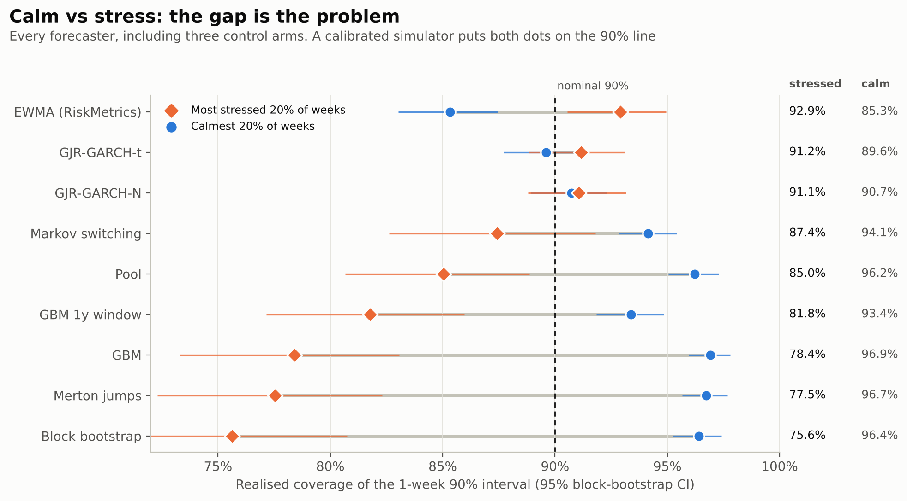
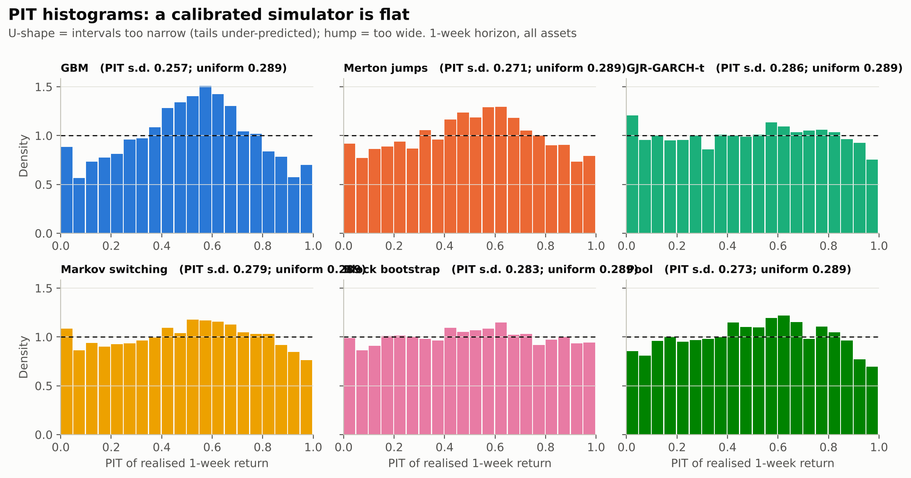
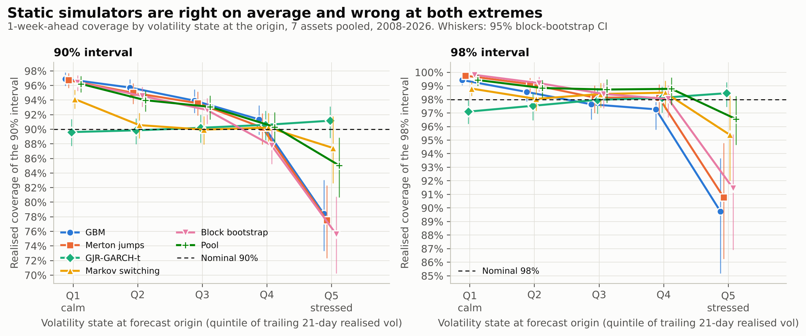
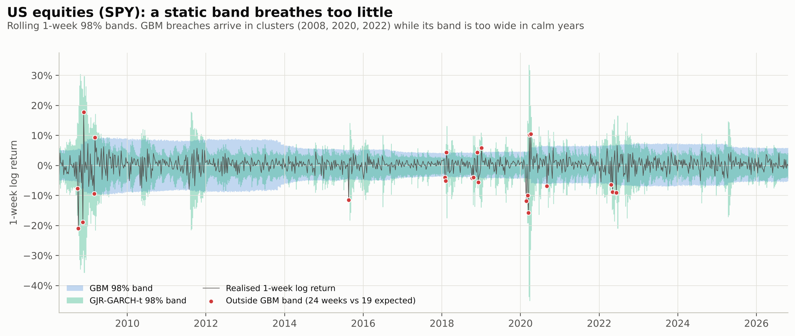
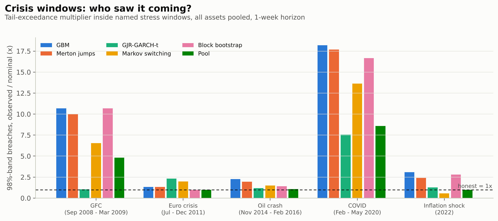

# Which Monte Carlo Tells the Truth?

**Out-of-sample calibration of five return simulators across seven asset classes, 2008–2026**

*Project 01 of [30 Quant Research Projects](../README.md) · Working paper, November 2026*



---

## Abstract

Monte Carlo simulation is the most common way to turn a return model into probabilities: price ranges,
Value-at-Risk, the chance of a drawdown. Most Monte Carlo projects stop at a fan of simulated paths.
This one asks whether the stated probabilities come true.

I evaluate five widely used simulators (geometric Brownian motion, Merton jump-diffusion, GJR-GARCH with
Student-t shocks, a two-state Markov-switching model and a stationary block bootstrap) and an
equal-weight pool of the five. Three control arms isolate the mechanism: GJR-GARCH with Gaussian shocks,
GBM on a one-year window, and RiskMetrics EWMA. Every forecaster issues strictly out-of-sample 1-week and
1-month predictive distributions at weekly origins from April 2008 to October 2026 on seven ETFs
covering US and emerging-market equities, long Treasuries, high-yield credit, gold, crude oil and
uranium. That is 112,626 forecast distributions in total, or 6,257 one-week forecasts per forecaster.
Calibration is tested with interval coverage, PIT histograms, and Kupiec, Christoffersen and Berkowitz
tests; accuracy is scored with CRPS and Diebold–Mariano tests. Uncertainty comes from a moving-block
bootstrap over calendar weeks, which respects both serial and cross-asset dependence.

**Main findings**

1. **Right on average, wrong at the extremes.** GBM's 1-week 90% interval contains 92.1% of outcomes
   overall. Split by the volatility state known at the origin, it contains **96.9% in the calmest fifth
   of weeks and 78.4% in the most stressed fifth** (95% CI 73.3–83.1%). The calm–stress gap of 18.5
   points (CI 13.6–23.7) is present in every one of the seven assets.
2. **Volatility dynamics fix it, fat tails do not.** Adding jumps to a static model leaves stressed-week
   coverage at 77.5%. Adding GJR-GARCH dynamics to a *Gaussian* model raises it to 91.1%, and its
   calm–stress gap (−0.3 points, CI −3.2 to 2.5) is statistically indistinguishable from zero.
3. **The dynamics must mean-revert.** A shorter GBM window only halves the gap (11.6 points), and
   RiskMetrics EWMA overshoots in the other direction: too narrow in calm weeks (85.3%), too wide in
   stressed ones (92.9%), with the worst 98%-tail record of all nine forecasters (1.9× too many breaches).
   GARCH works because its volatility forecast reverts to a long-run level over the horizon.
4. **Fat tails are a second-order fix.** Once the dynamics are right, Student-t shocks cut 98%-band
   breaches from 1.29× to 1.12× nominal overall and from 1.38× to 1.03× in the Global Financial Crisis.
5. **Crises.** In the GFC the static simulators breached their 98% band 10–11× more often than promised;
   GJR-GARCH-t breached at the promised rate. No forecaster coped with COVID: the best breached 7.6× too
   often, because a crash that fast outruns any filter built on past returns.
6. **Merton's "jumps" are not rare.** In 88% of 1,567 re-estimations the jump intensity sits at its cap
   of 25 jumps a year, and jumps carry a median 38% of daily variance. The likelihood uses jumps to mimic
   volatility clustering, which is why Merton behaves like GBM out of sample.
7. **Better calibration is also better forecasting.** GJR-GARCH-t beats GBM on CRPS for all seven assets,
   significantly for six after a Holm correction for multiple testing.

---

## 1. Why this question

A simulator is only as useful as its probabilities. If a 90% interval is really an 80% interval in the
weeks that matter, every number built on it inherits the error: VaR limits, hedge ratios, margin,
position sizes, drawdown odds. Forecast evaluation has a mature toolkit for exactly this (Dawid, 1984;
Diebold, Gunther & Tay, 1998; Gneiting, Balabdaoui & Raftery, 2007). This project applies it to the
simulators people actually use.

Three design choices make it more than a horse race:

* **Conditional calibration.** Average coverage hides opposite errors in calm and stressed markets.
  Every forecast is tagged with the volatility state known at its origin: the percentile of trailing
  21-day realised volatility within the asset's own history up to that date (no look-ahead). Coverage is
  then measured within each quintile.
* **A factorial design.** Fat tails and volatility clustering usually arrive together, so it is rarely
  clear which one matters. A Gaussian GJR-GARCH arm completes a 2×2: static vs dynamic volatility, thin vs
  fat tails.
* **Two "cheap fix" controls.** A one-year-window GBM and RiskMetrics EWMA answer the obvious objection:
  maybe any shorter memory would do. It would not, as §6.4 shows.

## 2. Data

Daily adjusted closes from Yahoo Finance (dividends and splits included), converted to log returns on
the NYSE calendar, 10 April 2006 to 20 November 2026. The calendar matches the exchange calendar
exactly; no series has an internal gap.

| Ticker | Exposure | Why it is here | First forecast | 1-week forecasts |
|---|---|---|---|---|
| SPY | US large-cap equities | benchmark | Apr 2008 | 934 |
| EEM | Emerging-market equities | FX and contagion risk | Apr 2008 | 934 |
| TLT | 20y+ US Treasuries | rates; the 2022 drawdown | Apr 2008 | 934 |
| HYG | US high-yield credit | very low vol, gap risk | Apr 2009 | 884 |
| GLD | Gold | safe haven with its own crashes | Apr 2008 | 934 |
| USO | Front-month WTI futures | contango, the 2020 oil collapse | Apr 2008 | 934 |
| URA | Uranium miners | small, thematic, jumpy | Nov 2012 | 703 |

The largest daily moves were checked against known events (for example EEM −17.6% on 15 Oct 2008, USO
−29.2% log return on 9 Mar 2020, SPY −11.6% on 16 Mar 2020). The derived file is in `data/`.
`src/fetch_data.py` rebuilds it from scratch.

**Selection.** The ETFs were chosen in 2026 and all survived to 2026. Survivorship matters much less for
a calibration study than for a performance study, because the question is the shape of the predictive
distribution and not the level of returns, but the universe is still chosen with hindsight.

## 3. Forecasters

All forecasters are implemented from scratch in `src/models.py`. Each draws 10,000 paths per origin and
records cumulative log returns at h = 5 (1 week) and h = 21 trading days (1 month).

| Forecaster | Volatility | Tails | Estimation |
|---|---|---|---|
| **GBM** | static | Gaussian | sample mean and s.d. of the window |
| **Merton jump-diffusion** | static | compound-Poisson Gaussian jumps | MLE (Poisson mixture truncated at 8 jumps/day; intensity capped at 0.1/day) |
| **GJR-GARCH(1,1)-t** | dynamic, asymmetric, mean-reverting | Student-t | QMLE via `arch`; paths simulated through the variance recursion |
| **Markov switching** | two regimes | Gaussian mixture | Baum–Welch EM; simulation starts from the filtered regime probabilities |
| **Stationary block bootstrap** | static (resampled) | empirical | Politis–Romano, mean block 10 days |
| **Pool** | — | — | equal-weight linear pool of the five above |
| *Control: GJR-GARCH(1,1)-N* | dynamic, mean-reverting | Gaussian | as above |
| *Control: GBM 1y window* | static, shorter memory | Gaussian | last 252 days only |
| *Control: EWMA (RiskMetrics)* | dynamic, no mean reversion | Gaussian | λ = 0.94; current variance scaled by √h |

## 4. Backtest protocol

* **Origins:** every 5th trading day once 500 days of history exist. The stored "origin" date is the
  first trading day of the forecast horizon; the information set ends at the previous close.
* **Window:** the last ≤ 1,260 trading days (about 5 years). Early forecasts, including the GFC, use
  shorter windows of 2–3 years, which is what a forecaster in 2008 would have had.
* **Refits:** parameters are re-estimated every 4 origins (about monthly). Between refits the GARCH
  variance and the regime probabilities are still filtered through every new observation. All 3,134 GARCH
  fits converged.
* **Overlap:** 1-week forecasts at 5-day spacing do not overlap. 1-month forecasts issued weekly do, so
  every 1-month statistic uses every 5th origin (25-day spacing).
* **Seeds:** each (asset, origin) has its own deterministic seed. Results are exactly reproducible.

## 5. Evaluation

| Question | Tool |
|---|---|
| Do central 50/90/98% intervals contain 50/90/98% of outcomes? | empirical coverage |
| Is the whole predictive distribution right? | PIT histograms; Berkowitz (2001) LR test on Φ⁻¹(PIT) |
| Are tail breaches as frequent as promised? | Kupiec (1995) unconditional coverage at 1% and 5% |
| Do breaches cluster in time? | Christoffersen (1998) independence test |
| Which forecast is better overall? | CRPS (a proper scoring rule) and Diebold–Mariano with Newey–West errors, Holm-adjusted across assets |
| Does calibration depend on the market state? | coverage by quintile of trailing realised vol at the origin |
| How sure are we? | moving-block bootstrap (8-week blocks, 2,000 draws) resampling calendar weeks |
| What happens in crises? | GFC, Euro crisis, 2014–16 oil crash, COVID, 2022 inflation shock |

## 6. Results

### 6.1 Unconditional calibration looks fine, and that is the trap

1-week horizon, all assets pooled (6,257 forecasts per row):

| Forecaster | 50% cov. | 90% cov. | 98% cov. | 1% left-tail breaches | 98%-band breaches vs nominal | PIT s.d. (uniform 0.289) | CRPS ×100 |
|---|---|---|---|---|---|---|---|
| GBM | 61.6% | 92.1% | 96.9% | 1.76% | 1.54× | 0.257 | 1.687 |
| Merton jumps | 56.4% | 91.4% | 97.5% | 1.29% | 1.23× | 0.271 | 1.667 |
| GJR-GARCH-t | 51.0% | 90.2% | 97.8% | 1.39% | 1.12× | 0.286 | **1.615** |
| Markov switching | 53.5% | 90.8% | 97.9% | 1.21% | **1.03×** | 0.279 | 1.653 |
| Block bootstrap | 52.3% | 90.4% | 97.7% | 1.20% | 1.14× | 0.283 | 1.661 |
| Pool | 54.3% | 92.3% | 98.6% | 0.83% | 0.71× | 0.273 | 1.640 |
| *GJR-GARCH-N* | 52.5% | 90.7% | 97.4% | 1.58% | 1.29× | 0.282 | **1.615** |
| *GBM 1y window* | 56.4% | 90.4% | 96.3% | 2.25% | 1.84× | 0.273 | 1.676 |
| *EWMA (RiskMetrics)* | 51.8% | 89.2% | 96.2% | 2.57% | 1.92× | 0.285 | 1.626 |

GBM shows its signature even here. Its 50% interval contains 61.6% of outcomes (too wide in the middle)
while its 98% interval is breached 1.5× too often (too narrow in the tails). In the PIT histogram that is
a central hump with heavy wings. Apart from that, most rows look acceptable. The next section shows why
they are not.



### 6.2 Conditional calibration: the main result



90% interval coverage by volatility quintile at the origin (1-week horizon, all assets; each cell is
about 1,250 forecasts):

| Forecaster | Q1 calm | Q2 | Q3 | Q4 | Q5 stressed | Gap Q1−Q5 (95% CI) |
|---|---|---|---|---|---|---|
| GBM | 96.9% | 95.7% | 93.9% | 91.4% | **78.4%** | 18.5 (13.6, 23.7) |
| Merton jumps | 96.7% | 95.0% | 93.6% | 90.2% | 77.5% | 19.2 (14.2, 24.5) |
| Block bootstrap | 96.4% | 94.6% | 92.7% | 87.8% | 75.6% | 20.8 (15.4, 26.3) |
| Pool | 96.2% | 94.0% | 93.1% | 90.3% | 85.0% | 11.2 (7.0, 15.8) |
| Markov switching | 94.1% | 90.6% | 89.9% | 90.2% | 87.4% | 6.7 (2.2, 11.6) |
| GJR-GARCH-t | 89.6% | 89.8% | 90.2% | 90.6% | **91.2%** | −1.6 (−4.4, 1.4) |
| *GJR-GARCH-N* | 90.7% | 90.5% | 90.5% | 90.9% | 91.1% | −0.3 (−3.2, 2.5) |
| *GBM 1y window* | 93.4% | 93.0% | 92.0% | 89.1% | 81.8% | 11.6 (7.2, 16.6) |
| *EWMA (RiskMetrics)* | 85.3% | 88.1% | 89.9% | 91.8% | 92.9% | −7.6 (−10.7, −4.2) |

The static simulators keep almost the same width whatever the market does. GBM's 90% band is only 18%
wider in stressed weeks than in calm ones (10.0% → 11.8% of log return). GJR-GARCH-t's band widens 2.8×
(6.2% → 17.1%), which keeps it close to 90% in every state. Static simulators spend width when nothing
happens and run out of it when it matters, and an unconditional test averages the two errors away.

The pattern holds at 98% (GBM: 99.4% calm, 89.7% stressed; GJR-GARCH-t: 97.1% and 98.5%) and at the
1-month horizon (GBM: 97.7% and 81.5%; GJR-GARCH-t: 90.1% and 92.2%). It also holds asset by asset.
Stressed-quintile 90% coverage for GBM ranges from 72.2% (EEM) to 81.5% (TLT); for GJR-GARCH-t it ranges
from 88.8% (HYG) to 95.5% (SPY) (`results/q5_coverage_by_asset.csv`).

### 6.3 Dynamics vs fat tails: the factorial


| | Static volatility | Dynamic volatility (GJR-GARCH) |
|---|---|---|
| **Thin tails** | GBM: 78.4% stressed-week cov. · GFC breaches 10.7× | GJR-GARCH-N: 91.1% · GFC 1.4× |
| **Fat tails** | Merton: 77.5% · GFC 10.0× | GJR-GARCH-t: 91.2% · GFC 1.0× |

Moving along the "tails" axis changes stressed-week coverage by about one point. Moving along the
"dynamics" axis changes it by thirteen. Fat tails help only *after* the dynamics are right. They improve
the extreme quantiles (98%-band breaches: 1.29× → 1.12× overall; 2022: 1.69× → 1.27×) and leave the body
of the distribution unchanged (identical mean CRPS).

This also explains Merton. Across 1,567 rolling re-estimations the MLE puts the jump intensity at its cap
(25 jumps a year) 88% of the time, and the jump component carries a median 38% of daily variance (10th–90th
percentile: 23–63%; `results/param_diagnostics.csv`). The model is not finding rare discontinuities. It
approximates the *unconditional* mixture of calm and turbulent days with a static scale mixture, which
fixes the kurtosis of the histogram but cannot put the fat tails in the right weeks.

### 6.4 Not just any dynamics: why GARCH and not a shorter memory

The two control arms answer "would any adaptive volatility do?".

* **GBM on a one-year window** adapts more slowly than it seems. It halves the calm–stress gap (18.5 →
  11.6 points) but is still at 81.8% in stressed weeks, and its tails get worse overall (1.84× breaches),
  because a one-year sample variance is noisy and lags turning points.
* **RiskMetrics EWMA** adapts fast but never reverts. It assumes today's variance persists over the whole
  horizon, so it is too narrow just after calm spells (85.3%) and too wide in the middle of turbulence
  (92.9%, gap −7.6 points, CI excluding zero). It has the most 1% left-tail breaches of all nine
  forecasters (2.57%), failing Kupiec on 6 of 7 assets.
* **GJR-GARCH** forecasts a variance path that decays from today's level toward a long-run mean, at a
  speed estimated from the data. That is the ingredient the other dynamic arms lack, and it is what
  produces the flat coverage profile.


### 6.5 Asset by asset


* GBM's 98% band is too narrow on every asset, from barely (1.02× for EEM and HYG) to badly: uranium
  2.35×, oil 1.93×, gold 1.77×.
* High-yield credit is the most deceptive asset. Its tiny daily volatility and rare violent gaps make the
  bootstrap, Markov switching and the pool far too wide in the tails (0.23–0.57×), and it is where
  volatility dynamics pay off most (CRPS +13.4% vs GBM).
* Gold is hard for everyone (1.2–2.0×). Some of its largest weekly moves came out of quiet markets: before
  the April 2013 crash, gold's trailing volatility sat at the 15th percentile of its history, so there
  was nothing for a volatility filter to react to.



For SPY the *count* of GBM breaches is only mildly too high (24 vs 19 expected). The *timing* is the
problem: breaches pile up in late 2008, March 2020 and 2022, while the band is visibly too wide through
2012–2019. The GJR-GARCH-t band moves with the market.

### 6.6 Tail tests

1-week horizon; number of the seven assets on which each test rejects at 5%:

| Forecaster | Kupiec 1% | Christoffersen 1% | Kupiec 5% | Christoffersen 5% | Berkowitz |
|---|---|---|---|---|---|
| GBM | 3 | 5 | 1 | 3 | 6 |
| Merton jumps | 1 | 5 | 1 | 3 | 5 |
| Block bootstrap | 1 | 5 | 1 | 3 | 5 |
| Markov switching | 1 | 3 | 0 | 0 | 4 |
| GJR-GARCH-t | 2 | 1 | 2 | 0 | 3 |
| Pool | 1 | 1 | 2 | 0 | 4 |
| *GJR-GARCH-N* | 3 | 1 | 0 | 0 | 3 |
| *GBM 1y window* | 5 | 2 | 1 | 2 | 5 |
| *EWMA (RiskMetrics)* | 6 | 1 | 2 | 0 | 5 |

The breach-*count* tests (Kupiec) separate the forecasters poorly. With about 900 weekly observations a
1% VaR expects only nine breaches, so the test has little power. The breach-*clustering* test
(Christoffersen) and the full-distribution test (Berkowitz) separate them clearly. A validation that
only checks "the right number of exceptions", as many risk-model backtests do, would miss most of what
goes wrong here. Per-asset p-values are in `results/var_backtests.csv`. These counts are descriptive and
are not corrected for multiple testing.

### 6.7 Crises



98%-band breaches relative to the nominal 2%, all assets pooled, 1-week horizon:

| Window (forecasts) | GBM | Merton | GJR-GARCH-t | Markov sw. | Bootstrap | Pool | *GARCH-N* | *GBM 1y* | *EWMA* |
|---|---|---|---|---|---|---|---|---|---|
| GFC, Sep 08–Mar 09 (145) | 10.7× | 10.0× | **1.0×** | 6.6× | 10.7× | 4.8× | 1.4× | 6.9× | 1.4× |
| Euro crisis, H2 2011 (151) | 1.3× | 1.3× | 2.3× | 2.0× | 1.0× | 1.0× | 2.3× | 5.0× | 2.6× |
| Oil crash, Nov 14–Feb 16 (463) | 2.3× | 1.9× | 1.2× | 1.5× | 1.4× | 1.1× | 1.5× | 3.1× | 2.8× |
| COVID, Feb–May 2020 (99) | 18.2× | 17.7× | **7.6×** | 13.6× | 16.7× | 8.6× | 8.1× | 16.2× | 8.1× |
| Inflation shock, 2022 (355) | 3.1× | 2.4× | 1.3× | 0.6× | 2.8× | 1.0× | 1.7× | 3.1× | 2.1× |

These windows are short. The GFC row rests on 145 forecasts, where a calibrated 98% band expects about
three breaches, so a multiplier of 1.0× versus 1.4× is one breach. The differences between static and
dynamic forecasters (31 breaches for GBM against 3 for GJR-GARCH-t in the GFC) are far larger than that.

The GFC built up over months, so a filter could see it coming. COVID went from record calm to the fastest
bear market on record in about a month, and every history-only forecaster was too narrow. The Euro-crisis
row is the reverse case. GARCH bands had tightened during the calm first half of 2011 (SPY 1-week
predictive s.d. 2.4% in July, against 3.5% for GBM) and were caught by the August shock, while the static
models were still estimated on a window that contained 2008 and were wide by accident.

### 6.8 Proper scoring


CRPS rewards calibration and sharpness together. GJR-GARCH (either innovation) beats GBM on every asset.
After a Holm correction across the seven assets, GJR-GARCH-t's gain is significant on six (adjusted
p ≤ 0.011); uranium is the exception (+0.8%, adjusted p = 0.08). Gains range from 0.8% (uranium) to 13.4%
(high-yield credit). The pool comes next among the main five. It never wins and never loses badly, the
usual pattern for forecast combination, but its tails are too wide (0.71× breaches) because averaging
distributions of different widths adds dispersion. EWMA scores well on CRPS (1.626) despite its poor tails.
CRPS weights the centre of the distribution, which is why it complements, and cannot replace, the tail
tests.

## 7. What this means in practice

* **Report calibration by regime, not on average.** One unconditional coverage number can hide an
  18-point error in the weeks that matter.
* **If you add one ingredient to GBM, add mean-reverting volatility dynamics.** Fat tails without
  dynamics look good in a histogram and do little out of sample. Dynamics without mean reversion (EWMA)
  swap one bias for its mirror image.
* **"Model-free" is not "assumption-free".** The block bootstrap assumes next week looks like a random
  week from the last five years. In stress it was the worst assumption in the set (75.6% coverage).
* **Short-horizon crash risk needs forward-looking information.** No backward-looking forecaster
  anticipated March 2020. The natural next step is to anchor the simulator to option-implied volatility,
  where projects 13 (GARCH), 14 (implied vol surface) and 26 (Heston calibration) of this series lead.

## 8. Limitations

* **One pre-committed design.** A 5-year window, monthly refits and a 10-day bootstrap block were fixed
  before looking at results and not tuned. The one-year GBM control shows the main result does not hinge
  on the window length.
* **Merton cap.** Without a cap the intensity runs to the boundary and the model becomes a pure variance
  mixture. The cap keeps "jumps" interpretable, and §6.3 reports how often it binds.
* **Near-integrated GARCH fits.** For HYG, half of the GJR-GARCH-t fits have persistence ≥ 1 (URA 20%,
  TLT 10%, the others under 3%). Those fits have no finite long-run variance, so on HYG the
  mean-reversion argument applies only loosely. Every fit converged.
* **Dependence across assets.** Pooled statistics mix seven correlated assets. Confidence intervals
  therefore resample whole calendar weeks, but per-asset results are reported throughout as the more
  conservative evidence.
* **Hindsight universe.** See §2. Results are for investable ETFs. USO's roll yield and URA's short
  history are features of the instruments, not of the underlying commodities.
* **Drift.** All forecasters use the window's sample mean as drift. At 1–4 week horizons it is small
  relative to volatility and identical across forecasters, so it does not drive the comparisons.
* **Volatility state.** Quintiles are defined by trailing realised volatility. A forward-looking state
  variable such as VIX would be a natural robustness check, but VIX does not exist for every asset here.

## 9. Reproduce

```bash
pip install -r requirements.txt
bash run_all.sh               # about 8 minutes on 4 cores
```

which runs

```bash
python src/backtest.py        # -> results/forecasts.csv.gz, results/fitted_params.csv.gz
python src/evaluate.py        # tests, confidence intervals, diagnostics -> results/*.csv
python src/figures.py         # -> figures/*.png
```

`python src/fetch_data.py` (optional) rebuilds the data file from Yahoo Finance. Yahoo revises its
adjustments from time to time, so a rebuilt file can differ in the last digit from the committed one.
Every number in this paper comes from the committed file.

## 10. Repository layout

```
01-monte-carlo-calibration/
├── data/etf_daily_log_returns.csv   daily log returns, 7 ETFs, 2006-2026
├── src/models.py                    all forecasters, from scratch
├── src/backtest.py                  rolling out-of-sample forecast engine
├── src/evaluate.py                  coverage, Kupiec, Christoffersen, Berkowitz, CRPS, DM, bootstrap CIs
├── src/figures.py                   all figures
├── src/fetch_data.py                rebuilds the data file
├── results/                         every number quoted above, as CSV
└── figures/                         all charts
```

## References

* Berkowitz, J. (2001). Testing density forecasts, with applications to risk management. *Journal of Business & Economic Statistics*, 19(4).
* Christoffersen, P. (1998). Evaluating interval forecasts. *International Economic Review*, 39(4).
* Dawid, A. P. (1984). Statistical theory: the prequential approach. *Journal of the Royal Statistical Society A*, 147(2).
* Diebold, F. X., Gunther, T. A. & Tay, A. S. (1998). Evaluating density forecasts with applications to financial risk management. *International Economic Review*, 39(4).
* Diebold, F. X. & Mariano, R. S. (1995). Comparing predictive accuracy. *Journal of Business & Economic Statistics*, 13(3).
* Glosten, L., Jagannathan, R. & Runkle, D. (1993). On the relation between the expected value and the volatility of the nominal excess return on stocks. *Journal of Finance*, 48(5).
* Gneiting, T., Balabdaoui, F. & Raftery, A. E. (2007). Probabilistic forecasts, calibration and sharpness. *Journal of the Royal Statistical Society B*, 69(2).
* Hamilton, J. D. (1989). A new approach to the economic analysis of nonstationary time series and the business cycle. *Econometrica*, 57(2).
* Holm, S. (1979). A simple sequentially rejective multiple test procedure. *Scandinavian Journal of Statistics*, 6(2).
* J.P. Morgan/Reuters (1996). *RiskMetrics: Technical Document*, 4th ed.
* Kupiec, P. (1995). Techniques for verifying the accuracy of risk measurement models. *Journal of Derivatives*, 3(2).
* Künsch, H. R. (1989). The jackknife and the bootstrap for general stationary observations. *Annals of Statistics*, 17(3).
* Merton, R. C. (1976). Option pricing when underlying stock returns are discontinuous. *Journal of Financial Economics*, 3(1–2).
* Politis, D. N. & Romano, J. P. (1994). The stationary bootstrap. *Journal of the American Statistical Association*, 89(428).

---

*Data: Yahoo Finance adjusted closes, used for research only. This is not investment advice.*
