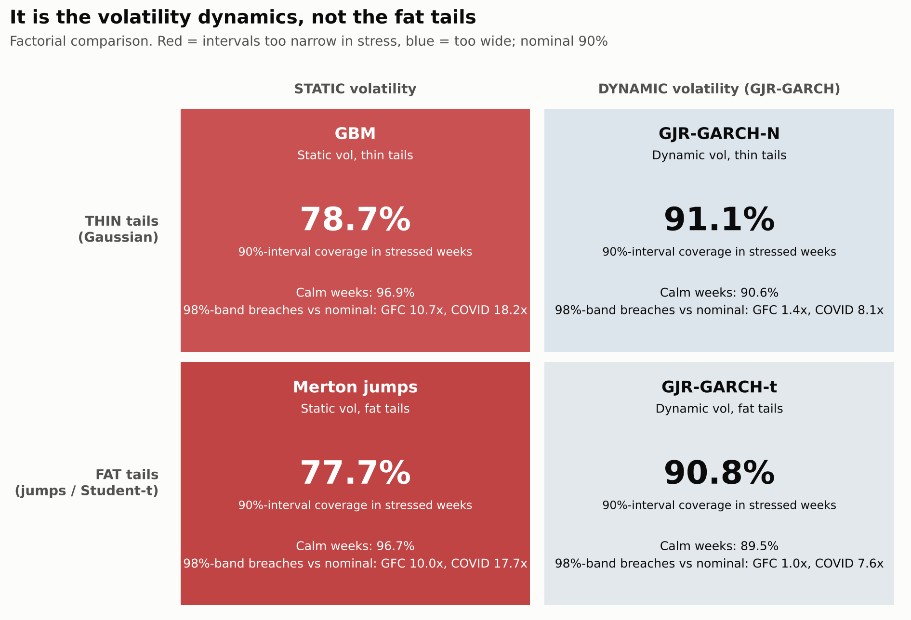
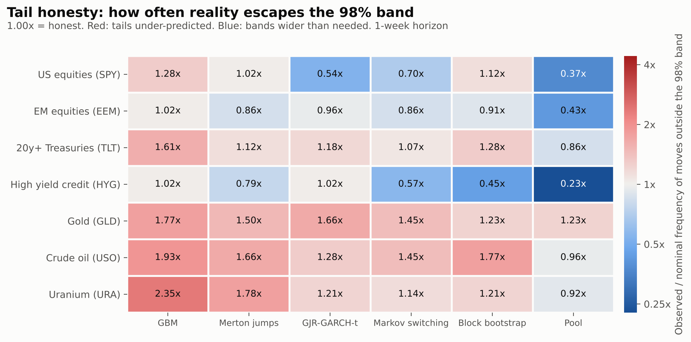
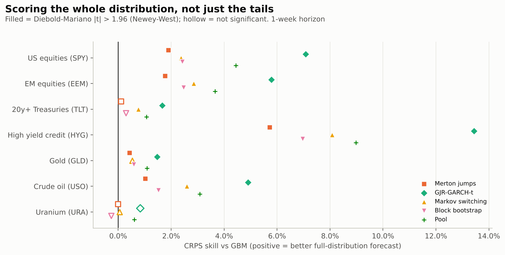

# Which Monte Carlo Tells the Truth?

**Out-of-sample calibration of five return simulators across seven asset classes, 2008–2026**

*Project 01 of [30 Quant Research Projects](../README.md) · Working paper, November 2026*


---

## Abstract

Monte Carlo simulation is the most common way to turn a return model into probabilities: price ranges,
Value-at-Risk, retirement odds, "a 5% chance of losing more than X". The usual project stops at a fan of
simulated paths. The question I care about is different: **are the probabilities any good?**

I run five widely used simulators (geometric Brownian motion, Merton jump-diffusion, GJR-GARCH with Student-t
innovations, a two-state Markov-switching model and a stationary block bootstrap) plus an equal-weight
pool of all five, producing **87,598 strictly out-of-sample forecast distributions** (6,257 one-week
forecasts per simulator) at weekly origins from April 2008 to October 2026, across seven cross-asset ETFs: US and emerging-market equities, long Treasuries,
high-yield credit, gold, crude oil and uranium. I test calibration with coverage, PIT histograms,
Kupiec, Christoffersen and Berkowitz tests, and score the full distribution with CRPS and Diebold–Mariano
tests. A sixth simulator, GJR-GARCH with Gaussian shocks, is added as a control so the design becomes a
2×2: static vs dynamic volatility, thin vs fat tails.

**Main findings**

1. **Right on average, wrong in every regime.** Unconditionally, GBM's 1-week 90% interval contains
   92.1% of outcomes, which looks fine. Split by the volatility state at the forecast origin and it
   covers **96.9% in calm weeks and only 78.7% in stressed weeks**. The block bootstrap, often sold as
   "model-free", is the worst at 76.6%.
2. **It is the volatility dynamics, not the fat tails.** Adding fat tails to a static model (Merton:
   77.7% in stress) changes almost nothing. Adding GARCH dynamics to a *Gaussian* model brings stressed-week
   coverage to 91.1%. Fat tails help only as a second step: once dynamics are in, Student-t shocks cut
   GFC 98%-band breaches from 1.4× to 1.0× nominal.
3. **Static models breach in clusters.** In the Global Financial Crisis, GBM, Merton and the bootstrap
   saw moves outside their 98% band **10–11× more often than promised**. GJR-GARCH-t: 1.0×. Static
   models fail the Christoffersen independence test at the 1% level for 5 of 7 assets; GJR-GARCH-t for 1.
4. **Nobody was ready for COVID.** Even the best simulator breached its 98% band 7.6× too often in
   Feb–May 2020. A one-week horizon is shorter than the time a GARCH filter needs to react to a shock that
   arrives at full speed. That is a real limit of history-only models, not a tuning problem.
5. **Merton's "jumps" are not rare.** In 87% of rolling re-estimations the MLE jump intensity sits at its
   cap of 25 jumps a year, and jumps explain 22–63% of daily variance. The likelihood is using "jumps" to
   approximate volatility clustering, which is why Merton behaves like GBM out of sample.
6. **Better calibration also means better forecasts.** GJR-GARCH-t improves CRPS over GBM on all seven
   assets, significantly on six (Diebold–Mariano, Newey–West). Gains range from 0.8% (uranium, not
   significant) to 13.4% (high-yield credit).

---

## 1. Why this question

A simulator is only as useful as its probabilities. If a 90% interval is really an 80% interval in the
weeks that matter, every number built on top of it inherits that error: VaR limits, option hedges,
margin, position sizing, the probability of a drawdown. Most textbook Monte Carlo exercises check
whether the simulated paths "look reasonable" and never check whether the stated probabilities come
true. Forecast evaluation has a mature toolkit for this (Dawid, 1984; Diebold, Gunther & Tay, 1998;
Gneiting, Balabdaoui & Raftery, 2007). This project applies that toolkit to the simulators people
actually use.

Two design choices make it more than a horse race:

* **Conditional calibration.** Average coverage hides opposite errors in calm and stressed markets. I
  split every forecast by the volatility state *known at the origin* (the quintile of trailing 21-day
  realised volatility against the asset's own history up to that date, so there is no look-ahead) and
  ask whether the stated probabilities hold *in each state*.
* **A factorial control.** Fat tails and volatility clustering are usually added together, so it is
  never clear which one does the work. Adding GJR-GARCH with Gaussian shocks completes a 2×2 design
  and separates the two effects.

## 2. Data

Daily adjusted closes from Yahoo Finance, converted to log returns (dividends and splits included),
10 April 2006 to 20 November 2026, aligned to the NYSE calendar.

| Ticker | Exposure | Why it is here | First forecast |
|---|---|---|---|
| SPY | US large-cap equities | benchmark | Apr 2008 |
| EEM | Emerging-market equities | FX and contagion risk | Apr 2008 |
| TLT | 20y+ US Treasuries | rates; the 2022 drawdown | Apr 2008 |
| HYG | US high-yield credit | very low vol, gap risk | Apr 2009 |
| GLD | Gold | safe haven with its own crashes | Apr 2008 |
| USO | Front-month WTI futures | contango, April 2020 | Apr 2008 |
| URA | Uranium miners | small, thematic, jumpy | Nov 2012 |

The universe is chosen to stress the simulators in very different ways (rates, credit, commodities, a
thematic equity niche), not to flatter any of them. The derived return file is in `data/`.
`src/fetch_data.py` rebuilds it from scratch.

## 3. Simulators

All simulators are implemented from scratch in `src/models.py`. Each draws 10,000 paths per origin and
records cumulative log returns at h = 5 (1 week) and h = 21 trading days (1 month).

| Simulator | Volatility | Tails | Estimation |
|---|---|---|---|
| **GBM** | static | Gaussian | sample mean and s.d. of the window |
| **Merton jump-diffusion** | static | compound-Poisson Gaussian jumps | MLE (Poisson mixture truncated at 8 jumps/day; intensity capped at 0.1/day) |
| **GJR-GARCH(1,1)-t** | dynamic, asymmetric | Student-t | QMLE via `arch`; paths simulated with the variance recursion |
| **Markov switching** | two regimes | Gaussian mixture | Baum–Welch EM; simulation starts from the filtered regime probabilities |
| **Stationary block bootstrap** | static (resampled) | empirical | Politis–Romano, mean block 10 days |
| **Pool** | — | — | equal-weight linear pool of the five |
| *GJR-GARCH(1,1)-N (control)* | dynamic, asymmetric | Gaussian | as above, not part of the pool |

## 4. Backtest protocol

* **Origins:** every 5th trading day once at least 500 days of history exist. There are 934 origins
  per full-history asset, 6,257 one-week forecasts per simulator and 87,598 forecast distributions in
  total.
* **Window:** the last ≤ 1,260 trading days (about 5 years). Only data up to the close before the
  origin is used.
* **Refits:** parameters are re-estimated every 4 origins (about monthly). Between refits the GARCH
  variance and the regime probabilities are still filtered through every new observation.
* **Overlap:** 1-month forecasts issued weekly overlap. Every test on h = 21 uses a non-overlapping
  subsample (every 5th origin).
* **Seeds:** each (asset, origin) has its own deterministic seed, and all simulators share the stream.
  Results are exactly reproducible.

## 5. Evaluation

| Question | Tool |
|---|---|
| Do central 50/90/98% intervals contain 50/90/98% of outcomes? | empirical coverage |
| Is the entire predictive distribution right? | PIT histograms; Berkowitz (2001) LR test on Φ⁻¹(PIT) |
| Are tail breaches as frequent as promised? | Kupiec (1995) unconditional coverage at 1% and 5% |
| Do breaches cluster? | Christoffersen (1998) independence test |
| Which forecast is better overall? | CRPS (proper scoring rule) and Diebold–Mariano with Newey–West errors |
| Does calibration depend on market state? | coverage by quintile of trailing realised vol at the origin |
| What happens in crises? | GFC, Euro crisis, 2014–16 oil crash, COVID, 2022 inflation shock |

## 6. Results

### 6.1 Unconditional calibration looks fine, which is exactly the trap

1-week horizon, all assets pooled (6,257 forecasts each):

| Simulator | 50% cov. | 90% cov. | 98% cov. | 1% left-tail breaches | 98%-band breaches vs nominal | PIT s.d. (0.289 = uniform) | CRPS (×100) |
|---|---|---|---|---|---|---|---|
| GBM | 61.6% | 92.1% | 96.9% | 1.76% | 1.54× | 0.257 | 1.687 |
| Merton jumps | 56.4% | 91.4% | 97.5% | 1.29% | 1.23× | 0.271 | 1.667 |
| GJR-GARCH-t | 51.0% | 90.2% | 97.8% | 1.39% | 1.12× | 0.286 | **1.615** |
| GJR-GARCH-N (control) | 52.5% | 90.7% | 97.4% | 1.58% | 1.29× | 0.282 | **1.615** |
| Markov switching | 53.5% | 90.8% | 97.9% | 1.21% | **1.03×** | 0.279 | 1.653 |
| Block bootstrap | 52.3% | 90.4% | 97.7% | 1.20% | 1.14× | 0.283 | 1.661 |
| Pool | 54.3% | 92.3% | 98.6% | 0.83% | 0.71× | 0.273 | 1.641 |

GBM's signature is visible even here. Its 50% interval contains 61.6% of outcomes (too wide in the
centre) while its 98% interval misses 1.5× too often (too narrow in the tails). That is the PIT
"hump plus wings" pattern of a distribution with too little kurtosis. Every other number in this table
looks acceptable, and the next section shows why it is misleading.


### 6.2 Conditional calibration: the main result

90% interval coverage by volatility state at the origin (1-week horizon, all assets):

| Simulator | Q1 calm | Q2 | Q3 | Q4 | Q5 stressed |
|---|---|---|---|---|---|
| GBM | 96.9% | 96.1% | 93.0% | 89.9% | **78.7%** |
| Merton jumps | 96.7% | 95.3% | 92.6% | 89.0% | 77.7% |
| Block bootstrap | 96.1% | 94.9% | 91.5% | 86.4% | 76.6% |
| Markov switching | 93.3% | 91.7% | 89.3% | 90.1% | 87.3% |
| Pool | 95.8% | 94.7% | 92.2% | 89.7% | 85.2% |
| GJR-GARCH-N | 90.6% | 91.4% | 89.5% | 91.0% | 91.1% |
| **GJR-GARCH-t** | 89.5% | 90.7% | 89.7% | 90.8% | 90.8% |

The static simulators keep roughly the same width whatever the market does. GBM's 90% band is only
16% wider in stressed weeks than in calm ones (10.1% → 11.7% of log return). GJR-GARCH-t's band
widens 2.7× (6.3% → 16.8%), and that is what keeps it close to 90% in every state. Static simulators
waste width when nothing happens and run out of width when it matters. Averaged over time the two errors
cancel, so unconditional tests miss them.

The same holds at 98% (GBM: 99.5% calm, 89.7% stressed; GJR-GARCH-t: 97.1% to 98.3%) and at the
1-month horizon (GBM 97.6% to 82.6%; GJR-GARCH-t 89.6% to 92.1%).

### 6.3 Dynamics vs fat tails: the factorial



| | Static volatility | Dynamic volatility (GJR-GARCH) |
|---|---|---|
| **Thin tails** | GBM: 78.7% stressed-week cov. · GFC breaches 10.7× | GJR-GARCH-N: 91.1% · GFC 1.4× |
| **Fat tails** | Merton: 77.7% · GFC 10.0× | GJR-GARCH-t: 90.8% · GFC 1.0× |

Moving along the "tails" axis changes stressed-week coverage by about one point. Moving along the
"dynamics" axis changes it by twelve. Fat tails become useful only *after* the dynamics are right: they
improve the extreme quantiles (98%-band breaches: 1.29× → 1.12× overall; 2022: 1.69× → 1.27×) and leave
the body of the distribution unchanged (identical mean CRPS to three decimals).

This also explains the Merton result. Across 396 rolling re-estimations the MLE puts the jump intensity
at its cap (25 jumps a year) 87% of the time, and the jump component carries 22–63% of daily variance
(`results/merton_diagnostic.csv`). The model is not finding rare discontinuities. It is approximating
the unconditional *mixture* of calm and turbulent days with a static scale mixture. That fixes the
unconditional kurtosis but cannot place the fat tails in the right weeks.

### 6.4 Asset by asset



* GBM's 98% band is too narrow on every asset, from barely (1.02× for EEM and HYG) to badly: uranium
  2.35×, oil 1.93×, gold 1.77×.
* High-yield credit is the most deceptive asset. Its tiny daily vol and rare violent gaps make the
  bootstrap, Markov switching and the pool far too wide in the tails (0.23–0.57×), and it is where
  volatility dynamics pay off most (CRPS +13.4% vs GBM).
* Gold is hard for everyone (1.2–1.8×). Several of its largest weekly moves (for example the April 2013
  crash) arrived out of quiet markets, so there was little for a volatility filter to pick up in advance.


For SPY the *count* of GBM breaches is only mildly too high (24 vs 19 expected). Their *timing* is the
problem: the breaches pile up in late 2008, March 2020 and 2022, while the band is visibly too wide
through 2012–2019. The GJR-GARCH-t band breathes with the market.

### 6.5 Tail tests

1-week horizon, number of the seven assets where each test rejects at 5%:

| Simulator | Kupiec 1% | Christoffersen 1% | Kupiec 5% | Christoffersen 5% | Berkowitz |
|---|---|---|---|---|---|
| GBM | 3 | 5 | 1 | 3 | 6 |
| Merton jumps | 1 | 5 | 1 | 3 | 5 |
| Block bootstrap | 1 | 5 | 1 | 3 | 5 |
| Markov switching | 1 | 3 | 0 | 0 | 4 |
| GJR-GARCH-N | 3 | 1 | 0 | 0 | 3 |
| GJR-GARCH-t | 2 | 1 | 2 | 0 | 3 |
| Pool | 1 | 1 | 2 | 0 | 4 |

The breach *count* tests (Kupiec) barely separate the models. The breach *clustering* tests
(Christoffersen) and the full-distribution test (Berkowitz) do. Validating a risk model only on "the
right number of exceptions", as many backtesting practices do, would miss most of what goes wrong here.

### 6.6 Crises


| Window | GBM | Merton | GJR-GARCH-t | Markov sw. | Bootstrap | Pool |
|---|---|---|---|---|---|---|
| GFC (Sep 08–Mar 09) | 10.7× | 10.0× | **1.0×** | 6.6× | 10.7× | 4.8× |
| Euro crisis (H2 2011) | 1.3× | 1.3× | 2.3× | 2.0× | 1.0× | 1.0× |
| Oil crash (Nov 14–Feb 16) | 2.3× | 1.9× | 1.2× | 1.5× | 1.4× | 1.1× |
| COVID (Feb–May 2020) | 18.2× | 17.7× | **7.6×** | 13.6× | 16.7× | 8.6× |
| Inflation shock (2022) | 3.1× | 2.4× | 1.3× | 0.6× | 2.8× | 1.0× |

*(98%-band breaches relative to the nominal 2%, all assets pooled.)*

The GFC built up over months, so a filter could see it coming. COVID went from record calm to the fastest
bear market on record in about a month, and every history-only simulator was too narrow. The Euro-crisis row
is the reverse case. GARCH bands had tightened during the calm first half of 2011 and were caught by
the August shock, while the static models were still estimated on a window that contained 2008 and
were wide by accident. No simulator wins in every window, but the static
ones lose the windows that matter most.

### 6.7 Proper scoring



CRPS rewards calibration and sharpness together. GJR-GARCH (either innovation) beats GBM on every asset
and significantly on six. The pool comes second. It never wins, but it never loses badly either, which
is the usual case for forecast combination. Its tails are too wide (0.71× breaches), because averaging
five distributions with different widths adds dispersion.

## 7. What this means in practice

* **Report calibration by regime, not on average.** One unconditional coverage number can hide a
  20-point error in the weeks that matter.
* **If you add one ingredient to GBM, add volatility dynamics.** Fat tails without dynamics look good
  in a histogram and do little out of sample.
* **"Model-free" is not "assumption-free".** The block bootstrap assumes the next week looks like a
  random week from the last five years. In stress that is the worst assumption of the set.
* **Short-horizon crash risk needs forward-looking information.** No backward-looking simulator
  anticipated March 2020. The obvious next step is to anchor the simulator to option-implied volatility,
  which is where projects 13 (GARCH), 14 (implied vol surface) and 26 (Heston calibration) of this
  series lead.

## 8. Limitations and robustness notes

* **One estimation design.** A 5-year rolling window, monthly refits and a 10-day bootstrap block. A
  shorter window would help the static models adapt faster, at the cost of noisier estimates. I keep one
  pre-committed design rather than tuning it on the test sample.
* **Merton cap.** Without a cap the intensity runs to the boundary and the model becomes a pure
  variance mixture. The cap of 0.1/day keeps "jumps" interpretable. The diagnostic in §6.3 reports how
  often it binds.
* **Pooled tests.** Pooled-across-assets statistics treat assets as independent, and they are
  correlated in crises, so pooled standard errors are optimistic. Per-asset tests are reported
  separately in `results/var_backtests.csv`.
* **ETF data.** USO's roll yield and URA's short history are features of the instruments, not of the
  underlying commodities. Results are for investable ETFs.
* **Means.** All simulators use the sample mean of the window as drift. At 1–4 week horizons the
  drift is negligible relative to the volatility, but it is the same for every model, so it does not
  drive the comparisons.

## 9. Reproduce

```bash
pip install -r requirements.txt
python src/fetch_data.py      # optional: rebuild data/etf_daily_log_returns.csv from Yahoo Finance
python src/backtest.py        # ~6 min on 4 cores -> results/forecasts.csv.gz
python src/evaluate.py        # calibration tests and summaries -> results/*.csv
python src/merton_diagnostic.py
python src/figures.py         # -> figures/*.png
```

or `bash run_all.sh`.

## 10. Repository layout

```
01-monte-carlo-calibration/
├── data/etf_daily_log_returns.csv   daily log returns, 7 ETFs, 2006-2026
├── src/models.py                    the six simulators, from scratch
├── src/backtest.py                  rolling out-of-sample forecast engine
├── src/evaluate.py                  coverage, Kupiec, Christoffersen, Berkowitz, CRPS, DM
├── src/merton_diagnostic.py         are jumps really jumps?
├── src/figures.py                   all figures
├── results/                         every number quoted above, as CSV
└── figures/                         all charts
```

## References

* Berkowitz, J. (2001). Testing density forecasts, with applications to risk management. *JBES*, 19(4).
* Christoffersen, P. (1998). Evaluating interval forecasts. *International Economic Review*, 39(4).
* Dawid, A. P. (1984). Statistical theory: the prequential approach. *JRSS A*, 147(2).
* Diebold, F. X., Gunther, T. A. & Tay, A. S. (1998). Evaluating density forecasts with applications to financial risk management. *International Economic Review*, 39(4).
* Diebold, F. X. & Mariano, R. S. (1995). Comparing predictive accuracy. *JBES*, 13(3).
* Glosten, L., Jagannathan, R. & Runkle, D. (1993). On the relation between the expected value and the volatility of the nominal excess return on stocks. *Journal of Finance*, 48(5).
* Gneiting, T., Balabdaoui, F. & Raftery, A. E. (2007). Probabilistic forecasts, calibration and sharpness. *JRSS B*, 69(2).
* Hamilton, J. D. (1989). A new approach to the economic analysis of nonstationary time series and the business cycle. *Econometrica*, 57(2).
* Kupiec, P. (1995). Techniques for verifying the accuracy of risk measurement models. *Journal of Derivatives*, 3(2).
* Merton, R. C. (1976). Option pricing when underlying stock returns are discontinuous. *Journal of Financial Economics*, 3(1–2).
* Politis, D. N. & Romano, J. P. (1994). The stationary bootstrap. *JASA*, 89(428).

---

*Data: Yahoo Finance adjusted closes, used for research only. This is not investment advice.*
