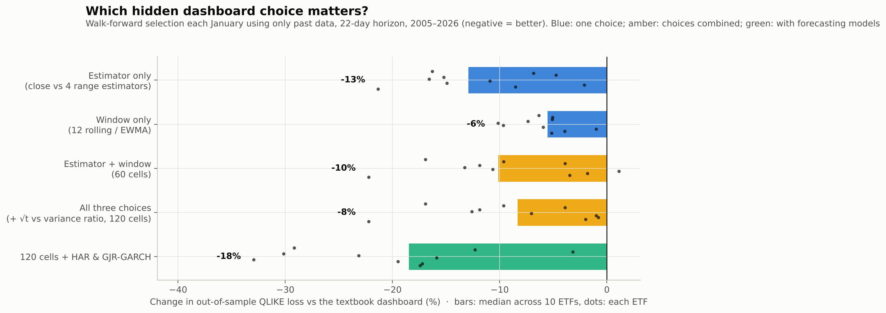
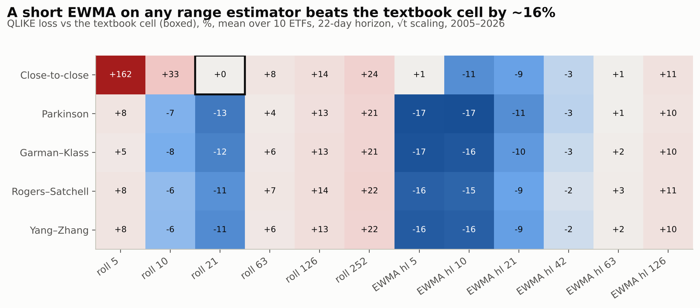
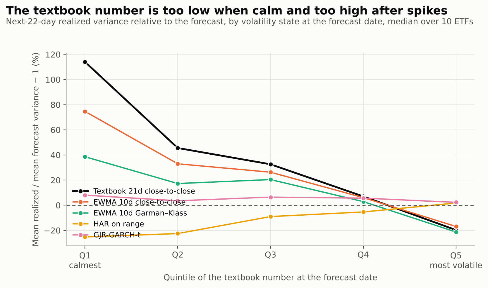
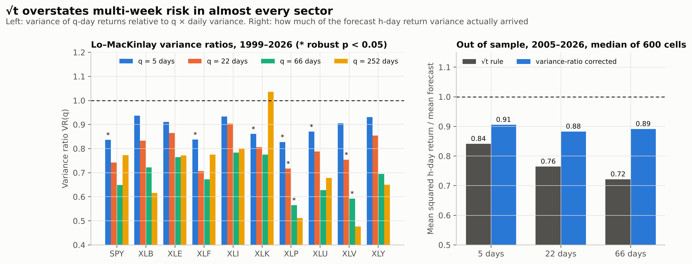
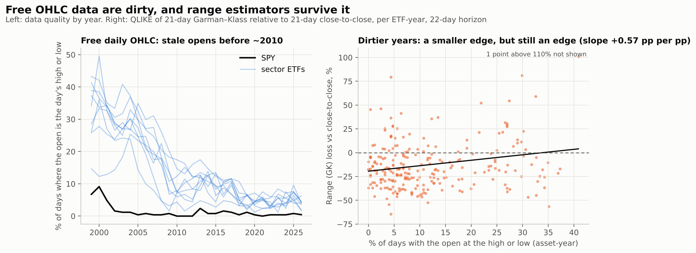
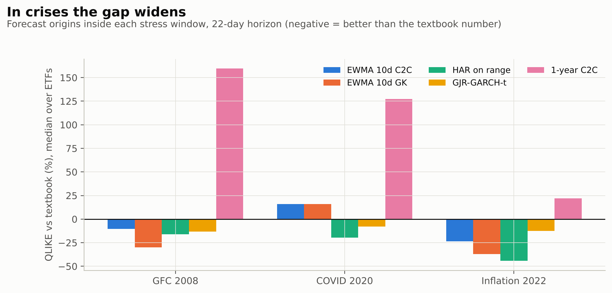

# What Your Volatility Dashboard Gets Wrong

**Three hidden choices behind the "annualized volatility" number, tested out of sample on SPY and nine sector ETFs, 1999–2026**

*Project 02 of [30 Quant Research Projects](../README.md) · Working paper, November 2026*



---

## Abstract

Almost every returns-and-volatility dashboard shows the same number: the standard deviation of the last
21 daily close-to-close returns, multiplied by √252. People read it as "how risky is this asset going to be".
Behind it are three choices that nobody states. The first is the **estimator**: closing prices only, or the
day's open, high and low as well. The second is the **window**: 21 equally weighted days, or something else.
The third is the **horizon scaling**: the √t rule, which assumes returns are serially uncorrelated.

This paper asks a simple question: **which of the three choices matters most for how well the number forecasts the
volatility that actually follows, and is the textbook combination ever the right one?**

I build every combination of 5 estimators (close-to-close, Parkinson, Garman–Klass, Rogers–Satchell,
Yang–Zhang), 12 weighting schemes (rolling windows of 5–252 days and EWMA half-lives of 5–126 days) and 2
horizon scalings (√t, and a trailing variance-ratio correction). That makes 120 dashboard specifications. I
add two ablations and three forecasting models as benchmarks (HAR-RV on close-to-close and on range data, and
GJR-GARCH-t). Each specification forecasts the next 5, 22 and 66 trading days of realized variance at every
trading day from January 2005 to October 2026, for SPY and the nine original SPDR sector ETFs. That gives
**54,850 out-of-sample forecast origins per horizon** and about 8 million forecasts per horizon. Losses are QLIKE and MSE,
tested with HAC Diebold–Mariano tests, Holm corrections, a stationary bootstrap and the Model Confidence Set.

**Main findings (22-day horizon unless stated)**

1. **The estimator is the hidden choice that matters most, and the textbook gets it wrong.** If a
   dashboard is allowed to pick its estimator each January using only past data, its out-of-sample QLIKE
   loss falls by a median **13%** across the ten ETFs, and it improves in 10 of 10. Picking the window instead
   gains only 6%. A 5–10 day EWMA of Parkinson or Garman–Klass beats the textbook number by 16–17% on the
   panel (Holm-adjusted p ≤ 0.002).
2. **More choice did worse.** Selecting among all 120 specifications each year gains *less* (−8%) than
   selecting the estimator alone (−13%). With 22 years of data, a large menu turns into noise-fitting.
   Adding a real model to the menu helps most: GJR-GARCH-t alone is 25% better than the textbook on the
   panel (Holm p < 0.001). HAR on range data is 24% better on average, but too unstable across ETFs to survive Holm.
3. **The textbook number is wrong in a predictable direction.** When it reads calm (bottom quintile, 9.2%
   annualized on average), the next month delivers 13.8%. When it reads stressed (top quintile, 37.4%), the
   next month delivers 33.9%. GJR-GARCH-t is within 2–8% of the realized variance in every quintile.
4. **√t overstates multi-week risk in almost every sector.** Variance ratios are below 1 at every horizon for
   9 of 10 ETFs (median VR(22) = 0.80, VR(66) = 0.68). Out of sample, only **76%** of the √t-scaled 22-day
   return variance arrives (72% at 66 days). A trailing variance-ratio correction removes half of that bias
   and cuts MSE by 7% (21% at 66 days), but it does not improve QLIKE (+1.4%, p = 0.15). Whether to fix √t
   depends on which loss you care about.
5. **Free OHLC data are dirty, and range estimators survive it.** Before 2010, the sector ETFs' open was
   recorded as the day's high or low on 25% of days, against 2.5% for SPY. That is a symptom of stale opening
   prints. Range estimators lose 0.6 points of their edge for each extra point of stale opens, but still beat
   close-to-close in 77% of ETF-years.
6. **Dropping the overnight return is the single worst common mistake.** Parkinson on the intraday range
   alone, which is what many dashboards compute, misses the overnight share of the variance (27–39% depending on the ETF) and is 44% worse than the
   textbook on QLIKE. MSE ranks it as *better* than the textbook, which is a warning about using MSE to
   choose volatility estimators.

An interactive dashboard built from these results ([dashboard/index.html](dashboard/index.html)) shows the
textbook number next to the winning forecasts for every ETF.

---

## 1. Why this question

A returns-and-volatility dashboard is the first thing most people build in quantitative finance, and the
usual version is a tutorial: download prices, compute `returns.rolling(21).std() * sqrt(252)` and plot it.
The number then gets used in practice for position sizing, stop distances, VaR and option sanity checks, as
if it were a forecast. It is one, implicitly. So it can be tested like one.

Each part of the textbook formula is a choice with a literature behind it:

* **Estimator.** Parkinson (1980), Garman & Klass (1980), Rogers & Satchell (1991) and Yang & Zhang (2000)
  showed that the daily high, low and open carry far more information about variance than the close alone.
  In theory they are 5–8 times more efficient. In practice they are rarely used in dashboards, and the
  efficiency claims assume clean continuous-time data.
* **Window.** RiskMetrics (1996) popularized EWMA with λ = 0.94 (a half-life of about 11 days). Rolling
  windows of 21, 63 or 252 days are the other common default. The right memory depends on how fast
  volatility mean-reverts.
* **Scaling.** Annualizing with √252, or scaling a daily number to a month with √22, assumes that h-day
  return variance is h times daily variance. Lo & MacKinlay (1988) gave the test, and Poterba & Summers (1988)
  documented mean reversion at long horizons.

What I have not seen is these three choices put **in one factorial design**, evaluated with the same out-of-sample
protocol, so that their importance can be compared directly and against a proper forecasting model. That is
the contribution here. The secondary contributions are a measurement of how dirty free daily OHLC data are,
and of what that does to range estimators. There is also a result on the √t rule that depends on the loss
function, which I did not expect.

## 2. Data

* **Assets:** SPY and the nine original Select Sector SPDR ETFs: Materials (XLB), Energy (XLE), Financials (XLF),
  Industrials (XLI), Technology (XLK), Consumer Staples (XLP), Utilities (XLU), Health Care (XLV) and
  Consumer Discretionary (XLY). The universe is deliberately distinct from project 01 (cross-asset ETFs),
  and the sectors differ a lot in volatility level, liquidity history and overnight-gap behaviour.
* **Fields:** daily open, high, low, close and adjusted close from Yahoo Finance, 22 December 1998 to 20 November
  2026, on the 7,021 days when all ten traded.
* **Stored form:** [data/sector_ohlc_features.csv](data/sector_ohlc_features.csv) holds four scale-free
  log quantities per ETF and day, in units of 1e-5: the adjusted close-to-close return *r*, and ln(H/O),
  ln(L/O) and ln(C/O). The overnight return is *o = r − ln(C/O)*, so dividends and splits are handled by the
  adjusted close, and intraday ratios need no adjustment.
* **Cleaning:** none needed for consistency: no row has a high below the open or close, or a low above
  them. Data *quality* is a separate question, and §6.5 measures it.

## 3. The 120 dashboards and the benchmarks

**Daily variance proxies.** For each day, with u = ln(H/O), d = ln(L/O), c = ln(C/O):

| Estimator | Daily proxy | Notes |
|---|---|---|
| Close-to-close (C2C) | r² | the textbook |
| Parkinson (PK) | (u − d)² / (4 ln 2) + o² | range-based |
| Garman–Klass (GK) | ½(u − d)² − (2 ln 2 − 1)c² + o² | range + close |
| Rogers–Satchell (RS) | u(u − c) + d(d − c) + o² | drift-robust |
| Yang–Zhang (YZ) | σ²(o) + kσ²(c) + (1 − k)·mean(RS) | window-level, k from the effective window length |

Every range estimator **includes the overnight term o²**, so all five target the same close-to-close
variance. This matters, as ablation A1 shows.

**Weighting.** Rolling windows of 5, 10, 21, 63, 126 and 252 days, and EWMA with half-lives of 5, 10, 21, 42, 63 and
126 days. For Yang–Zhang under EWMA, the effective sample size (1 + λ)/(1 − λ) sets k.

**Horizon scaling.** The forecast of h-day variance is either h·σ̂² (the √t rule in variance form) or
h·σ̂²·VR̂(h). Here VR̂(h) is a trailing 3-year variance ratio, clipped to [0.5, 2] and shrunk halfway to 1. The
shrinkage weight was set before seeing any out-of-sample result and was not tuned.

**Ablations (reported, never selected).** A1: Parkinson on the intraday range only (no o²), the common
dashboard shortcut. A2: GK rescaled each day to the trailing one-year C2C level (keeps GK's timing, imposes
C2C's level).

**Benchmarks.** HAR-RV (Corsi 2009) on daily/weekly/monthly C2C components, and the same HAR on GK + o²
components. Both use expanding-window OLS refitted every 22 days, with only targets already observed. The
third is GJR-GARCH(1,1) with Student-t shocks, refitted every 22 days on a trailing 2,000-day window and
filtered forward daily with fixed parameters in between. Its h-step forecast is the closed form with
persistence α + γ/2 + β.

## 4. Protocol

* **Target:** realized variance over the next h days, RV = Σ r²_{t+1..t+h}, for h = 5, 22 (primary) and 66.
* **Origins:** every trading day from 3 January 2005 to the last day with a complete target. That is 5,485
  origins per ETF at h = 22. Every forecast uses only data up to the close of the origin day. A unit test
  perturbs all future data and checks that no forecast up to that date changes.
* **Loss:** QLIKE, L = RV/F − ln(RV/F) − 1, as primary. MSE is secondary. Both are robust to using a noisy but
  unbiased variance proxy (Patton 2011). QLIKE scores relative errors, so calm and turbulent periods count
  comparably. MSE is dominated by a handful of crisis months.
* **Walk-forward selection:** on the first trading day of each year, a "data-driven dashboard" picks the
  specification with the lowest mean QLIKE over all past origins whose targets were already observed, and
  keeps it for the year. Variants restrict the menu to estimators only, windows only, scalings only,
  estimator × window (60), the full grid (120), or the grid plus the three benchmarks.
* **Inference:** Diebold–Mariano tests with Newey–West HAC (lag 2h) for each ETF and for the panel (the
  cross-ETF average loss differential). Holm correction applies within each family (per-ETF tests: 1,460 per
  horizon; panel tests: 146 per horizon). There are stationary-bootstrap (mean block 2h, B = 1,000) 95%
  intervals for loss ratios, and a Model Confidence Set (Hansen, Lunde & Nason 2011; T_max, α = 0.10) over the 123
  candidates per ETF.
* **Stress windows (forecast origins):** GFC, 1 September 2008 to 31 March 2009; COVID, 15 February to
  30 April 2020; 2022 inflation shock, 1 January to 31 October 2022.

## 5. Results

### 5.1 Which hidden choice matters (Figure 1)

| Walk-forward menu (h = 22) | Median QLIKE change vs textbook | ETFs improved | Holm p < 0.05 |
|---|---|---|---|
| Estimator only (5) | **−12.9%** | 10 / 10 | 3 |
| Window only (12) | −5.5% | 10 / 10 | 0 |
| Estimator + window (60) | −10.1% | 9 / 10 | 0 |
| Full grid incl. scaling (120) | −8.3% | 10 / 10 | 0 |
| Grid + HAR + GJR-GARCH-t (123) | **−18.5%** | 10 / 10 | 4 |

The same ordering holds at 5 days (estimator + window −14%, grid + models −17%). At 66 days the window becomes
much more important (window only −25%), because a 21-day window is far too short to forecast a quarter. The
models dominate there too (−32%). Source: [results/wf.csv](results/wf.csv).

The second line of the table makes the first finding concrete. The textbook 21-day window is already close to
the best *rolling* window. Most of what the window choice can gain comes from switching to EWMA, and it is a
small gain. The textbook *estimator*, though, is the worst of the five on a 21-day window in 9 of 10 ETFs (Rogers–Satchell is worst for XLU), and the worst in 69% of all ETF × window cells. Two further points:
selecting from more options did worse (row 4 vs row 1), and every single-ETF improvement is directionally
consistent but only a few survive Holm, because one ETF's 22 years of overlapping monthly targets are a small
sample.

### 5.2 The estimator × window grid (Figure 2)



On the panel, the best cells are a 5–10 day EWMA of any range estimator, between −16% and −17% against the
textbook cell. Representative panel tests at h = 22 (mean of per-ETF loss ratios, Holm-adjusted p over 146 tests):

| Specification | QLIKE vs textbook | Holm p | MSE vs textbook |
|---|---|---|---|
| GJR-GARCH-t | **−25.4%** | < 0.001 | −30% |
| HAR on GK + overnight | −23.6% | 0.52 | −25% |
| HAR on C2C | −22.2% | 1.00 | −24% |
| Parkinson, EWMA hl 5 | −17.2% | < 0.001 | −6% |
| Garman–Klass, EWMA hl 10 | −16.4% | 0.002 | −11% |
| Garman–Klass, rolling 21 | −12.3% | < 0.001 | +9% |
| C2C, EWMA hl 10 (≈ RiskMetrics) | −11.1% | 0.016 | −15% |
| C2C, rolling 63 | +7.7% | 1.00 | +2% |
| C2C, rolling 252 | +24.0% | 1.00 | +3% |
| C2C, rolling 5 | +162% | < 0.001 | +19% |
| A1: Parkinson without overnight, rolling 21 | **+43.8%** | 1.00 | −24% |
| A2: GK rescaled to C2C level, rolling 21 | −6.6% | 1.00 | −4% |

The HAR models have large average gains but are not significant after Holm. Their losses are much more
variable across ETFs and over time than GJR-GARCH-t's. Source: [results/panel.csv](results/panel.csv),
[results/scores.csv](results/scores.csv).

**The Model Confidence Set is uninformative on single ETFs, which is itself a result.** At α = 0.10 it keeps 113–121
of the 123 candidates per ETF, and the textbook is inside it for all ten (MCS p between 0.33 and 0.86). It only
reliably rules out the 5-day rolling window and a few 10- and 252-day variants. With overlapping monthly targets,
one ETF's history cannot rank 120 similar forecasts. The panel tests and the walk-forward exercise can, because
they pool information. Source: [results/mcs.csv](results/mcs.csv).

### 5.3 The textbook number errs in a predictable direction (Figure 3)



Sorting forecast dates by the textbook reading shows classic regression to the mean. When the last 21 days
were unusually quiet, the textbook number (9.2% annualized on average) understates the next month (13.8%) by a
third in volatility terms, or +114% in variance (median over ETFs). After spikes it overshoots by 20%. A
shorter EWMA halves the calm-state bias and a range estimator halves it again. GJR-GARCH-t, which mean-reverts
towards a long-run level by construction, is within 2–8% in every quintile. HAR on range over-forecasts in calm
states (−25%). A plausible reason, not tested here, is that its intercept is fitted to C2C targets while its
regressors include range data inflated by stale opens (see §5.5). Part of the pattern is mechanical, because sorting
on a noisy estimate selects its errors, but that is exactly the error a dashboard reader inherits. Source: [results/bias.csv](results/bias.csv).

### 5.4 The √t rule (Figure 5)



Variance ratios on 1999–2026 daily log returns are below 1 for every ETF at 5, 22 and 66 days, with medians of
0.89, 0.80 and 0.68. At 252 days nine of ten are below 1, the exception being XLK (1.04). Individually, the
heteroskedasticity-robust Lo–MacKinlay z* is significant (p < 0.05, unadjusted) for 5, 2, 2 and 0 ETFs at q = 5,
22, 66 and 252. The point estimates are consistently below 1 but individually noisy. The effect is stronger in
2013–2026 than in 1999–2012 at long horizons (median VR(252) of 0.50 vs 0.75), which is consistent with sharp
V-shaped selloffs such as 2018, 2020 and 2025.

**A design correction, disclosed.** The pre-registered target, Σ r², makes h·σ² exactly right *by construction*,
so it cannot reward any scaling correction. The √t rule is a claim about the variance of the *h-day
return*. I therefore added, after seeing the first results, a second target: the squared h-day return
(Σ r)², which is an unbiased proxy for that variance. The variance-ratio forecasts themselves are unchanged.
Against that target:

| Horizon | Realized / forecast, √t | Realized / forecast, VR-corrected | QLIKE, VR vs √t | MSE, VR vs √t |
|---|---|---|---|---|
| 5 days | 0.84 | 0.91 | +0.1% (p = 0.28) | −3.5% |
| 22 days | 0.76 | 0.88 | +1.4% (p = 0.15) | −7.0% |
| 66 days | 0.72 | 0.89 | +3.2% (p = 0.12) | −20.8% |

(Medians over 600 estimator × window × ETF cells; p-values from panel DM tests.) So √t overstates 22-day return
variance by about 30% (1/0.76), and the correction removes about half of the bias. MSE, which is dominated by
crisis months where reversals are strongest, rewards the correction. QLIKE, which weighs calm months equally and
punishes under-forecasts more than over-forecasts, does not. The honest summary is that √t is biased upwards
but a naive fix is not a free lunch. Source: [results/scaling_return_target.csv](results/scaling_return_target.csv),
[results/variance_ratios.csv](results/variance_ratios.csv).

### 5.5 The data trap (Figure 4)



On a clean, continuously traded series, the open is the day's high or low only occasionally, and SPY shows
about 0.7% of days since 2010. The sector ETFs showed it on **25% of days from 1999 to 2009** and 7% since,
which indicates opening prints that were stale or set at the previous close. This contaminates exactly the inputs
range estimators rely on. In 2005–09 the mean GK proxy *exceeds* mean squared close-to-close returns by
about 15%, where theory and discrete trading would push it slightly below.

Despite this, GK beats C2C (both on a 21-day window) in 77% of ETF-years. Within ETFs, each extra percentage
point of stale-open days costs about 0.6 points of that advantage (slope 0.61, naive p = 0.004 with ETF fixed
effects, not adjusted for serial correlation). Rescaling GK to the C2C level (ablation A2) does not help. It
loses about half of GK's advantage, so the level of the range estimator is less of a problem than its noise.
Source: [results/gk_vs_c2c_by_year.csv](results/gk_vs_c2c_by_year.csv),
[results/data_quality_by_year.csv](results/data_quality_by_year.csv).

### 5.6 Crises (Figure 6)



| Median QLIKE vs textbook | GFC 2008 | COVID 2020 | 2022 |
|---|---|---|---|
| Parkinson, EWMA hl 5 | **−48%** | −0% | −20% |
| GK, EWMA hl 10 | −30% | +16% | −37% |
| HAR on range | −16% | **−20%** | **−44%** |
| GJR-GARCH-t | −13% | −8% | −12% |
| C2C, rolling 252 | +160% | +127% | +22% |

COVID is the one window where short EWMAs did *not* beat the textbook. The shock arrived in days and reversed
within weeks, so fast estimators overshot on the way down. The 1-year window, a common "long-term risk" setting,
is the worst choice in every crisis. Source: [results/stress.csv](results/stress.csv).

## 6. What this means for anyone building a dashboard

1. Use the open, high and low you already have, and **always add the overnight return**. Without it, a range
   estimator is worse than the close.
2. Use an EWMA with a half-life of about 5–10 days rather than a 21-day box. This is close to the RiskMetrics
   default for a reason.
3. If the number is used as a forecast, show a mean-reverting forecast next to it. A GJR-GARCH-t or a HAR
   costs a few lines of code and removes the calm-state under-statement.
4. Do not annualize a one-month number with √t and treat it as a quarterly or annual risk figure without
   saying so. In these sectors it overstated 1-week to 3-month return variance by roughly 20–40%.
5. Do not let a large menu of options be chosen by backtest. The data could not tell 120 similar
   dashboards apart, and selecting among them did worse than a single principled switch.

## 7. Connections to the other projects

* **Project 01** found that simulators with static volatility are right on average and wrong in every regime.
  Figure 3 is the same phenomenon for the number on the dashboard: the textbook vol is roughly unbiased overall,
  too low in calm periods and too high after spikes. In both projects the fix is mean reversion in variance, not fatter tails.
* **Project 10 (market terminal)** asks which numbers on a screen carry information. This project goes deep on
  one of them, the volatility tile.
* **Projects 13 (GARCH) and 14 (implied volatility)** pick up where §5.6 leaves off: GJR-GARCH-t is the
  strongest simple forecaster here, and COVID shows the need for forward-looking information.
* **Universe overlap is deliberate and minimal.** SPY appears in several projects as the common market benchmark.
  The nine sector ETFs are used only here.

## 8. Limitations and referee notes

* **The target is itself built from close-to-close returns.** A dashboard that measured intraday-sampled
  realized variance might rank estimators differently. Close-to-close is chosen because it is what risk
  limits and P&L experience. Patton's robustness result protects the *ranking* under QLIKE and MSE, but not
  statements about levels.
* **Overlapping targets.** Daily origins with 22-day targets are highly autocorrelated. All tests use HAC
  lag 2h and block bootstraps of the same length, but effective sample sizes are about 250 independent
  months per ETF. This is why single-ETF tests are weak.
* **Post-hoc elements, disclosed.** (i) The squared-cumulative-return target for the scaling question (§5.4)
  was added after the first run, for the reason given there. (ii) Figure 3 was first drawn as a geometric-mean
  ratio, which Jensen's inequality biases downwards for right-skewed RV. It was switched to a ratio of means
  before writing. (iii) A look-ahead bug in the HAR start-up phase (negative-index slicing before 1,000
  observations) was caught by the unit test and fixed before any evaluation. It could only affect pre-2003 forecasts.
* **Walk-forward history starts in 2005.** Selection only sees losses from the evaluation window, so 2005 uses
  the textbook specification and the early years choose on short histories. This biases the walk-forward gains
  towards zero, so the reported gains are conservative.
* **Benchmarks are deliberately simple.** There is no implied volatility (VIX, sector VIX indices), no
  realized-kernel data and no jump components. Projects 13 (GARCH) and 14 (implied vol surface) take these up.
* **One data vendor.** The stale-open finding is about Yahoo's history for these tickers. A paid
  consolidated-tape source may be cleaner, and the range-estimator advantage could then be larger.
* **Universe.** These are US sector ETFs only. Single stocks, with earnings gaps, would stress the overnight term much more.

## 9. Reproduce

```bash
pip install -r requirements.txt
python src/fetch_data.py     # optional: re-download (the committed CSV is the exact input used)
bash run_all.sh              # tests, ~8M forecasts, all tables, figures and the dashboard (10–25 min, 4 cores)
```

The intermediate forecast files (`results/forecasts_h*.npz`, about 140 MB) are not committed. Every table
in this paper is in `results/` as CSV.

## 10. Repository layout

```
02-volatility-dashboard-audit/
├── README.md                 this paper
├── data/sector_ohlc_features.csv
├── src/estimators.py         daily proxies, weighting schemes, variance-ratio scaling
├── src/forecast.py           120 dashboards + ablations + HAR / GJR-GARCH-t, every origin
├── src/evaluate.py           losses, walk-forward selection, DM/Holm, bootstrap, MCS, VR tests
├── src/figures.py            Figures 1–6
├── src/dashboard.py          interactive dashboard (dashboard/index.html)
├── src/fetch_data.py         data download
├── tests/test_core.py        estimator bias/efficiency on simulated paths, no-look-ahead, inference code
├── results/                  every number in this paper as CSV
└── figures/
```

## References

* Corsi, F. (2009). A simple approximate long-memory model of realized volatility. *Journal of Financial Econometrics*, 7(2).
* Garman, M. & Klass, M. (1980). On the estimation of security price volatilities from historical data. *Journal of Business*, 53(1).
* Glosten, L., Jagannathan, R. & Runkle, D. (1993). On the relation between the expected value and the volatility of the nominal excess return on stocks. *Journal of Finance*, 48(5).
* Hansen, P., Lunde, A. & Nason, J. (2011). The model confidence set. *Econometrica*, 79(2).
* J.P. Morgan/Reuters (1996). *RiskMetrics — Technical Document*, 4th ed.
* Lo, A. & MacKinlay, A. C. (1988). Stock market prices do not follow random walks. *Review of Financial Studies*, 1(1).
* Parkinson, M. (1980). The extreme value method for estimating the variance of the rate of return. *Journal of Business*, 53(1).
* Patton, A. (2011). Volatility forecast comparison using imperfect volatility proxies. *Journal of Econometrics*, 160(1).
* Politis, D. & Romano, J. (1994). The stationary bootstrap. *JASA*, 89(428).
* Poterba, J. & Summers, L. (1988). Mean reversion in stock prices. *Journal of Financial Economics*, 22(1).
* Rogers, L. C. G. & Satchell, S. (1991). Estimating variance from high, low and closing prices. *Annals of Applied Probability*, 1(4).
* Yang, D. & Zhang, Q. (2000). Drift-independent volatility estimation based on high, low, open, and close prices. *Journal of Business*, 73(3).
