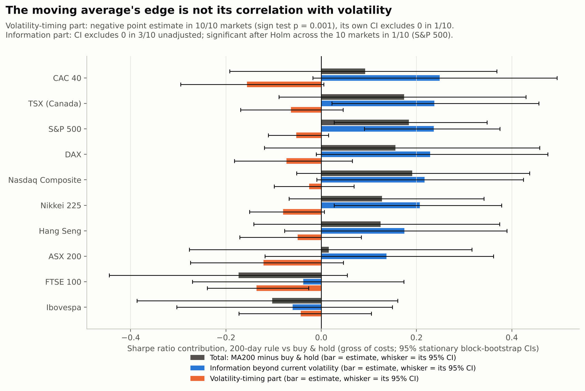
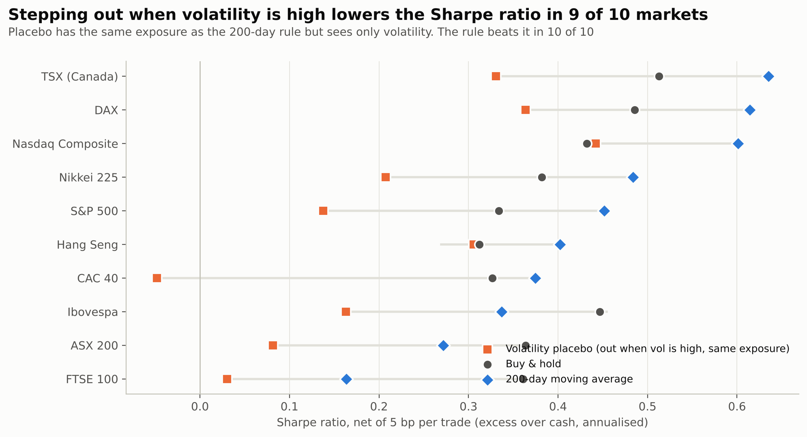
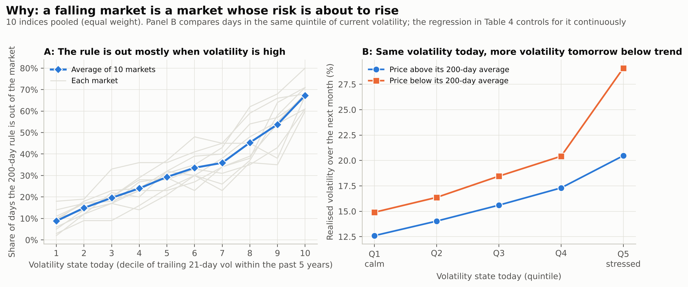
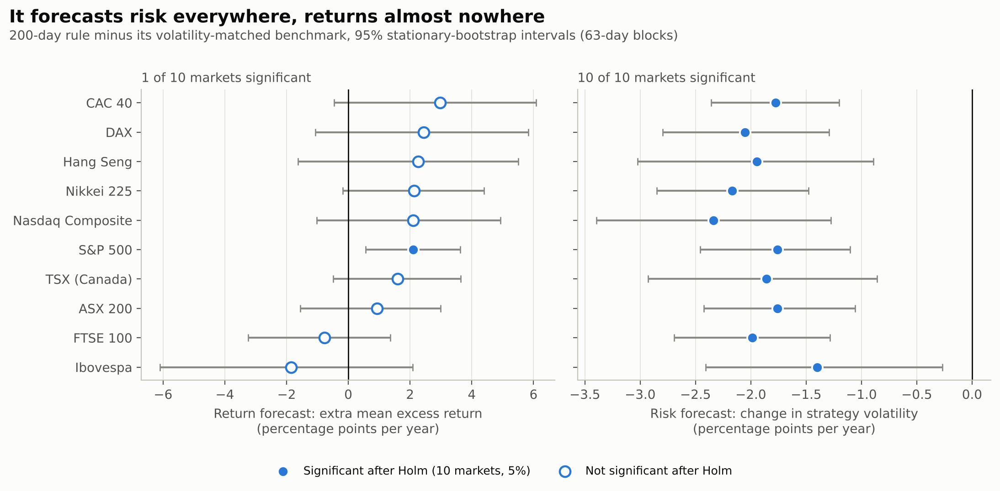
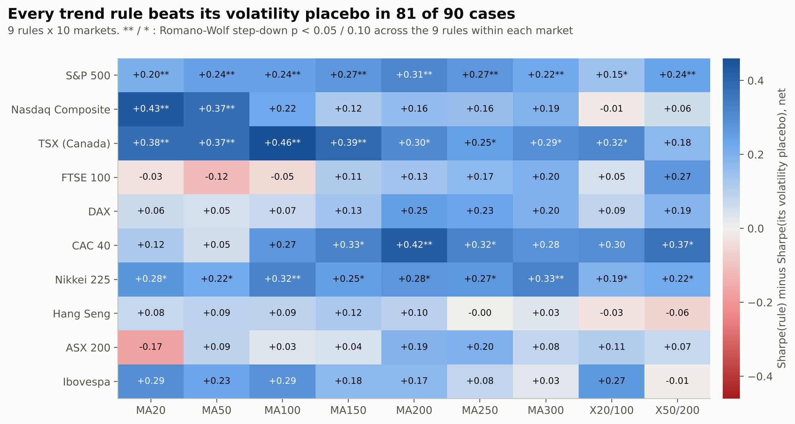
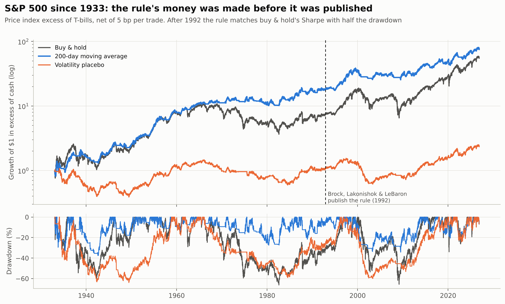
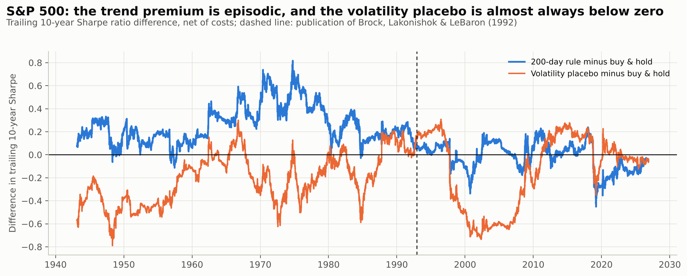

# Not a Volatility Filter: What the 200-Day Moving Average Actually Knows

*Project 03 of [30 Quant Research Projects](../README.md) · 10 equity indices · S&P 500 back to 1933 · ≈430 market-years of daily data*

> **Headline.** People often explain the 200-day moving-average rule as a volatility filter: it is out of the market mostly when volatility is high. That is true, and it is also not why the rule works. I built a placebo that keeps the rule's exposure in each volatility decile and destroys everything else. That volatility-timing part has a **negative** point estimate in **10 of 10** markets (−0.03 to −0.16 Sharpe; sign test p = 0.001). Each market on its own is noisy: the 95% CI excludes zero only for the FTSE 100, and none survives Holm. So the evidence is in the consistency of the sign, not in any single market. Everything the rule adds over buy & hold comes from information *beyond* today's volatility. Most of that information is about **risk**: while the rule is invested, volatility is 1.4–2.3 points a year lower than the placebo's, and that is significant in **10 of 10** markets after a Holm correction. Some of it is about **returns**: those are about 2 points a year higher in 8 of 10 markets, but only the S&P 500 is significant after the Holm correction across the 10 markets. On the S&P 500 after the rule was published (1992–2026), it matches buy & hold's Sharpe ratio (0.40 vs 0.41) with half the maximum drawdown (−34% vs −66%).



---

## 1. Question

The 200-day moving-average rule is invested when the index closes above its 200-day average and holds cash otherwise. It is the most-cited technical rule there is (Brock, Lakonishok & LeBaron 1992; Siegel; Faber 2007). Its record is well known: lower drawdowns and, in long US samples, a higher Sharpe ratio.

A common and plausible explanation is that the rule is a **volatility filter in disguise**. Prices fall when volatility rises (the leverage effect), so "price below its trend" is almost the same thing as "volatility is high". Being out of the market in high-volatility states lowers risk, so the Sharpe ratio rises. If that is all the rule does, a simpler and more transparent rule that looks only at volatility should do the same job.

**Research question.** How much of the moving-average rule's performance comes from timing *current* volatility, and how much from information about future returns or future risk that current volatility does not contain?

**Hypotheses (fixed before running the tests, see §3).**
* **H1 (volatility filter).** Within volatility states, the trend signal carries no information: a placebo with the same exposure *in each volatility state* earns the same Sharpe ratio as the rule.
* **H2 (return forecast).** Controlling for the volatility state, the signal predicts next-month volatility-standardised returns (coefficient > 0).
* **H3 (risk forecast).** Controlling for current volatility, the signal predicts next-month realised volatility (coefficient < 0 when the rule is invested).

Why it matters: if H1 held, the rule would be redundant with volatility targeting, which is cheaper to run and easier to scale. If it fails, the next question is *what* the price trend knows, because that decides whether a moving average belongs in a risk model (#06, #13, #19) or in an alpha model (#12).

## 2. Data

| Index | Yahoo symbol | Sample used (after warm-up) | Years |
|---|---|---|---|
| S&P 500 | ^GSPC | 1933-01 – 2026-11 | 93.6 |
| Nasdaq Composite | ^IXIC | 1976-02 – 2026-11 | 50.8 |
| Nikkei 225 | ^N225 | 1970-02 – 2026-11 | 55.4 |
| TSX (Canada) | ^GSPTSE | 1984-07 – 2026-11 | 42.2 |
| FTSE 100 | ^FTSE | 1988-12 – 2026-11 | 38.0 |
| DAX | ^GDAXI | 1993-01 – 2026-11 | 34.0 |
| Hang Seng | ^HSI | 1992-02 – 2026-11 | 34.1 |
| CAC 40 | ^FCHI | 1995-03 – 2026-11 | 32.0 |
| ASX 200 | ^AXJO | 1997-11 – 2026-11 | 29.1 |
| Ibovespa | ^BVSP | 2000-02 – 2026-11 | 26.3 |

Daily closes from Yahoo Finance, pulled on 2026-11-18 (`data/index_closes.csv`, `src/fetch_data.py`). Each sample starts once the 200-day average and the 5-year placebo window are available. Ibovespa starts in 1995, before warm-up, to skip the hyperinflation years. Cash is the 13-week T-bill (^IRX) for the two US indices from 1960, and zero before that and for non-US indices (see Limitations). Every window from §6.4 is covered: 1937–38, 1973–74, 1987, 2000–02, 2008, 2020 and 2022.

The universe is deliberately different from project 01's ETFs: here the point is *long* history across many markets, and only price indices go back that far. That choice costs us dividends. §7 shows why it does not bias the main comparison.

## 3. Design (pre-registered)

These choices were fixed before any result was seen. The items marked *(added)* were added after the first results, to resolve a puzzle, and are reported as such.

* **Rule.** Signal $S_t = 1\{P_t > \text{MA}_{200}(P)_t\}$ uses closes up to and including day $t$. It is held over the return from close $t$ to close $t+1$, so nothing on day $t+1$ is known when the decision is taken (`tests/test_core.py::test_signal_has_no_look_ahead`). Cost: 5 bp per one-way trade. Results are shown with 0, 10 and 20 bp too.
* **Volatility state.** Trailing 21-day realised volatility, ranked against its own past 5 years (1,260 days), so each state is relative to the market's recent normal.
* **Matched volatility placebo.** It is invested iff today's volatility is below the quantile of the past 5 years that equals the rule's own invested fraction over the same 5 years. It never sees prices, only volatility. It has the same average exposure as the rule and is out in exactly the highest-volatility states.
* **Spell-shuffle null.** Shuffles the rule's own in/out spells at random (1,000 draws). That keeps exposure and turnover and destroys all timing information.
* **Baselines.** Buy & hold, plus a long-only volatility target $w_t=\min(1,\ \bar\sigma_{5y}/\sigma_t)$, the textbook continuous version of the volatility idea.
* **Inference.** Sharpe-ratio differences use the Ledoit–Wolf (2008) HAC delta-method test and a stationary block bootstrap (63-day mean blocks, 999 draws). Predictive regressions use Newey–West errors, and the pooled panel uses Driscoll–Kraay errors. Across 10 markets I apply Holm, and across the 9-rule grid within a market I apply Romano–Wolf step-down.
* *(added)* **Volatility-stratified decomposition** (§5.2). It is the clean test of H1.

## 4. Baseline results



**Table 1. Net Sharpe ratio (excess of cash, 5 bp per trade) and maximum drawdown**

| Index | Buy & hold | MA200 | Vol placebo | Vol target | MaxDD B&H | MaxDD MA200 |
|---|---|---|---|---|---|---|
| S&P 500 | 0.33 | **0.45** | 0.14 | 0.31 | −66% | −37% |
| Nasdaq | 0.43 | **0.60** | 0.44 | 0.49 | −81% | −51% |
| TSX | 0.51 | **0.63** | 0.33 | 0.56 | −50% | −26% |
| DAX | 0.49 | **0.61** | 0.36 | 0.50 | −73% | −36% |
| Nikkei 225 | 0.38 | **0.48** | 0.21 | 0.34 | −82% | −33% |
| Hang Seng | 0.31 | **0.40** | 0.31 | 0.27 | −65% | −39% |
| CAC 40 | 0.33 | **0.37** | −0.05 | 0.29 | −65% | −29% |
| ASX 200 | **0.36** | 0.27 | 0.08 | 0.35 | −54% | −26% |
| Ibovespa | **0.45** | 0.34 | 0.16 | 0.45 | −60% | −46% |
| FTSE 100 | **0.36** | 0.16 | 0.03 | 0.32 | −53% | −51% |

(`results/performance.csv`, `results/sharpe_tests.csv`)

Three facts set up the puzzle:

1. **The rule beats buy & hold in 7 of 10 markets, but none of those gaps is individually significant.** HAC p-values run from 0.14 to 0.74. The rule's reliable benefit is the drawdown: it cuts the maximum drawdown in all 10 markets, typically by half.
2. **The volatility placebo is worse than buy & hold in 9 of 10 markets.** The exception is Nasdaq, 0.44 vs 0.43. Simply stepping out when volatility is high does not work.
3. **The rule beats its own volatility placebo in 10 of 10 markets.** The gap is 0.04 to 0.42 Sharpe, significant at 5% (HAC) for the S&P 500, TSX, CAC 40 and Nikkei. Against the spell-shuffle null, the rule's Sharpe is in the top 5% in 5 of 10 markets. The placebo is in the top 5% in none.

So whatever the rule does, it is not "be out when volatility is high". The next section measures what it is.

## 5. What the trend signal knows

### 5.1 It is strongly correlated with volatility



Panel A shows the premise is right. In the calmest decile of volatility the rule is out 9% of the time; in the most turbulent, 67%. The relation is monotone in every market.

### 5.2 Decomposition: volatility timing vs everything else

Write the rule's exposure in each volatility decile $k$ as $p_k$. The **volatility-matched benchmark** holds $p_k$ of the index on every day in decile $k$. That is the expectation of shuffling the rule's signal *within* each decile, which keeps the rule's link to volatility exactly and destroys anything else. Then:

$$\underbrace{SR_{MA}-SR_{B\&H}}_{\text{total}} = \underbrace{SR_{bench}-SR_{B\&H}}_{\text{volatility timing}} + \underbrace{SR_{MA}-SR_{bench}}_{\text{information beyond current vol}}$$

All three quantities get 95% CIs from a stationary block bootstrap that re-estimates $p_k$ inside every draw, so the serial dependence of both the signal and the returns is respected (`results/stratified_decomposition.csv`).

**Table 2. Sharpe decomposition (gross of costs)**

| Index | Total [95% CI] | Volatility timing [95% CI] | Beyond current vol [95% CI] | Holm p (beyond vol) |
|---|---|---|---|---|
| S&P 500 | +0.18 [0.03, 0.35] | −0.05 [−0.11, 0.02] | **+0.24** [0.09, 0.38] | **0.010** |
| TSX | +0.17 [−0.09, 0.43] | −0.06 [−0.17, 0.05] | +0.24 [0.02, 0.46] | 0.117 |
| Nikkei 225 | +0.13 [−0.07, 0.34] | −0.08 [−0.15, 0.01] | +0.21 [0.03, 0.38] | 0.117 |
| CAC 40 | +0.09 [−0.19, 0.37] | −0.16 [−0.30, 0.01] | +0.25 [−0.02, 0.50] | 0.252 |
| DAX | +0.16 [−0.12, 0.46] | −0.07 [−0.18, 0.07] | +0.23 [−0.01, 0.48] | 0.252 |
| Nasdaq | +0.19 [−0.05, 0.44] | −0.03 [−0.10, 0.07] | +0.22 [−0.01, 0.42] | 0.252 |
| Hang Seng | +0.13 [−0.14, 0.38] | −0.05 [−0.17, 0.08] | +0.17 [−0.08, 0.39] | 0.284 |
| ASX 200 | +0.02 [−0.28, 0.32] | −0.12 [−0.27, 0.05] | +0.14 [−0.12, 0.36] | 0.504 |
| FTSE 100 | −0.17 [−0.45, 0.05] | **−0.14 [−0.24, −0.03]** | −0.04 [−0.27, 0.17] | 1.000 |
| Ibovespa | −0.10 [−0.39, 0.16] | −0.04 [−0.17, 0.11] | −0.06 [−0.30, 0.15] | 1.000 |

**H1 is rejected statistically in the S&P 500, and in direction in 8 of 10 markets.** The volatility-timing part has a negative point estimate in all 10 markets. That is unlikely by chance: a sign test gives p = 0.001 if the markets were independent. They are correlated, so read that as an upper bound on the evidence. Market by market the part is small next to its noise. Its CI excludes zero only for the FTSE 100 (one-sided bootstrap p < 0.05 in 3 of 10: FTSE, CAC 40, Nikkei), and none survives Holm. The defensible claim is that volatility timing does not *help* in any market, and that it most likely costs Sharpe. The part beyond volatility is positive in 8 of 10. Its own CI excludes zero in 3 of 10 (S&P 500, TSX, Nikkei; unadjusted bootstrap p < 0.05 in 6 of 10), and only the S&P 500 survives Holm across the 10 markets. In this paper "survives" always means significant after that Holm correction.

Why does volatility timing hurt? In the top volatility quintile, days when the price is *above* its trend still have high returns: 13% a year annualised for the S&P 500 (`results/mechanism.csv`). Those are recoveries and melt-ups, and a pure volatility rule sits them out.

### 5.3 Risk forecast vs return forecast



The "beyond current volatility" part can come from a higher mean, a lower volatility, or both. Splitting it (`analytic_mean_gap`, `analytic_vol_gap`):

* **Risk (H3): significant in 10 of 10 markets after Holm.** The rule's returns are 1.4–2.3 points a year less volatile than the volatility-matched benchmark's, 7–16% lower in relative terms. Panel B of the mechanism figure shows the reason: at the *same* current volatility, days below trend are followed by a more volatile month (pooled 29% vs 20% in the top quintile). The predictive regression agrees. With log 21-day and 63-day volatility as controls, the signal lowers next-month log realised volatility in all 10 markets, with |t| > 2 in 7 (`results/direction_regressions.csv`).
* **Returns (H2): positive in 8 of 10, significant in 1.** The mean gap is about +2 points a year (0.9 to 3.0) in the 8 positive markets. Only the S&P 500 is significant after Holm (p = 0.04). In the regression of next-month volatility-standardised returns on the signal plus volatility-quintile dummies, only the S&P 500 has t > 2 (2.51). The pooled 10-market panel with Driscoll–Kraay errors gives b = 0.085, t = 1.53. None of the 90 rule × market coefficients survives Holm.

In Sharpe terms the return part is the larger piece of the point estimate, roughly 70–95% in the markets where the rule works. But it is the fragile piece. The risk part is smaller, roughly 5–30%, and it is universal. The honest summary: **the moving average is a reliable risk forecaster and an unreliable return forecaster, and it is not a volatility filter.**

## 6. Robustness

### 6.1 Other rules and multiple testing



Nine rules (MA 20–300 and the 20/100 and 50/200 crossovers) × 10 markets. The rule beats its own volatility placebo in **81 of 90** cases, and 17 survive Romano–Wolf at 5% within their market. Against buy & hold, only 2 of 90 survive: Nasdaq MA20 and MA50. Those two are consistent with the known positive autocorrelation of the early Nasdaq Composite from stale small-cap prices, not with a tradable edge (`results/grid_romano_wolf.csv`).

### 6.2 Design choices (all variants on the same dates per market)

| Variant | MA200 − placebo (mean, # > 0) | Placebo − B&H (mean, # > 0) |
|---|---|---|
| Baseline, 5 bp | +0.09, 7/10 | −0.14, 1/10 |
| 0 / 10 / 20 bp | +0.09 / +0.09 / +0.08 | −0.11 / −0.17 / −0.22 |
| 63-day volatility state | +0.04, 6/10 | −0.09, 2/10 |
| 1-year placebo window | +0.08, 8/10 | −0.13, 2/10 |
| 20-year placebo window | +0.04, 6/10 | −0.09, 3/10 |
| Extra day of execution lag | +0.08, 7/10 | −0.15, 1/10 |
| Dividend proxy (+3% a year) | +0.09, 8/10 | −0.12, 1/10 |

These use a common, shorter sample: the latest start any variant allows, for example 1943 for the S&P 500 and 2010 for Ibovespa (`results/robustness.csv`). The sign of both columns holds in every variant. The size of the rule's advantage over the placebo is sensitive to how the placebo is defined. The decomposition in §5.2 is the version that does not depend on that choice. Re-run with 1-year, 5-year and 20-year deciles and with 63-day volatility, the volatility-timing part stays negative in 8 to 10 markets and the volatility gap stays negative in **10 of 10** under every definition (`results/stratified_robustness.csv`).

### 6.3 Sub-periods: the publication test



| S&P 500 | B&H Sharpe | MA200 Sharpe | MA200 MaxDD | B&H MaxDD |
|---|---|---|---|---|
| 1934–1961 | 0.48 | **0.70** | −38% | −60% |
| 1962–1991 | 0.02 | **0.30** | −27% | −66% |
| 1992–2026 (after BLL 1992) | **0.41** | 0.40 | −34% | −66% |

Every Sharpe advantage over buy & hold was earned before the rule was published. After 1992 it is gone, consistent with McLean & Pontiff's evidence of post-publication decay. What survives is the *risk* benefit: the same Sharpe with half the drawdown. In the 2010s the rule trailed (0.48 vs 0.76), because sharp V-shaped recoveries punish a slow signal.



### 6.4 Stress windows

Median cumulative return across the markets available in each window (`results/stress_windows.csv`):

| Window | Buy & hold | MA200 | Vol placebo |
|---|---|---|---|
| 2000–02 dot-com (10 markets) | −44% | **−19%** | −48% |
| 2008 GFC (10) | −47% | **−6%** | −21% |
| 2020 Covid crash (10) | −19% | −9% | **−5%** |
| 2022 inflation (10) | −10% | **−7%** | −8% |
| 1987 crash (4) | −23% | **−8%** | −10% |
| 1973–74 (2) | −38% | −18% | **−10%** |

The rule protects best in slow bear markets (2000–02, 2008). In the 2020 crash, and on the S&P 500 in 1987 and 1973–74, the volatility rule got out faster. This is the mechanism of §5 seen in the data: volatility moves first in a sudden crash, and the trend moves first in a slow decline.

## 7. Limitations

* **Price indices, not total return.** Dividends are missing. Buy & hold loses the full yield and the rule loses it only while invested, so the rule-vs-buy-&-hold gap is *flattered* by about 0.3 × yield ≈ 0.6–1 point a year. The rule-vs-placebo comparison and the decomposition compare equal exposures, so they are close to unaffected. A +3% dividend proxy changes nothing (§6.2).
* **Cash.** The non-US indices use a zero cash rate and are in local currency. The decomposition is unaffected (equal exposure), but the absolute Sharpe ratios are not comparable across countries.
* **Index, not instrument.** Before index futures and ETFs (pre-1982 for the US) you could not trade the index at 5 bp. The pre-1960 S&P 500 results describe a signal, not a strategy.
* **One family of signals.** I test simple price-vs-average rules. Time-series momentum (#12) and regime models (#19) are natural extensions.
* **The return-forecasting evidence rests mostly on one market.** The S&P 500 is also the market where the rule was discovered, so its 1934–1991 history is in-sample for the literature even though it is out-of-sample here.
* **Market selection.** The 10 indices are markets that exist and are well documented today. Markets that collapsed or closed (for example Russia in 1917 or Argentina) are missing, which flatters buy & hold more than the rule.
* **Early S&P 500 data.** Before 1957 the Yahoo series is the S&P 90 / reconstructed index. The warm-up also drops 1928–1932, so the 1929 crash, where the rule famously shone, is *excluded*. That makes the S&P 500 results conservative for the rule.
* **The binary placebo is one of many possible volatility rules.** The continuous volatility target (Table 1) does no better overall: it beats the rule in only 3 of 10 markets, and it beats buy & hold in only 4 of 10.

## 8. Referee-style self-review: what it changed

Before publishing I reviewed the project as a hostile referee would. Each point below changed the analysis or the text:

1. **"Your placebo is a straw man."** The binary placebo's result depends on how it is built: with a 20-year window it is much closer to the rule. I added the volatility-stratified decomposition (§5.2). It copies the rule's exposure by volatility decile exactly, so it needs no design choice, and it is now the main test.
2. **"Different variants use different samples."** The first robustness table compared variants with different start dates. Every variant is now evaluated on the same dates per market (§6.2).
3. **"Permutation p-values ignore serial dependence."** A day-level shuffle treats days as independent, which makes p-values too small. The primary inference is now a stationary block bootstrap (63-day blocks) that re-estimates the benchmark inside each draw. The permutation p-values are kept in the CSV as secondary.
4. **"Overclaiming."** An early draft said the placebo loses to buy & hold in 10 of 10 markets. That is true for the stratified benchmark, but for the binary placebo it is 9 of 10. Every count in the text was re-checked against `results/`.
5. **"Missing dividends."** I added a dividend-proxy variant and the bias argument in §7.
6. **"Which whisker is which, and what does 10/10 mean?"** (Manager review.) The star chart now gives each quantity (total, volatility timing, information) its own bar and its own CI, and Table 2 reports all three CIs. "Lowers Sharpe in 10/10" was rewritten as "negative point estimate in 10/10, sign test p = 0.001, individually significant in 1/10".
7. **"Return or risk?"** The first draft said the signal "predicts direction". The split into a mean gap and a volatility gap (§5.3) showed that the robust part is the risk forecast. The headline was rewritten around that.

## 9. Conclusion

The 200-day moving average is correlated with volatility, but that correlation is not where its value comes from. A rule built only from that correlation loses money relative to buy & hold. What the trend adds is information about the *next* month's risk that today's volatility does not contain. That is a falling market whose volatility is about to rise, the leverage effect working with a lag. The information is universal across 10 markets and robust to every design choice tested. Its information about returns is weaker, concentrated in the pre-1992 S&P 500, and not distinguishable from noise elsewhere after multiple-testing correction.

**How this fits the rest of the series.** Project #10 asks a neighbouring question from the forecasting side: it tests a 200-day *gap* as a predictor of next-week returns and volatility on project #01's seven ETFs (2006–2026) and monthly S&P 500 data, with Clark–West tests against 21-day realised volatility. It finds the trend numbers useless for returns and only weakly informative about volatility beyond RV21. The two projects agree on the main point: there is no return forecast, and whatever information exists is about risk. They differ in strength. Here the evidence for risk information is strong (10 of 10 markets) because the test is at the strategy level, over a month, across 430 market-years, and it conditions on the volatility *state* rather than on a linear RV21 term. Project #07 finds that volatility timing is "the smaller lever" in Kelly sizing; §5.2 finds that binary volatility timing is actually harmful at fixed exposure.

Practical reading: a moving average belongs in a **risk overlay** (it halves drawdowns at roughly unchanged Sharpe), not in an alpha model. Links: #06 (VaR) and #13 (GARCH) for the risk models this signal complements, #12 for momentum with costs, #19 for regime detection, #23 for the multiple-testing issue behind any "best" moving-average length.

## Reproduce

```bash
pip install -r requirements.txt
bash run_all.sh          # tests, all experiments, all figures; about 6 minutes on one core
```

All numbers in this document are in `results/*.csv`. Seeds are fixed. Data refresh: `python src/fetch_data.py`.

## References

Brock, W., Lakonishok, J., LeBaron, B. (1992). Simple technical trading rules and the stochastic properties of stock returns. *Journal of Finance* 47(5).
Faber, M. (2007). A quantitative approach to tactical asset allocation. *Journal of Wealth Management* 9(4).
Moreira, A., Muir, T. (2017). Volatility-managed portfolios. *Journal of Finance* 72(4).
Ledoit, O., Wolf, M. (2008). Robust performance hypothesis testing with the Sharpe ratio. *Journal of Empirical Finance* 15(5).
Romano, J., Wolf, M. (2005). Stepwise multiple testing as formalized data snooping. *Econometrica* 73(4).
Politis, D., Romano, J. (1994). The stationary bootstrap. *JASA* 89(428).
Driscoll, J., Kraay, A. (1998). Consistent covariance matrix estimation with spatially dependent panel data. *REStat* 80(4).
McLean, R. D., Pontiff, J. (2016). Does academic research destroy stock return predictability? *Journal of Finance* 71(1).
Black, F. (1976). Studies of stock price volatility changes. *Proceedings of the ASA*. (leverage effect)
