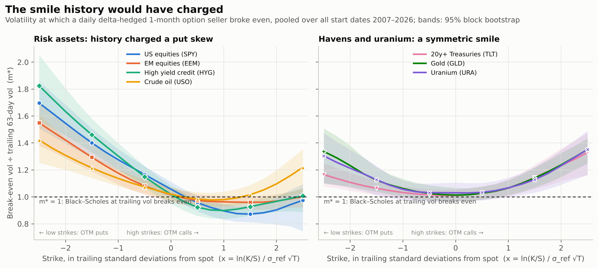
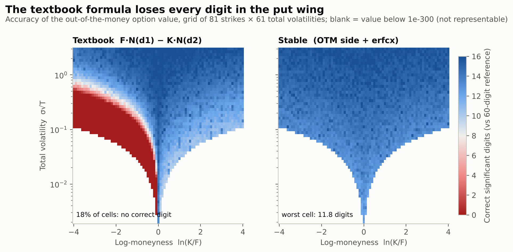
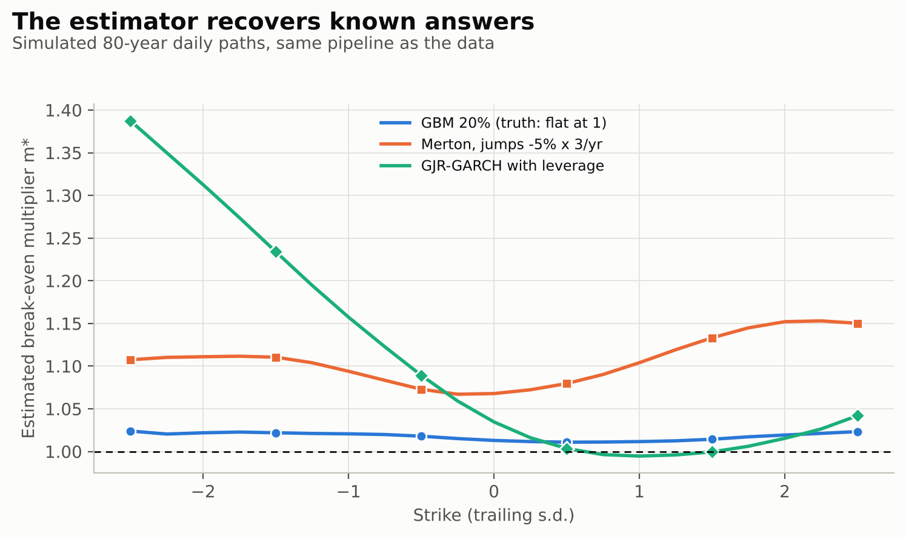
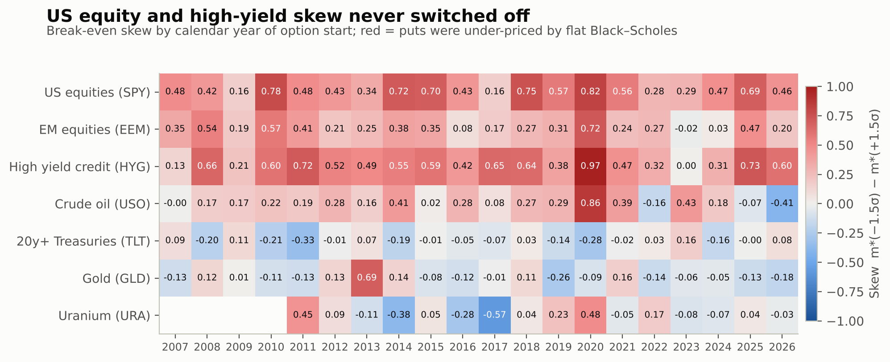
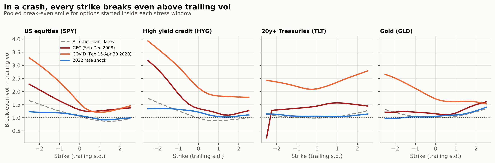
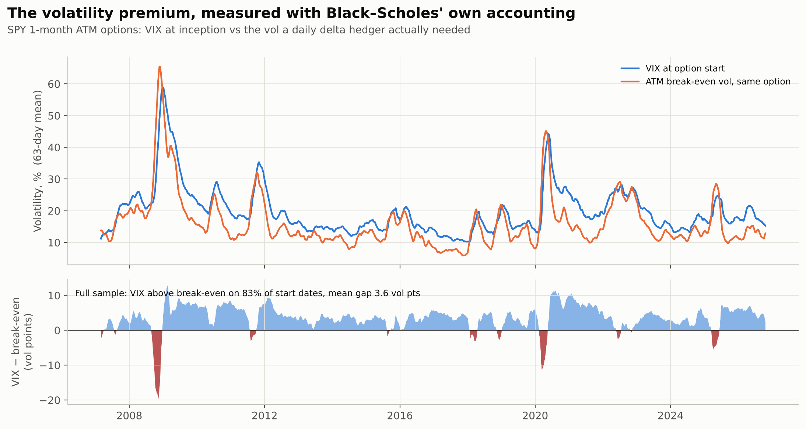
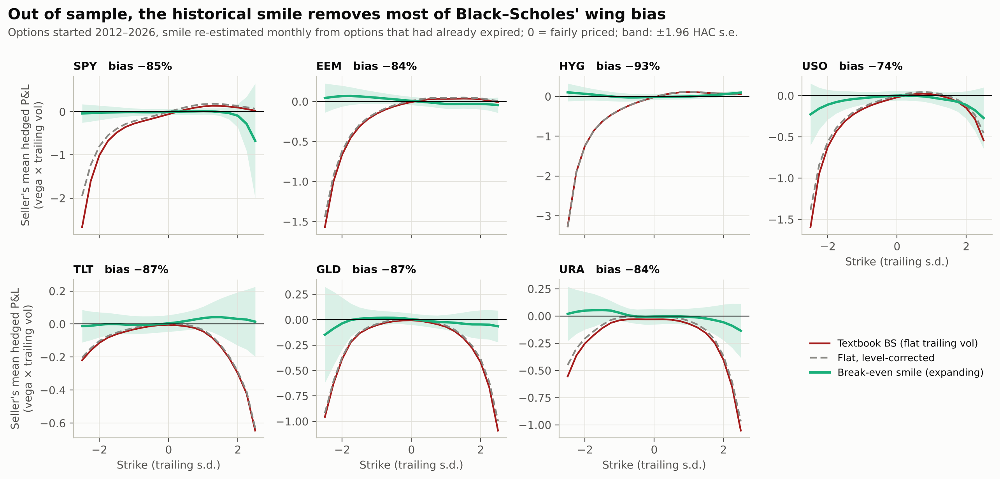

# The Smile History Would Have Charged

**Break-even Black–Scholes volatilities by strike across seven asset classes, 2007–2026, and a pricer that keeps its digits in the wings**

*Project 04 of [30 Quant Research Projects](../README.md) · Working paper, November 2026*



---

## Abstract

Black–Scholes has one free input, volatility, and the textbook way to fill it in is trailing realised
volatility. This paper asks what that number *should* have been, strike by strike, judged by
the hedging argument behind the formula. A delta-hedged option seller who quotes volatility σ
earns ½ Σ Γ S² (σ² dt − R²). The σ that sets this to zero is the **break-even volatility**. It is a
gamma-weighted realised volatility that depends on the strike, because gamma sits in different places
for different strikes. I compute it for daily-hedged one-month options on a standardised strike grid at
every trading day from January 2007 to October 2026, on seven ETFs covering US and emerging-market
equities, high-yield credit, crude oil, long Treasuries, gold and uranium. That is 33,719 option paths per strike.

**Main findings**

1. **At the money, Black–Scholes with trailing volatility is fair. In the wings it is not.** The pooled
   break-even multiplier m\* = σ\*/σ_trailing at the money ranges from 1.01 to 1.06, and none of the seven
   differs from 1 after Holm correction. At 2.5 trailing standard deviations below spot, a put seller
   needed **1.70× trailing vol on SPY (95% CI 1.51–1.86) and 1.82× on HYG (1.57–2.05)** to break even.
2. **History charged a put skew on risk assets and a symmetric smile on havens.** The skew
   m\*(−1.5σ) − m\*(+1.5σ) is +0.53 on SPY (95% CI 0.45–0.61), +0.53 on HYG, +0.33 on EEM and +0.20 on
   USO, all with Holm-adjusted p < 0.01. It is −0.08 on TLT, −0.02 on gold and 0.00 on uranium.
   Convexity (a smile) is positive and significant for **all seven** assets.
3. **The skew is a regime-free fact for US equities and high yield.** SPY's break-even skew is
   positive in every one of the 20 calendar years, and so is HYG's. Gold's skew is positive in only 7
   of 20 years.
4. **It is the spot–volatility link, not the jumps.** In simulation, a Merton model with large negative
   jumps produces almost no daily-hedging skew (−0.02). A GJR-GARCH model without jumps but with leverage
   reproduces the equity shape (+0.23). Variance arrives when prices are already lower, which is where
   low-strike gamma sits.
5. **The volatility risk premium, measured with Black–Scholes' own accounting.** VIX exceeded the SPY
   at-the-money break-even vol on 83% of start dates, by 3.6 vol points on average. The gap inverts in
   every crash: −5.3 points for options started in September–December 2008 and −2.3 points in
   February–April 2020.
6. **The historical smile is forecastable out of sample.** A smile re-estimated monthly from options that
   had already expired, applied on top of the trailing vol, removes **74–93% of flat Black–Scholes'
   mean absolute pricing bias** across strikes in 2012–2026. The improvement is significant for 6 of 7
   assets after Holm correction; TLT, whose smile is shallow, is the exception.
   It does not reduce the path-by-path squared hedging error by a significant amount. The smile
   corrects the *price*, but it cannot make a single month's hedging P&L predictable.

Part I is the engineering underneath. The textbook formula F·N(d1) − K·N(d2) returns **no correct
digit in 18% of a standard (moneyness × volatility) grid**. These are deep out-of-the-money puts priced
through put–call parity. The pricer here prices the out-of-the-money side directly with the scaled
complementary error function. It keeps at least 11.8 correct digits everywhere against a 60-digit
reference, and its implied-volatility solver inverts every representable price to within 3.3 × 10⁻¹³.

---

## 1. Motivation and question

Every introductory Black–Scholes project prices an option with a volatility taken from history and stops.
Every options desk knows the market does not quote a single volatility: it quotes a smile. The usual
explanation is that the smile is *risk-neutral*: it reflects crash fear and risk premia, not physical
reality. That claim is testable without any option data. Black–Scholes is also an accounting identity.
Its P&L decomposition says exactly what volatility a hedger needed, path by path and strike by strike.
If the *physical* world also produces a smile, part of the market smile is simply fair value.

**Research question.** If you had sold every one-month option and delta-hedged it daily from 2007 to 2026,
which volatility would have made you break even at each strike? Does that "realised smile" differ from
flat? Does its shape differ by asset class? Does it predict where flat Black–Scholes will misprice next?

Ideas this builds on: the gamma-weighted break-even volatility of Bergomi (*Stochastic Volatility
Modeling*, 2016, ch. 1) and Dupire's work on the realised P&L of a delta hedge; the variance risk premium
(Carr and Wu 2009; Bollerslev, Tauchen and Zhou 2009); and Jäckel (2015, "Let's be rational") on
the numerics of implied volatility. To my knowledge the break-even smile has not been published across asset
classes, over two decades, with formal inference and an out-of-sample test.

## 2. Part I: a Black–Scholes pricer you can trust in the wings

`src/bs.py` implements Black-76 on the forward with a discount factor, so the same function prices
equity (Black–Scholes–Merton with yield q), futures and FX options. It provides analytic Greeks (delta,
gamma, vega, theta, rho, vanna, volga) and an implied-volatility solver.

**Two choices matter for accuracy.**

* *Price the out-of-the-money side and get the other side by parity.* An in-the-money value is
  "intrinsic + small number". The small number is the out-of-the-money value, and it carries all the
  information.
* *Use erfcx, not N(·), for the out-of-the-money value.* Using N(−x) = ½ erfcx(x/√2) e^{−x²/2} and the
  identity K e^{−d2²/2} = F e^{−d1²/2}, the call becomes F e^{−d1²/2}/2 · [erfcx(−d1/√2) − erfcx(−d2/√2)].
  This is a difference of two O(1) numbers rather than two tiny ones.

**Implied volatility.** The quote is mapped to the normalised out-of-the-money call. The solver
iterates Newton steps on *log price* in total volatility. A bracket is always maintained, and the solver
falls back to bisection whenever a Newton step would leave it. Quotes outside the no-arbitrage bounds return NaN.



| Pricer | Median correct digits | Worst cell | Cells with no correct digit | IV round-trip max rel. error |
|---|---|---|---|---|
| Textbook F·N(d1) − K·N(d2) | 13.2 | **< 0** | **17.8%** | n/a |
| Stable (this repo) | 14.7 | 11.8 | 0.0% | 3.3 × 10⁻¹³ (0 failures in 2,891) |

*Grid: ln(K/F) ∈ [−4, 4] (81 points) × σ√T ∈ [0.002, 3] (61 points, log-spaced); reference: mpmath at 60
digits; `results/accuracy_summary.csv`.*

This matters for the rest of the paper. Out-of-the-money puts at 2.5 standard deviations are exactly where
the break-even smile is steepest. A pricer that rounds them to zero would hide the effect this paper measures.

## 3. Part II: the break-even smile

### 3.1 Method (pre-registered)

For a path S₀, …, S_n rebalanced every h days, the seller of an option quoted at σ and delta-hedged at σ earns,
to second order,

  P&L(σ) = ½ Σⱼ Γⱼ(σ) Sⱼ² (σ² h/252 − Rⱼ²),  Rⱼ = S_{j+h}/S_j − 1.

The drift of S drops out of this gamma–theta form, so no expected-return assumption is needed. Rates are set to zero;
for one-month options the financing term is below 0.5% of vega at any rate seen in the sample.

* **Strikes in standardised units.** On each start date t₀, σ_ref is the trailing 63-day realised vol,
  known at t₀. Strikes are K = S₀ exp(x σ_ref √T) for x ∈ {−2.5, −2.25, …, 2.5}. A strike at x = −2 is
  "two trailing standard deviations below spot" on every asset and date. That makes uranium and
  Treasuries comparable.
* **Quote at a multiple of trailing vol.** Each option is quoted at σ = m · σ_ref, on a grid
  m ∈ [0.20, 4.00] in steps of 0.01. Gamma is evaluated at the quoted vol, so the break-even is a
  fixed point. P&L is divided by inception vega × σ_ref, which makes it scale-free across assets and decades.
* **Break-even multiplier.** m\*(x) solves mean_paths P&L(m · σ_ref) = 0. It is the single multiplier that
  would have made a seller of *all* such options break even. That is the economically relevant
  pooled answer, rather than the median path.
* **Sample.** Every trading day from 2007-01-03 (later for HYG and URA) to October 2026. There are
  4,983 overlapping one-month paths per asset, and 4,853 for HYG and 3,951 for URA.
* **Data.** Daily total-return log returns of seven ETFs (the same series as project 01, from Yahoo Finance)
  and the CBOE VIX close (`data/vix_daily.csv`, from the datasets/finance-vix mirror on GitHub).

**Hypotheses, fixed before the results were inspected.**

| | Statistic | H₀ | Expected |
|---|---|---|---|
| H1 skew | S = m\*(−1.5) − m\*(+1.5) | S = 0 | S > 0 for SPY, EEM, HYG |
| H2 convexity | C = ½[m\*(−1.5) + m\*(+1.5)] − m\*(0) | C = 0 | C > 0 for all |
| H3 level | L = m\*(0) − 1 | L = 0 | not rejected |
| H4 VRP | SPY ATM sold at VIX | mean P&L = 0 | > 0 overall, < 0 in crises |
| H5 OOS | mean abs. bias, expanding smile vs flat | no gain | gain > 0 |

**Inference.** The 1,000-replicate moving-block bootstrap resamples start dates in blocks of 63 trading days.
That is three times the overlap of the paths, so serial dependence from overlapping options is preserved.
Within each hypothesis family, a Holm correction runs across the seven assets.
Time-series means use Newey–West standard errors with 42 lags.

### 3.2 Validation: does the estimator recover a known answer?

The same pipeline runs on 80 years of simulated daily data (`src/validation.py`):



| Simulated world | m\*(−1.5) | m\*(0) | m\*(+1.5) |
|---|---|---|---|
| GBM, constant 20% vol (truth: flat 1) | 1.02 | 1.01 | 1.01 |
| Merton, σ = 15%, 3 jumps/yr of −5% ± 3% | 1.11 | 1.07 | 1.13 |
| GJR-GARCH(1,1) with leverage, no jumps | 1.23 | 1.04 | 1.00 |

Under GBM the estimator is flat at 1, apart from a 1–2% upward bias. That bias is the Jensen effect of
dividing by an *estimated* trailing vol, and it is small next to the effects below.

The Merton row is the key interpretive result. Even large *negative* jumps produce a symmetric smile, not a
skew. With daily hedging, a jump is charged at the gamma of the strike *where the spot was before the
jump*. Jumps add variance at every strike, and that convexity is all they produce. A skew needs variance to be *higher when the
price is lower*, the leverage effect. The GJR row shows that this alone reproduces the equity shape.

### 3.3 Results

**Pooled break-even multipliers** (`results/breakeven_smiles.csv`, `results/hypothesis_tests.csv`):

| Asset | m\*(−2.5) | m\*(−1.5) | m\*(0) | m\*(+1.5) | m\*(+2.5) | Skew [95% CI] | Convexity [95% CI] |
|---|---|---|---|---|---|---|---|
| SPY | 1.70 | 1.40 | 1.06 | 0.87 | 0.97 | **+0.53** [0.45, 0.61] | +0.08 [0.04, 0.13] |
| HYG | 1.82 | 1.46 | 1.02 | 0.93 | 1.01 | **+0.53** [0.44, 0.64] | +0.18 [0.13, 0.21] |
| EEM | 1.55 | 1.29 | 1.02 | 0.96 | 1.00 | **+0.33** [0.25, 0.42] | +0.11 [0.08, 0.14] |
| USO | 1.42 | 1.21 | 1.02 | 1.02 | 1.22 | **+0.20** [0.11, 0.30] | +0.10 [0.06, 0.13] |
| TLT | 1.17 | 1.06 | 1.01 | 1.14 | 1.33 | −0.08 [−0.14, −0.01] | +0.09 [0.06, 0.13] |
| GLD | 1.34 | 1.12 | 1.01 | 1.14 | 1.35 | −0.02 [−0.10, 0.08] | +0.12 [0.08, 0.16] |
| URA | 1.30 | 1.13 | 1.03 | 1.13 | 1.35 | 0.00 [−0.15, 0.13] | +0.10 [0.04, 0.14] |

Holm-adjusted p-values: skew < 0.001 for SPY, HYG, EEM and USO; TLT 0.06; GLD and URA 1.00. Convexity
< 0.001 for all seven. ATM level: no asset rejects (smallest Holm p = 0.63, SPY).

* **H1 is confirmed for equities and credit, and extends to oil.** High yield, not the S&P 500, has the
  steepest realised skew in the sample. Credit is short a put on the issuers' assets (see project 27,
  Merton credit model), and the hedging data show it.
* **H2 is confirmed everywhere.** Every asset class has a realised smile. The flat Black–Scholes world is
  rejected for all seven.
* **H3 is not rejected.** At the money, the textbook recipe (63-day trailing vol) is unbiased on average.
  The textbook error is a wing error. Non-rejection is not proof of zero, though. SPY's at-the-money CI
  [0.99, 1.11] still allows trailing vol to understate the fair ATM vol by up to 11%.
* **The skew is not a crisis artefact.** If every start date inside the GFC, COVID and 2022 windows is
  dropped, the skew barely moves: SPY +0.52, HYG +0.51, EEM +0.30, USO +0.19, with TLT, GLD and URA
  between −0.06 and −0.03 (`results/stress_smiles.csv`, "All other start dates").
* **Most months the seller wins, and the pooled answer is set by the months they lose.** The median
  per-path break-even multiplier at −1.5σ is *below* 1 on every asset (SPY 0.99, HYG 0.94). The pooled
  value is 1.40 and 1.46. The put-wing P&L is a short-skew profile: small gains most months, rare large losses.



**Stability.** SPY's yearly skew is positive in all 20 calendar years, from +0.16 in 2009 to +0.82 in
2020. HYG's is positive in all 20 as well, although only barely in 2023 (+0.001). Gold's is positive in just 7 of 20 years and changes sign 8 times. Treasuries
lean slightly to a *call* skew in crisis years (2008: −0.20, 2011: −0.33, 2020: −0.28), the flight-to-quality rally.



**Stress windows** (`results/stress_smiles.csv`). For options started inside a crisis, every strike breaks
even above trailing vol, because trailing vol lags. In the COVID window the SPY multiplier is 2.71 at −1.5σ
and 1.55 at the money. HYG reaches 3.30 and 2.14. The 2022 rate shock behaves differently. It was a slow
grind rather than a crash, and SPY's smile in 2022 is *flatter* than usual (skew +0.28 against +0.52 in other
years). TLT's at-the-money multiplier was 1.06, unremarkable, even though it was the asset at the centre of the shock.

### 3.4 H4: the volatility risk premium, in Black–Scholes' own units



| Window | Start dates | Mean VIX | Mean ATM break-even | Gap (vol pts) | VIX above | Mean seller P&L at VIX (HAC s.e.) |
|---|---|---|---|---|---|---|
| Full sample | 4,983 | 19.7 | 16.2 | **+3.6** | 83% | +0.23 (0.02) |
| GFC Sep–Dec 2008 | 85 | 51.6 | 56.9 | **−5.3** | 46% | −0.23 (0.28) |
| COVID Feb 15–Apr 30 2020 | 52 | 45.4 | 47.8 | **−2.3** | 63% | −0.33 (0.35) |
| 2022 rate shock | 251 | 25.6 | 24.5 | +1.2 | 62% | +0.07 (0.04) |

H4 is confirmed in direction. The full-sample premium is about 10 HAC standard errors from zero. The crisis
inversions are large in magnitude, but each window holds only 2–4 independent months, so they are not
individually significant. Caveat: VIX is a 30-calendar-day variance-swap rate built from *all* strikes, so
it sits above at-the-money implied vol by a convexity term of roughly 1–2 points. The gap here is therefore an upper bound on the at-the-money premium.

## 4. Part III: is the smile forecastable? (H5, out of sample)

From January 2012, each month I re-estimate m\*(x) using only options that had **already expired** by
the start of that month (an expanding window). Each new option is then priced with one of three models:

* **Textbook BS**: σ = σ_ref at every strike.
* **Flat, level-corrected**: σ = m̂\*(0) · σ_ref at every strike.
* **Break-even smile**: σ = m̂\*(x) · σ_ref.

For SPY, two VIX-based models are added: VIX flat, and VIX × the break-even shape m̂\*(x)/m̂\*(0). The seller's
hedged P&L at the model price is its pricing error. The primary metric was fixed in advance: the
**mean absolute bias across the 21 strikes** over 2012–2026.



| Asset | Textbook | Level-corrected | Break-even smile | Bias removed | 95% CI of gain | Holm p | DM (MSE) |
|---|---|---|---|---|---|---|---|
| SPY | 0.403 | 0.337 | 0.062 | 85% | [0.13, 0.50] | < 0.001 | 1.15 |
| EEM | 0.229 | 0.217 | 0.036 | 84% | [0.04, 0.36] | 0.020 | 1.52 |
| HYG | 0.475 | 0.477 | 0.035 | 93% | [0.21, 0.66] | < 0.001 | 1.43 |
| TLT | 0.126 | 0.116 | 0.016 | 87% | [−0.03, 0.21] | 0.123 | 1.21 |
| GLD | 0.259 | 0.238 | 0.034 | 87% | [0.05, 0.32] | 0.020 | 1.92 |
| USO | 0.272 | 0.238 | 0.072 | 74% | [0.10, 0.31] | < 0.001 | 1.33 |
| URA | 0.213 | 0.176 | 0.033 | 84% | [0.02, 0.29] | 0.024 | 2.25 |

*Units: seller's mean hedged P&L per unit of inception vega × trailing vol (`results/oos_tests.csv`).*

* **The shape matters, not just the level.** A flat level correction removes at most 18% of the bias, and for HYG it removes none. The bias lives in the wings.
* **The smile survives out of sample.** It was learned on 2007–2011 and then expanded. It was not fitted
  to COVID, yet it priced the 2020 wings far better than flat volatility did.
* **What it does not do.** Diebold–Mariano statistics on per-path *squared* error are 1.2–2.3: positive
  everywhere, but only URA clears 1.96 before correction, and none survives a Holm correction at 5%. One
  month's hedging P&L is dominated by the realised path, and no smile can predict that.
  The break-even smile is a fair *price*, not a hedge.
* **SPY and VIX.** Selling SPY options at flat VIX still lost money at −2σ (−0.16). That is consistent
  with VIX carrying a level premium but no skew. VIX × break-even shape earns a nearly constant +0.21 to
  +0.33 across strikes. In other words, the variance risk premium is roughly *proportional* across the
  smile once the realised shape is accounted for.

## 5. Robustness

`src/ablation.py` re-estimates the smile under every modelling choice (`results/ablation.csv`):

Skew m\*(−1.5) − m\*(+1.5), with ATM m\*(0) in brackets:

| Variant | SPY | HYG | EEM | USO | TLT | GLD | URA |
|---|---|---|---|---|---|---|---|
| Baseline | +0.53 (1.06) | +0.53 (1.02) | +0.33 (1.02) | +0.20 (1.02) | -0.08 (1.01) | -0.02 (1.01) | -0.00 (1.03) |
| Gamma at trailing vol | +0.64 (1.06) | +0.70 (1.02) | +0.41 (1.02) | +0.23 (1.02) | -0.10 (1.01) | -0.02 (1.01) | +0.00 (1.03) |
| Weekly hedging | +0.31 (0.97) | +0.41 (1.02) | +0.22 (0.92) | +0.18 (0.97) | -0.06 (0.90) | -0.01 (0.97) | +0.02 (1.06) |
| 3-month options | +0.59 (1.10) | +0.81 (1.11) | +0.36 (1.03) | +0.21 (1.00) | -0.16 (0.99) | -0.06 (1.01) | -0.03 (1.01) |
| Log returns | +0.53 (1.06) | +0.54 (1.02) | +0.34 (1.02) | +0.21 (1.02) | -0.08 (1.01) | -0.02 (1.01) | +0.01 (1.03) |
| First half 2007-2016 | +0.53 (1.04) | +0.52 (1.00) | +0.37 (1.01) | +0.20 (1.03) | -0.10 (1.01) | +0.06 (1.01) | -0.04 (1.03) |
| Second half 2017-2026 | +0.54 (1.08) | +0.55 (1.04) | +0.30 (1.02) | +0.20 (1.01) | -0.06 (1.02) | -0.09 (1.02) | +0.02 (1.03) |

* **The sign and ranking of the skew survive every variant.** Risk assets stay positive (SPY +0.31 to +0.64,
  HYG +0.41 to +0.81). Havens and uranium stay within ±0.16 of zero. Both halves of the sample give
  almost identical numbers: SPY +0.53 and +0.54, HYG +0.52 and +0.55.
* **Weekly hedging lowers the level, by 3–11% at the money, and roughly halves the equity skew.** Two candidate explanations
  are slight negative autocorrelation of daily returns (project 02 tests variance ratios) and gamma being
  sampled less often near the strike. This project does not separate the two. Either way, the break-even
  depends on how often you hedge.
* **Evaluating gamma at trailing vol** (no fixed point) steepens every smile. The fixed point matters for the
  wings.
* **Three-month options** have steeper wings and a higher ATM level (SPY 1.10, HYG 1.11). Trailing vol is more
  stale over a quarter.
* **Log instead of simple returns** changes nothing beyond the second decimal.

## 6. Referee self-review: what it changed

A full referee-style pass was made after the first draft. It changed the following:

1. **Added confidence intervals to the headline wing numbers.** The point estimates 1.70 and 1.82 now carry
   their bootstrap CIs (1.51–1.86 and 1.57–2.05), because wings are where the estimate is noisiest.
2. **Tested whether the skew is a crisis artefact.** The skew was re-estimated without the GFC, COVID and
   2022 windows (Section 3.3). It barely moves.
3. **Qualified the ATM non-rejection.** "Not rejected" was rephrased, because SPY's ATM CI still allows a
   bias of up to 11%.
4. **Reported the median next to the pooled estimate,** so that the short-skew P&L profile is visible and
   the pooled number is not mistaken for a typical month.
5. **Added the robustness suite** (Section 5). It showed that the break-even level depends on the hedging
   frequency, and that caveat is now stated.
6. **Added a validation study** before trusting the data results. It overturned the original hypothesis
   that jumps drive the skew: under daily hedging they produce a symmetric smile.
7. **Labelled the reference line in the main figure** ("m\* = 1: Black–Scholes at trailing vol breaks even")
   and marked which side holds puts and which holds calls, so the ratio axis cannot be read as a volatility level.
8. **Stated explicitly that the OOS gain is in bias, not in squared error.** The DM statistics are reported
   even though they are not significant after correction.

## 7. Limitations

* **Physical, not risk-neutral.** The break-even smile is what hedgers *needed*, not what the market *charged*.
  Without option quotes, the comparison with market smiles is limited to VIX. Project 14 (implied volatility
  surface) closes that loop.
* **Second-order P&L.** The gamma–theta form ignores third-order terms (speed × R³). Those matter on
  days with jumps larger than about 3 standard deviations, and they are concentrated in the wings. The
  table in Section 3.2 shows the estimator still behaves sensibly under jumps, but a full-revaluation
  hedging P&L would be the stricter test. Project 16 (delta hedging) does that.
* **Overlapping paths and few crises.** The 4,983 daily start dates contain about 237 independent months
  and only two true crashes. The block bootstrap accounts for the overlap but cannot create crises that
  did not happen. Stress-window estimates rest on 2–4 independent months each.
* **Transaction costs, discrete strikes, early exercise** (ETF options are American) and dividends
  inside the hedge are ignored. Delta-hedging costs would add a bid–ask term that also increases in the wings.
* **URA starts in 2011**, so it has no GFC window, and HYG starts in mid-2007.
* **Same universe as project 01.** The cloud environment could not reach market-data providers, so
  this project reuses project 01's ETF returns. The question and the methods are different.
* **Data precision.** Returns are stored to 4 decimals (±0.5 bp). The effect on R² is below 0.1% of
  daily variance for every asset.

## 8. Reproduce

```bash
pip install -r requirements.txt
bash run_all.sh            # ~17 minutes on one core, two thirds of it in ablation.py; writes results/ and figures/
python -m pytest tests     # 16 tests: pricer vs 60-digit reference, Greeks, IV, estimator under GBM
```

| File | What it does |
|---|---|
| `src/bs.py` | Pricer, Greeks, implied volatility |
| `src/accuracy.py` | Part I accuracy study vs mpmath |
| `src/breakeven.py` | Break-even P&L engine on (path × strike × vol multiplier) |
| `src/analysis.py` | Hypotheses H1–H5, bootstrap, stress, VIX, out-of-sample |
| `src/validation.py` | Simulation study |
| `src/ablation.py` | Robustness |
| `src/figures.py` | All figures |

## 9. Connections to other projects

* **01 Monte Carlo calibration**: the same seven assets. Project 01 found that static simulators fail
  in stressed regimes. Here the same mechanism shows up as a strike-dependent volatility.
* **13 GARCH** and **19 HMM regimes**: the validation shows that the leverage effect, not jumps, creates skew.
* **14 Implied vol surface**: compares this physical smile with the market's risk-neutral one.
* **16 Delta hedging**: full-revaluation version of the P&L used here.
* **26 Heston calibration**: Heston's ρ is the parametric version of the skew measured here.
* **27 Merton credit**: why high-yield credit has the steepest realised put skew.

## References

Bergomi, L. (2016). *Stochastic Volatility Modeling*. Chapman & Hall/CRC. · Black, F. (1976). The pricing of
commodity contracts. *JFE*. · Black, F. and Scholes, M. (1973). *JPE*. · Bollerslev, T., Tauchen, G. and Zhou, H.
(2009). Expected stock returns and variance risk premia. *RFS*. · Carr, P. and Wu, L. (2009). Variance risk
premiums. *RFS*. · Glosten, L., Jagannathan, R. and Runkle, D. (1993). *JF*. · Holm, S. (1979). *Scand. J.
Stat.* · Jäckel, P. (2015). Let's be rational. *Wilmott*. · Künsch, H. (1989). The jackknife and the
bootstrap for general stationary observations. *Ann. Stat.* · Newey, W. and West, K. (1987). *Econometrica*.

---

Code: MIT. Text and figures: CC BY 4.0.
