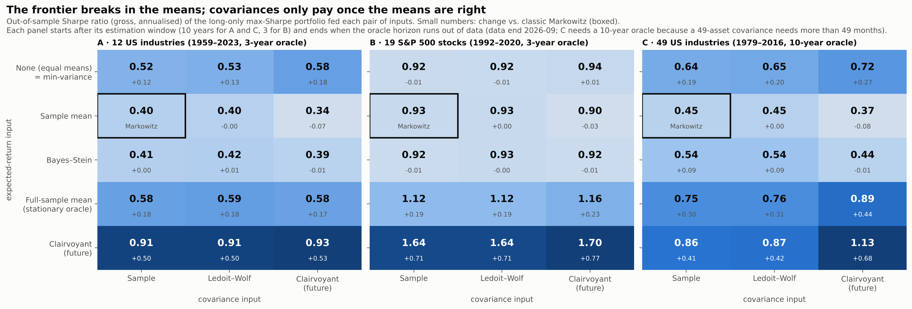
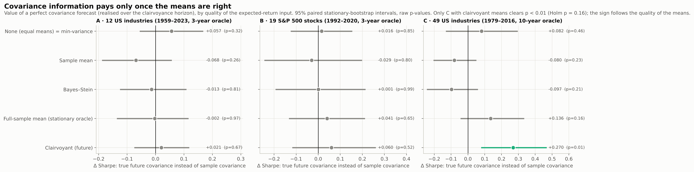
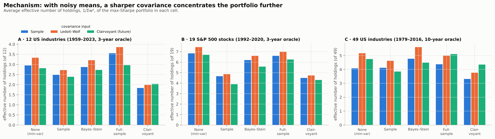
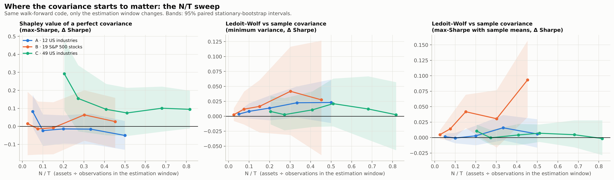
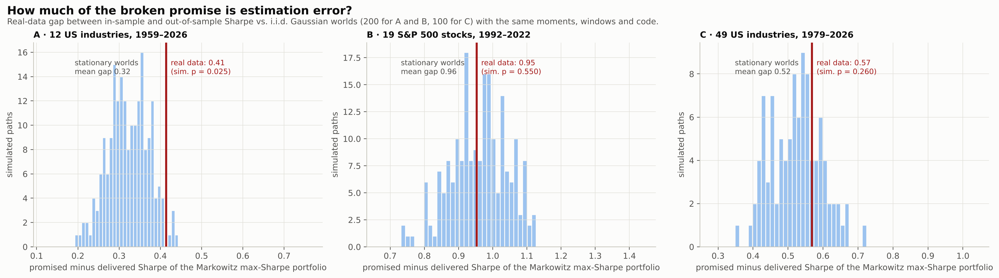
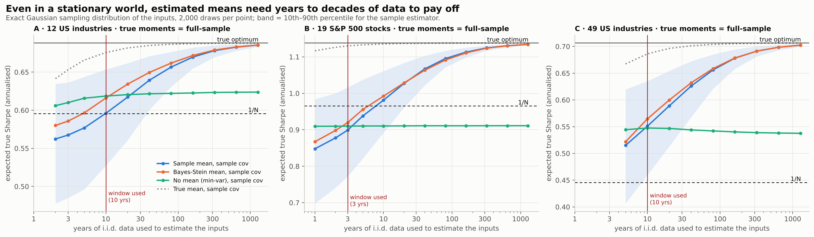
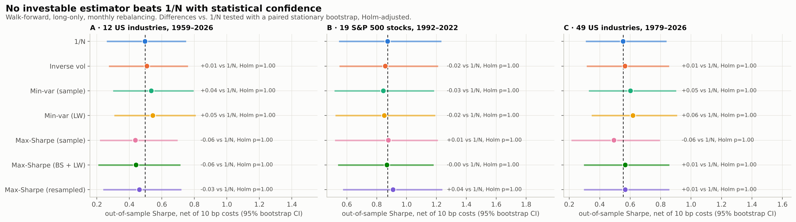
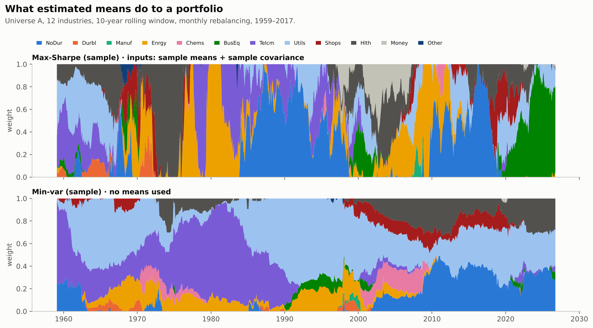

# Where Does the Efficient Frontier Break?

**An oracle experiment that splits mean-variance's out-of-sample failure between expected returns and covariances, across 12 and 49 US industries (1949–2026) and three decades of large-cap stocks**

*Project 05 of [30 Quant Research Projects](../README.md) · Working paper, November 2026*



---

## Abstract

Everyone who has drawn an efficient frontier has heard that it "does not work out of sample". The usual
explanation is error maximisation: the optimiser takes its most extreme positions exactly where the
inputs are most wrong. That explanation leaves out which inputs are to blame. Expected returns and
covariances get blamed together, and the literature then fixes both at once (shrink the means, shrink the
covariance, resample everything).

I separate them with a **clairvoyance experiment**. At every rebalance of a walk-forward backtest, a
long-only max-Sharpe optimiser gets one of five expected-return inputs (none, sample, Bayes–Stein,
the full-sample average, or the *true* future average) crossed with one of three covariance inputs (sample,
Ledoit–Wolf, or the *true* future covariance). That makes 15 portfolios per date, and the gaps between them
put a price on each kind of perfect information. I run it on three universes that share no assets with
project 01: **12 US industries (monthly, 1949–2026)**, **49 US industries (monthly, 1969–2026)** and
**19 S&P 500 stocks (daily, 1990–2022)**. A sweep over the estimation window moves the ratio of assets to
observations (N/T) from 0.03 to 0.82, and a stationary Gaussian counterfactual (100–200 simulated worlds per
universe, same code) separates estimation error from non-stationarity.

**Main findings**

1. **The frontier breaks in the means, in every universe and at every N/T tested.** In a Shapley split of
   what perfect information is worth, expected returns account for **105% of it for 12 industries
   (95% CI 89–130%), 98% for stocks (78–131%) and 86% for 49 industries (64–106%)**. Perfect means add
   +0.55 to +0.75 of Sharpe; perfect covariances add −0.02 to +0.09, never significantly.
2. **Covariance information only pays once the means are good.** The value of a perfect covariance rises with
   the quality of the mean input in all three universes. With 49 industries the interaction is large and
   significant: a perfect covariance adds **+0.27 (p = 0.008) when the means are also perfect**, but −0.08
   with sample means. The interaction term is +0.35 [0.15, 0.55], p = 0.0005. With 12 assets it is +0.09 (p = 0.18).
3. **What drives the value of covariance information is the number of assets, not N/T.** Across the window sweep,
   the covariance Shapley value stays around zero at every N/T for 12 industries and 19 stocks (N/T up to 0.5) and stays
   positive at every N/T for 49 industries (+0.07 to +0.29). A richer cross-section gives the risk model
   more to work with. A shorter window does not.
4. **Ledoit–Wolf shrinkage is close to irrelevant for long-only portfolios.** For minimum variance it never
   changes the Sharpe ratio significantly (largest effect +0.04 across 16 window settings). It helps only for
   max-Sharpe on stocks with very short windows (+0.09 at N/T = 0.45). The long-only constraint already acts
   as shrinkage (Jagannathan & Ma 2003).
5. **No investable estimator beats 1/N after Holm correction**, in any universe, net of 10 bp costs. Minimum
   variance with Ledoit–Wolf is the best point estimate on both industry sets (+0.05 and +0.06 Sharpe) and loses
   7 to 15 percentage points less than 1/N in the 1987, 2008 and 2022 crashes.
6. **Theory says Markowitz should win on 49 industries. It does not.** In a stationary world with the same
   moments, sample max-Sharpe beats 1/N with 92% probability on 10 years of data and should be +0.10 Sharpe ahead.
   On real data it is −0.05 behind (p = 0.06 against the simulation). For 12 industries the broken promise
   is also larger than estimation error alone explains (p = 0.025; about 22% of the gap is non-stationarity).
   For stocks, estimation error explains all of it.

**The practical message.** For a long-only investor, effort spent on the covariance matrix is mostly wasted
until there is a defensible view on expected returns. Better covariances become valuable as the cross-section
grows *and* the means improve, not before. Without such a view, "no view" (minimum variance or 1/N) is the
benchmark to beat, and nothing here beats it with confidence.

---

## 1. Why this question

The out-of-sample failure of mean-variance is one of the best documented results in finance (Michaud 1989;
Chopra & Ziemba 1993; Kan & Zhou 2007; DeMiguel, Garlappi & Uppal 2009). Chopra & Ziemba made the first
attempt at attribution: they perturbed means, variances and covariances around a fixed "true" input and found
that errors in means cost roughly ten times as much as errors in variances. That was a sensitivity analysis
on a hypothetical. It did not answer the question an investor actually faces: **if I could buy perfect
foresight on one input, which one should I buy, and how much is it worth out of sample, on real data where
the "truth" changes over time?**

The clairvoyance design answers that directly and makes three less obvious comparisons possible:

* **Are means unknowable, or just badly estimated?** The *full-sample* mean is what an investor would know if
  expected returns were constant and 60+ years of data were available. If it helps, the problem is sample size.
* **Does better covariance information interact with bad means?** If the errors come from the means, a sharper
  covariance might make things worse by letting the optimiser act on them more aggressively.
* **Does the answer flip in high dimensions?** Random-matrix theory says the sample covariance degrades as N/T
  grows. If the covariance ever becomes the bottleneck, a window sweep should show it.

## 2. Data

| | A · 12 industries | B · 19 stocks | C · 49 industries |
|---|---|---|---|
| Assets | Fama–French 12 industry portfolios (value-weighted) | 19 S&P 500 constituents | Fama–French 49 industry portfolios (value-weighted) |
| Frequency | monthly excess returns | daily simple returns | monthly excess returns |
| Sample | 1949-01 to 2026-09 (933 months) | 1990-01 to 2022-12 (8,312 days) | 1969-07 to 2026-09 (687 months) |
| Out-of-sample (horse race) | 1959-01 to 2026-09 (813 months) | 1992-12 to 2022-12 | 1979-07 to 2026-09 (567 months) |
| Factorial sample (needs future data) | 1959-01 to 2023-10 (778 months) | 1992-12 to 2020-01 (6,804 days) | 1979-07 to 2016-10 (448 months) |
| Source | Ken French data library, CRSP vintage 2026-09 | `skfolio.datasets.load_sp500_dataset` | Ken French data library, CRSP vintage 2026-09 |

Industry returns are in excess of the one-month T-bill from the same library. C starts in 1969-07 because
several of the 49 industries have missing data before then. The raw library files are kept in `data/raw/`
and `src/data.py` rebuilds the panels from them.

**Data vintage.** An earlier version of this study used the 2017 vintage of the same library (as shipped in
`linearmodels`). On the overlapping months the two vintages correlate at 0.997, with a mean absolute difference of 0.1% a month,
which comes from CRSP revisions. Every headline result held in both vintages. The numbers here are from the 2026 vintage.

**Data decisions fixed before any backtest.** In B, an asset is excluded if more than 30% of its daily returns
are exactly zero in any calendar year (stale prices). This removes only RRC (92% zeros in 1990). B has no risk-free
series, so its Sharpe ratios use raw returns. That changes levels, not comparisons between portfolios.

**Known flaw: survivorship.** The 19 stocks are large caps *as of 2022*, so their full-sample means are inflated
by hindsight. That flatters the "full-sample mean" row in B. The industry universes are built from all listed
firms and have no such bias, which is why they carry the main conclusions.

## 3. Design

**Walk-forward.** At each rebalance the estimation window is the previous *W* observations (A and C: 120 months;
B: 756 days ≈ 3 years). Portfolios are held until the next rebalance (A and C: 1 month; B: 21 trading days),
with weights drifting with prices in between. Turnover is measured against drifted weights and charged 10 bp
one way. All portfolios are long-only and fully invested. The long-only max-Sharpe problem is solved exactly
as a quadratic program (minimise y′Σy subject to μ′y = 1, y ≥ 0, then normalise).

**The 5 × 3 information factorial.** The long-only max-Sharpe portfolio is computed for every pair of

| Expected-return input | Covariance input |
|---|---|
| **None**: equal means, which makes max-Sharpe identical to minimum variance | **Sample** |
| **Sample** mean of the window | **Ledoit–Wolf** (2004), shrunk towards a scaled identity |
| **Bayes–Stein** (Jorion 1986), shrunk towards the minimum-variance portfolio's mean | **Clairvoyant**: realised covariance over the next *H* observations |
| **Full-sample**: average over the whole dataset (the "stationary oracle") | |
| **Clairvoyant**: realised mean over the next *H* observations | |

The clairvoyance horizon *H* is 36 months in A, 756 days in B and 120 months in C. C needs a longer horizon
because a covariance of 49 assets estimated on fewer than 49 months is singular. The clairvoyant cells are
the only place where look-ahead is used, on purpose. Because each clairvoyant cell needs *H* observations of future data, the factorial sample ends *H* before the data do: in 2023-10 for A, but in 2016-10 for C (2026-09 minus 10 years). It starts in 1979-07 for C because the 49-industry data begin in 1969-07 and the first estimation window takes 10 years. The horse race, which needs no future data, runs to 2026-09 in both. Sample × Sample is classic Markowitz.

**Shapley split.** On the 2 × 2 corner {Sample, Clairvoyant} × {Sample, Clairvoyant}, the value of perfect mean
information is the average of its two marginal contributions, and likewise for the covariance. The two values
add up to the total gain. The **interaction** (CC − CS − SC + SS) measures how much one kind of information is
worth more when the other is present.

**The horse race** uses only investable strategies: 1/N, inverse volatility, minimum variance (sample and LW),
max-Sharpe (sample), max-Sharpe (Bayes–Stein means + LW covariance) and Michaud (1998) resampled max-Sharpe
(100 draws per rebalance, Wishart for the covariance).

**N/T sweep.** The same code with estimation windows of 24–240 months (A), 60–240 months (C) and 42–756 days (B),
which moves N/T from 0.025 to 0.82.

**Stationary counterfactual.** For each universe I simulate i.i.d. Gaussian paths (200 for A and B, 100 for C)
with the full-sample mean and covariance and the real length, then run *the same code* on them. What
survives there is pure estimation error. The residual on real data is non-stationarity. A separate exact
calculation draws inputs from their Gaussian sampling distribution (2,000 draws per point) to ask how many
years of data each estimator needs.

**Statistics.** Sharpe ratios and their differences use a paired stationary bootstrap (Politis & Romano 1994;
mean block 12 months for A and C, 63 days for B; 2,000 replications), so all strategies are resampled on the
same dates. P-values come from the centred bootstrap distribution. Families are Holm-corrected: the 6
comparisons with 1/N per universe, and the 22 factorial effects per universe.

**Pre-registration, honestly stated.** The A and B universes, windows, cost level, estimators, factorial levels,
bootstrap settings, robustness grid and hypotheses H1, H2 and H4 were fixed in `src/config.py` before the first
run. Universe C, the N/T sweep and the shorts variant were added afterwards in response to an internal review that asked whether
the result would flip in higher dimensions. H3 was relabelled exploratory after the first run and H5 was
written before C was run.

* **H1** The Markowitz portfolio delivers less than it promises. *Supported, trivially.*
* **H2** Expected returns account for more than half of the value of perfect information. *Supported in all three universes.*
* **H3** (exploratory) Perfect covariance information has negative value under estimated means. *Point estimates negative in 14 of 17 variants; significant in 2. See 4.3.*
* **H4** No investable estimator beats 1/N after costs. *Not rejected anywhere.*
* **H5** (added with C) At high N/T the covariance share of the value of information rises above one half. *Rejected: it peaks at 38% (C, W = 240).*

## 4. Results

### 4.1 The factorial: means carry almost all of the value

Figure 1 (top of page) shows out-of-sample Sharpe ratios (gross) for all 15 cells. Going down the rows
from sample to clairvoyant means adds +0.50 (A), +0.41 (C) and +0.71 (B) with the sample covariance.
Going across the columns from sample to Ledoit–Wolf changes nothing by more than 0.012 in any of the 15 rows.

| Shapley value of perfect information | A · 12 industries | B · 19 stocks | C · 49 industries |
|---|---|---|---|
| Expected returns | **+0.55** [0.35, 0.75] | **+0.75** [0.51, 1.05] | **+0.58** [0.28, 0.89] |
| Covariances | −0.02 [−0.11, 0.06] | +0.02 [−0.16, 0.21] | +0.09 [−0.03, 0.23] |
| Share due to means | **105%** [89%, 130%] | **98%** [78%, 131%] | **86%** [64%, 106%] |
| Interaction (means × covariance) | +0.09 [−0.04, 0.21], p = 0.18 | +0.09 [−0.09, 0.28], p = 0.33 | **+0.35 [0.15, 0.55], p = 0.0005** |
| Classic Markowitz (Sample × Sample) | 0.40 | 0.93 | 0.45 |
| Perfect information (Clairvoyant × Clairvoyant) | 0.93 | 1.70 | 1.13 |

The exact stationary calculation gives the same ranking from first principles. At the window actually used,
knowing the true covariance but estimating the means costs 0.089 (A), 0.152 (C) and 0.238 (B) of Sharpe against the true
optimum. Knowing the true means but estimating the covariance costs 0.013, 0.020 and 0.008. **Even in a world built to
be estimable, 88% (A), 88% (C) and 97% (B) of the loss comes from the means.**

### 4.2 Are means unknowable, or just badly estimated?

The *full-sample* row answers this. Replacing the trailing 10-year mean with the long-run average raises the Sharpe
ratio by +0.18 in A (Holm p = 0.045 with LW, 0.088 with the sample covariance) and +0.30 in C (raw p = 0.03, Holm 0.38).
**Long-run industry premia exist and are stable enough to matter, but a 10-year window is far too short to see them.**
In B the gain (+0.19) is not significant and is partly survivorship.

The *None* row asks whether estimated means are better than no means. Minimum variance beats the sample mean by
+0.12 (A) and +0.19 (C), not significant after Holm, and ties in B (−0.01). **Trailing sample means carry somewhere
between zero and negative information.** Bayes–Stein helps a little in C (+0.09, raw p = 0.04) and not at all in A or B.

### 4.3 Covariance information pays only once the means are right



Figure 2 plots the value of the true future covariance at each level of mean quality. The ordering is the same
in all three universes. The value is negative or zero with sample or Bayes–Stein means (A −0.07, C −0.08 and −0.10,
B −0.03) and positive with clairvoyant means (A +0.02, C **+0.27**, B +0.06). Only the C value with clairvoyant means
is individually significant (raw p = 0.008, Holm 0.16 among 22 effects), but the interaction test in 4.1, which is a single
pre-specified contrast, is decisive for C (p = 0.0005).

Robustness of the value of the clairvoyant covariance **given sample means**:

| Variant | A · 12 industries | B · 19 stocks | C · 49 industries |
|---|---|---|---|
| Main | −0.068 (p = 0.26) | −0.029 (p = 0.80) | −0.080 (p = 0.23) |
| Shorter window (A, C: 5y; B: 1y) | −0.051 (p = 0.31) | −0.085 (p = 0.29) | +0.002 (p = 0.98) |
| Longer window (A, C: 20y; B: 5y) | +0.075 (p = 0.26) | −0.052 (p = 0.60) | **+0.238 (p = 0.04)** |
| Shorter horizon (A: 5y; C: 5y; B: 1y) | −0.096 (p = 0.10) | −0.021 (p = 0.85) | −0.017 (p = 0.85) |
| Longer horizon (A: 10y; B: 5y) | **−0.106 (p = 0.03)** | −0.050 (p = 0.63) | — |
| Shorts allowed (w ≥ −30%) | −0.041 (p = 0.65) | −0.094 (p = 0.43) | **−0.390 (p = 0.015)** |

Fourteen of 17 variants are negative. The variants share most of their data and are not independent, so this is
a consistent sign, not a significant result. The two positive exceptions with real size are the 20-year windows, where
the sample means are least noisy, and they are exactly where the interaction story predicts a positive value. In the stationary simulation the
same effect is on average *positive* (+0.03 in A, +0.02 in C, +0.01 in B), so the negative sign on real data is not a
property of the estimator.



The mechanism is visible in the weights (Figure 3). With sample means, the clairvoyant covariance makes the portfolio
more concentrated in all three universes (effective holdings: A 2.5 → 2.4, C 4.1 → 3.9, B 4.7 → 3.9). An accurate
risk model tells the optimiser precisely which combinations are cheap in risk, and it spends that budget on
whichever assets the noisy mean favours. With clairvoyant means in C, the same covariance *diversifies* the
portfolio (3.3 → 4.4 holdings), because now the bets it enables are right. Allowing shorts gives the optimiser more
room to act on noise, and the C penalty grows from −0.08 to −0.39.

### 4.4 The N/T sweep: does the covariance ever become the bottleneck?



The concern this sweep addresses is that 12–19 assets with 120 months or 3 years of data are a comfortable N/T, and
the covariance might matter at higher dimension. The same code was run with 16 estimation windows:

| | A · 12 industries | B · 19 stocks | C · 49 industries |
|---|---|---|---|
| N/T range | 0.05–0.50 | 0.03–0.45 | 0.20–0.82 |
| Shapley value of covariance | −0.05 to +0.08, all CIs cross 0 | −0.01 to +0.06, all CIs cross 0 | **+0.07 to +0.29**, positive at every N/T; significant at W = 240 (0.29 [0.09, 0.48]) |
| Covariance share of the value of information | ≤ 15% | ≤ 8% | 13% to 38% |
| LW − sample, minimum variance | ≤ +0.02, n.s. | ≤ +0.04, n.s. | ≤ +0.02, n.s. |
| LW − sample, max-Sharpe with sample means | ≤ +0.02, n.s. | **+0.04 at N/T = 0.15, +0.09 at N/T = 0.45** | ≤ +0.01, n.s. |

Three conclusions follow, and the first is the reverse of what the textbook view predicts:

1. **The value of covariance information depends on N, not on N/T.** Shortening the window in A or B never makes
   the covariance matter. Moving from 12 to 49 industries does, at every window. In C the covariance value is *largest*
   at the lowest N/T (W = 240), where the means are also least noisy. This is the interaction again.
2. **Means stay the bottleneck at every N/T tested.** The covariance share never exceeds 38%, so H5 is rejected.
3. **Ledoit–Wolf earns its keep only for single stocks at short windows**, where daily sample covariances of 19 names on 42–126
   days are noisy enough for shrinkage to help max-Sharpe. For long-only minimum variance it is never significant,
   consistent with Jagannathan & Ma (2003): the no-short constraint already shrinks the extreme covariance estimates.

The sweep stops at N/T = 0.82 because a long-only optimiser with a full-rank sample covariance needs T > N. The
regime where Ledoit–Wolf is known to matter most (N/T > 1, hundreds of stocks, shorts allowed) is outside this study
and is taken up in project #24 (PCA statistical arbitrage).

### 4.5 Promise vs delivery



| Markowitz max-Sharpe | A · 12 industries | B · 19 stocks | C · 49 industries |
|---|---|---|---|
| Promised (average in-sample Sharpe) | 0.86 | 1.85 | 1.08 |
| Delivered (out-of-sample, gross) | 0.45 | 0.90 | 0.51 |
| Gap | 0.41 | 0.95 | 0.57 |
| Gap in stationary worlds (mean; 95th pct.) | 0.32; 0.40 | 0.96; 1.09 | 0.52; 0.64 |
| P(stationary gap ≥ real gap) | **0.025** | 0.55 | 0.26 |
| Share of gap from non-stationarity | **22%** | ≈ 0% | 8% |
| Max-Sharpe minus 1/N: real vs stationary | −0.05 vs 0.00 (p = 0.21) | +0.02 vs −0.06 (p = 0.77) | **−0.05 vs +0.10 (p = 0.06)** |

Single stocks are so noisy that estimation error explains the whole gap. Industries are less noisy, and what is left
shows that their expected returns *move*. C adds a sharper version of the same point: with 49 industries, a stationary
world says Markowitz should beat 1/N by 0.10 of Sharpe, and the real world says it loses by 0.05. Only 6% of the
simulated worlds are that bad.

### 4.6 How many years would you need?



Using the exact Gaussian sampling distribution of the inputs (2,000 draws per point):

| Years of data | P(sample max-Sharpe beats 1/N): A | B | C |
|---|---|---|---|
| 3 | 38% | 24% | — |
| 5 | 45% | 43% | 80% |
| 10 | 57% | 64% | 92% |
| 20 | 75% | 89% | 98% |
| 40 | 92% | 99% | 100% |

The answer depends on how much room the true optimum leaves over 1/N. In C the true tangency portfolio (Sharpe 0.71) is far
ahead of 1/N (0.45), so even noisy means win in theory within 5 years. In A the gap is small (0.69 vs 0.60) and the
sample-mean optimiser needs about 30 years to catch up with simple minimum variance. These are *best-case* numbers.
They assume the moments never change, and Section 4.5 shows that for industries they do.

### 4.7 The horse race



| Net Sharpe (10 bp) | A | Δ vs 1/N [95% CI] | B | Δ vs 1/N [95% CI] | C | Δ vs 1/N [95% CI] |
|---|---|---|---|---|---|---|
| 1/N | 0.50 | — | 0.87 | — | 0.55 | — |
| Inverse vol | 0.51 | +0.01 [−0.00, 0.03] | 0.86 | −0.02 [−0.08, 0.05] | 0.57 | +0.01 [−0.01, 0.04] |
| Min-var (sample) | 0.53 | +0.04 [−0.09, 0.16] | 0.84 | −0.03 [−0.22, 0.15] | 0.60 | +0.05 [−0.12, 0.21] |
| Min-var (LW) | **0.54** | +0.05 [−0.07, 0.17] | 0.85 | −0.02 [−0.20, 0.16] | **0.62** | +0.06 [−0.09, 0.22] |
| Max-Sharpe (sample) | 0.44 | −0.06 [−0.19, 0.07] | 0.88 | +0.01 [−0.25, 0.23] | 0.49 | −0.06 [−0.26, 0.14] |
| Max-Sharpe (BS + LW) | 0.44 | −0.06 [−0.16, 0.06] | 0.87 | −0.00 [−0.21, 0.17] | 0.57 | +0.01 [−0.15, 0.19] |
| Max-Sharpe (resampled) | 0.46 | −0.03 [−0.13, 0.06] | **0.91** | +0.04 [−0.16, 0.20] | 0.57 | +0.01 [−0.14, 0.18] |

Every Holm-adjusted p-value is 1.00 (smallest raw p = 0.17). Turnover per year ranges from 0.27 (1/N, A) to 3.7
(max-Sharpe, B), and the max-Sharpe book holds 2.4 (A), 4.1 (C) and 4.6 (B) effective positions. These results are consistent with DeMiguel et al. (2009),
here on a 68-year walk-forward with costs.

**Costs.** Raising costs from 0 to 50 bp moves max-Sharpe (sample) minus 1/N from −0.05 to −0.10 in A and from +0.02 to −0.05 in B.
Minimum variance with LW stays ahead of 1/N on both industry sets at every cost level (+0.03 to +0.07). Full table in `results/*_cost_sensitivity.csv`.



Figure 7 shows why max-Sharpe struggles. With sample means, the 12-industry portfolio rotates between two or three sectors at a time,
for example 100% energy for long stretches around 1980. Without means, minimum variance holds a stable, utility-heavy book.

### 4.8 Crises

Cumulative net return inside each stress window:

| | 1973–74 (A) | 1987 (A) | 2000–02 (A) | 2008 (A) | 2008 (C) | 2008 (B) | 2020 COVID (A) | 2020 COVID (B) | 2022 (A) | 2022 (C) | 2022 (B) |
|---|---|---|---|---|---|---|---|---|---|---|---|
| 1/N | −52% | −30% | −35% | −46% | −48% | −43% | −23% | −11% | −14% | −14% | 0% |
| Min-var (LW) | **−44%** | **−17%** | **−31%** | **−31%** | −36% | **−33%** | −19% | −13% | **−7%** | **−2%** | **+11%** |
| Max-Sharpe (sample) | −54% | −29% | −44% | −41% | **−35%** | −43% | **−18%** | **−3%** | −21% | −8% | −12% |
| Max-Sharpe (resampled) | −53% | −28% | −41% | −39% | −36% | −39% | −18% | −5% | −20% | −7% | −12% |

Minimum variance gives the best or near-best protection in almost every window. The exceptions are COVID and 2008 in C, where
max-Sharpe happened to hold the recent winners. In B those winners were Microsoft, Eli Lilly, Walmart and Coca-Cola.
That is momentum, not foresight, and it reversed in 2022, when max-Sharpe was the worst strategy in A and B.

## 5. What this means in practice

1. **For a long-only book, do not start with the covariance matrix.** Shrinkage, factor models and even perfect foresight
   move the Sharpe ratio by hundredths until the means are good. The covariance starts to pay with a larger cross-section *and*
   a credible mean model, and the two have to come together.
2. **Treat the expected-return input as the actual investment decision.** It is worth +0.5 to +0.75 of Sharpe if right, and it
   is what makes Markowitz worse than 1/N if wrong. Without a view you can defend, use none: minimum variance or 1/N.
3. **Longer is better than cleverer.** On industries, a long-run average beat a 10-year average by more than any shrinkage
   estimator. If premia must be estimated, pool across time or across assets with a pricing model (project #17) rather than
   shrinking a short sample.
4. **Do not trust the frontier's promise.** The in-sample Sharpe ratio was about twice the out-of-sample one in every
   universe. Project #23 (Deflated Sharpe) formalises this haircut.

## 6. Referee self-review

Before publishing, I reviewed the study as a hostile referee would. The objections and responses follow.

**"12 to 19 assets is a toy. Of course the covariance doesn't matter."** This was the strongest objection to the first
version. Answer: universe C (49 assets) and the N/T sweep (N/T up to 0.82) were added. The covariance does start to
matter with 49 assets, but only through the interaction with good means, and never enough to overturn H2. The regime N/T > 1
remains untested, and the claims are limited to N ≤ 49.

**"The clairvoyance horizon differs across universes (3 years in A, 10 years in C), so A and C are not comparable."** True, and
it cannot be avoided: a 49-asset covariance needs more than 49 months. Robustness rows with a 5-year horizon in C (−0.017) and
5- and 10-year horizons in A (−0.10, −0.11) give the same sign. The A-versus-C contrast in the interaction may partly reflect the
horizon as well as N, and I flag that rather than claim N alone drives it.

**"A clairvoyant covariance estimated over 36 months is noisier than a 120-month sample covariance."** Partly true in A, which is
why the concentration evidence is also shown for B (both covariances on 756 days) and C (clairvoyant horizon 120 months, the same
length as the window). The mechanism appears in all three.

**"Long-only is a strong constraint and hides the problem."** Correct, and that is part of the finding. The shorts variant
(w ≥ −30%) lowers the means' share to 89% (A) and 79% (C) and makes the negative covariance interaction much larger in C (−0.39,
p = 0.015). Unconstrained mean-variance is a different and worse problem. The conclusions here are for long-only and lightly
levered books.

**"You ran many variants and are reporting the ones that look good."** All variants are reported, including the inconvenient
ones (the 20-year windows with a positive covariance value, and B where nothing is significant). The 22 factorial effects and 6
horse-race comparisons are Holm-corrected. The interaction is a single contrast specified in the design. H5 was written down
before C was run, and it was rejected.

**"Universe C and the N/T sweep were added after seeing the results."** Yes. They were added to answer a reviewer's question, not to
rescue a result, and they *weakened* the original headline: in v1 the covariance looked worthless everywhere, and C shows it is not.

**"Survivorship in B."** Acknowledged in Section 2. B is never used alone for a conclusion. Every claim is supported by an industry
universe without survivorship.

**"The Gaussian counterfactual has no fat tails or volatility clustering."** True (project #01 shows these matter for risk). For a
comparison of monthly-rebalanced Sharpe ratios the effect is second-order, but the p-values in Section 4.5 should be read as approximate.

**"Costs of 10 bp are too low for 49 industries or single stocks."** The cost table goes to 50 bp. Higher costs only hurt the
high-turnover max-Sharpe strategies, which strengthens the conclusion against them.

**"Bootstrap p-values on Sharpe differences are fragile."** The paired stationary bootstrap respects autocorrelation and the
cross-correlation of strategies (Ledoit & Wolf 2008 recommend the same approach). With 448–813 months, a 0.1 Sharpe difference
has a standard error of about 0.07, so the study is powered for effects of about 0.15 and above. It is not powered for the smaller ones.

## 7. Limitations

* **Statistical power.** Most covariance effects are in the ±0.1 range, below what 40–68 years of monthly data can resolve.
* **N ≤ 49 and N/T < 1.** The high-dimensional regime is outside the study.
* **Long-only** (with one light-shorting variant).
* **"Clairvoyant" means a multi-year average, not the next month.** A clairvoyant one-month mean would trivially dominate everything.
* **Survivorship and no risk-free rate** in B. **Prices rounded to 3 decimals** in B, which adds tiny noise to early daily returns of low-priced shares.
* **B ends in 2022** (the vintage of the package). The industry universes run to September 2026.
* **Gaussian counterfactual** without fat tails.

## 8. Reproduce

```bash
pip install -r requirements.txt
./run_all.sh        # tests, backtests, simulations, N/T sweep, statistics, figures (~25 min on 4 cores)
```

Seeds are fixed in `src/config.py`. `src/data.py` rebuilds `data/*.csv` from `data/raw/` (Ken French files) and
`skfolio`. `src/fetch_kf.js` documents how the raw files were downloaded. The unit tests cover the optimisers
(against a generic solver and the closed-form tangency), Ledoit–Wolf (against scikit-learn), the absence of
look-ahead in every investable strategy, cost accounting, the Holm correction and the bootstrap.

## 9. Repository layout

```
05-efficient-frontier/
├── README.md               this paper
├── LINKEDIN_POST.md
├── run_all.sh  requirements.txt
├── data/                   raw/ (Ken French files) + the three return panels
├── src/
│   ├── config.py           every design choice
│   ├── data.py             builds the three universes
│   ├── portfolio.py        estimators (sample, Ledoit–Wolf, Bayes–Stein) and long-only QP optimisers
│   ├── backtest.py         walk-forward horse race + 5×3 information factorial
│   ├── simulate.py         stationary counterfactual and "years of data needed"
│   ├── sweep.py            N/T sweep
│   ├── evaluate.py         bootstrap tests, Holm, Shapley split, stress, robustness, costs
│   └── figures.py
├── tests/                  pytest suite
├── results/                every number in this paper, as CSV (summary.csv has the headline numbers)
├── figures/
└── study/                  ESTUDIO_05.pdf (plain-Spanish study notes)
```

## References

* Chopra, V. & Ziemba, W. (1993). The effect of errors in means, variances, and covariances on optimal portfolio choice. *Journal of Portfolio Management* 19(2).
* DeMiguel, V., Garlappi, L. & Uppal, R. (2009). Optimal versus naive diversification: how inefficient is the 1/N portfolio strategy? *Review of Financial Studies* 22(5).
* Jagannathan, R. & Ma, T. (2003). Risk reduction in large portfolios: why imposing the wrong constraints helps. *Journal of Finance* 58(4).
* Jorion, P. (1986). Bayes–Stein estimation for portfolio analysis. *Journal of Financial and Quantitative Analysis* 21(3).
* Kan, R. & Zhou, G. (2007). Optimal portfolio choice with parameter uncertainty. *Journal of Financial and Quantitative Analysis* 42(3).
* Ledoit, O. & Wolf, M. (2004). A well-conditioned estimator for large-dimensional covariance matrices. *Journal of Multivariate Analysis* 88(2).
* Ledoit, O. & Wolf, M. (2008). Robust performance hypothesis testing with the Sharpe ratio. *Journal of Empirical Finance* 15(5).
* Markowitz, H. (1952). Portfolio selection. *Journal of Finance* 7(1).
* Michaud, R. (1989). The Markowitz optimization enigma: is "optimized" optimal? *Financial Analysts Journal* 45(1).
* Michaud, R. (1998). *Efficient Asset Management*. Harvard Business School Press.
* Politis, D. & Romano, J. (1994). The stationary bootstrap. *Journal of the American Statistical Association* 89(428).
* Shapley, L. (1953). A value for n-person games. *Contributions to the Theory of Games* II.
