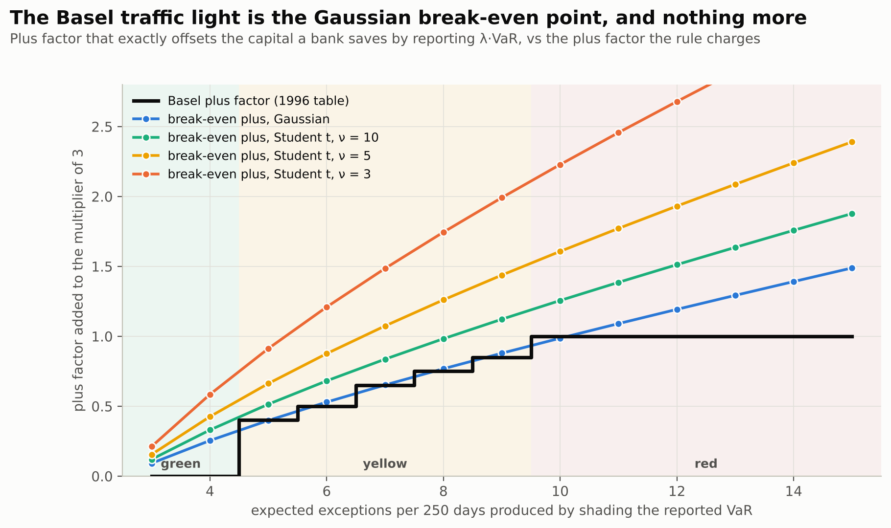
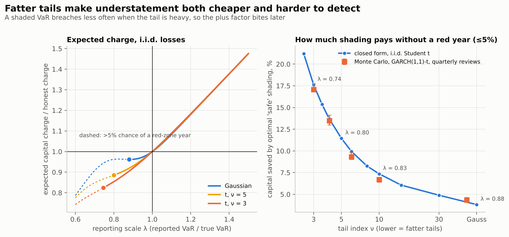
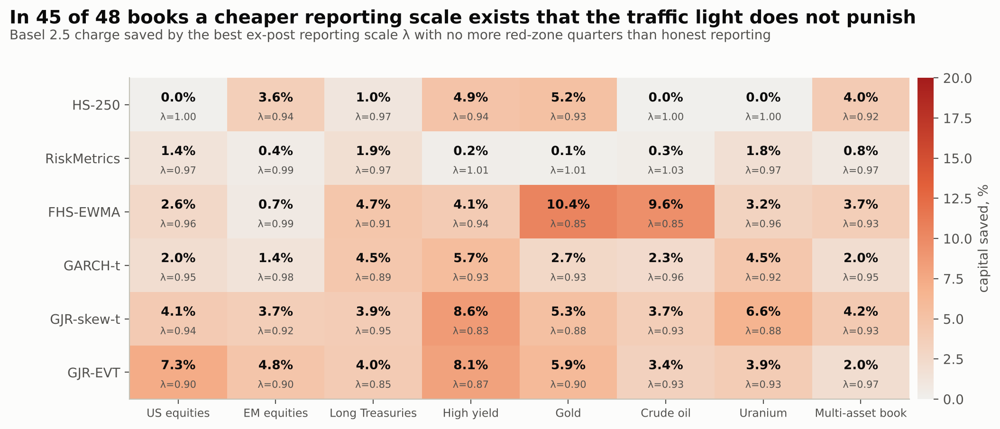
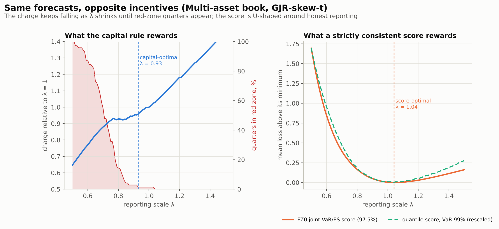
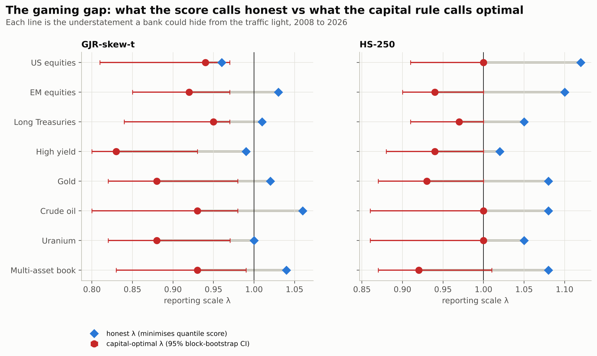
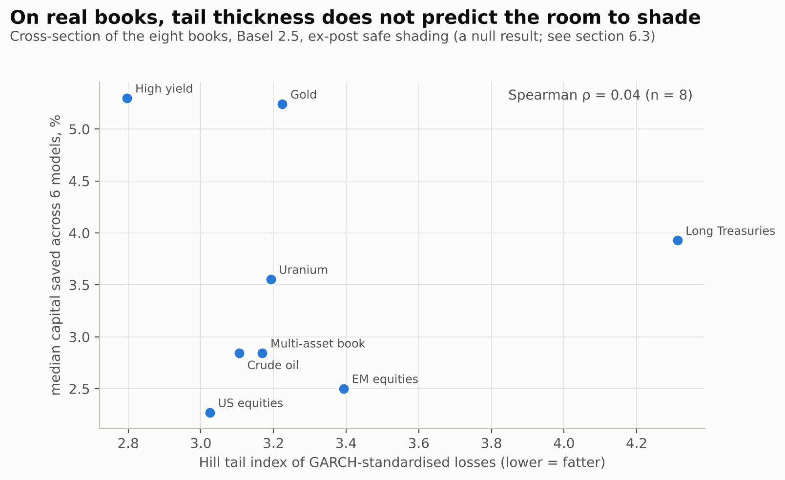
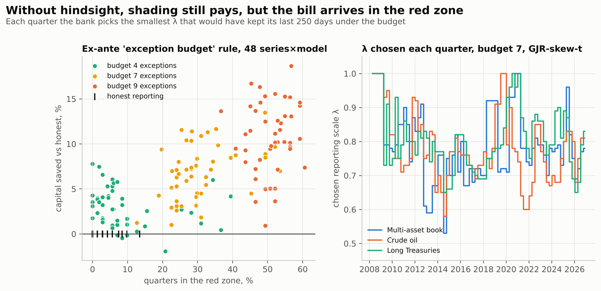
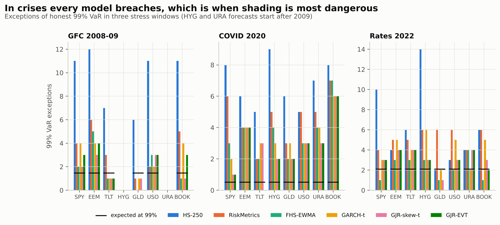

# Is It Cheaper to Be Wrong?

**The incentive structure of the Basel VaR traffic light: closed form, Monte Carlo and 216,552 out-of-sample forecasts, 2008–2026**

*Project 06 of [30 Quant Research Projects](../README.md) · Working paper, November 2026*



---

## Abstract

A Value-at-Risk calculator is usually judged by how often its forecast is breached. Regulators turn
those breaches into money: since 1996 a bank's market-risk charge is a multiple of its own reported
VaR, and the multiple rises (the "plus factor") only when the bank sees five or more breaches in 250
days. This project asks whether that rule makes honest reporting the cheapest strategy, or whether
a bank that **shades** its VaR by a factor λ < 1 pays less capital than it is penalised.

The analysis has three parts. A **closed form** under i.i.d. losses gives the plus factor that would
exactly offset the capital saved by shading. A **Monte Carlo** with GARCH(1,1)-t losses and the real
quarterly review mechanics checks it. Then an **empirical test** runs six standard VaR/ES models
(historical simulation, RiskMetrics, filtered HS, GARCH-t, GJR-GARCH skew-t, GJR-GARCH + EVT) strictly
out of sample on seven ETFs and a multi-asset book, from April 2008 to November 2026, under both the
Basel 2.5 rule and the FRTB rule.

**Main findings**

1. **The 1996 traffic light is the Gaussian break-even schedule, almost to the second decimal.** If
   losses are normal, the plus factor that exactly cancels the saving from shading is 0.40, 0.65, 0.88
   and 0.99 at 5, 7, 9 and 10 expected exceptions. The Basel table charges 0.40, 0.65, 0.85 and 1.00.
   Under normality, shading is roughly a zero-sum bet; the best "safe" shading saves 3.8% of capital.
2. **With fat tails it is not.** With Student-t losses (ν = 3), the break-even plus factor at 10
   exceptions is 2.23, more than twice what the table charges. A bank can report 75% of its true VaR,
   keep the chance of a red-zone year under 5%, and save **17.6%** of its capital (GARCH Monte Carlo:
   17.1%, 95% CI 16.8–17.8%). The saving falls monotonically from 21% at ν = 2.5 to 3.8% at the
   Gaussian limit. FRTB inherits the same incentive because its plus factor follows the same counts.
3. **On real data the hidden room is smaller but systematic.** For every one of the 48 series × model
   cells, the capital-minimising reporting scale lies *below* the scale a strictly consistent score
   calls honest (median gap 0.12). Without adding a single red-zone quarter, the median cell could have
   cut its Basel 2.5 charge by 3.7% relative to its own forecast (up to 10.4%), and by 6.0% relative to
   its calibrated forecast. The pre-registered test against λ = 1 passes only just: in 27 of 48 cells
   (needed: 24) the bootstrap CI for the capital-optimal λ lies entirely below 1, and a run with an
   earlier bootstrap seed gave 23, so this count is borderline.
4. **A strictly consistent score points the other way.** The FZ0 joint VaR/ES score and the quantile
   score agree on the honest scale within 0.03 (median), and both are U-shaped around it. The capital
   rule is monotone in λ until red quarters appear.
5. **Without hindsight, the room cannot be harvested safely.** An ex-ante "exception budget" rule
   saves 7.1% (median) when it aims at 7 exceptions a year, but puts the bank in the red zone in 28% of
   quarters, against 0% for honest reporting in most books. The traffic light's real teeth are the red
   zone and crisis clustering, not the plus factor.
6. **Picking the model by capital picks the wrong model.** A bank choosing among its red-free models by
   capital picks the model the FZ0 score ranks best in only 3 of 16 series × regime cases.

**What this means.** A VaR backtest that only counts exceptions is not incentive compatible once
losses have fat tails, which they do on every asset here (Hill tail index 2.8 to 4.3). The fix the
theory suggests is not a steeper table for one distribution but a capital add-on tied to a strictly
consistent score, which rewards the honest forecast for any distribution.

---

## 1. Why this question

Most "VaR calculator" projects compute a number and count how often it was breached. That tells you
whether a forecast is calibrated. It does not answer the question a regulator cares about: **does the
rule that turns breaches into capital make honesty the cheapest strategy?**

The internal-models approach works like this. A bank reports its 99% one-day VaR each day. Its charge is

$$\text{charge}_t = \max\Big(\text{VaR}^{10d}_{t-1},\; (3 + \text{plus}_t)\cdot\tfrac{1}{60}\textstyle\sum_{i=1}^{60}\text{VaR}^{10d}_{t-i}\Big),$$

where the plus factor depends on the number N of days in the last 250 on which the loss exceeded the
reported VaR (green N ≤ 4: 0; yellow 5–9: 0.40 to 0.85; red N ≥ 10: 1.00, and the supervisor may reject
the model). FRTB kept the machinery: 1.5 + plus (0 to 0.50) now multiplies the 97.5% Expected Shortfall,
but the plus factor is still driven by 99% VaR exceptions.

A bank that reports λ·VaR pays λ times less, and is punished only through the plus factor. So the
question has a precise form:

> **Is λ · (3 + E[plus(N) | λ]) minimised at λ = 1?**

Pieces of the answer exist. Pérignon & Smith (2010) and Kerkhof & Melenberg (2004) study banks' reported
VaRs, Berkowitz, Christoffersen & Pelletier (2011) show that exception-count tests have little power at
250 observations, and elicitability theory (Gneiting 2011; Fissler & Ziegel 2016) says that scoring
functions can make honest reporting optimal while ES alone cannot. What I could not find is the direct
calculation: **how much capital the traffic light lets a bank save by shading, how that depends on the
tail of the loss distribution, and what it looks like with real models on real data.**

## 2. Hypotheses and pre-registration

H1 and H2 test the closed form; their thresholds were set after the first theory run, so they are
checks, not pre-registered tests. **H3 to H5 were written down before any capital, shading or
model-choice number was computed** (only the forecasts' exception rates had been looked at).

| | Hypothesis | Falsified if | Result |
|---|---|---|---|
| H1 | Under i.i.d. Gaussian losses the plus-factor table is close to break-even. | Safe shading saves > 5% at ν = ∞ | **Holds** (3.8%) |
| H2 | The saving from safe shading grows as the tail gets fatter. | Saving not monotone in ν | **Holds** (closed form and Monte Carlo) |
| H3 | On real data, most cells have a capital-optimal scale below 1 that adds no red-zone quarters. | < 24 of 48 cells with a 95% block-bootstrap CI for λ_capital entirely below 1 | **Borderline pass** (27/48; 23/48 with another seed); against the calibrated scale: 41/48 |
| H4 | A strictly consistent score does not reward that shading. | Median \|λ_FZ0 − λ_quantile\| > 0.05 | **Holds** (0.03) |
| H5 | Choosing the model by capital does not pick the score-best model. | Same model in ≥ 50% of cases | **Holds** (3/16), but only 2 of 13 differences are significant |

## 3. Part A: when does shading pay? (closed form)

Let the true one-day loss have 99% quantile q, and let the bank report λq. With i.i.d. losses the number
of exceptions in a year is N ~ Binomial(250, p(λ)), with p(λ) = P(L > λq), and in steady state the
charge is proportional to

$$C(\lambda) = \lambda\,\big(3 + \mathbb{E}[\text{plus}(N)]\big).$$

**The break-even schedule.** Fix the expected number of exceptions a shading bank would produce, N̄.
Solving 250·p(λ) = N̄ gives the shading λ(N̄), and the plus factor that exactly cancels the saving is
plus*(N̄) = 3(1/λ(N̄) − 1). This depends only on the shape of the tail.

| expected exceptions | 5 | 7 | 9 | 10 |
|---|---|---|---|---|
| Basel plus factor | 0.40 | 0.65 | 0.85 | 1.00 |
| break-even, Gaussian | 0.40 | 0.65 | 0.88 | 0.99 |
| break-even, t (ν = 10) | 0.51 | 0.84 | 1.12 | 1.26 |
| break-even, t (ν = 5) | 0.66 | 1.07 | 1.44 | 1.61 |
| break-even, t (ν = 3) | 0.91 | 1.49 | 1.99 | 2.23 |

The 1996 table reproduces the Gaussian break-even almost exactly (Figure 1). Under normality, shading
moves the bank along a nearly flat line. With fat tails, shading the VaR by a given fraction produces
*fewer* extra exceptions, because the quantile is far out in a tail that thins slowly: a t3 bank that
reports 0.8·VaR breaches 1.8% of days, a Gaussian bank 3.1%. The plus factor therefore bites late and
too gently.

**Unconstrained, shading always pays.** Because the plus factor is capped at +1 (one third of the base
multiplier), the unconstrained minimum is at the edge of the grid (λ = 0.5, a 34% saving) for every ν.
The only real deterrent is the red zone, which in practice can trigger model rejection. So the relevant
question is how much shading pays **while keeping the chance of a red year at or below 5%**:

| tail index ν | 2.5 | 3 | 4 | 5 | 6 | 10 | 30 | Gaussian |
|---|---|---|---|---|---|---|---|---|
| safe λ | 0.71 | 0.75 | 0.78 | 0.80 | 0.82 | 0.84 | 0.86 | 0.88 |
| capital saved | 21.2% | 17.6% | 13.7% | 11.4% | 10.0% | 7.4% | 4.9% | 3.8% |



**Monte Carlo check.** 200 paths of 4,000 days from GARCH(1,1) with standardised t innovations
(ω = 0.02, α = 0.08, β = 0.90), the bank knows the true conditional VaR, the supervisor counts
exceptions over 250 days and resets the plus factor every quarter, and the constraint is ≤ 5% of quarters
in the red zone. Results agree with the closed form (Figure 2, right): ν = 3, λ = 0.75, saving 17.1%
(95% bootstrap CI 16.8–17.8%); ν = 6, 9.3%; ν = 50, 4.3%. Volatility clustering does not rescue the rule.

## 4. Part B: data and models

**Data.** The same daily total-return series as [project 01](../01-monte-carlo-calibration/): SPY, EEM,
TLT, HYG, GLD, USO and URA (Yahoo Finance adjusted closes, log returns, April 2006 to 20 November 2026),
plus a **multi-asset book**: a daily rebalanced 40/10/35/15 mix of SPY, EEM, TLT and GLD. Reusing the
universe is deliberate: project 01 showed which return models are calibrated at 90–98%; this one goes
to the 99% tail and asks what the regulator does with it.

**Forecasters.** Each one issues a one-day 99% VaR, a 97.5% VaR and a 97.5% ES every day, using only
data before that day. Parametric models are re-estimated every 20 days on a rolling 500-day window and
filtered daily with frozen parameters, as in production.

| Model | Volatility | Shock distribution |
|---|---|---|
| HS-250 | none (last 250 days) | empirical |
| RiskMetrics | EWMA, λ = 0.94 | Gaussian |
| FHS-EWMA | EWMA, λ = 0.94 | empirical standardised residuals (500 days) |
| GARCH-t | GARCH(1,1) | standardised Student t |
| GJR-skew-t | GJR-GARCH(1,1,1) | Hansen skewed t |
| GJR-EVT | GJR-GARCH(1,1,1), Gaussian QML | GPD tail above the 90% residual quantile (McNeil & Frey 2000) |

Out-of-sample periods start on 8 April 2008 (HYG: April 2009, URA: November 2012) and end on
20 November 2026: 36,092 forecast days per model, **216,552 VaR/ES forecasts in total**.

**Capital rules.** Basel 2.5: 3 + plus (1996 table) times the 60-day mean of √10·VaR99. FRTB (simplified):
1.5 + plus (MAR99 table) times the 60-day mean of √10·ES97.5, with no liquidity horizons, stressed
calibration or non-modellable factors. In both, exceptions are counted against the *reported*
λ·VaR99 over the last 250 days, the plus factor is reset every 63 trading days, and the first 250
out-of-sample days are burn-in.

**Shading.** A bank reports λ × (its model's VaR and ES) with λ on a grid from 0.50 to 1.50. The
*capital-optimal* λ minimises the average charge subject to **no more red-zone quarters than honest
reporting**. The *honest* λ minimises the quantile score of VaR99 (equivalently, recalibrates the
model's scale); I also report the λ that minimises the FZ0 score of (VaR97.5, ES97.5). Uncertainty
for λ_capital comes from a moving-block bootstrap with 250-day blocks (200 replications for Basel 2.5,
100 for FRTB).

## 5. Classical backtests: what a standard VaR project would report

| Model | 99% exception rate (avg) | Kupiec rejects (Holm, of 8) | DQ rejects | Acerbi–Szekely Z2 rejects | FZ0 rank (avg) |
|---|---|---|---|---|---|
| HS-250 | 1.49% | 4 | 8 | 0 | 6.0 |
| RiskMetrics | 2.00% | 7 | 8 | 6 | 4.6 |
| FHS-EWMA | 1.21% | 0 | 5 | 0 | 3.8 |
| GARCH-t | 1.46% | 5 | 5 | 5 | 2.6 |
| GJR-skew-t | 1.15% | 0 | 2 | 0 | **1.6** |
| GJR-EVT | 1.16% | 0 | 4 | 0 | 2.4 |

Tests are Kupiec (unconditional coverage), Christoffersen (independence), the Engle–Manganelli dynamic
quantile test (4 lags + VaR), and the Acerbi–Szekely Z2 test for ES with a HAC standard error. p-values
are adjusted with Holm across the 48 cells of each test (Benjamini–Hochberg in `results/backtests.csv`).
The ranking is the familiar one: an asymmetric GARCH with a fat-tailed, skewed shock is best (lowest
FZ0 score in 6 of 8 series), RiskMetrics' Gaussian tail is too thin, and historical simulation reacts
too slowly. This table is where most VaR projects end. It says nothing about whether the bank had a
reason to report these numbers.

## 6. Results

### 6.1 A cheaper scale exists almost everywhere



In 45 of 48 cells some λ < 1 lowers the Basel 2.5 charge without adding a red-zone quarter. The median
saving is 3.7% of the charge (the median cell's block-bootstrap 95% CI is 0.4% to 9.1%), the largest
10.4% (FHS-EWMA on gold). The three zero cells are historical simulation on
SPY, USO and URA, whose crisis exceptions already use up the red-zone budget. The FRTB numbers are
almost identical (median 3.7%), because the incentive comes from the same exception counts.

The pre-registered test (H3) asks for a bootstrap CI entirely below λ = 1. That happens in 27 of 48 cells
(Basel 2.5) and 25 of 48 (FRTB), just above the threshold of 24. The count is sensitive to the bootstrap
draw: an earlier run with a different seed gave 23 for Basel 2.5, so I read H3 as borderline, not as
confirmed. The more meaningful
comparison is against the *calibrated* scale, because several models under-predict risk to begin with
(honest λ > 1 for HS, GARCH-t and RiskMetrics). Against that, the CI lies entirely below the honest λ in
**41 of 48** cells, and the gap between the two is positive in **all 48** (median 0.12).

### 6.2 Opposite incentives from the same forecasts



For the multi-asset book with the best model (GJR-skew-t), the charge keeps falling as λ shrinks until
red-zone quarters appear, and it is minimised at λ = 0.93. Both strictly consistent scores are U-shaped
and minimised at λ = 1.04: the model is, if anything, slightly too optimistic, and the score asks for
more risk, not less. Across all 48 cells the FZ0 and quantile scores agree on the honest scale within
0.03 (median), which supports H4.



The gap is largest for the models that most need upward correction. RiskMetrics' honest scale is 1.18
(its Gaussian tail is too thin), but its capital-optimal scale is 0.98: a bank running RiskMetrics would
keep a model that under-reports risk by about 15% and still have no capital reason to fix it. Measured
against calibrated reporting, the median cell saves 6.0% (RiskMetrics: 8.4%).

### 6.3 Why the empirical room is smaller than the theory, and a null result

Theory says t-like tails (ν ≈ 3 to 4, which is what the Hill estimates show) leave room for 14–18%
savings. The empirical median is 3.7%. Three things close the gap:

1. **The constraint is stricter.** "No more red quarters than honest reporting over 18 years" is much
   tighter than "≤ 5% chance of a red year"; honest reporting itself has red quarters in only 17 of 48
   cells.
2. **Exceptions cluster.** 2008, March 2020 and 2022 produce runs of breaches for every model
   (Figure 8). A shaded VaR turns those runs into red quarters, so the crises, not the average year,
   decide how much a bank can shade.
3. **The tail is not the whole story.** Across the eight books the Hill tail index does **not** predict
   the room to shade (Spearman ρ = 0.04, n = 8; Figure 7). High yield (index 2.8) has the most room and
   long Treasuries (4.3) the second most among the large-saving books. With eight points this is a weak
   test, but it says the i.i.d. tail index is not a usable rule of thumb on real data.



### 6.4 Without hindsight

The ex-post optimum uses the whole sample. A real bank would have to choose λ in advance. The simplest
rule: at each quarterly reset, pick the smallest λ that would have kept the *past* 250 days at or below
a budget of B exceptions.

| budget B | median charge vs honest | median red-zone quarters | extra red quarters vs honest | cells with more red quarters |
|---|---|---|---|---|
| 4 (stay green) | −2.7% | 5.6% | +4.4 pp | 42 / 48 |
| 7 (mid-yellow) | −7.1% | 28.2% | +28.2 pp | 48 / 48 |
| 9 (edge of red) | −10.8% | 52.1% | +49.3 pp | 48 / 48 |



The rule saves capital but overshoots its own budget (3.3% exception rate when aiming at 2.8%), because
volatility regimes change faster than the 250-day lookback. Under Basel 2.5 a red zone can mean losing
the model approval, so a rational bank would not run this rule. That is the honest conclusion of this
section: **the traffic light leaves money on the table ex post, but harvesting it ex ante requires
taking red-zone risk.** The incentive problem is real at the margin (B = 4 still saves 2.7% for 4.4 pp
of extra red quarters), not a free lunch.

### 6.5 Choosing the model by capital

A bank does not have to scale its numbers: it can choose among models. Among each series' red-free
models, the capital-minimising choice is the FZ0-best model in only **3 of 16** series × regime cases
(Basel 2.5: EEM, HYG; FRTB: HYG). It picks RiskMetrics for gold and Treasuries, and plain GARCH-t for
crude oil. The capital pick is significantly worse by the FZ0 score (Diebold–Mariano, HAC) in two
series, gold (p = 0.02) and the multi-asset book (p = 0.02); elsewhere the difference is not
significant at 5%. In the multi-asset book the FZ0-best model has red quarters, so the bank's red-free
choice costs it 10% *more* capital; capital and accuracy pull apart in both directions.

### 6.6 Crises

| window | expected exceptions per model | HS-250 | RiskMetrics | FHS-EWMA | GARCH-t | GJR-skew-t | GJR-EVT |
|---|---|---|---|---|---|---|---|
| GFC, Sep 2008–Mar 2009 (6 books) | 8.8 | 58 | 21 | 12 | 16 | 11 | 14 |
| COVID, 19 Feb–30 Apr 2020 (8 books) | 4.1 | 54 | 37 | 29 | 28 | 24 | 21 |
| Rates, Jan–Oct 2022 (8 books) | 16.7 | 49 | 42 | 18 | 32 | 25 | 23 |



Every model breaches too often in March 2020, five to thirteen times the nominal rate. Historical
simulation is the worst in every window. These are exactly the quarters in which a shaded VaR crosses
into the red zone, which is why the empirical safe shading in 6.1 is modest.

## 7. What this means in practice

* **For supervisors.** A plus-factor table that is break-even for Gaussian losses is too lenient for the
  tails banks actually face. A steeper table would only fix one distribution. A rule that adds capital in
  proportion to a strictly consistent score (FZ0 for VaR and ES together) rewards the honest forecast for
  every distribution. Comparative backtesting in the sense of Nolde & Ziegel (2017) is the natural route.
* **For risk managers.** Read exception-count backtests as a lower bound on what could be wrong. A model
  can sit in the green zone and still need a 10–18% upward rescaling (RiskMetrics, GARCH-t, HS here).
* **For anyone building a VaR tool.** Report the score-optimal scale alongside the exception count. It is
  one line of code (minimise the quantile loss over λ) and it shows the direction and size of the bias.

## 8. Limitations

* **Single-asset books.** A trading book aggregates thousands of positions. The 40/10/35/15 book is a
  minimal portfolio; diversification thins the tails and should shrink the room to shade.
* **Simplified FRTB.** No liquidity horizons, stressed ES, desk-level P&L attribution or the 97.5%
  backtest; the FRTB result only concerns the plus-factor channel.
* **Constant scaling.** Banks do not literally multiply by λ. Model choice, window length, data
  cleaning and decay factors are softer levers with the same effect; 6.5 covers only the first.
* **Supervisory discretion.** The yellow zone is a presumption, not an automatic penalty, and
  supervisors may waive exceptions. I apply the table mechanically.
* **Ex-post optimum.** 6.1 is an upper bound on what a bank could achieve; 6.4 shows that a simple
  ex-ante rule overshoots. A smarter ex-ante rule (for example, conditioning on implied volatility)
  might do better.
* **Data.** Yahoo adjusted closes rounded to one basis point; USO's April 2020 roll and URA's short
  history are included as they are.
* **H1 and H2 were not pre-registered.** Their thresholds were set after the first theory run.
* **H4 is a weak test.** Both scores are strictly consistent by construction; the hypothesis only checks
  that the two honest scales agree on real data, so the informative number is the gap in 6.1, not H4.
* **Bootstrap seams.** Concatenating 250-day blocks breaks the 60-day average and the 250-day exception
  count at each seam, which adds noise to the CIs for λ_capital.
* **Model choice is ex post.** "Red-free" in 6.5 is judged on the whole sample, like the optimum in 6.1.

## 9. Reproduce

```bash
pip install -r requirements.txt
./run_all.sh          # tests, forecasts, theory, evaluation, figures (about 5 minutes on 4 cores)
```

`src/fetch_data.py` rebuilds the data file from Yahoo Finance; the committed CSV is the same file as in
project 01. Every number in this README is in `results/`:

| file | contents |
|---|---|
| `forecasts.csv.gz` | 216,552 daily VaR99, VaR97.5 and ES97.5 forecasts with realised returns |
| `theory_break_even.csv`, `theory_curves.csv`, `theory_optimum.csv`, `theory_mc_garch.csv` | Part A |
| `backtests.csv`, `scores.csv` | classical tests (raw, Holm, BH) and FZ0 / quantile scores with DM tests |
| `capital_curves.csv.gz`, `shading.csv` | charge vs λ for every cell and regime; honest vs capital-optimal λ with CIs |
| `adaptive.csv`, `adaptive_lambda_paths.csv.gz` | ex-ante exception-budget rule |
| `model_choice.csv`, `stress.csv`, `tail_index.csv` | sections 6.3, 6.5, 6.6 |

Tests (`python -m pytest tests -q`, 17 tests) cover the backtests against known cases, the capital
mechanics against a brute-force loop, the strict consistency of both scores, the EVT and skew-t tail
formulas, the absence of look-ahead in the forecasters, and the headline fact that the Basel table
matches the Gaussian break-even schedule.

## 10. Repository layout

```
06-var-backtesting-incentives/
├── README.md            this paper
├── LINKEDIN_POST.md
├── run_all.sh  requirements.txt
├── data/                etf_daily_log_returns.csv (shared with project 01)
├── src/
│   ├── models.py        the six VaR/ES forecasters
│   ├── backtest.py      rolling out-of-sample driver
│   ├── backtests.py     coverage tests, Z2, quantile and FZ0 scores, DM, Basel/FRTB capital
│   ├── theory.py        closed form, break-even schedule, GARCH Monte Carlo
│   ├── evaluate.py      everything in sections 5 and 6
│   └── figures.py
├── tests/test_core.py
├── results/  figures/
```

**Related projects.** [01](../01-monte-carlo-calibration/) (calibration of return simulators, same data),
13 (GARCH forecasting), 23 (deflated Sharpe: another case where a naive statistic rewards the wrong behaviour).

## References

* Acerbi, C. & Szekely, B. (2014). Backtesting Expected Shortfall. *Risk*, December.
* Basel Committee on Banking Supervision (1996). *Supervisory framework for the use of "backtesting" in conjunction with the internal models approach to market risk capital requirements.*
* Basel Committee on Banking Supervision (2019). *Minimum capital requirements for market risk* (MAR33, MAR99).
* Berkowitz, J., Christoffersen, P. & Pelletier, D. (2011). Evaluating Value-at-Risk models with desk-level data. *Management Science* 57(12).
* Christoffersen, P. (1998). Evaluating interval forecasts. *International Economic Review* 39(4).
* Engle, R. & Manganelli, S. (2004). CAViaR. *Journal of Business & Economic Statistics* 22(4).
* Fissler, T. & Ziegel, J. (2016). Higher order elicitability and Osband's principle. *Annals of Statistics* 44(4).
* Gneiting, T. (2011). Making and evaluating point forecasts. *JASA* 106(494).
* Kerkhof, J. & Melenberg, B. (2004). Backtesting for risk-based regulatory capital. *Journal of Banking & Finance* 28(8).
* Kupiec, P. (1995). Techniques for verifying the accuracy of risk measurement models. *Journal of Derivatives* 3(2).
* McNeil, A. & Frey, R. (2000). Estimation of tail-related risk measures for heteroscedastic financial time series. *Journal of Empirical Finance* 7(3–4).
* Nolde, N. & Ziegel, J. (2017). Elicitability and backtesting: perspectives for banking regulation. *Annals of Applied Statistics* 11(4).
* Patton, A., Ziegel, J. & Chen, R. (2019). Dynamic semiparametric models for expected shortfall (and Value-at-Risk). *Journal of Econometrics* 211(2).
* Pérignon, C. & Smith, D. (2010). The level and quality of Value-at-Risk disclosure by commercial banks. *Journal of Banking & Finance* 34(2).
