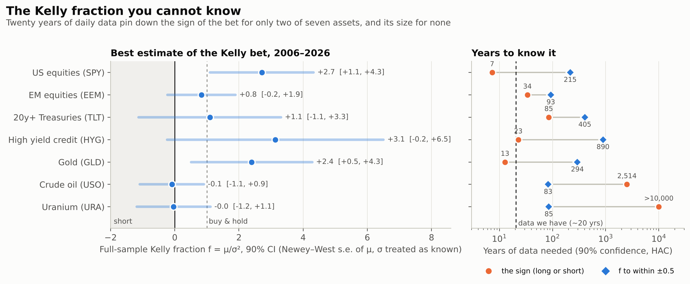
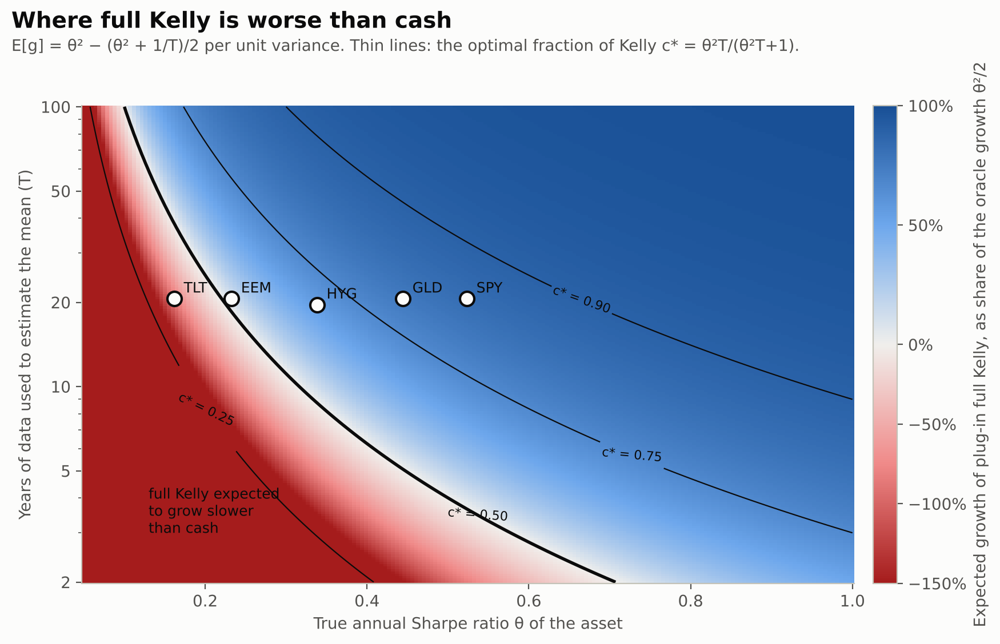
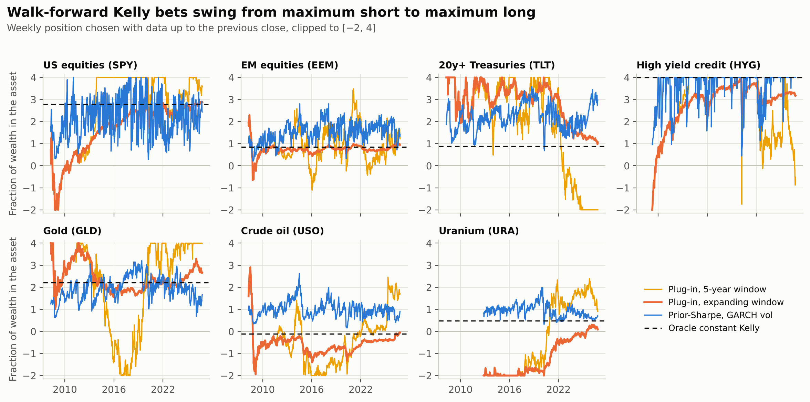
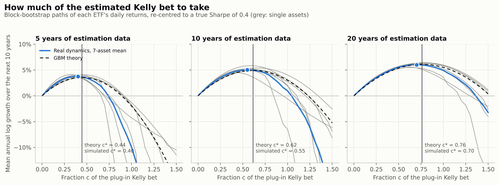
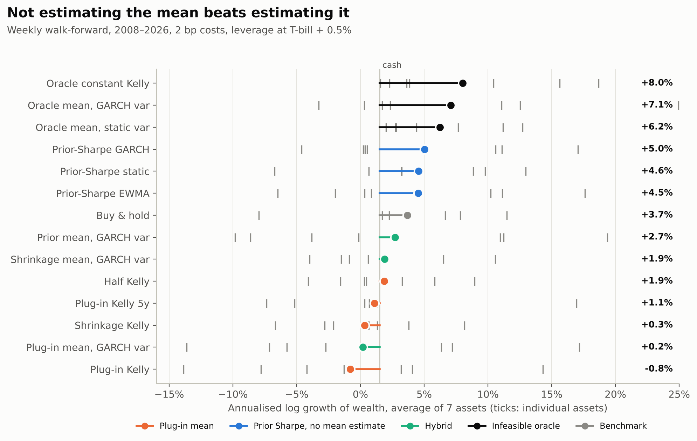
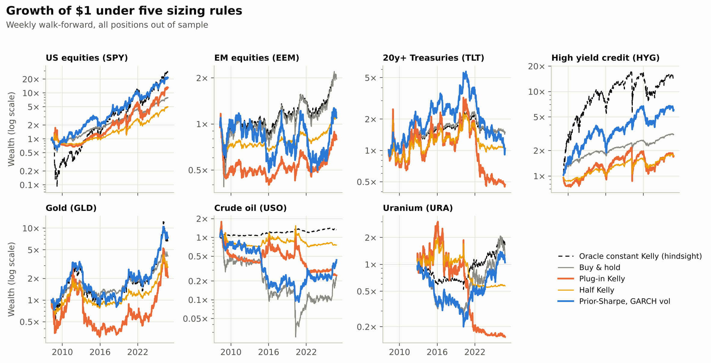
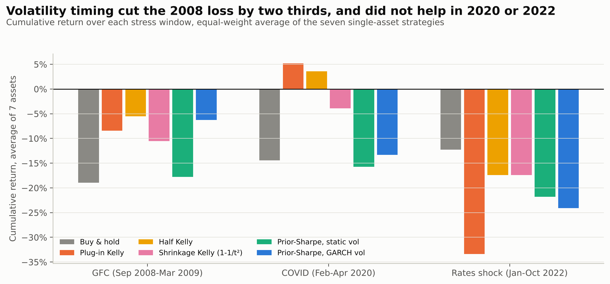
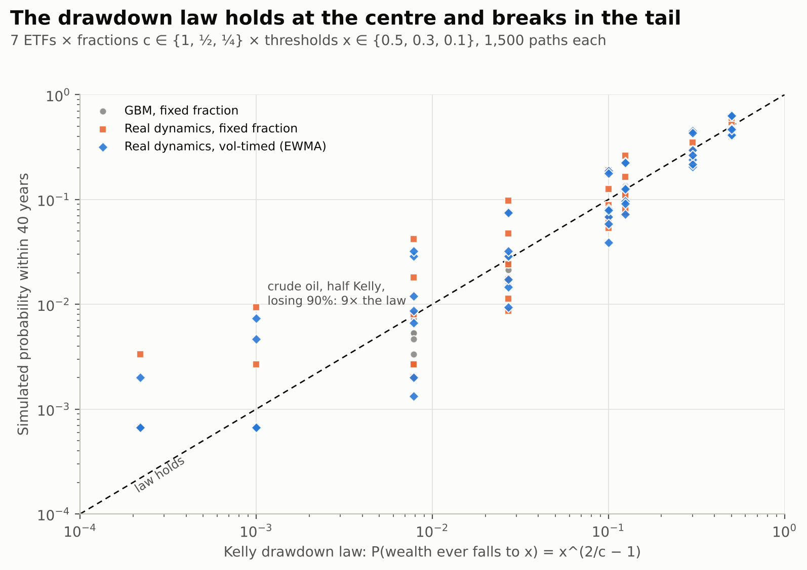

# The Kelly Fraction You Cannot Know

**Estimation risk, volatility timing and the drawdown law in growth-optimal betting, seven asset classes, 2008–2026**

*Project 07 of [30 Quant Research Projects](../README.md) · Working paper, November 2026*



---

## Abstract

The Kelly criterion says how much to bet to make wealth grow as fast as possible: for an asset with
excess drift μ and variance σ², hold the fraction f\* = μ/σ². Every Kelly tutorial plugs in a historical
mean and stops there. The question here is what happens when you **cannot know μ**, which is always.

I combine three pieces of evidence. First, closed-form theory for the growth of the plug-in Kelly bet when
μ is estimated from T years of data, checked by simulation. Second, a Monte Carlo "Kelly simulator" that
replaces the textbook Gaussian world with block-bootstrapped paths of real ETF returns, so fat tails and
volatility clustering are kept. Third, a strictly out-of-sample weekly walk-forward of 15 sizing rules on
seven cross-asset ETFs (US and emerging equities, long Treasuries, high-yield credit, gold, crude oil and
uranium) from 2008 to 2026, with costs, a leverage spread and a position cap. The volatility forecasts come
from the best-calibrated simulator in [Project 01](../01-monte-carlo-calibration/), so this project also
measures what that calibration is worth in money.

**Main findings**

1. **The Kelly fraction is unknowable on any realistic sample.** With 20 years of daily data, the 90%
   confidence interval of the Kelly fraction (Newey–West) excludes zero for only two of the seven assets
   (US equities and gold). Knowing the *sign* of the bet would take 23 years for high yield, 34 for
   emerging markets and 85 for long Treasuries. Knowing its *size* to within ±0.5 (say, 2.0× versus 2.5×
   leverage) would take between 83 and 890 years for every asset.
2. **Full Kelly with an estimated mean is worse than cash unless θ²T > 1**, where θ is the annual Sharpe
   ratio and T the years of data. The optimal share of the estimated bet is c\* = θ²T/(θ²T+1), which has a
   feasible form, 1 − 1/t², where t is the t-statistic of the mean. In the Gaussian world the theory is
   exact. On bootstrapped real returns the best share is 8–11% below theory (0.40, 0.55 and 0.70 for 5, 10
   and 20 years against 0.44, 0.62 and 0.76), and over-betting is punished much harder than in theory.
3. **Out of sample, plug-in Kelly lost to cash.** Averaged across the seven assets, the expanding-window
   plug-in bet grew wealth at **−0.8% a year**, against +1.5% for T-bills, +3.7% for buy-and-hold and
   +8.0% for the best constant bet chosen with hindsight. Half Kelly (+1.9%) and the 1 − 1/t² shrinkage
   rule (+0.3%) helped little.
4. **Not estimating the mean beats estimating it.** A rule that assumes the *same* Sharpe ratio of 0.3 for
   every asset and only scales by forecast volatility (f = 0.3/σ̂, with σ̂ from Project 01's GJR-GARCH-t)
   grew at **+5.0% a year**, capturing 54% of the hindsight-optimal excess growth, and beat plug-in Kelly
   on **all seven assets**. The pooled advantage of 9.0 points a year has a Newey–West t of 1.74
   (one-sided p = 0.04) but does **not** survive Holm correction (p = 0.16). Eighteen years is too short
   to rank sizing rules with confidence, which is the paper's thesis applied to itself.
5. **Volatility timing is the smaller lever.** Holding the mean assumption fixed, swapping a static
   volatility for the GARCH forecast adds 0.4 to 1.0 points a year. Knowing the true mean would add 1.6
   points. Estimating it *costs* 5.4 points. Timing helped most in the 2008 crisis, where it cut the
   average loss from 18% to 6%, and did not help in 2020 or 2022.
6. **Kelly's drawdown law holds at the centre and fails in the tail.** Under real return dynamics, full
   Kelly halved wealth in 48% of 40-year paths (theory: 50%). But half Kelly on crude oil lost 90% of
   wealth **9× more often** than the law says, and volatility timing brought it back to the law.

---

## 1. Why this question

The Kelly criterion is the most-cited answer to "how much should I bet", from Kelly (1956) and Thorp
(1969) to Merton's continuous-time portfolio rule. Its promises are strong: no other strategy grows
faster in the long run, and the probability that full Kelly ever halves your wealth is exactly one half.
Both promises assume the bettor knows the odds. In financial markets the odds are the expected excess
return, and the expected return is the hardest quantity in finance to estimate: its standard error
shrinks only with the square root of *calendar time*, not of the number of observations (Merton, 1980).

That makes the practical question different from the textbook one. It is not "what is the Kelly fraction"
but "what is the best bet *given that I will estimate the Kelly fraction badly*". The literature has
answers in pieces: Kan & Zhou (2007) on estimation risk in mean-variance rules, MacLean, Thorp & Ziemba
(2010) on fractional Kelly, Moreira & Muir (2017) on volatility-managed portfolios. This project puts the
pieces in one experiment, adds real-return simulation and a long out-of-sample test, and asks which
part of the Kelly bet can actually be known.

## 2. Theory in one page

Let excess returns have annual drift μ, variance σ² and Sharpe ratio θ = μ/σ. A constant fraction f grows
wealth at g(f) = fμ − f²σ²/2, maximised by f\* = μ/σ² with growth θ²/2 per year.

**Estimation risk.** Estimate μ from T years: μ̂ ~ N(μ, σ²/T). Bet a share c of the plug-in fraction,
f = c·μ̂/σ². Then

> E[g] = c θ² − c² (θ² + 1/T) / 2, maximised at **c\* = θ²T / (θ²T + 1)**.

Full Kelly (c = 1) has E[g] = (θ² − 1/T)/2, which is **negative unless θ²T > 1**. A Sharpe-0.3 asset needs
11 years of data before full plug-in Kelly is even expected to beat cash; a Sharpe-0.16 asset (long
Treasuries) needs 39. The unbiased estimate of θ²T is t² − 1, where t is the t-statistic of the mean, so
the feasible optimal share is **ĉ = 1 − 1/t²** (positive part): bet nothing unless the mean is more than
one standard error from zero.

**Knowability.** The standard error of f̂ is s.e.(μ̂)/σ² = 1/(σ√T) for iid returns; I use the Newey–West
standard error of the mean instead, which multiplies this by a factor k between 0.82 and 1.04 across the
seven assets. σ is treated as known: its relative sampling error over 20 years is 1–2%, against 50% or
more for μ, so it adds almost nothing. Two decision-relevant horizons follow. The **sign** of the bet is
known at 90% confidence once T > (1.645k/θ)². The **size** is known to within ±0.5 once
T > (1.645k / 0.5σ)². The second does not depend on the estimate at all, so it cannot blow up near f = 0.

**The drawdown law.** Under geometric Brownian motion, betting c·f\* makes the probability that wealth
*ever* falls to a fraction x of its starting value equal to x^(2/c − 1): one half for full Kelly and x = ½,
one in eight for half Kelly.



*Figure 2. Expected growth of full plug-in Kelly as a share of the oracle growth θ²/2. Below the thick
line it is expected to grow slower than cash. Dots: the seven ETFs at their full-sample Sharpe ratio and
sample length (oil and uranium have Sharpe ≈ 0 and fall off the left edge).*

## 3. Data and pre-registered design

**Data.** Daily total-return log returns of SPY, EEM, TLT, HYG, GLD, USO and URA from April 2006 (HYG April
2007, URA November 2010) to 20 November 2026, the same file as Project 01. Cash earns the annual average
3-month T-bill rate (`data/tbill_3m_annual.csv`).

**Weekly walk-forward.** Rebalance at each of Project 01's weekly forecast origins: 934 weeks per asset
(884 for HYG, 703 for URA), 6,257 asset-weeks. Every input uses data up to the previous close. The
position is clipped to f ∈ [−2, 4]; borrowing pays the T-bill rate + 0.5%; turnover after intra-week drift
costs 2 bp per unit. If a week's loss exceeds wealth the strategy is ruined and stays at zero (it never
happened in the baseline).

**Inputs.** μ̂ and σ̂ from an expanding window of daily excess returns (minimum 500 days), or a rolling
1,260-day window; σ_EWMA with λ = 0.94; σ_GARCH from Project 01's out-of-sample GJR-GARCH-t predictive
standard deviation for exactly the week being bet on. The agnostic prior Sharpe ratio θ₀ = 0.3 is the same
for every asset and was fixed before any backtest was run.

| Family | Rule | Position f |
|---|---|---|
| Benchmarks | Cash · Buy & hold | 0 · 1 |
| Plug-in | Plug-in Kelly · Plug-in 5y · Half Kelly · Shrinkage Kelly | μ̂/σ̂² · rolling · ½μ̂/σ̂² · (1−1/t²)₊ μ̂/σ̂² |
| Prior Sharpe (no mean estimate) | static · EWMA · GARCH | θ₀/σ̂ · θ₀/σ_EWMA · θ₀/σ_GARCH |
| Hybrids | plug-in / prior / shrinkage mean with GARCH variance | μ̂/σ²_G · θ₀σ̂/σ²_G · ĉμ̂/σ²_G |
| Infeasible oracles | constant Kelly · oracle mean with static or GARCH variance | best constant f in hindsight · μ_full/σ̂² · μ_full/σ²_G |

**Pre-registered hypotheses** (one-sided tests on weekly log-growth differences, Newey–West standard
errors, stationary block-bootstrap 95% intervals, Holm correction across the 28 asset-level tests and
separately across the 4 pooled tests):

* **H2** plug-in Kelly grows slower than buy-and-hold;
* **H3** the prior-Sharpe GARCH rule grows faster than plug-in Kelly;
* **H4** volatility timing adds growth (prior-Sharpe GARCH vs prior-Sharpe static);
* **H5** the 1 − 1/t² shrinkage rule grows faster than plug-in Kelly.

**Simulator.** S1 checks the closed forms in a Gaussian world (20,000 draws per cell). S2 draws stationary
block-bootstrap paths (mean block 63 days, so volatility clusters survive) of each ETF's daily excess
returns, re-centred to a common true Sharpe ratio of 0.4, estimates μ and σ on T ∈ {5, 10, 20} years,
then bets c·f̂ for the next 10 years (1,000 paths per asset and T). S3 runs 1,500 40-year paths per asset
at c ∈ {1, ½, ¼} of the *true* Kelly fraction, with and without EWMA volatility timing, against Gaussian
paths with the same mean and variance.

## 4. Result 1: you cannot know the fraction

| Asset | Years | Sharpe | HAC t | Kelly f̂ | 90% CI (HAC) | P(sign wrong) | Years to know sign | Years to know f ±0.5 |
|---|---|---|---|---|---|---|---|---|
| US equities (SPY) | 20.6 | 0.52 | 2.76 | 2.71 | [1.10, 4.33] | 0.3% | 7 | 215 |
| Gold (GLD) | 20.6 | 0.44 | 2.09 | 2.40 | [0.51, 4.29] | 1.8% | 13 | 294 |
| High yield (HYG) | 19.6 | 0.34 | 1.53 | 3.14 | [−0.24, 6.51] | 6.3% | 23 | 890 |
| EM equities (EEM) | 20.6 | 0.23 | 1.29 | 0.83 | [−0.23, 1.89] | 9.9% | 34 | 93 |
| Treasuries (TLT) | 20.6 | 0.16 | 0.81 | 1.09 | [−1.13, 3.31] | 20.9% | 85 | 405 |
| Crude oil (USO) | 20.6 | −0.03 | −0.15 | −0.09 | [−1.09, 0.91] | 44.1% | 2,514 | 83 |
| Uranium (URA) | 16.0 | −0.01 | −0.05 | −0.04 | [−1.19, 1.12] | 47.9% | 15,736 | 85 |

*Newey–West standard errors of the mean of daily excess returns (Bartlett kernel, 9 lags); σ treated as
known. "Years to know" assumes the point estimate stays where it is. For oil and uranium the
sign horizon is huge because the estimated Sharpe ratio is close to zero, which is the honest answer:
if the true edge is near zero, no sample will tell you which way to bet. The ±0.5 horizon has no such
problem and is long for every asset, longest for low-volatility assets, where a given error in μ is
divided by a small σ².*

The interval for high-yield credit runs from a small short to 6.5× leverage. Even the best-measured asset,
the S&P 500, has an interval from 1.1× to 4.3×, and the growth of those two bets differs by more than the
equity premium.

In real time it is worse, because the estimate is updated as data arrive (Figure 3). The expanding-window
plug-in bet on SPY sat at the −2 short limit through early 2009, at the bottom of the market. On uranium it
pointed the wrong way 90% of the time. The 1 − 1/t² rule set the bet to zero in 86% of weeks for EEM and
76% for oil, which is the honest answer: the data do not say which way to bet.



## 5. Result 2: how much of the estimated bet to take

In the Gaussian world, the closed forms match simulation within Monte Carlo noise (largest error
0.07 oracle-growth units for θ ≥ 0.3, in the 3-year cells where f̂ is wildest; see `results/sim_gbm_grid.csv`). With θ = 0.3 and 10 years of data, full plug-in
Kelly is expected to grow 11% *slower than cash* in units of the oracle growth, and a single 10-year path
ends below cash 47% of the time.

On real return paths (Figure 6) the shape is the same, but two things change. The best share is lower
than theory, and the right side of the curve falls much faster: with 5 years of data, betting the full
estimated fraction loses 10% a year on average, against −2% in theory, because fat tails and volatility
clusters punish leverage that the quadratic approximation does not see. Under-betting is cheap; over-betting
is expensive, and more expensive than the Gaussian model says.

| Estimation window | c\* theory | c\* simulated | Growth at simulated c\* | Growth of full plug-in |
|---|---|---|---|---|
| 5 years | 0.44 | 0.40 | +3.8% | −10.0% |
| 10 years | 0.62 | 0.55 | +5.0% | +1.0% |
| 20 years | 0.76 | 0.70 | +6.0% | +4.9% |

*True Sharpe 0.4 for every asset; oracle growth θ²/2 = 8.0% a year.*



## 6. Result 3: out of sample, 2008–2026



| Rule | Pooled growth | Share of oracle excess growth | Mean f | Avg max drawdown |
|---|---|---|---|---|
| Oracle constant Kelly (hindsight) | +8.0% | 100% | 1.59 | 58% |
| Oracle mean, GARCH variance (infeasible) | +7.1% | 86% | 1.91 | 62% |
| Oracle mean, static variance (infeasible) | +6.2% | 73% | 1.37 | 54% |
| **Prior-Sharpe, GARCH vol** | **+5.0%** | **54%** | 1.91 | 71% |
| Prior-Sharpe, static vol | +4.6% | 47% | 1.41 | 69% |
| Prior-Sharpe, EWMA vol | +4.5% | 46% | 1.99 | 73% |
| Buy & hold | +3.7% | 33% | 1.00 | 58% |
| Half Kelly | +1.9% | 6% | 0.63 | 52% |
| Cash | +1.5% | 0% | 0 | 0% |
| Plug-in Kelly, 5-year window | +1.1% | −6% | 1.39 | 83% |
| Shrinkage Kelly (1 − 1/t²) | +0.3% | −18% | 0.57 | 52% |
| **Plug-in Kelly** | **−0.8%** | **−36%** | 1.25 | 78% |

*Pooled growth is the equal-weight average of the seven assets' annualised log growth. Full per-asset
numbers in `results/summary_by_asset.csv`.*

The ranking has a clear structure. Every rule that uses an *estimated* asset mean is near or below cash.
Every rule that ignores it and only scales by volatility is above buy-and-hold. The infeasible rows show
that the mean *is* valuable when known: the oracle mean adds 1.6 points to the static prior rule. The
problem is not that the mean does not matter, but that its estimate is mostly noise, and Kelly converts
noise into leverage.

**Pre-registered tests** (annualised growth difference, bootstrap 95% CI, Holm-adjusted p):

| Hypothesis | Pooled difference | 95% CI | NW t | p (one-sided) | p (Holm) | Assets in the hypothesised direction |
|---|---|---|---|---|---|---|
| H2 plug-in < buy & hold | −6.9 pts | [−17.3, +2.9] | −1.34 | 0.09 | 0.27 | 5 of 7 |
| H3 prior-Sharpe GARCH > plug-in | +9.0 pts | [−1.1, +19.5] | 1.74 | 0.04 | 0.16 | **7 of 7** |
| H4 GARCH timing > static | +1.2 pts | [−1.8, +4.6] | 0.73 | 0.23 | 0.46 | 4 of 7 |
| H5 shrinkage > plug-in | +1.8 pts | [−2.9, +6.8] | 0.73 | 0.23 | 0.46 | 4 of 7 |

*"Pooled" averages the weekly growth of whichever assets are live each week, which weights the early
years (fewer assets) more heavily than the per-asset table; the simple average of the seven per-asset
H3 differences is +5.8 points.*

None of the pre-registered hypotheses is significant after multiple-testing correction, and I report
that as a result, not a footnote. H3 has the right sign on every asset, with a sign test p of 1/128, but
the per-asset growth differences are so noisy that 18 years cannot separate them at conventional levels.
That is finding 1 again, one level up: if the mean of one asset's return cannot be known in 20 years, the
mean of the *difference* between two leveraged strategies cannot either.



**Decomposing the gap.** Holding the variance input fixed and changing only the mean input:

| Mean input → | Oracle (infeasible) | Prior Sharpe 0.3 | Estimated |
|---|---|---|---|
| Static variance | +6.2% | +4.6% | −0.8% |
| GARCH variance, Kelly 1/σ² scaling | +7.1% | +2.7% | +0.2% |
| GARCH variance, constant-Sharpe 1/σ scaling | – | +5.0% | – |

Two lessons. The mean input is worth 7 points a year between the best and the worst choice; the variance
input is worth about 1. And scaling by 1/σ² (the literal Kelly rule with a fixed mean) is too aggressive
when the volatility forecast is low: it pushes leverage to the cap in calm markets just before the shock.
Scaling by 1/σ, which assumes a constant Sharpe ratio rather than a constant mean, kept the timing gains
and avoided that.

**Stress windows.** Volatility timing cut the average loss in the 2008 crisis from 17.8% (static prior)
to 6.2%. It did not help in the COVID crash (−13.3% against −15.7%), which arrived faster than a weekly
volatility forecast can react, exactly as Project 01 found for its forecast intervals. In the 2022 rates
shock it was slightly worse (−24.1% against −21.8%), because volatility in Treasuries rose gradually while
prices fell steadily. Plug-in Kelly lost 33% in 2022: it had learned from 14 years of falling yields that
long Treasuries deserved 2–4× leverage.



## 7. Result 4: the drawdown law under real returns



| Fraction of true Kelly | Wealth falls to | Law | GBM, 40 years | Real dynamics | Real, vol-timed |
|---|---|---|---|---|---|
| Full | 50% | 50.0% | 46.7% | 47.7% | 49.7% |
| Full | 10% | 10.0% | 7.8% | 9.5% | 9.9% |
| Half | 50% | 12.5% | 11.7% | 12.9% | 13.8% |
| Half | 30% | 2.7% | 2.4% | 3.2% | 3.6% |
| Half | 10% | 0.10% | 0.03% | 0.18% | 0.21% |
| Quarter | 50% | 0.78% | 0.60% | 1.11% | 1.30% |

*Averages over the seven assets, 1,500 paths each, daily rebalancing.*

On average the law survives fat tails and clustering surprisingly well, because daily rebalancing turns
a large shock into many small ones. The failure is in the tail and in specific assets. Deep losses at
fractional Kelly happen 1.2–1.8× more often than the law says on average (and up to 6× more often than
in equivalent Gaussian paths), and the excess is concentrated where returns jump: at half Kelly, crude oil lost 90% of its starting wealth with probability 0.93% (law: 0.10%), and
high-yield credit fell to 30% with probability 4.7% (law: 2.7%). For oil, volatility timing brought the
probability back to 0.07%. For high yield and uranium it made the tail worse, because constant-Sharpe
scaling holds 40% more average leverage than the fixed fraction.

## 8. What would change the conclusion (limitations)

* **The prior Sharpe is a choice.** θ₀ = 0.3 was fixed in advance and is an ordinary long-run Sharpe for
  risky assets. With θ₀ = 0.2 the rule grows 4.8%, with 0.4 it grows 4.1%; it beats plug-in Kelly at every
  value (`results/robustness.csv`). It is not robust to an asset with a *negative* true Sharpe: it lost
  4.6% a year on crude oil, where contango made the ETF a structurally bad bet.
* **Shorting drives much of the plug-in loss.** Long-only with f ∈ [0, 2], plug-in Kelly grows 4.7% and the
  prior-Sharpe GARCH rule 5.0%, so the gap shrinks to 0.3 points. A long-only investor loses much less by
  estimating the mean, because the worst estimates were negative ones that the cap now ignores.
* **Single assets.** Each asset is sized on its own. A multi-asset Kelly portfolio (Σ⁻¹μ) amplifies
  estimation error further; that question belongs to Projects 05 (efficient frontier) and 20 (risk parity).
* **The T-bill series** is annual averages, and the 2026 value is a year-to-date estimate. Leverage at
  T-bill + 0.5% is cheaper than most investors can borrow; with a 2% spread the levered rules lose
  0.3–1.5 points; the prior-Sharpe GARCH rule still beats plug-in Kelly on all seven assets, although the static
  version (3.9%) now edges the GARCH version (3.6%).
* **Eighteen years, one history.** The out-of-sample period contains one great financial crisis, one
  pandemic crash and one rates shock. The simulator widens the evidence, but it resamples the same history.
* **What was not tested:** Bayesian priors fitted across assets, regime-dependent means (Project 19),
  option-implied volatility (Project 14), intraweek rebalancing and taxes.

## 9. Referee notes

Points I checked against my own results before publishing:

* **Is "years to know" a mechanical artefact?** An earlier draft used a *relative* tolerance (±50% of f),
  which explodes when f is near zero (oil, uranium). The headline now uses the sign horizon and an
  *absolute* tolerance; the relative version is kept in `results/knowability.csv` (`years_rel_50`) only.
* **Are the confidence intervals too narrow?** They use Newey–West standard errors. Daily returns of SPY
  and EEM are slightly negatively autocorrelated, so HAC is 14–18% *narrower* than iid there; for the
  other assets it is up to 4% wider. With iid errors the sign horizons move by a few years (SPY from 7
  to 10, HYG from 23 to 24), and the same two assets have a known sign.
* **The "7 of 7" sign test is not independent evidence.** The seven assets share shocks (2008, 2020), so
  1/128 overstates the evidence. I report it, but the Holm-corrected tests are the ones to trust.
* **Discrete versus continuous Kelly.** The plug-in rules use the continuous formula μ/σ²; with weekly
  rebalancing the exact log-optimal fraction differs by a few percent of f, far below the estimation
  error. The hindsight oracle is solved on exact discrete weekly growth, so the approximation can only
  make the feasible rules look slightly worse, not better.
* **Asset selection.** The seven ETFs were chosen in 2026 and include two (oil, uranium) whose long-run
  returns were poor. This hurts every long-biased rule equally and does not change the ranking.
* **Data reuse.** The prior Sharpe of 0.3, the weekly calendar and the position limits were fixed before
  the backtest was run; the volatility forecasts are Project 01's, produced without seeing this project.

## 10. Conclusion

The Kelly criterion is right about what to maximise and wrong about what you know. Its input is the
expected return, which twenty years of data cannot pin down for most assets, and its output turns
estimation noise directly into leverage. In this sample, a bettor who refused to estimate any asset's
mean, assumed the same modest Sharpe ratio everywhere and spent their modelling effort on forecasting
volatility, grew wealth faster than the plug-in Kelly bettor on every asset, and kept 54% of what perfect
hindsight would have earned. The part of Kelly you can know is the denominator.

## Connections to the other projects

* **[01 Monte Carlo calibration](../01-monte-carlo-calibration/)** supplies the volatility forecasts. Its
  finding that dynamic volatility matters more than fat tails reappears here in money: GARCH timing helped
  in 2008, and nothing history-based helped in March 2020.
* **13 GARCH volatility forecasting** will test whether better variance forecasts add more growth here.
* **23 Deflated Sharpe ratio** formalises the problem in section 6: comparing strategies on one noisy history.

## Reproduce

```bash
pip install -r requirements.txt
./run_all.sh          # tests, backtest, simulator, statistics, figures: about 2 minutes
```

| Script | Output |
|---|---|
| `src/kelly.py` | theory, drawdown law, bootstrap, Newey–West, Holm |
| `src/backtest.py` | `results/weekly.csv.gz`, `results/inputs.csv.gz` |
| `src/simulate.py` | `results/sim_gbm_grid.csv`, `sim_real_multiplier.csv`, `sim_drawdown_law.csv` |
| `src/evaluate.py` | `summary_*.csv`, `tests.csv`, `stress_windows.csv`, `knowability.csv`, `plugin_instability.csv`, `robustness.csv` |
| `src/figures.py` | `figures/*.png` |
| `tests/test_kelly.py` | 8 unit tests: closed forms, drawdown law, no look-ahead, accounting |

All seeds are fixed. `data/gjr_garch_t_weekly_forecasts_from_project01.csv` is the GJR-GARCH-t, 5-day
subset of Project 01's `results/forecasts.csv.gz` (columns asset, origin, t, y, sd, mean).

## References

* Kelly, J. L. (1956). A new interpretation of information rate. *Bell System Technical Journal*, 35(4).
* Thorp, E. O. (1969). Optimal gambling systems for favorable games. *Review of the ISI*, 37(3).
* Merton, R. C. (1980). On estimating the expected return on the market. *Journal of Financial Economics*, 8(4).
* Kan, R., & Zhou, G. (2007). Optimal portfolio choice with parameter uncertainty. *JFQA*, 42(3).
* MacLean, L. C., Thorp, E. O., & Ziemba, W. T. (2010). Long-term capital growth: the good and bad properties of the Kelly and fractional Kelly capital growth criteria. *Quantitative Finance*, 10(7).
* Moreira, A., & Muir, T. (2017). Volatility-managed portfolios. *Journal of Finance*, 72(4).
* Politis, D. N., & Romano, J. P. (1994). The stationary bootstrap. *JASA*, 89(428).
* Newey, W. K., & West, K. D. (1987). A simple, positive semi-definite, heteroskedasticity and autocorrelation consistent covariance matrix. *Econometrica*, 55(3).
* Holm, S. (1979). A simple sequentially rejective multiple test procedure. *Scandinavian Journal of Statistics*, 6(2).

---

*Not investment advice. Code MIT, text and figures CC BY 4.0.*
