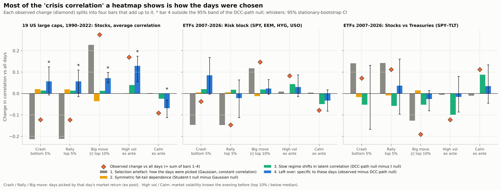
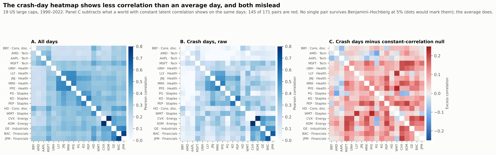
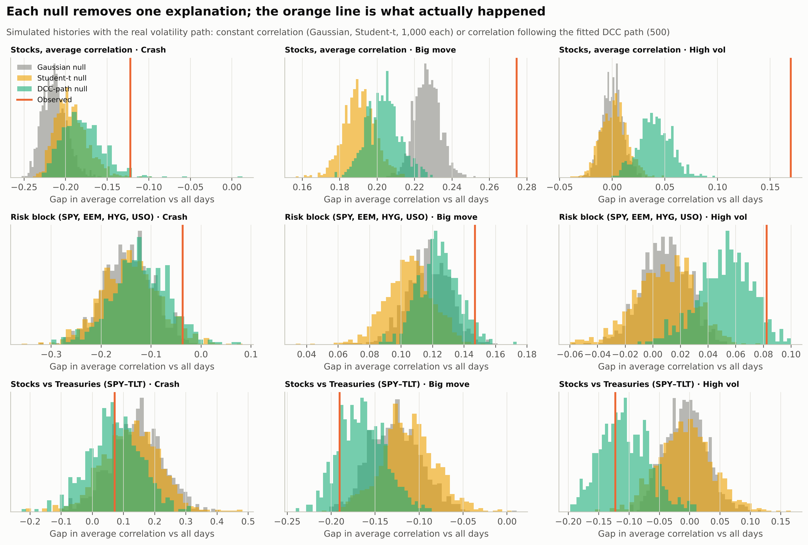
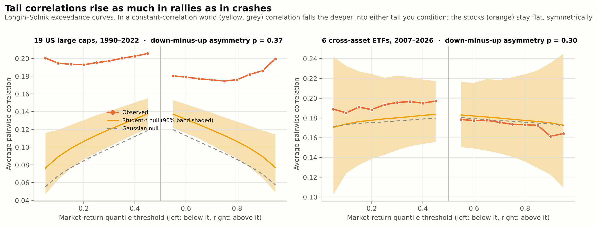
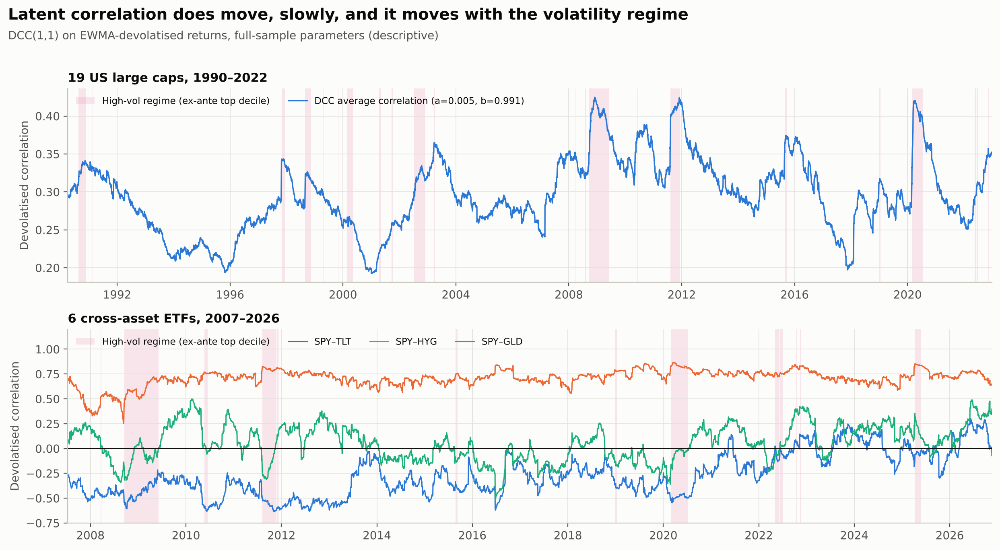
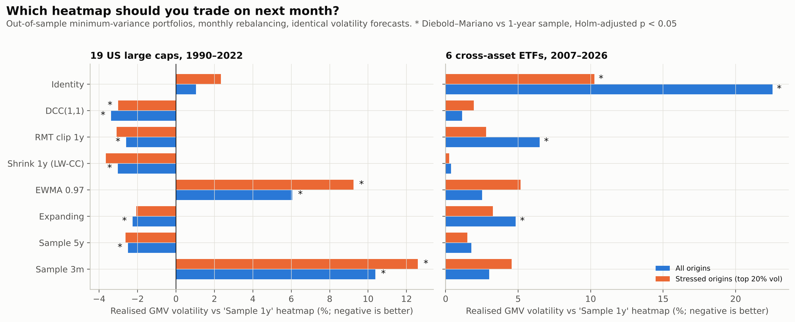

# Do Correlations Really Go to One in a Crash?

**Separating how the days were chosen from what the market did, in 33 years of correlation heatmaps**

*Project 08 of [30 Quant Research Projects](../README.md) · Working paper, November 2026*



---

## Abstract

"In a crisis, all correlations go to one" is one of the most repeated sentences in risk management.
The usual evidence is a correlation heatmap drawn on crash days next to one drawn on normal days.
That comparison is biased. Correlation measured on a subset of days depends on how the subset was picked,
even if nothing about the market's dependence structure changes (Boyer, Gibson & Loretan, 1999;
Forbes & Rigobon, 2002). This project asks: **once the mechanical effects of conditioning are removed,
how much of the crisis rise in correlation is real, and is it specific to crashes?**

I build three counterfactual worlds that keep each asset's *actual* volatility path and change only
the dependence: constant correlation with Gaussian shocks, constant correlation with Student-t shocks
(symmetric tail dependence), and correlation that follows its fitted DCC path (slow regimes). Every
conditioning rule is re-applied inside 1,000 simulated histories per world (500 for the DCC world).
The observed change in correlation then splits into four additive parts: **selection artefact,
fat-tail dependence, slow regime shifts, and a remainder specific to the chosen days**. Universes:
19 US large caps (1990–2022, 8,249 days) and six cross-asset ETFs (2007–2026, 4,873 days). A second
part asks the practical question: which correlation estimate should you use for next month?

**Main findings**

1. **The crash-day heatmap shows *less* correlation than an average day.** Average pairwise correlation
   among the 19 stocks is 0.32 on all days and 0.20 on the 5% worst market days (95% CI of the change
   −0.19 to −0.05). 92% of pairs look *less* correlated on crash days.
2. **That drop is a conditioning artefact, and it hides a real rise.** Restricting to one tail of the
   market mechanically removes 0.21 of correlation even when latent correlation is constant. Net of
   that, crash days carry **+0.07** more correlation than a constant-correlation world (t-null p = 0.003).
3. **But crashes are not special: rallies show the same +0.07** (p = 0.009). Down-tail minus up-tail
   exceedance correlation is +0.008 for stocks (null p = 0.37) and +0.024 for ETFs (p = 0.30). Over
   1990–2022 I find no downside asymmetry once the conditioning bias is removed.
4. **The real effect is a volatility *regime*, which you can see coming.** Conditioning on the
   market's *ex-ante* volatility (top decile, known the evening before) creates no selection artefact.
   In that regime correlation is **+0.17** higher (CI 0.10 to 0.22). In named crises the
   devolatised correlation of the stocks rose by +0.23 (GFC), +0.37 (2011) and +0.51 (COVID).
5. **For a portfolio hedged with Treasuries, the crash-day heatmap gets the direction wrong.** On crash
   days SPY–TLT looks *less* negative (−0.24 vs −0.31). A constant-correlation world predicts +0.14 of
   that shift, so the raw sign is pure artefact. In high-volatility regimes the hedge genuinely
   *strengthens* (−0.12 vs all days). 2022 is the exception: the stock–bond correlation turned positive
   (+0.02 in Jan–Oct 2022, from −0.13 the year before).
6. **For next month, use a slow, shrunk heatmap, not a fast one.** Out of sample, with identical
   volatility forecasts, a DCC(1,1) correlation lowers realised minimum-variance volatility by 3.4% and
   Ledoit–Wolf shrinkage by 3.0% relative to the standard 1-year heatmap (Holm-adjusted DM p < 0.01).
   "Fast" heatmaps (3-month window, EWMA 0.97) are 6–10% worse, and worse still in stressed months
   (+9 to +13%). On the six ETFs, nothing beats the 1-year sample.

---

## 1. Why this question

Correlation heatmaps are the most common first picture in a quant notebook, and conditional heatmaps
("what does it look like in a sell-off?") are the most common second one. The answer drives real
decisions: diversification assumptions, stress tests, the amount of capital set aside for crises, and
whether bonds will hedge equities when they are needed.

The statistical problem is old but rarely respected in practice. Correlation is a ratio of covariance
to the product of standard deviations, and the *selection* of observations changes both. Select on a
large absolute market move and you inflate the variance of the common factor, so correlation rises
mechanically. Select on one tail of the market and you truncate it, so correlation falls mechanically.
Forbes & Rigobon (2002) showed the first effect for international stock-market contagion. Boyer, Gibson &
Loretan (1999) and Longin & Solnik (2001) showed that even the Gaussian distribution produces exceedance
correlations that fall towards zero in the tails. Ang & Chen (2002) and Hong, Tu & Zhou (2007) report
that the drop is smaller on the downside, which became the "asymmetric correlation" stylised fact.

What I have not seen is a decomposition that (i) keeps each asset's real volatility path instead of
assuming i.i.d. returns, (ii) separates fat-tail dependence from slow correlation regimes, and
(iii) reports the result as the four pieces a practitioner actually needs: *how much of my conditional
heatmap is the way I picked the days, how much is fat tails, how much is a regime I could have seen
coming, and how much is specific to these days?* That is the contribution here, together with an
out-of-sample test of which heatmap to use going forward.

## 2. Data

| Universe | Assets | Period | Days | Source |
|---|---|---|---|---|
| US large caps | AAPL, AMD, BAC, BBY, CVX, GE, HD, JNJ, JPM, KO, LLY, MRK, MSFT, PEP, PFE, PG, UNH, WMT, XOM (9 sectors) | Apr 1990 – Dec 2022 | 8,249 | Adjusted closes shipped with `skfolio` |
| Cross-asset ETFs | SPY, EEM, TLT, HYG, GLD, USO | Jul 2007 – Nov 2026 | 4,873 | Yahoo Finance adjusted closes (project 01) |

Daily log returns. The first 63 days of each universe are a volatility warm-up and are never evaluated.

* **Range Resources (RRC) is removed.** Its 1990–92 quotes are unchanged on 70–92% of days (no other
  stock exceeds 27% in any year), with a spurious +110% one-day return on 10 Apr 1990. Stale prices bias
  correlations towards zero, which is the quantity under study. Found in the referee pass (§8).
* The stock panel ends in Dec 2022 because that is where the published dataset ends. The ETF panel runs
  to Nov 2026 and covers 2008, 2020 and 2022. The stock panel covers 1998, 2008, 2011, 2020 and 2022.
* The ETF universe overlaps project 01 on purpose: it reuses the same data so that the two papers can be
  read together (01: marginal distributions; 08: dependence). URA is dropped because it starts in Nov 2010.

## 3. Method

### 3.1 Volatility and the market

Each asset's ex-ante volatility σ<sub>i,t</sub> is a RiskMetrics EWMA (λ = 0.94) using returns up to
t−1, floored at 0.2% a day. Devolatised returns are z<sub>i,t</sub> = r<sub>i,t</sub> / σ<sub>i,t</sub>.
The "market" is the equal-weight portfolio of the 19 stocks, and SPY for the ETFs.

### 3.2 Conditioning rules (pre-registered)

| Rule | Days selected | What it imitates |
|---|---|---|
| Crash days | market return in its bottom 5% | "the heatmap in a sell-off" |
| Rally days | market return in its top 5% | the mirror image, rarely drawn |
| Big-move days | \|market return\| in its top 10% | "volatile days" chosen ex post |
| High-vol regime | market's ex-ante EWMA vol in its top 10% | a regime known the evening before |
| Calm regime | market's ex-ante vol below its median | the comparison regime |

The statistic is the change in average pairwise correlation (Fisher-z averaged) between the selected
days and all days, computed on raw returns, exactly as a heatmap would be. For the ETFs, the
six-asset average mixes risk assets and hedges whose correlations move in opposite directions, so I
also test the **risk block** (SPY, EEM, HYG, USO) and the **SPY–TLT** and SPY–GLD pairs.

### 3.3 Four worlds and an additive decomposition

All three null worlds generate r<sub>t</sub> = σ<sub>t</sub> ⊙ z<sub>t</sub> with the *real*
σ<sub>t</sub> path, then recompute the market, re-apply every rule and recompute the statistic.

| World | z<sub>t</sub> | B | Removes |
|---|---|---|---|
| Gaussian null | N(0, R̄), R̄ = full-sample correlation of z | 1,000 | pure selection effect |
| Student-t null | multivariate t<sub>ν</sub>(0, R̄), ν by profile MLE (6.75 stocks, 7.25 ETFs) | 1,000 | + symmetric tail dependence |
| DCC-path null | t<sub>ν</sub>(0, R<sub>t</sub>), R<sub>t</sub> the fitted DCC(1,1) path | 500 | + slow regime shifts |
| Observed | the data | | |

Observed gap G = **selection** E[G│Gauss] + **tail dependence** (E[G│t] − E[G│Gauss]) +
**regime** (E[G│DCC] − E[G│t]) + **day-specific remainder** (G − E[G│DCC]).

Inference: one-sided Monte Carlo p-values of the observed gap against each null; 95% confidence
intervals for G from a stationary bootstrap of days (mean block 21, 1,000 replications, rules
recomputed in each replication). Pair-level tests (171 stock pairs, 15 ETF pairs) use
Benjamini–Hochberg. The asymmetry test compares down-tail and up-tail exceedance correlation at the
10% threshold against the t-null.

### 3.4 Out-of-sample horse race (part B)

Every 21 trading days after a five-year burn-in (332 origins for stocks from 1995, 172 for ETFs from
2012), nine estimators forecast the correlation of the next 21 devolatised returns: rolling samples
(3 months, 1 year, 5 years, expanding), EWMA (λ = 0.97), Ledoit–Wolf (2004) shrinkage to constant
correlation on 1 year, random-matrix eigenvalue clipping (Laloux et al., 1999) on 1 year, DCC(1,1)
(Engle, 2002; re-estimated every year on an expanding window, mean-reverting 21-day forecast) and the
identity. All share the same ex-ante volatilities, so only the correlation differs. Losses: realised
variance of the global minimum-variance portfolio (economic) and the Gaussian log score of the next
month's z (statistical, proper). Diebold–Mariano tests against the 1-year sample with Newey–West
errors, Holm-adjusted across the eight comparisons.

## 4. Results, part A: what a conditional heatmap shows

### 4.1 Three heatmaps of the same 19 stocks



Panel B is the picture people draw to show that "correlations go to one". It shows the opposite:
correlations are *lower* on crash days for 157 of 171 pairs. Panel C removes what a constant-correlation
world shows on the same days. 145 of 171 pairs are then positive, with a median excess of +0.07.
**No single pair survives Benjamini–Hochberg at 5%** (smallest q = 0.085, LLY–WMT). The evidence is in
the cross-section, not in any one cell. A heatmap that colours individual cells as "contagion" is
over-reading noise.

### 4.2 The decomposition

| Universe · block | Rule | Observed | Selection | Fat tails | Regime | Day-specific | p vs DCC null |
|---|---|---:|---:|---:|---:|---:|---:|
| Stocks · average | Crash days | −0.122 | −0.213 | +0.020 | +0.014 | **+0.057** | 0.022 |
| Stocks · average | Rally days | −0.123 | −0.212 | +0.019 | +0.013 | **+0.056** | 0.024 |
| Stocks · average | Big-move days | +0.275 | +0.227 | −0.036 | +0.013 | **+0.071** | 0.002 |
| Stocks · average | High-vol regime | +0.170 | +0.000 | +0.001 | +0.039 | **+0.129** | 0.002 |
| Stocks · average | Calm regime | −0.091 | +0.002 | −0.000 | −0.024 | **−0.068** | 0.002 (lower) |
| ETFs · risk block | Crash days | −0.037 | −0.146 | +0.005 | +0.020 | +0.085 | 0.068 |
| ETFs · risk block | High-vol regime | +0.082 | +0.009 | −0.000 | +0.044 | +0.030 | 0.048 |
| ETFs · SPY–TLT | Crash days | +0.071 | +0.141 | −0.017 | −0.052 | −0.001 | 0.50 |
| ETFs · SPY–TLT | High-vol regime | −0.123 | −0.006 | −0.001 | −0.100 | −0.016 | 0.37 (lower) |

Full table with bootstrap intervals for every block and rule: `results/gap_decomposition.csv`.

Four things stand out.

* **Selection dominates the rules that are chosen ex post.** For crash, rally and big-move days, the
  selection artefact is two to four times the size of everything else, with the sign set by the rule:
  one tail lowers correlation, both tails raise it.
* **Fat tails barely matter.** A Student-t world with ν ≈ 7 adds only 0.02–0.04. Symmetric tail
  dependence is not what makes crisis heatmaps look the way they do.
* **For stocks the day-specific remainder is real but symmetric.** About +0.06 on crash days and the same
  on rally days, both outside the DCC-null 95% band. In this universe, extreme days of *either* sign
  couple stocks more than the slow regime predicts.
* **The ex-ante regime is the clean effect.** A rule that uses only yesterday's volatility has no
  selection artefact, and correlation in the top-decile regime is +0.17 higher. The DCC path explains
  about a quarter of it (+0.04), because a model whose correlation half-life is about 150 days cannot
  move as fast as the regime does.



### 4.3 No downside asymmetry once conditioning is accounted for



In a constant-correlation world, exceedance correlation falls the deeper into either tail you condition
(yellow and grey). The stocks stay flat at about 0.18–0.20 in both directions. They are clearly above
the null on both sides, and the down-tail minus up-tail difference at 10% is +0.008 (t-null 95th
percentile 0.038, p = 0.37). The ETFs sit inside the null band throughout (asymmetry p = 0.30). Over
1990–2026, what earlier studies called "asymmetric correlation" looks like symmetric excess correlation
in extreme markets on top of a large mechanical effect, and not like a downside-only phenomenon.
Section 7 discusses why this differs from Ang & Chen (2002).

### 4.4 Latent correlation moves slowly, and with the regime



The fitted DCC parameters are a = 0.005, b = 0.991 for stocks (half-life about 155 days) and
a = 0.017, b = 0.977 for the ETFs (about 123 days). Average devolatised stock correlation ranges from
0.19 (1996, 2000, 2017) to 0.42 (late 2008, 2011, March 2020). The stock–bond correlation was negative
for almost the whole sample, reached −0.6 in 2008–2012, and crossed into positive territory in 2022–23.

### 4.5 Stress windows

| Window | Universe · block | Pre-window year | Window (raw) | Window (devolatised) | Devolatised change |
|---|---|---:|---:|---:|---:|
| LTCM/Russia, Aug–Oct 1998 | Stocks | 0.32 | 0.43 | 0.46 | +0.14 |
| GFC, Sep 2008 – Mar 2009 | Stocks | 0.37 | 0.62 | 0.60 | +0.23 |
| GFC | ETF risk block | 0.32 | 0.65 | 0.64 | +0.32 |
| GFC | SPY–TLT | −0.51 | −0.44 | −0.51 | +0.01 |
| Euro/US downgrade, Aug–Oct 2011 | Stocks | 0.35 | 0.73 | 0.73 | +0.37 |
| COVID, 20 Feb – 30 Apr 2020 | Stocks | 0.26 | 0.75 | 0.77 | +0.51 |
| COVID | ETF risk block | 0.56 | 0.69 | 0.78 | +0.22 |
| 2022 rate shock, Jan–Oct 2022 | Stocks | 0.23 | 0.41 | 0.39 | +0.16 |
| 2022 rate shock | SPY–TLT | −0.13 | +0.03 | +0.02 | +0.16 |

Calendar windows are not selected on the returns inside them, so raw and devolatised numbers agree and
the selection artefact is not an issue. In these windows correlations really do rise, by a lot. The
point of this paper is not that crisis correlation is a myth. It is that **the crash-day heatmap is the
wrong instrument to see it**, and that the rise belongs to the crisis *period*, not to the down days.

### 4.6 Sub-periods

| Period | Crash-day excess vs t-null | p | High-vol regime excess | p |
|---|---:|---:|---:|---:|
| 1990–2006 | +0.008 | 0.28 | +0.089 | 0.003 |
| 2007–2022 | +0.124 | 0.007 | +0.167 | 0.003 |

The crash-day excess is entirely a post-2007 phenomenon in this sample. The regime effect is present in
both halves and doubles in the second. (`results/subperiod_decomposition.csv`; 300 draws per null.)

## 5. Results, part B: which heatmap to use next month



| Estimator | Stocks: GMV vol vs 1y sample | Holm p | Stocks, stressed months | ETFs: GMV vol vs 1y | Holm p |
|---|---:|---:|---:|---:|---:|
| Sample 3 months | +10.4% | <0.001 | +12.6% | +3.0% | 0.71 |
| **Sample 1 year (baseline)** | 16.5% p.a. | | 25.5% p.a. | 6.0% p.a. | |
| Sample 5 years | −2.5% | 0.005 | −2.6% | +1.8% | 0.34 |
| Expanding | −2.3% | 0.005 | −2.1% | +4.8% | 0.002 |
| EWMA 0.97 | +6.1% | 0.006 | +9.2% | +2.5% | 0.82 |
| Shrink 1y (Ledoit–Wolf CC) | −3.0% | 0.004 | **−3.7%** | +0.4% | 0.66 |
| RMT clip 1y | −2.6% | 0.028 | −3.1% | +6.5% | <0.001 |
| **DCC(1,1)** | **−3.4%** | <0.001 | −3.0% | +1.1% | 0.82 |
| Identity | +1.0% | 0.60 | +2.3% | +22.5% | <0.001 |

The log score gives the same ranking for stocks (DCC best, then 5-year sample and shrinkage; 3-month
sample and EWMA far worse; all Holm p < 0.03). In the crisis windows of §4.5 (`results/stress_forecast.csv`),
shrinkage and DCC beat the 1-year sample in every stock episode (by 2–6% and 0.5–4.5%), while the 3-month
sample loses in every one (by 4–21%).

The intuition follows directly from part A. Latent correlation moves on a half-life of months, so a
3-month window mostly adds estimation noise. 19 assets and 252 days leave a lot of noise in a 1-year
sample, and shrinkage or a slow DCC removes it. Reacting fast to "crisis correlation" means reacting to
the noisiest estimate at the worst time. With six assets, the noise problem is small and the 1-year
sample is already hard to beat.

## 6. What this changes in practice

1. **Do not draw crash-day heatmaps without a null.** The picture is dominated by the conditioning, and
   for stock–bond hedges it can show the wrong direction. If you must, show panel C, not panel B.
2. **Condition on information you have, not on the outcome.** A heatmap for "high ex-ante volatility"
   is free of selection bias and shows the effect that matters: +0.17 correlation among stocks.
3. **Stress tests should raise correlations by regime, not by sign.** The excess on extreme days is as
   large in rallies as in crashes. A stress test that only correlates the down-moves misses half of it.
4. **For allocation, shrink and go slow.** DCC or Ledoit–Wolf shrinkage on a year of devolatised data
   beat the default heatmap out of sample, in calm and stressed months alike.

## 7. Limitations and what would change the conclusion

* **Survivorship.** The 19 stocks are large companies that existed through 2022. Firms that failed in a
  crisis (Lehman, Bear Stearns, Enron) are missing, and their correlations in the crises were probably
  higher. This biases the *level* of crisis correlation down. It should affect the selection artefact
  much less, because that depends on the conditioning rule and the volatility path.
* **Price rounding.** Early quotes are rounded to $0.001 on split-adjusted prices; 2.5% of daily returns
  are exactly zero (mostly before 1997). This attenuates early correlations slightly. RRC, the extreme
  case, was removed.
* **The nulls use ex-ante volatility.** Days whose realised volatility jumps beyond the EWMA forecast are
  modelled through the Student-t shocks only. A world with intraday volatility jumps common to all assets
  could create more crash-day dependence than the t-null does, which would shrink the day-specific
  remainder. My excess numbers are therefore upper bounds on genuine day-specific coupling.
* **Single-factor market definition.** An equal-weight market for stocks and SPY for ETFs. A
  cap-weighted market would select slightly different days.
* **Asymmetry versus earlier work.** Ang & Chen (2002) used monthly US portfolios from 1963–1998 and a
  Gaussian benchmark. My benchmark keeps the volatility path, which absorbs the leverage effect (down
  moves raise future volatility, and high volatility raises correlation). This is the most likely reason
  for the difference, and it is a claim about where asymmetry comes from, not that it does not exist.
* **Power.** 413 crash days and 171 pairs make pair-level inference weak. No individual pair is
  significant after FDR control, so I make no pair-level contagion claims.
* **ETF forecasting sample.** The ETF horse race starts in 2012 (5-year burn-in) and so excludes the GFC.

## 8. Referee-style self-review: what it changed

I reviewed the first complete draft as a hostile referee would. Changes made:

1. **Bad data found and removed.** The first draft produced a DCC estimate of a = 0.79, an absurd value.
   The cause was RRC's stale 1990–92 quotes. A flat price for weeks drives EWMA volatility to zero, and
   then the first move produces a standardised return of 549. RRC was removed and a volatility floor added.
2. **A third null added.** The first draft compared the data against constant-correlation worlds only, so
   any slow drift in correlation would have shown up as "crash contagion". The DCC-path null separates the
   regime from the day-specific effect.
3. **ETF average split into blocks.** The six-ETF average showed nothing, because the risk-asset rise
   and the stronger stock–bond hedge cancel out. The risk block and SPY–TLT now carry the ETF results.
4. **Over-claiming titles corrected.** An early figure title said the exceedance "V shape" was "mostly
   conditioning". The data show flat curves against a Λ-shaped null, and the title now says that.
5. **Pair-level claims withdrawn.** The first draft highlighted the strongest pairs (WMT–PFE, WMT–LLY)
   as contagion. They do not survive FDR control, so they are reported as cross-sectional evidence only.
6. **Stress windows and sub-periods added**, so that the headline does not rest on one pooled sample.

## 9. Reproduce

```bash
pip install -r requirements.txt
./run_all.sh          # data, 10 unit tests, both studies, stress windows, figures (~20 min on 4 cores)
```

Seeds are fixed. Every number above is in `results/`. Unit tests (`tests/test_core.py`) check that the
volatility filter never looks ahead, that the simulators reproduce their target correlation and
degrees of freedom, that one-tail conditioning lowers and two-tail conditioning raises Gaussian
correlation, that shrinkage and clipping return valid correlation matrices, that DCC recovers known
parameters, and the multiple-testing adjustments.

| File | Content |
|---|---|
| `src/core.py` | EWMA vol, null simulators, ν MLE, DCC, Ledoit–Wolf CC, RMT clipping, HAC/DM, Holm, BH |
| `src/conditioning.py` | part A: rules, three nulls, bootstrap, decomposition, exceedance curves, pairs |
| `src/forecast.py` | part B: nine estimators, GMV and log-score losses, DM tests |
| `src/stress.py` | named stress windows |
| `src/figures.py` | all figures |

## Connections to other projects

* **01 · Monte Carlo calibration:** same ETF data. 01 found that volatility dynamics, not fat tails, fix
  marginal forecasts. 08 finds the same for dependence: the volatility regime matters, the t-tails barely do.
* **05 · Efficient frontier** and **20 · Risk parity:** both consume a correlation matrix. Part B says
  which one to feed them.
* **13 · GARCH:** the volatility filter here is EWMA; GARCH devolatisation is a natural robustness check.
* **19 · Regime detection:** the high-volatility regime is the clean conditioning variable; an HMM is a
  better way to define it.
* **24 · PCA statistical arbitrage:** the eigenvalue clipping used here is the noise filter behind PCA
  factors.

## References

Ang, A. & Chen, J. (2002). Asymmetric correlations of equity portfolios. *Journal of Financial Economics* 63, 443–494.
Boyer, B., Gibson, M. & Loretan, M. (1999). Pitfalls in tests for changes in correlations. Federal Reserve IFDP 597.
Engle, R. (2002). Dynamic conditional correlation. *Journal of Business & Economic Statistics* 20, 339–350.
Forbes, K. & Rigobon, R. (2002). No contagion, only interdependence. *Journal of Finance* 57, 2223–2261.
Hong, Y., Tu, J. & Zhou, G. (2007). Asymmetries in stock returns: statistical tests and economic evaluation. *Review of Financial Studies* 20, 1547–1581.
Laloux, L., Cizeau, P., Bouchaud, J.-P. & Potters, M. (1999). Noise dressing of financial correlation matrices. *Physical Review Letters* 83, 1467.
Ledoit, O. & Wolf, M. (2004). Honey, I shrunk the sample covariance matrix. *Journal of Portfolio Management* 30, 110–119.
Longin, F. & Solnik, B. (2001). Extreme correlation of international equity markets. *Journal of Finance* 56, 649–676.
Politis, D. & Romano, J. (1994). The stationary bootstrap. *JASA* 89, 1303–1313.

---

*Figure notes.* Colours follow the shared palette of this series: grey for the selection artefact, yellow
for fat-tail dependence, green for regimes, blue for what is left, orange for observed values.
Diverging maps are centred at zero.
