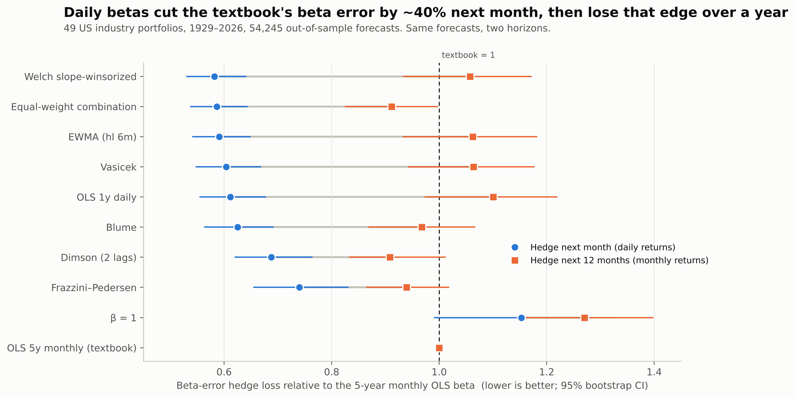
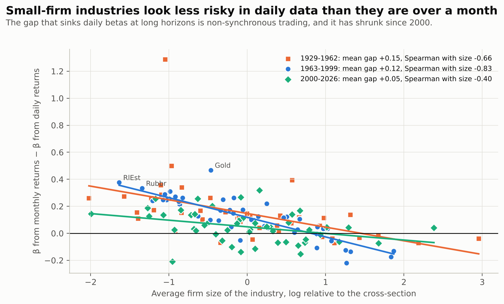
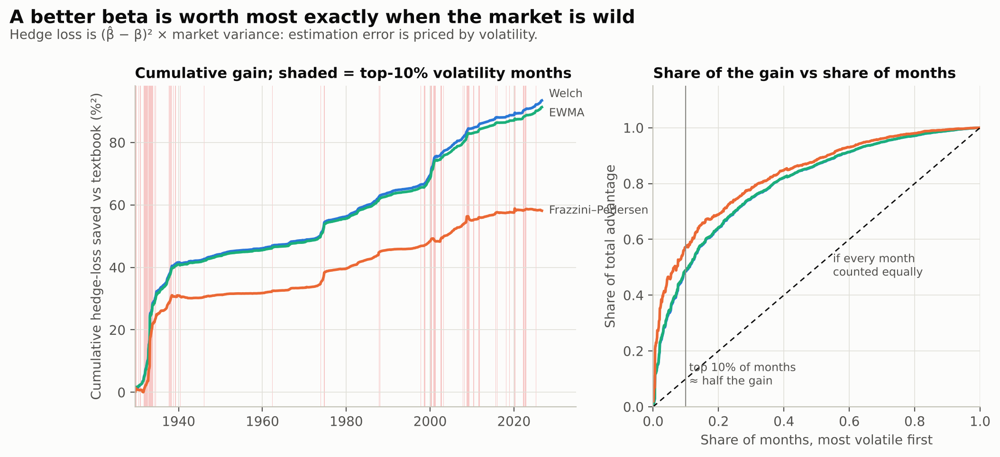
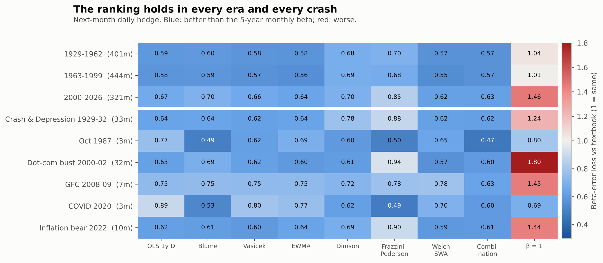
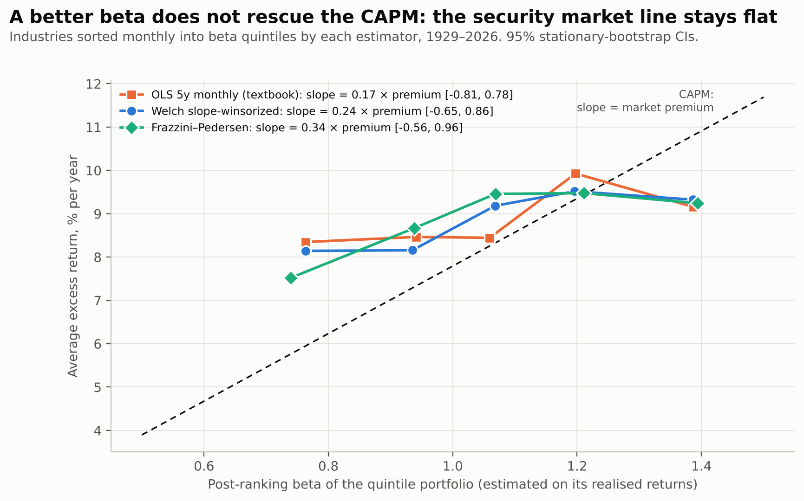

# The Beta You Hedge With

**A 97-year out-of-sample horse race of nine market-beta estimators, and whether a better beta rescues the CAPM**

*Project 09 of [30 Quant Research Projects](../README.md) · Working paper, November 2026*



---

## Abstract

The CAPM beta is the most estimated number in finance, and the textbook recipe (OLS on five years of
monthly returns) is still the default in courses, data terminals and valuation reports. Two questions
are usually asked separately. Which estimator forecasts beta best? And is the flat security market
line (high-beta assets do not earn more) just a symptom of noisy betas? This project answers both on
the same forecasts, with a loss function that a practitioner actually pays: **the variance left over
after hedging next period's market exposure with the estimated beta.**

Nine estimators (textbook monthly OLS, one-year daily OLS, Blume, Vasicek, EWMA, Dimson, Frazzini–
Pedersen, Welch's slope-winsorized age-weighted beta, and an equal-weight combination) plus a β = 1
baseline forecast the beta of each of the 49 Fama–French industry portfolios at every month-end from
July 1929 to August 2026, using only data available that day. That is **54,245 out-of-sample forecasts
per estimator over 1,166 months**, scored on the next month of daily returns and on the next twelve
monthly returns. Inference uses Newey–West Diebold–Mariano tests with Holm correction, a 90% Model
Confidence Set and stationary-bootstrap confidence intervals.

**Main findings**

1. **Daily data cut the textbook's beta error by about 40% next month.** Measured as the avoidable part
   of the hedge loss (the part due to β̂ ≠ realised β), Welch's estimator leaves 0.58 of the textbook's
   error (95% CI 0.53–0.64), EWMA 0.59 and Vasicek 0.60. All eight alternatives beat the textbook after
   Holm correction (largest adjusted p = 0.0002). The 90% Model Confidence Set is {Welch, Combination,
   EWMA}. The ranking holds in each of three eras and in all six stress windows from 1929 to 2022.
2. **The same daily betas lose that edge when the hedge horizon is a year.** Hedging the next twelve
   *monthly* returns, one-year daily OLS is 10% *worse* than the textbook (ratio 1.10, CI 0.97–1.22),
   and Welch, EWMA and Vasicek are 6% worse. Only estimators that correct for slow price adjustment
   keep an edge: Dimson 0.91 (CI 0.83–1.01) and the combination 0.91 (CI 0.82–1.00). None of these
   12-month differences survives Holm correction, so the honest summary is "the advantage disappears",
   not "it reverses".
3. **Why: industries of small firms look less risky in daily data.** The gap between monthly and daily
   betas averages +0.12 to +0.15 before 2000 and is strongly tied to firm size (Spearman −0.83 in
   1963–1999) and to the lagged response to the market (Spearman +0.90). It shrank to +0.05 after 2000,
   and in 2000–2026 the daily estimators win at the 12-month horizon too (0.86–0.90).
4. **Beta error is priced by volatility.** The hedge-loss penalty is (β̂ − β)² × market variance, so the
   most volatile 10% of months deliver about half of every estimator's total advantage (49–57%), even
   though the better estimators also win in 86–92% of all months.
5. **A better beta does not rescue the CAPM.** For every estimator, the post-ranking security market
   line rises at only 0.17–0.34 of the market premium, and the upper end of every 95% CI is below 1.
   Fama–MacBeth slopes are significantly below the realised market return for seven of nine
   estimators after Holm. Better beta *forecasts* buy more realised beta spread, not more return
   spread. A beta-neutral low-minus-high-beta industry portfolio earns 3.4–4.1% a year (t = 2.3–3.0).

**Practical rule.** Estimate beta at the frequency you will hedge at. For a one-month hedge, use
age-weighted daily data with some shrinkage (EWMA, Vasicek or Welch). For a long-horizon hedge or a
cost of capital, either stay with monthly data or correct daily betas for non-synchronous trading
(Dimson lags), and shrink toward the cross-sectional mean. Do not expect any of them to make
high-beta assets earn more.

---

## 1. Why this question

The beta estimation literature is mostly a forecasting contest (Blume 1975; Vasicek 1973; Levi & Welch
2017; Welch 2022), and the asset-pricing literature mostly takes betas as given and finds the security
market line too flat (Black, Jensen & Scholes 1972; Fama & French 1992; Frazzini & Pedersen 2014). The
two meet in an old argument: if betas are measured with error, sorting on noisy betas understates the
true slope, so maybe the CAPM's failure is an estimation failure. This project puts both questions on
one set of forecasts, adds a third (does the winner depend on the hedge horizon?), and uses a loss that
has a direct economic meaning.

**Why a hedging loss.** If an investor holds an asset with excess return *y* and shorts β̂ units of the
market *x*, the variance of the hedged position over the next period is

  L(β̂) = mean[(y − β̂x)²] = L(β\*) + (β̂ − β\*)² · mean[x²],

where β\* is the beta that would have been best in hindsight for that period. The second term is the
only part an estimator controls. It is a squared beta error **weighted by realised market variance**:
the same error costs ten times more in a month when the market is ten times more variable. That one
identity drives finding 4 and explains why rankings are decided in crises.

**Pre-registered design.** Before any result was computed I fixed the universe, the estimator
parameters (literature defaults, listed in `src/estimators.py`), the loss function, the
evaluation sample, the subperiods and stress windows, and the following hypotheses.

| | Hypothesis | Verdict |
|---|---|---|
| H1 | Daily-data estimators with shrinkage or age-weighting beat the 5-year monthly OLS beta in next-month hedge loss. | **Supported** (all eight alternatives, Holm p < 0.001) |
| H2 | More than half of the advantage comes from the most volatile 10% of months. | **Borderline**: 49–57% depending on the estimator |
| H3 | No estimator produces a security market line with a slope equal to the market premium. | **Supported** (all CIs below 1) |
| H4 | At a 12-month monthly-return horizon, uncorrected daily betas lose to monthly betas, and a lag correction (Dimson) recovers the gap. | **Directionally supported, not significant** after Holm |

## 2. Data

**Assets.** The 49 value-weighted industry portfolios of Kenneth French's Data Library, daily returns
from July 1926 to September 2026 (CRSP vintage 202609). Industry portfolios are deliberately chosen over
individual stocks: they exist for a century with no survivorship bias, their betas move with real
economic exposure, and they include industries made of small, thinly traded firms (Coal, Ships,
Rubber, Real Estate) next to mega-cap ones, which is what makes the horizon question testable. Some
industries start later (Soda, Health, Fun and others in 1963); the panel is unbalanced and every
comparison uses the common sample where all estimators are defined.

**Market.** A daily value-weighted market built from the 49 industries, with weights equal to number of
firms × average firm size at the previous month-end (both reported by French). It is used instead of
French's daily factor file only for engineering reasons. Its fidelity was checked against the official
series:

| Check | Value |
|---|---|
| Monthly: correlation with official Mkt (1926–2026, 1,202 months) | 0.9995 |
| Monthly: tracking error | 0.58% a year |
| Daily: correlation with official Mkt-RF (400 random days) | 0.9996 |
| Daily: slope on official / mean absolute difference | 0.9995 / 1.5 bp |

**Risk-free rate.** French's monthly one-month T-bill, converted to the daily rate that compounds to the
monthly rate over that month's trading days (French's own convention). All returns are excess returns.

**Provenance.** The three zip files used have SHA-256 hashes identical to the files served by the
Data Library on 21 November 2026 (hashes in `src/fetch_data.py`). The parsed panel is committed as
`data/panel_daily.csv.gz`.

## 3. Estimators

All parameters were set before evaluation from the original papers or common practice.

| Name | Data | Recipe |
|---|---|---|
| **OLS-5Y-M** (textbook) | 60 monthly returns (min 36) | OLS slope with intercept |
| OLS-1Y-D | 252 daily returns (min 200) | OLS slope with intercept |
| Blume | as OLS-1Y-D | 0.33 + 0.67 β̂ (Blume 1975) |
| Vasicek | as OLS-1Y-D | Empirical-Bayes shrinkage toward the cross-sectional mean, weight = prior variance / (prior variance + sampling variance) |
| EWMA | all past daily returns | Exponentially weighted covariance / variance, half-life 126 days |
| Dimson | 252 daily returns | Sum of slopes on the market return and its first two lags (Dimson 1979) |
| Frazzini–Pedersen | 5y of overlapping 3-day log returns for correlation, 1y of daily for volatilities | ρ · σᵢ/σₘ, then 0.6 β̂ + 0.4 (Frazzini & Pedersen 2014) |
| Welch-SWA | last 756 daily returns | Returns winsorized to [−2x, 4x] around the market's own move, exponential age weights with decay 2/252 per day (Welch 2022) |
| Combination | | Equal-weight average of the eight estimators above |
| β = 1 | | The "no information" baseline |

## 4. Backtest protocol

At the last trading day of each month *t*, each estimator computes each industry's beta from data up to
and including that day. The forecast is scored on

* **next month, daily returns**: L = mean over the days of month *t*+1 of (y − β̂x)²; and
* **next 12 months, monthly returns**: L = mean over months *t*+1…*t*+12 of (Y − β̂X)², with
  compounded monthly excess returns.

Months with fewer than 15 valid daily returns for an industry are skipped. The first evaluation month
is August 1929 (when Frazzini–Pedersen's five-year correlation window first fills), the last is
September 2026 (October 2025 for the 12-month horizon). Unit tests (`tests/`) check every estimator
against reference implementations and verify that perturbing any future return leaves every past
forecast unchanged.

## 5. Evaluation

* **Excess-loss ratio.** For each month, the cross-sectional average of L(β̂) − L(β\*) across industries,
  summed over months and divided by the textbook's sum. This is the share of the textbook's avoidable
  error that remains. Because β\* is estimated from the evaluation month itself, its noise adds the
  same amount to every estimator, so the ratio is biased toward 1 (conservative). Differences in excess
  loss equal differences in raw loss exactly, so the tests below are on raw loss.
* **Diebold–Mariano** tests on the monthly series of loss differences versus the textbook, with
  Newey–West errors (6 lags at the monthly horizon, 18 lags for the overlapping 12-month horizon) and
  **Holm** correction across the nine comparisons.
* **Model Confidence Set** (Hansen, Lunde & Nason 2011), T_max statistic, 90% level.
* **Stationary bootstrap** (Politis & Romano 1994) over months, mean block 12 (24 for the 12-month
  horizon), 2,000 resamples, for all confidence intervals.
* **Mincer–Zarnowitz slope**: a market-variance-weighted regression of realised on forecast beta. A slope
  below 1 means the forecasts are too dispersed and should be shrunk.

## 6. Results

### 6.1 Next month: daily data win by a wide margin

| Estimator | Hedge loss (%²/day) | Variance removed | Excess-loss ratio [95% CI] | DM t | Holm p | MZ slope | In 90% MCS |
|---|---|---|---|---|---|---|---|
| Welch-SWA | 1.301 | 47.8% | **0.58** [0.53, 0.64] | −6.07 | <0.001 | 0.93 | ✓ |
| Combination | 1.302 | 47.8% | 0.59 [0.54, 0.64] | −5.93 | <0.001 | 1.04 | ✓ |
| EWMA | 1.303 | 47.7% | 0.59 [0.54, 0.65] | −6.03 | <0.001 | 0.91 | ✓ |
| Vasicek | 1.305 | 47.6% | 0.60 [0.55, 0.67] | −5.71 | <0.001 | 0.91 | |
| OLS-1Y-D | 1.307 | 47.6% | 0.61 [0.55, 0.68] | −5.64 | <0.001 | 0.86 | |
| Blume | 1.309 | 47.5% | 0.63 [0.56, 0.69] | −5.44 | <0.001 | 1.29 | |
| Dimson | 1.321 | 47.0% | 0.69 [0.62, 0.76] | −4.60 | <0.001 | 0.81 | |
| Frazzini–Pedersen | 1.331 | 46.6% | 0.74 [0.65, 0.83] | −3.95 | <0.001 | 1.32 | |
| **OLS-5Y-M (textbook)** | 1.381 | 44.6% | 1 | | | 0.63 | |
| β = 1 | 1.410 | 43.4% | 1.15 [0.99, 1.33] | +2.38 | 0.017 | | |

*Hindsight-optimal β\* leaves 1.189 %²/day. Common sample: 54,245 industry-months, 1,166 months.*

Three things stand out. First, the textbook beta is badly over-dispersed (MZ slope 0.63): its high betas
are too high and its low betas too low, which is exactly the error Blume and Vasicek were designed to
fix. Second, the move from monthly to daily data does most of the work: plain one-year daily OLS
already reaches 0.61, and shrinkage or age-weighting adds a few points. Third, Blume and Frazzini–
Pedersen over-shrink at this horizon (MZ slopes 1.29 and 1.32), so their fixed weights toward 1 cost
accuracy for diversified industry portfolios.

In absolute terms, hedging removes about 45–48% of an industry's daily variance, and the
best estimator lowers the remaining variance by 5.8% relative to the textbook. The 40% figure refers to
the part of the loss an estimator can influence.

### 6.2 Next year: the advantage disappears

| Estimator | Excess-loss ratio [95% CI] | DM t | Holm p | Bias of β̂ vs realised monthly β | In 90% MCS |
|---|---|---|---|---|---|
| Dimson | **0.91** [0.83, 1.01] | −1.76 | 0.63 | −0.06 | ✓ |
| Combination | 0.91 [0.82, 1.00] | −1.76 | 0.63 | −0.09 | ✓ |
| Frazzini–Pedersen | 0.94 [0.86, 1.02] | −1.34 | 0.97 | −0.06 | ✓ |
| Blume | 0.97 [0.87, 1.07] | −0.56 | 1.00 | −0.10 | ✓ |
| **OLS-5Y-M (textbook)** | 1 | | | −0.01 | ✓ |
| Welch-SWA | 1.06 [0.93, 1.17] | +0.85 | 1.00 | −0.12 | |
| EWMA | 1.06 [0.93, 1.18] | +0.88 | 1.00 | −0.11 | |
| Vasicek | 1.06 [0.94, 1.18] | +0.94 | 1.00 | −0.11 | |
| OLS-1Y-D | 1.10 [0.97, 1.22] | +1.40 | 0.97 | −0.11 | |
| β = 1 | 1.27 [1.15, 1.40] | +3.79 | 0.001 | −0.07 | |

The winners of 6.1 are now the losers. The bias column shows why: every estimator built on
contemporaneous daily returns under-predicts the beta that shows up in monthly returns by about 0.11.
The estimators that keep (or slightly improve) their rank are those that either use monthly data, add
lagged market returns (Dimson), use multi-day returns for correlation (Frazzini–Pedersen) or shrink
toward 1 (Blume). Nothing is significant after Holm: twelve-month windows overlap, so a century gives
fewer than 100 independent observations.

### 6.3 Why the horizon matters: non-synchronous trading



For each industry and era I estimate beta on the same days twice, from daily and from monthly returns.

| Era | Mean daily β | Mean monthly β | Mean gap | Gap > 0 | Spearman(gap, size) | Spearman(gap, lag β) |
|---|---|---|---|---|---|---|
| 1929–1962 | 0.96 | 1.11 | +0.15 | 79% | −0.66 | +0.89 |
| 1963–1999 | 0.97 | 1.09 | +0.12 | 82% | −0.83 | +0.90 |
| 2000–2026 | 0.95 | 1.00 | +0.05 | 69% | −0.40 | +0.47 |

The gap is largest for industries of small firms and is almost perfectly ranked by how much the
industry reacts to *yesterday's* market (all p < 0.005). That is the signature of stale prices
(Scholes & Williams 1977; Dimson 1979): small firms' prices catch up with market moves over several
days, so a daily regression misses part of their exposure, while a monthly regression captures it. The
gap has fallen by two thirds since 2000, consistent with decimalisation and electronic trading, and
the subperiod table confirms that daily estimators beat the textbook at the 12-month horizon in
2000–2026 (ratios 0.86–0.90) but not before.

| 12-month horizon | OLS-1Y-D | Vasicek | EWMA | Welch | Dimson | FP | Combination |
|---|---|---|---|---|---|---|---|
| 1929–1962 | 1.16 | 1.12 | 1.12 | 1.12 | 0.88 | 0.88 | 0.92 |
| 1963–1999 | 1.16 | 1.11 | 1.10 | 1.10 | 0.96 | 0.96 | 0.95 |
| 2000–2026 | 0.91 | 0.91 | 0.90 | 0.89 | 0.92 | 1.03 | 0.86 |

### 6.4 Beta error is priced by volatility



| Estimator | Advantage from top 5% vol months | Top 10% | Bottom 50% | Months won |
|---|---|---|---|---|
| Welch-SWA | 34% | 49% | 13% | 89% |
| EWMA | 34% | 49% | 13% | 90% |
| Combination | 38% | 52% | 12% | 92% |
| Vasicek | 35% | 49% | 13% | 88% |
| Frazzini–Pedersen | 46% | 57% | 12% | 75% |

The better estimators win most months, but by tiny amounts; the bulk of the accumulated gain arrives
in a handful of violent episodes (1929–33, 1937–38, 1974, 2000–02, 2008–09). A beta
estimator evaluated only on a calm sample would look almost indistinguishable from the textbook.

### 6.5 Every era, every crash



At the one-month horizon, every alternative beats the textbook in every subperiod and in each of the
six stress windows: the 1929–32 crash and depression, October 1987, the dot-com bust, the 2008–09
financial crisis, the COVID crash and the 2022 inflation bear market. β = 1 is the only estimator that
is worse than the textbook in most windows.

### 6.6 Ablations and sensitivity

| Variant | Next month | Next 12 months |
|---|---|---|
| OLS daily 126 / **252** / 504 / 1260 days | 0.64 / **0.61** / 0.65 / 0.72 | 1.16 / **1.10** / 1.10 / 1.11 |
| OLS monthly **60** / 36 / 120 months | **1** / 1.03 / 1.15 | **1** / 1.04 / 1.10 |
| EWMA half-life 63 / **126** / 252 days | 0.59 / **0.59** / 0.62 | 1.10 / **1.06** / 1.05 |
| Dimson 1 / **2** / 5 lags | 0.68 / **0.69** / 0.84 | 0.91 / **0.91** / 0.93 |
| Welch: **full** / age-weighting only / winsorizing only / neither | **0.58** / 0.59 / 0.67 / 0.67 | **1.06** / 1.08 / 1.10 / 1.11 |
| Welch bounds (−1, 3) / **(−2, 4)** / (−3, 5) | 0.58 / **0.58** / 0.58 | 1.04 / **1.06** / 1.06 |
| Blume / Vasicek applied to the 5-year *monthly* beta | 0.88 / 0.88 | 0.91 / 0.94 |
| Dimson-adjusted daily beta + Vasicek shrinkage (not pre-registered) | 0.67 | **0.88** |

Bold = main specification. Two lessons. On industry portfolios, **Welch's gain comes from age-weighting,
not winsorizing**: winsorizing alone is no better than plain OLS on the same window, which makes sense
because diversified portfolios have few idiosyncratic outliers to clip (on single stocks the
winsorizing would likely matter more). And the conclusions are not knife-edge: no reasonable parameter
choice makes the monthly textbook competitive at one month, and no variant of an uncorrected daily
beta beats the textbook at twelve months over the full sample. The last row, a post-hoc combination of the two fixes that work at
long horizons, gives the best 12-month ratio (0.88); it is reported as a lead for future work, not as
a result.

### 6.7 Does a better beta rescue the security market line?



Each month, the 49 industries are sorted into quintiles by each estimator's beta; portfolios are held
one month. Post-ranking betas come from regressing each quintile's realised returns on the market.
Under the CAPM, the line through the quintiles should rise at the market premium (7.8% a year).

| Sorting beta | Post-ranking β spread (Q5−Q1) | SML slope / market premium [95% CI] | Beta-neutral low-minus-high alpha | Fama–MacBeth γ₁ − market, Holm p |
|---|---|---|---|---|
| OLS-5Y-M (textbook) | 0.62 | 0.17 [−0.81, 0.78] | 4.1% (t 3.0) | 0.023 |
| OLS-1Y-D | 0.61 | 0.20 [−0.78, 0.84] | 3.8% (t 2.5) | 0.010 |
| Blume | 0.61 | 0.20 [−0.78, 0.84] | 3.8% (t 2.5) | 0.090 |
| Vasicek | 0.64 | 0.28 [−0.64, 0.89] | 3.6% (t 2.5) | 0.014 |
| EWMA | 0.62 | 0.29 [−0.61, 0.93] | 3.4% (t 2.3) | 0.008 |
| Dimson | **0.69** | 0.31 [−0.61, 0.90] | 3.7% (t 2.5) | 0.014 |
| Frazzini–Pedersen | 0.66 | **0.34** [−0.56, 0.96] | 3.4% (t 2.4) | 0.159 |
| Welch-SWA | 0.62 | 0.24 [−0.65, 0.86] | 3.7% (t 2.5) | 0.014 |
| Combination | 0.66 | 0.22 [−0.72, 0.84] | 4.0% (t 2.7) | 0.031 |

The answer is no. Whatever beta is used to sort, high-beta industries earn about one fifth to one third
of what the CAPM says they should, and the upper end of every confidence interval is below the full
premium. Better beta forecasting does do one thing: it widens the realised beta spread between the
quintiles (0.62 for the textbook, up to 0.69 for Dimson), which is what better sorting should do. But
the return spread does not grow with it. The estimators that steepen the line slightly (Dimson,
Frazzini–Pedersen) are the ones that forecast better at long horizons, not at short ones, which fits:
the return premium is earned over months, so the relevant beta is the long-horizon one. The
low-minus-high-beta industry portfolio, levered to be market-neutral, earns 3.4–4.1% a year; the raw
t-statistics are 2.3–3.0, but after Holm across the nine sorts only the textbook sort stays below 5%
(adjusted p = 0.024), so this is a "betting-against-beta in industries" effect of modest strength.

## 7. What this means in practice

* **Hedging a book for the next month:** use daily data, age-weighted (EWMA with a six-month half-life
  or Welch), and shrink toward the cross-sectional mean. Expect to remove roughly 40% of the beta
  error you would carry with a five-year monthly beta, most of it in the months that matter.
* **Cost of capital, long-horizon hedges, small or illiquid assets:** daily betas understate exposure.
  Either use monthly data or add lagged market returns (Dimson) and then shrink. On data before 2000,
  uncorrected daily betas are 0.1–0.15 too low for the average industry.
* **Never use the raw five-year monthly beta without shrinkage:** its Mincer–Zarnowitz slope of 0.63
  says the cross-section of textbook betas is about 60% too dispersed.
* **Do not use a better beta to argue for the CAPM.** The flat SML is not a measurement artefact.

## 8. Limitations

* **Portfolios, not stocks.** Industries are diversified, so idiosyncratic noise is small and
  winsorizing has little to do. On individual stocks, estimation noise is much larger and the gains from
  shrinkage and winsorizing would likely be bigger; the horizon gap would also be larger for small
  caps. Testing this needs CRSP-quality stock data, which is not freely available.
* **The market is built from the same 49 industries**, as the CRSP value-weighted market is built from
  the same stocks. Its daily correlation with the official factor is 0.9996.
* **Realised β\* is noisy** (about 21 daily observations), which biases every excess-loss ratio toward
  1. The true improvements are therefore at least as large as reported.
* **Twelve-month horizon power.** With overlapping windows, the 12-month tests have little power; the
  direction is consistent across eras and robustness variants, but no single 12-month comparison is
  significant after multiple-testing correction.
* **Forty-nine assets for the SML.** Quintiles hold about ten industries, so the SML slope is estimated
  with wide intervals. The conclusion (slope well below the premium) is robust; the exact slope is not.
* **Data revisions.** French revises history every month. The committed panel is frozen at the 202609
  vintage; re-downloading will move numbers in the third decimal.
* **Not tested:** conditional or regime-switching betas, betas from options (implied correlations),
  Kalman-filter betas (that is project 25), and factor models beyond the market (project 17).

## 9. Connections to other projects

* **#01 Monte Carlo calibration** found that what fixes risk forecasts in crises is *time-varying
  volatility*, not fat tails. This project finds the same pattern for betas: the age-weighted
  estimators (EWMA, Welch) win, and their advantage is earned in high-volatility months.
* **#13 GARCH** and **#25 Kalman hedge ratio** are the natural next steps for a dynamic beta; this
  project provides the benchmark they have to beat (Welch, excess-loss ratio 0.58).
* **#17 Fama–French factors** extends the SML question to multi-factor models.

## 10. Reproduce

```bash
pip install -r requirements.txt
./run_all.sh            # ~1 minute: backtest, statistics, robustness, figures, tests
python src/fetch_data.py   # optional: re-download the raw Ken French files and rebuild the panel
```

Every number above is in `results/*.csv`; every figure is produced by `src/figures.py`.

## 11. Repository layout

```
09-beta-horse-race/
├── README.md                 this paper
├── data/panel_daily.csv.gz   49 industry + market excess returns, daily, 1926-2026 (French, CRSP 202609)
│   industry_avg_firm_size_monthly.csv   French's average firm size per industry (for section 6.3)
├── src/
│   ├── fetch_data.py         download the raw files, check hashes, rebuild the panel
│   ├── data.py               parsing, market proxy, daily risk-free rate, validation
│   ├── estimators.py         the nine estimators (all parameters at the top)
│   ├── backtest.py           walk-forward forecasts and next-period sums of squares
│   ├── evaluate.py           loss tables, DM/Holm, MCS, bootstrap, stress, SML tests
│   ├── horizon_gap.py        daily vs monthly beta by industry and era
│   ├── robustness.py         sensitivity and ablations
│   └── figures.py
├── tests/test_estimators.py  correctness, no look-ahead, loss identity
├── results/   figures/
├── study/ESTUDIO_09.pdf     Spanish study guide (not part of the paper)
└── run_all.sh  requirements.txt  LINKEDIN_POST.md
```

## References

Black, F., Jensen, M. C. & Scholes, M. (1972). The capital asset pricing model: some empirical tests.
Blume, M. E. (1975). Betas and their regression tendencies. *Journal of Finance* 30(3).
Diebold, F. X. & Mariano, R. S. (1995). Comparing predictive accuracy. *JBES* 13(3).
Dimson, E. (1979). Risk measurement when shares are subject to infrequent trading. *JFE* 7(2).
Fama, E. F. & French, K. R. (1992). The cross-section of expected stock returns. *Journal of Finance* 47(2).
Fama, E. F. & MacBeth, J. D. (1973). Risk, return, and equilibrium: empirical tests. *JPE* 81(3).
Frazzini, A. & Pedersen, L. H. (2014). Betting against beta. *JFE* 111(1).
Hansen, P. R., Lunde, A. & Nason, J. M. (2011). The model confidence set. *Econometrica* 79(2).
Holm, S. (1979). A simple sequentially rejective multiple test procedure. *Scand. J. Statistics* 6(2).
Levi, Y. & Welch, I. (2017). Best practice for cost-of-capital estimates. *JFQA* 52(2).
Newey, W. K. & West, K. D. (1987). A simple, positive semi-definite, heteroskedasticity and autocorrelation consistent covariance matrix. *Econometrica* 55(3).
Politis, D. N. & Romano, J. P. (1994). The stationary bootstrap. *JASA* 89(428).
Scholes, M. & Williams, J. (1977). Estimating betas from nonsynchronous data. *JFE* 5(3).
Vasicek, O. A. (1973). A note on using cross-sectional information in Bayesian estimation of security betas. *Journal of Finance* 28(5).
Welch, I. (2022). Simply better market betas. *Critical Finance Review* 11(1).

Data: Kenneth R. French Data Library, Tuck School of Business, Dartmouth College.
