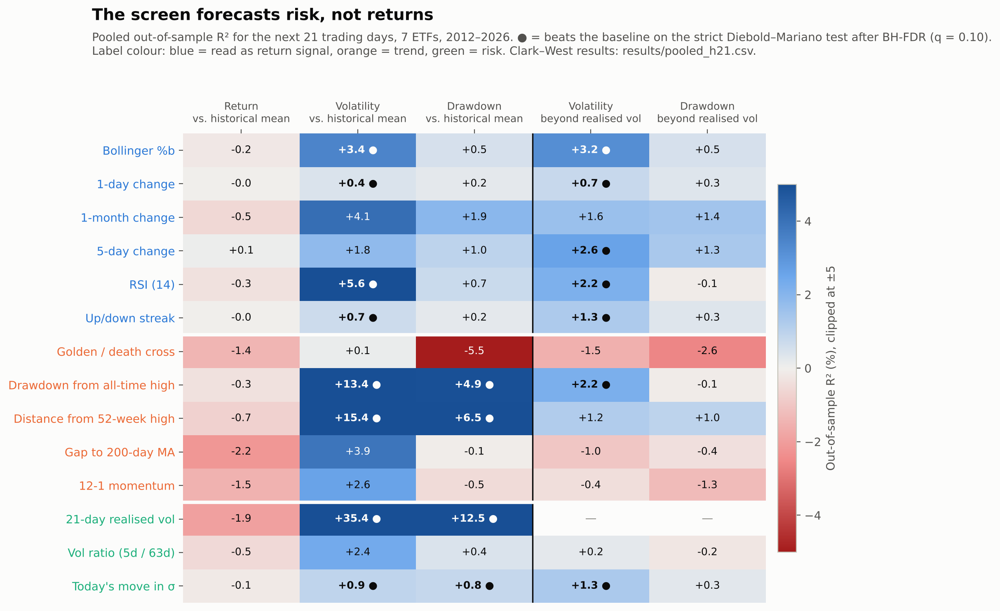
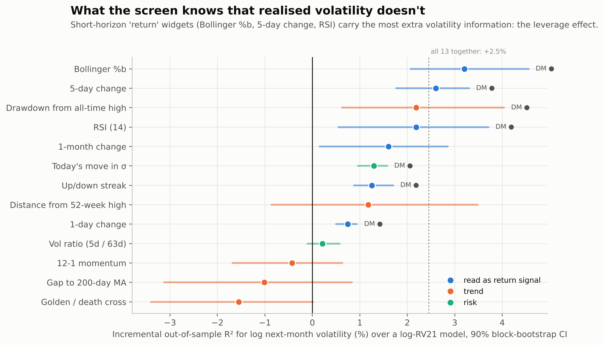
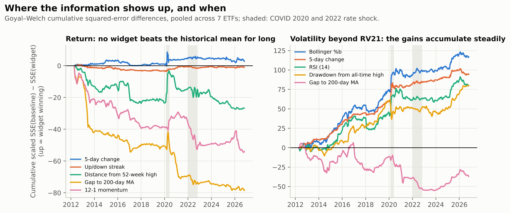
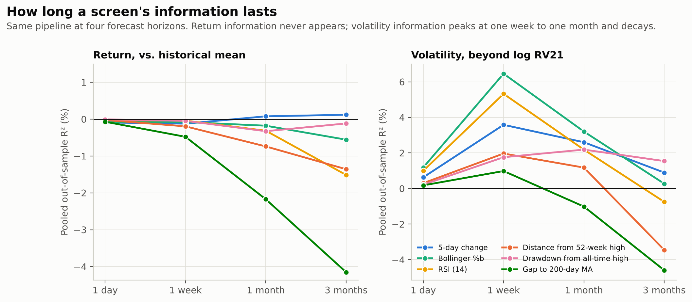
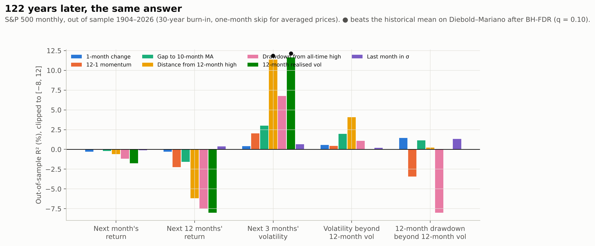
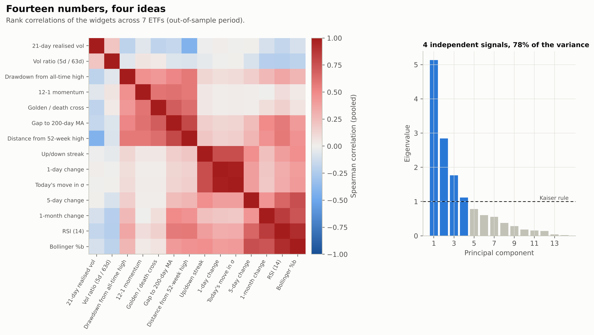
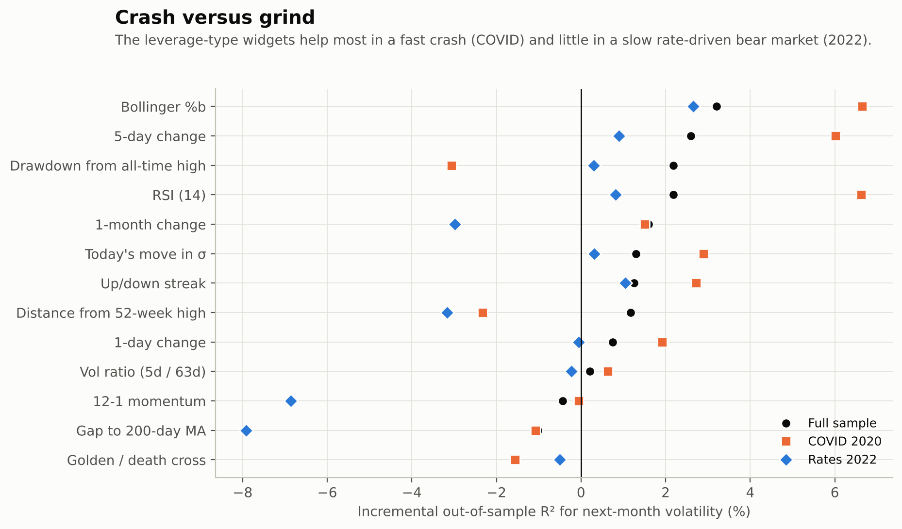

# What on a Market Screen Is Worth Looking At?

*A pre-registered out-of-sample audit of the fourteen numbers every market terminal shows, and a terminal rebuilt
around the answer.*

**Project 10 of [30 Quant Research Projects](../README.md)** · Data to 20 November 2026 ·
[Open the terminal](terminal/) · [Pre-registration](PREREGISTRATION.md)

---

## Abstract

Retail terminals show the same dozen numbers for every ticker: the day's change, the week, the month, RSI, the 50- and
200-day averages, the distance from the 52-week high, Bollinger %b, realised volatility, the drawdown. Most of them are
presented, and read, as signals about where the price goes next. I audit fourteen of them out of sample on seven ETFs
across asset classes (3,654 forecast dates, 2012–2026) and on 122 years of monthly S&P 500 data (1904–2026), for three
targets: next month's return, next month's volatility and next month's drawdown. The hypotheses were written down before
any out-of-sample number was computed.

**None of the fourteen numbers forecasts the return.** On the strict Diebold–Mariano test no return forecast beats the
historical mean after false-discovery-rate control, in the ETFs or in 122 years of S&P 500 data. The best pooled
out-of-sample R² is +0.08% (5-day change, 90% CI −0.21% to +0.38%), and the trend numbers (200-day gap, golden
cross, 12-1 momentum) are actively harmful, at −1.4% to −2.2%. **Almost every one of them forecasts risk.** The
numbers that are read as return signals carry the most information about volatility *beyond* realised volatility itself.
Bollinger %b adds +3.2% out-of-sample R² for next-month volatility (+6.4% at a one-week horizon), the 5-day change +2.6%
and RSI +2.2%, all surviving FDR on the strict test. The sign of that information depends on the asset. A Bollinger %b
going from its 10th to its 90th percentile cuts next-month volatility by 25% for US equities and 27% for high yield,
and *raises* it by 17% for gold. The fourteen numbers span four independent ideas, and combining all of them does worse
than the best one alone. The [terminal](terminal/) built from these results shows every number with what it has
actually predicted, and greys out those that predicted nothing.



---

## 1. Why this question

A screen is a forecasting device whether or not it admits it. A trader who sees "RSI 28" or "−14% from the 52-week high"
updates a belief about the next few weeks. The academic literature tests one signal at a time, usually as a trading
strategy, and usually for returns: momentum (Jegadeesh & Titman, 1993; Moskowitz, Ooi & Pedersen, 2012), the 52-week
high (George & Hwang, 2004), moving-average rules (Brock, Lakonishok & LeBaron, 1992), technical oscillators. Out-of-sample
studies of return predictability (Welch & Goyal, 2008) find that most published predictors fail to beat the historical
mean. Separately, the volatility literature has known since Black (1976) and Christie (1982) that falling prices raise
future volatility, the leverage effect, and HAR models (Corsi, 2009) forecast volatility well from its own lags.

What has not been done, as far as I can find, is to audit **the screen as a whole**: take the exact set of numbers a
terminal shows, ask each one the same three questions (return, volatility, drawdown) under the same out-of-sample
protocol, control for multiple testing across the whole screen, and then ask what the numbers add **beyond the one
number a risk model would use anyway**, realised volatility. The answer decides what a terminal should show and how it
should label it.

## 2. Pre-registered hypotheses

Written in [PREREGISTRATION.md](PREREGISTRATION.md) before any out-of-sample statistic was computed. Two changes were made
afterwards and are listed there. GFC stress could not be tested daily, and a Diebold–Mariano test was added as a stricter
secondary criterion.

| | Hypothesis | Verdict |
|---|---|---|
| **H1** | No widget beats the historical mean for the next-month return after BH-FDR (q = 0.10). | **Holds on the strict test; formally falsified by a hair on the lenient one.** Clark–West passes four widgets, but their R²_OS are −0.03% to +0.08%. Only the 5-day change has a positive point estimate, with a CI that spans zero. Diebold–Mariano passes none, and neither test passes any in 1904–2026. With BH applied to the 14 return tests alone, Clark–West passes none either (smallest adjusted p = 0.23). |
| **H2** | Vol-type widgets (RV21, vol ratio, today's σ-move) forecast log volatility with R²_OS > 20%. | **Only RV21: +35.4%** (log RV21: +42.7%). The vol ratio (+2.4%) and today's move (+0.9%) fall far short. (Today's move is tested signed, as screens show it; the pre-registration's "\|z\|" wording was imprecise.) |
| **H3** | Trend widgets carry volatility/drawdown information *incremental to RV21*, but none about the return. | **Supported in the weak form, narrowly in the strong one.** All five trend widgets pass Clark–West for incremental vol. Only the drawdown from the all-time high survives the strict test (+2.2%, CI 0.6% to 4.0%). The 200-day gap, momentum and the cross *lose* to RV21 alone. |
| **H4** | The 14 widgets span ≤ 4 independent pieces of information. | **Holds: exactly 4** eigenvalues above 1, 78% of the variance. |

The headline finding, that the short-horizon "return" widgets are the best incremental *volatility* predictors, was not
pre-registered. I report it as exploratory but robust. It holds at four horizons, in five of seven assets (not Treasuries or uranium), and in the COVID
crash, and the strict test confirms it after FDR control.

## 3. Data

* **Seven ETFs**, daily adjusted closes (dividends reinvested) from Yahoo Finance, April 2006 to 20 November 2026: SPY
  (US equities), EEM (emerging markets), TLT (long Treasuries), HYG (high yield), GLD (gold), USO (crude oil), URA
  (uranium miners). This is **deliberately the same universe and file as [Project 01](../01-monte-carlo-calibration/)**, its
  volatility-forecasting companion. Project 01 asked whether *simulators* get the risk right on these seven assets.
  This project asks what the *numbers on the screen* know about the same risk. Seven asset classes with different
  volatility regimes are the point of the cross-section.
* **S&P 500 monthly, January 1871 to September 2026**, Shiller's series as maintained in `datasets/s-and-p-500` on
  GitHub. Price returns only, since the dividend column is not maintained after 2023. Shiller prices are **monthly averages of daily
  closes**. Averaging makes consecutive monthly returns mechanically autocorrelated (Working, 1960), which would hand a
  fake edge to every short-term widget. Every monthly target therefore skips one month and starts at the end of month
  t+1.

## 4. The fourteen numbers

All are computed with information up to the close of day *t* only (a unit test rewrites the future and checks
that no past widget value changes).

| Number | Definition | Read by users as |
|---|---|---|
| 1-day, 5-day, 1-month change | sums of the last 1, 5, 21 log returns | return signal |
| RSI (14) | Wilder's relative strength index | return signal (overbought/oversold) |
| Bollinger %b | position of price in a 20-day, 2σ band | return signal |
| Up/down streak | signed count of consecutive same-sign days | return signal |
| 12-1 momentum | return from t−252 to t−21 | trend |
| Gap to 200-day MA | log price − log SMA200 | trend |
| Golden/death cross | sign of SMA50 − SMA200 | trend |
| Distance from 52-week high | log price − log 252-day max | trend |
| Drawdown from all-time high | log price − log running max | trend |
| 21-day realised vol | annualised RMS of daily returns | risk |
| Vol ratio | log(RV5 / RV63) | risk |
| Today's move in σ | r_t / sd of last 63 days | risk |

## 5. Method

**Targets** at day *t* use returns from *t*+1 to *t*+21 only. They are the forward log return, the log of forward realised
volatility, and the forward maximum drawdown of the cumulative return path.

**Out-of-sample forecasts.** For each asset, widget and target, an expanding-window OLS of the target on the widget,
refitted every 21 days after a 5-year training period. At each refit only observations whose 21-day target window has
closed enter the fit, a 21-day embargo, so overlapping targets never leak into training (unit-tested). The out-of-sample
period runs from April 2012 (April 2013 for HYG, November 2016 for URA) to October 2026.

**Two baselines.** *Standalone*: the prevailing historical mean of the target, the Welch–Goyal benchmark. *Incremental*
(volatility and drawdown only): an expanding OLS on log RV21, and the challenger adds the widget. This asks what a
number tells you that the obvious risk model does not already know.

**Statistics.** Campbell–Thompson out-of-sample R². **Clark–West** (2007) MSPE-adjusted test, which is the pre-registered
primary test. It asks whether the widget carries information *in population* and corrects for the noise of estimating a
larger model. **Diebold–Mariano** on the raw squared-error difference is the stricter secondary test, added after the first
results. It asks whether the forecast *as estimated* is better, and that is the question a terminal user faces. Both use
Newey–West variances with lag 2h = 42 for overlapping forecasts. Pooled tests weight assets equally: each asset's squared
errors are scaled by its baseline MSE and averaged by date. The 90% confidence intervals come from a moving-block bootstrap
(63-day blocks, 500 draws). **Benjamini–Hochberg at q = 0.10** is applied within each pre-registered family (standalone,
incremental, per-asset).



## 6. Results

### 6.1 Returns: the screen says nothing

The left column of the information map is the most important result. Of the 14 pooled return tests, Clark–West passes
four (1-day change, 5-day change, drawdown, streak). Their out-of-sample R² are −0.00%, +0.08%, −0.33% and −0.03%. That
is the textbook pattern of a population signal too weak to survive its own estimation noise. Diebold–Mariano passes none.
The four Clark–West passes also depend on the family. The pre-registered family pools return, volatility and drawdown
tests, and its many strong volatility rejections relax the BH threshold. Applied to the 14 return tests alone, BH leaves
no survivor (smallest adjusted p = 0.23).
Per asset, 1 of 98 return tests survives FDR: the drawdown of high-yield credit, at +3.4%, a plausible credit
mean-reversion effect. One rejection in 98 at q = 0.10 is what noise alone would produce.

The trend widgets are worse than useless for returns. The 200-day gap (−2.2%), RV21 (−1.9%), 12-1 momentum (−1.5%) and
the golden/death cross (−1.4%) all *lose* to the historical mean. The cumulative-error plot shows how. The 200-day gap
and momentum lose most of their ground in two episodes, the 2013 taper tantrum and the 2020 V-shaped recovery, when trend
signals were pointing the wrong way at the turn. Putting all fourteen numbers into one regression gives R²_OS = −20%.



### 6.2 Volatility and drawdown: the screen is a risk monitor

All fourteen widgets pass Clark–West for next-month volatility against the historical mean, and eight also pass
Diebold–Mariano. RV21 alone gives +35.4% (+42.7% in logs). The trend widgets come next, because a
drawdown is volatile: distance from the 52-week high gives +15.4% and drawdown from the all-time high +13.4%. They also
lead for drawdown, at +6.5% and +4.9%.

The more useful question is what each number adds **on top of realised volatility**. Here the ranking reverses. The
numbers read as short-term *return* signals carry the most extra risk information:

| Incremental R²_OS for next-month vol, over log RV21 | Point | 90% CI | Strict test (DM, FDR) |
|---|---|---|---|
| Bollinger %b | +3.2% | [+2.1, +4.6] | ✓ |
| 5-day change | +2.6% | [+1.8, +3.3] | ✓ |
| RSI (14) | +2.2% | [+0.5, +3.7] | ✓ |
| Drawdown from all-time high | +2.2% | [+0.6, +4.0] | ✓ |
| Today's move in σ | +1.3% | [+1.0, +1.6] | ✓ |
| Up/down streak | +1.3% | [+0.9, +1.7] | ✓ |
| 1-day change | +0.7% | [+0.5, +0.9] | ✓ |
| All 13 together | +2.5% | [−1.8, +6.2] | ✗ |
| Gap to 200-day MA | −1.0% | [−3.1, +0.8] | ✗ |
| Golden/death cross | −1.5% | [−3.4, +0.0] | ✗ |

This is the leverage effect seen through a terminal. A low Bollinger %b, a low RSI and a negative 5-day change all say
that the price has just fallen, and recent falls predict volatility that RV21 has not yet absorbed. The 200-day gap and
momentum are too slow: by the time they move, RV21 already contains the information. On drawdown, no widget survives
the strict test beyond RV21, which makes RV21 the single number a risk-minded screen cannot omit.

### 6.3 The same number means opposite things in different markets

A full-sample regression of log forward volatility on log RV21 and each widget shows how next-month volatility changes
when the widget moves from its 10th to its 90th percentile ([`results/vol_slopes_full_sample.csv`](results/vol_slopes_full_sample.csv)):

| | SPY | HYG | EEM | USO | TLT | URA | **GLD** |
|---|---|---|---|---|---|---|---|
| Bollinger %b | −25% | −27% | −15% | −11% | 0% | −1% | **+17%** |
| RSI (14) | −22% | −24% | −12% | −12% | +1% | −3% | **+19%** |
| 1-month change | −17% | −11% | −10% | −11% | 0% | −1% | **+17%** |

Equities, credit and oil show the classic leverage effect. Treasuries show none. **Gold shows it reversed**: rallies, not
sell-offs, precede volatility. This is consistent with gold's safe-haven role (Baur & Lucey, 2010) and the "inverse
leverage effect" reported for gold (Baur, 2012). A terminal that colours a low RSI as "oversold, buy" across all
assets is miscoding the one thing RSI does carry. Its information is about risk, and its sign depends on the asset.

### 6.4 How long the information lasts



Re-running the whole pipeline at 1, 5, 21 and 63 days, the incremental volatility information of the short-horizon
widgets **peaks at one week** (Bollinger %b +6.4%, RSI +5.3%, 5-day change +3.6%) and has mostly faded by three months.
The slow widgets (52-week high, 200-day gap) turn negative at three months. No horizon produces return information.

### 6.5 122 years of S&P 500



The monthly replication uses seven monthly versions of the widgets, 1,460–1,471 out-of-sample months from 1904, a
one-month skip and the same tests. **No widget forecasts the next month's or the next year's return on either test.**
Several are strongly negative at 12 months: realised vol −23%, drawdown −7.5%, 12-month high −6.2%. Volatility is again
forecastable. The distance from the 12-month high gives +11.4% standalone and +4.1% beyond 12-month vol (CW-significant).
The 12-month high and 12-month vol pass the strict test (BH-adjusted p = 0.053, just inside q = 0.10). The result does
not depend on the post-2010 sample.

### 6.6 Fourteen numbers, four ideas



Pooled rank correlations cluster into a **short-term move** block (1-day, today's σ-move, streak), an **oscillator**
block (5-day, 1-month, RSI, Bollinger %b, correlations up to 0.9), a **trend** block (52-week high, 200-day gap, cross,
momentum, drawdown) and a **volatility** block (RV21, vol ratio). Four eigenvalues exceed one and explain 78% of the
variance. This explains why the kitchen-sink model fails. The thirteen numbers beyond RV21 contain about three ideas,
and fitting thirteen coefficients to them costs more in estimation noise than it gains.

### 6.7 Crash versus grind



The leverage-type widgets earn most of their keep in a fast crash. In COVID (Feb–May 2020) Bollinger %b, RSI and the
5-day change each add +6% to +7% beyond RV21. In the slow, rate-driven 2022 bear market they add little, and the 200-day
gap and momentum lose 7–8%, because the trend "warning" fired early and volatility stayed contained. The GFC precedes the daily
out-of-sample period and is covered by the monthly replication.

## 7. The terminal

[**Open the Honest Market Terminal →**](terminal/)

The terminal is a single static page with the data embedded, rebuilt by `src/terminal_data.py`. For each of the seven
instruments it shows:

* the usual fourteen numbers, each with its percentile in the asset's own history;
* three badges per number: return information, volatility information and drawdown information beyond realised vol,
  marked *Informative* (strict test after FDR), *Weak* (positive out-of-sample R² but significant only on the lenient
  test) or *No info*;
* the **vol impact**: how much the number's current value moves next month's volatility forecast, relative to the
  number sitting at its median, holding realised vol fixed;
* a **next-month return forecast that honestly reads "No signal"**, and a next-month volatility forecast with a 90% range;
* a toggle, on by default, that hides the numbers that never predicted anything on the strict test.

At the 20 November 2026 close, after a −3.6% day in SPY and −6.6% in URA, the terminal forecasts next-month volatility of
26.6% for SPY (90% range 15–51%) against 20.9% from realised volatility alone. The difference comes from the
Bollinger %b and short-term moves the audit found informative.

## 8. Referee self-review

Before release I reviewed the project as a hostile referee would. These are the objections, and what was done about each.

| Objection | Response |
|---|---|
| Clark–West can reject while R²_OS ≤ 0. Marking those cells as "significant" next to a negative number misleads. | The star chart and the Shiller chart now mark only strict (Diebold–Mariano, FDR) results. The terminal's *Weak* badge requires a positive R²_OS. All CW results remain in the CSVs. |
| The pre-registered BH family mixes return and volatility tests, so strong volatility rejections relax the threshold for returns. | BH reapplied within the 14 return tests: no survivor on either test (smallest adjusted p = 0.23 for CW). H1's verdict is reported both ways. |
| Overlapping 21-day targets leak into training. | 21-day embargo at every refit, unit-tested. |
| Widgets peek at the future. | Unit test rewrites future returns and checks that no past widget value changes. |
| Shiller monthly averages create fake short-term predictability. | One-month skip on every monthly target (Working, 1960), unit-tested. |
| The headline finding (leverage-type widgets) was not pre-registered. | Labelled exploratory. It passes the strict test after FDR, in 5 of 7 assets, at 4 horizons, and in COVID. It fails in 2022 and in Treasuries and uranium, as reported. |
| The terminal's volatility model was chosen after seeing the results. | Stated in the terminal footer and in Limitations. The audit itself is fully out of sample. |
| Same universe as Project 01. | Deliberate, so the two projects can be read together (Section 3). |
| The GFC window is not in the daily sample. | Stated. It is covered by the 1904–2026 monthly replication. |

## 9. Limitations

* **Seven ETFs.** The cross-section spans asset classes, not securities. Single stocks have firm-level leverage effects
  and earnings jumps that ETFs average out. The universe is shared with Project 01 by design.
* **No GFC in the daily out-of-sample sample.** Five years of training after a one-year warm-up push the start to 2012.
  The monthly replication covers 1929, 1987 and 2008, but not daily.
* **Volatility target.** Realised volatility from 21 daily squared returns is a noisy proxy (Andersen & Bollerslev,
  1998). With intraday data every R² would be higher, and the ranking would probably not change.
* **Linear, univariate forecasts.** A widget could carry non-linear or interaction information (RSI only at extremes)
  that OLS misses. That is the right test for "the number as shown", not for every possible use of it.
* **Diebold–Mariano was added after the first results.** It is stricter, not more lenient, so it cannot manufacture a
  positive finding. The leverage-effect headline is exploratory, though it passes both tests.
* **The terminal's volatility model** (log RV21 + Bollinger %b) was chosen *after* seeing which widget was best. Its
  displayed forecast is therefore not an out-of-sample result. The audit is. Its coefficients are fitted on each asset's
  full history.
* **Shiller data** are monthly-averaged price returns, so the dividend yield is missing from the return target. That
  shifts the mean but not the predictability.

## 10. Links to the rest of the programme

* [Project 01](../01-monte-carlo-calibration/) used the same seven ETFs and found that volatility clustering, not fat tails,
  makes simulators honest. Here the same clustering makes RV21 the one indispensable number.
* Project 03 (moving-average backtest) and Project 12 (momentum with costs) test the trend widgets as trading rules.
  This audit predicts they will struggle on these assets after 2012.
* Project 13 (GARCH) builds the leverage effect into the variance equation (GJR/EGARCH). Section 6.3 says the asymmetry
  term should have the opposite sign for gold.
* Project 19 (regime detection) is the natural next step for the "crash versus grind" split.
* Project 23 (deflated Sharpe) generalises the multiple-testing logic used here.

## Reproduce

```bash
pip install -r requirements.txt
./run_all.sh          # audit (~2 min), figures, terminal, tests
```

| File | Content |
|---|---|
| `results/pooled_h21.csv` | Every pooled test: R²_OS, bootstrap CI, CW and DM statistics, BH-adjusted p-values (pre-registered family and return-only family) |
| `results/per_asset_h21.csv` | The same per asset |
| `results/horizon_profile.csv` | h = 1, 5, 21, 63 days |
| `results/shiller_monthly.csv` | 1904–2026 monthly replication |
| `results/stress_h21.csv` | COVID 2020 and 2022 windows |
| `results/widget_rank_correlation.csv`, `widget_pca.csv` | Redundancy (H4) |
| `results/vol_slopes_full_sample.csv` | Section 6.3 |
| `terminal/` | The terminal page and its JSON |

## References

Andersen, T. & Bollerslev, T. (1998). Answering the skeptics: yes, standard volatility models do provide accurate forecasts. *IER*.
Baur, D. (2012). Asymmetric volatility in the gold market. *Journal of Alternative Investments*.
Baur, D. & Lucey, B. (2010). Is gold a hedge or a safe haven? *Financial Review*.
Benjamini, Y. & Hochberg, Y. (1995). Controlling the false discovery rate. *JRSS B*.
Black, F. (1976). Studies of stock price volatility changes. *Proc. ASA*.
Brock, W., Lakonishok, J. & LeBaron, B. (1992). Simple technical trading rules and the stochastic properties of stock returns. *JF*.
Campbell, J. & Thompson, S. (2008). Predicting excess stock returns out of sample. *RFS*.
Christie, A. (1982). The stochastic behavior of common stock variances. *JFE*.
Clark, T. & West, K. (2007). Approximately normal tests for equal predictive accuracy in nested models. *J. Econometrics*.
Corsi, F. (2009). A simple approximate long-memory model of realized volatility. *J. Financial Econometrics*.
Diebold, F. & Mariano, R. (1995). Comparing predictive accuracy. *JBES*.
George, T. & Hwang, C. (2004). The 52-week high and momentum investing. *JF*.
Jegadeesh, N. & Titman, S. (1993). Returns to buying winners and selling losers. *JF*.
Moskowitz, T., Ooi, Y. & Pedersen, L. (2012). Time series momentum. *JFE*.
Welch, I. & Goyal, A. (2008). A comprehensive look at the empirical performance of equity premium prediction. *RFS*.
Working, H. (1960). Note on the correlation of first differences of averages in a random chain. *Econometrica*.
