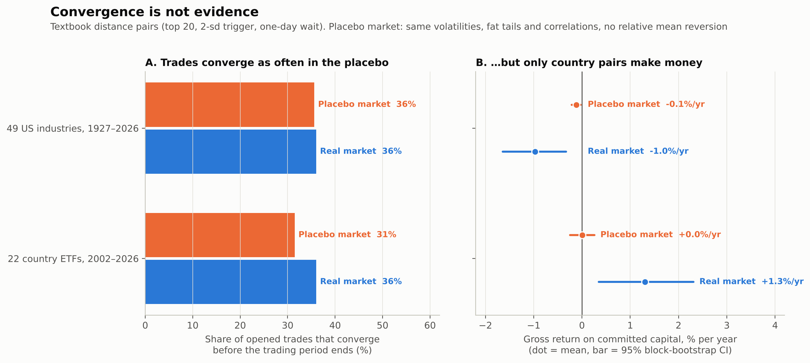
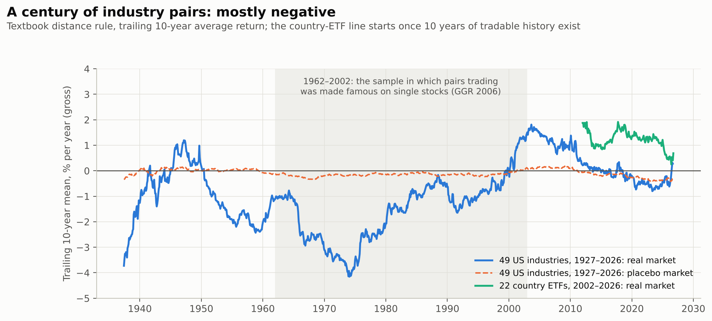
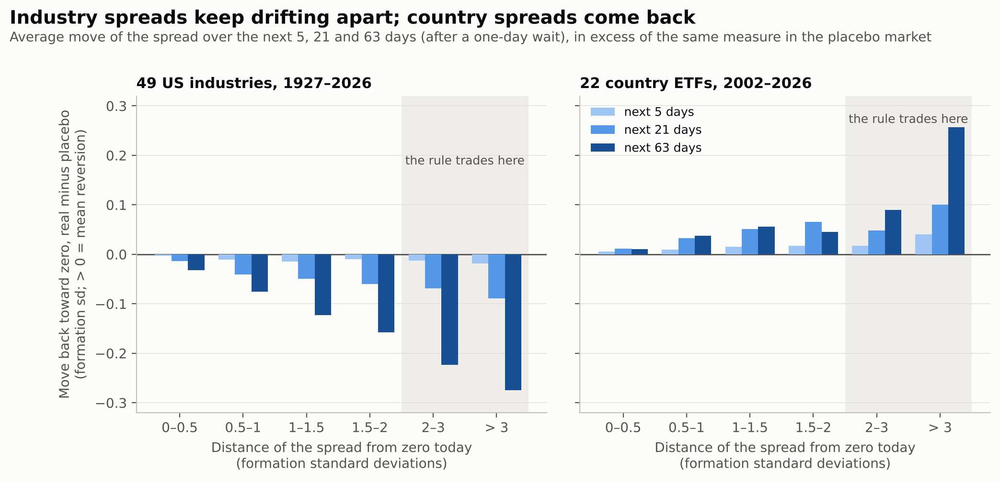
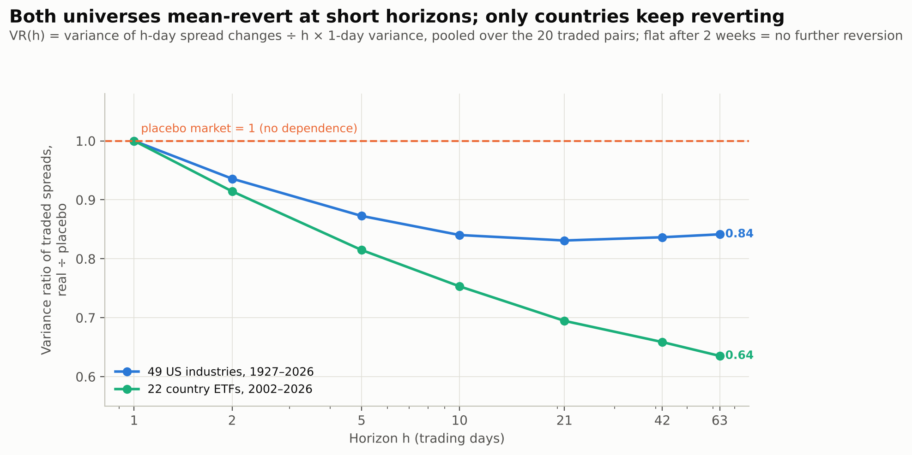
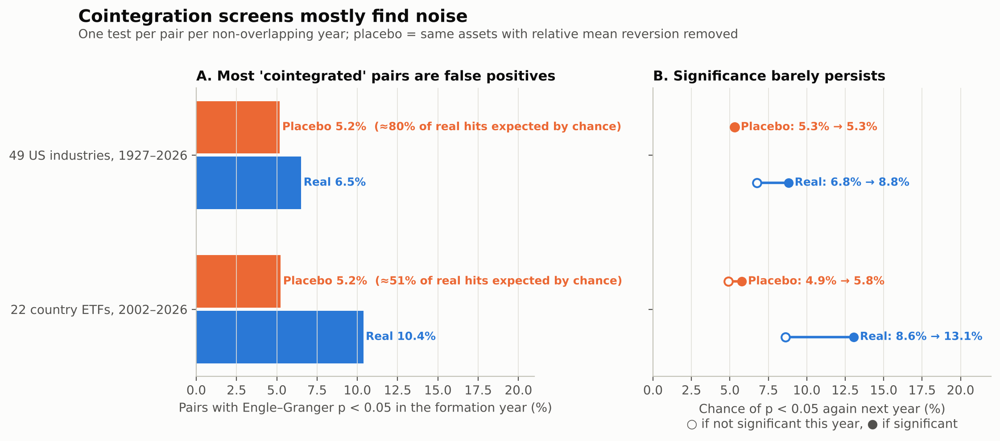
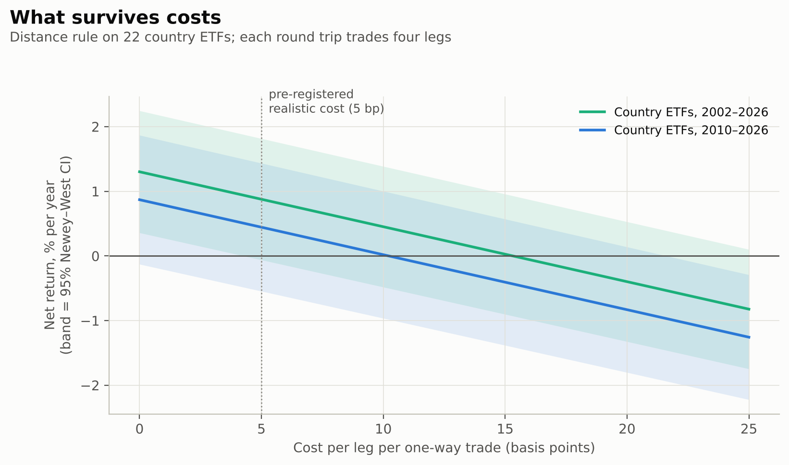
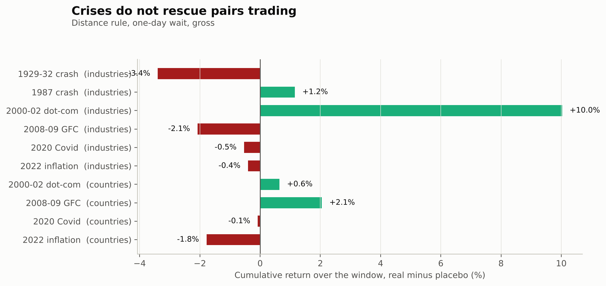

# Convergence Is Not Evidence

**Pairs trading against a placebo market, on a century of US industries and 25 years of country ETFs**

*Project 11 of [30 Quant Research Projects](../README.md) · Working paper, November 2026*



---

## Abstract

Pairs trading is usually sold with two pieces of evidence: most trades converge, and the selected pairs pass
a cointegration test. Both would also appear in a market where relative prices have no memory at all. I build
that market. For every formation-plus-trading window I resample whole days of returns after giving every asset
the same drift, which keeps each asset's volatility, fat tails and the full correlation matrix but removes any
tendency of a spread to come back. Then I run the textbook distance rule of Gatev, Goetzmann and Rouwenhorst
(2006) and an Engle–Granger rule on the real and on the placebo market, with a pre-registered design, on two
universes: the 49 Fama–French industry portfolios from 1927 to September 2026 (no survivorship, a century of
history) and 22 single-country equity ETFs from 2002 to November 2026 (tradable, one closing time).

Three results. **(1) Convergence is not evidence.** 36 % of opened trades converge on real industry data and
36 % in the placebo; for country ETFs, 36 % against 32 %. **(2) Most "cointegrated" pairs are false positives.**
6.5 % of industry pairs pass Engle–Granger at 5 % against 5.2 % in the placebo, so about four in five discoveries
are what chance alone delivers; for countries 10.4 % against 5.2 %. **(3) The profit depends on whether spreads
really revert, and only one universe's do.** Industry spreads keep drifting apart after they diverge (industry
momentum), and the distance rule lost 0.97 % a year gross over 99 years (Newey–West t = −3.0), worse than the
placebo's −0.12 %. Country spreads come back at every horizon from a week to three months, and the rule earned
+1.30 % a year gross (t = 2.7, 95 % CI +0.3 % to +2.3 %) — +0.44 % a year after a realistic 5 bp per leg in
2010–2026, which is not significant (t = 0.9). Along the way, the placebo itself had to be fixed twice: the
registered version gave the placebo foreknowledge of each asset's drift and would have "confirmed" a profitable
industry edge of +1.1 % a year with t = 3.6. Both flaws are documented, unit-tested and disclosed.

---

## 1. Question

A pair is two assets whose prices moved together in a formation year. When they drift apart, the rule buys the
cheap one, sells the rich one, and waits for the gap to close. The evidence usually quoted for this is
descriptive: a high share of trades that "converge", and a significant cointegration test in the formation
period. Neither is a test, because neither is compared with what the same rule produces when there is nothing
to find. A random walk also crosses its starting level often; with hundreds of candidate pairs, 5 % of them
pass a 5 % test by construction.

So the question is:

> How much of a pairs strategy's convergence, of its statistical evidence and of its profit is genuine relative
> mean reversion, measured against a placebo market with the same volatilities, fat tails and contemporaneous
> correlations but no relative mean reversion?

And, because the answer could depend on the assets, on the era and on trading frictions: in which universe and
in which decade does a genuine edge exist, and does it survive costs today?

## 2. Data

| Universe | Assets | Period used | Source | Why |
|---|---|---|---|---|
| **A. Industries** | 49 Fama–French value-weighted industry portfolios, daily total returns | Jul 1927 – Sep 2026 (1,186 monthly portfolios) | Ken French Data Library, vintage 202609, built by [project 09](../09-beta-horse-race/) | No survivorship bias; a century including 1929–32, 1987, 2000–02, 2008, 2020 and 2022 |
| **B. Countries** | SPY and 21 iShares MSCI single-country ETFs (Australia … South Africa) | Jan 2002 – 20 Nov 2026 (297 months) | Yahoo adjusted closes (dividends reinvested), downloaded 22 Nov 2026 | Tradable, all priced at the same New York close, and not the usual Coca-Cola/Pepsi stocks |

Regional funds (EFA, EEM, IEV, EPP, ILF, EWX) are excluded because they hold the single-country funds and would
form mechanical pairs. Industry data end in September 2026 (the latest French vintage); ETF data end on 20
November 2026.

**Two data-quality rules, fixed before any result** (`results/data_quality.csv`). An asset is eligible in a
window only if it has a return on every day and fewer than 5 % zero-return days in formation, because a stale
price manufactures mean reversion; and an industry must hold at least five firms at the previous month-end
(in 1927, 24 of the 49 held fewer, with one-firm portfolios moving more than 100 % in a day). Before 2005 the
country ETFs had 8–24 % zero-return days, so fewer than ten were eligible in every window before 2002 and
universe B effectively starts in January 2002. A run without the stale-price rule is reported in Section 5.

## 3. Design (pre-registered)

The full protocol, the hypotheses and every change made after registration are in
[PREREGISTRATION.md](PREREGISTRATION.md), written before any strategy return was computed.

**Strategy.** Formation 252 trading days, trading 126 days, a new portfolio on the first trading day of every
month, so six portfolios overlap. Returns are on *committed capital*: each of the 20 selected pairs gets $1,
traded or not, as in GGR.

* **Distance rule (primary).** Total-return indices normalised to 1 at the start of formation; pairs ranked by
  the sum of squared differences; top 20 traded. In trading, indices are renormalised to 1; a position opens when
  the spread exceeds 2 formation standard deviations and closes when it crosses zero or the period ends. $1 long
  the cheap leg, $1 short the rich leg, held buy-and-hold. **One-day wait**: decided at the close of day t,
  traded at the close of t+1.
* **Cointegration rule.** Engle–Granger on log prices (OLS with a constant, ADF with one lag on the residual,
  MacKinnon p-value); the 20 most negative t-statistics with a positive hedge ratio are traded on the residual's
  z-score with the same 2/0 rule, legs split 1 : β.
* **Ablations.** No wait and a 5-day wait; pairs ranked 101–120; all pairs; no renormalisation at the start of
  trading; the cointegration rule without the wait.

**The placebo market (N1).** For each 378-day window separately, every asset's daily returns are shifted so that
all assets have the same mean (the window's cross-sectional average), then whole days — the full cross-section
of returns on one date — are resampled with replacement. Each asset keeps its volatility and its fat tails, the
correlation matrix is untouched, and relative prices become driftless random walks: nothing a pairs rule could
exploit is left. Ten placebo replications per window, seeded by window. A unit test checks that the rule's mean
P&L on such a market is zero (`tests/test_core.py::test_martingale_placebo_has_zero_mean_pnl`).

**A drift-keeping placebo (ND)** skips the drift shift. It is the world where every asset's realised drift over
the window is known to persist — a perfect-momentum world — and is kept only to show what persistent relative
drift does to a contrarian rule.

**Inference.** Monthly returns; Newey–West t-statistics with 6 lags (the overlap of six portfolios); 95 % CIs
from a stationary block bootstrap (mean block 12 months); Holm correction across the four confirmatory tests.

## 4. Results

### 4.1 Headline: the rule converges as often on noise

| | Industries 1927–2026: real | placebo | Countries 2002–2026: real | placebo |
|---|---:|---:|---:|---:|
| Trades opened (per run) | 28,216 | 27,436 | 6,187 | 5,815 |
| Share that converge | **36.0 %** | **35.6 %** | **36.0 %** | **31.5 %** |
| Mean return, converged trade | +6.1 % | +6.1 % | +6.0 % | +7.5 % |
| Mean return, non-converged trade | −4.0 % | −3.5 % | −2.5 % | −3.5 % |
| Mean return per trade | −0.4 % | −0.1 % | +0.5 % | −0.0 % |
| Gross return, % a year (NW t) | **−0.97 (−3.0)** | −0.12 | **+1.30 (+2.7)** | +0.01 |
| Sharpe ratio (gross) | −0.33 | | 0.54 | |

The convergence share is the same in the industry placebo (ratio 0.99) and 87 % as high in the country
placebo (`results/convergence.csv`). A trade that converges makes about 6 % in either world, and one that does
not loses 3–4 % in either world. Convergence statistics describe the rule's geometry — a 2-sd trigger and a
zero-crossing exit — not the market. What separates the two universes is only visible in returns: the rule's
average trade loses on industries and wins on countries.

### 4.2 A century of industry pairs



| Decade (1927–29 omitted: 30 months, −7.8 %) | 1930s | 1940s | 1950s | 1960s | 1970s | 1980s | 1990s | 2000s | 2010s | 2020s |
|---|---:|---:|---:|---:|---:|---:|---:|---:|---:|---:|
| Industries, real, % a year | −1.2 | +0.3 | −2.1 | −3.0 | −2.2 | −0.5 | −0.1 | +1.1 | −0.2 | +0.4 |
| Industries, placebo | +0.0 | +0.0 | −0.1 | −0.2 | −0.1 | −0.1 | −0.1 | +0.1 | −0.3 | −0.2 |
| Countries, real | | | | | | | | +2.2 | +1.2 | +0.3 |

Industry pairs earned a positive return in three decades out of ten, and more than +0.5 % a year only in the
2000s, and lost most clearly in 1950–1979
(`results/by_decade.csv`). The 1962–2002 window, where GGR documented 11 % a year on single stocks, gives
−1.17 % a year on industries (t = −2.6). The rule is not "decaying" on industries; it never worked there. On
country ETFs the gross return falls from +2.2 % in the 2000s to +0.3 % so far in the 2020s.

### 4.3 Why: where the mean reversion lives



For every pair-day in the trading period, I measure how far the spread moves back toward zero over the next
5, 21 and 63 days (after a one-day wait), by how far it is from zero today, and subtract the same number in the
placebo (`src/diagnostics.py`, `results/reversion_by_distance.csv`). The placebo subtraction matters: with a
common positive drift, a price-index spread grows mechanically, so even the placebo shows "divergence".

* **Industry spreads keep diverging, and the further apart, the more.** At |z| > 3, the spread moves a further
  0.28 formation-sd *away* from zero over 63 days, beyond the placebo. This is industry momentum (Moskowitz and
  Grinblatt 1999) seen from the pairs side: an industry that has outperformed its twin keeps outperforming for
  months. A rule that bets on convergence exactly when divergence is largest is short that momentum.
* **Country spreads come back**, at every distance and horizon, and most where the rule trades: at |z| > 3,
  +0.26 sd over 63 days.



Variance ratios of the 20 traded spreads tell the same story without conditioning on the trigger
(`results/variance_ratios.csv`; the placebo's VR is between 1.00 and 1.01 at every horizon, which also confirms the
estimator has no bias worth worrying about here). Industry spreads mean-revert over the first two weeks (VR falls to 0.83 at
10–21 days) and then stop: VR is flat or rising from 21 to 63 days, the signature of persistence at longer
horizons. Country spreads keep reverting out to three months (VR 0.64 at 63 days). The distance rule waits a
day, then holds a trade for 55 days on average, so it pays for the industries' longer-horizon persistence and
collects the countries' longer-horizon reversion.

The drift-keeping placebo ND is the limiting case: if every asset's realised drift persisted perfectly, the rule
would lose 2.2 % a year on industries and 1.5 % on countries. Real industries (−1.0 %) sit between the
no-memory placebo (−0.1 %) and that world; real countries (+1.3 %) sit on the other side of zero.

### 4.4 Cointegration screens



One Engle–Granger test per pair per non-overlapping year (`results/coint_screen.csv`):

| | Industries: real | placebo | Countries: real | placebo |
|---|---:|---:|---:|---:|
| Pairs with p < 0.05 | 6.5 % | 5.2 % | 10.4 % | 5.2 % |
| Benjamini–Hochberg discoveries per year (q = 0.05) | 2.0 | 0.3 | 1.4 | 0.2 |
| P(p < 0.05 next year \| significant this year) | 8.8 % | 5.3 % | 13.1 % | 5.8 % |
| P(p < 0.05 next year \| not significant) | 6.8 % | 5.3 % | 8.6 % | 4.9 % |

With ~880 industry pairs a year, the 6.5 % "significant" are 57 pairs, of which about 46 are expected under the
placebo. After false-discovery control, two industry pairs a year survive. Significance is weakly persistent on
real data (+2.0 points for industries, +4.4 for countries, against ~0 in the placebo), so the screens are not
pure noise, but they are mostly noise.

The cointegration *rule* lost 2.5 % a year on industries and made +0.6 % (t = 0.7) on countries. Its placebo
loses too (−2.3 % and −2.3 % a year): with β ≠ 1 the two legs have unequal dollar sizes, so the position carries
net market exposure, and because the residual drifts upward when β < 1 and the market rises, the rule tends to
be net short in rising markets. Against its own placebo it is flat on industries (−0.3 %) and +2.8 % on
countries. Ranking pairs by an EG statistic did not beat ranking them by distance in either universe.

### 4.5 Costs



The distance rule trades about 0.7–0.8 dollars of notional per dollar committed per month
(`results/costs.csv`). On country ETFs the gross return breaks even at 15 bp per leg for 2002–2026 and 10 bp for
2010–2026.

| Countries, distance rule | Gross | 5 bp / leg | 10 bp | 20 bp |
|---|---:|---:|---:|---:|
| 2002–2026, % a year (NW t) | +1.30 (2.7) | +0.88 (1.8) | +0.45 (0.9) | −0.40 (−0.8) |
| 2010–2026 | +0.87 (1.7) | +0.44 (0.9) | +0.02 (0.0) | −0.83 (−1.7) |

The pre-registered realistic cost for a small account in liquid country ETFs since 2010 is 5 bp per leg
(half-spread plus impact). At that cost the post-2010 return is +0.44 % a year on committed capital, with a
Sharpe ratio of 0.21 — a real but small effect that a 2-sigma investor cannot distinguish from zero.

### 4.6 Scorecard of the pre-registered hypotheses

| | Hypothesis | Result | Verdict |
|---|---|---|---|
| H1 | Industries: real − placebo > 0, full sample | −0.85 % a year, t = −2.6, Holm p = 1.00 | **Rejected — the sign is the opposite** |
| H2 | No significant edge in 2003–2026 | Industries +0.23 % (t = 0.5) ✓; countries +1.30 % (t = 2.6, Holm p = 0.02) ✗ | **Half supported** |
| H2 | 2003–2026 edge smaller than 1962–2002 | Industries had no 1962–2002 edge to lose (−1.08 %) | Not meaningful as stated |
| H3 | Placebo convergence ≥ 80 % of real | 99 % (industries), 87 % (countries) | **Supported** |
| H4 | EG significance share < 2 × placebo | 1.26 × (industries), 1.98 × (countries) | **Supported (countries only just)** |
| H4 | Persistence lift no larger than placebo | +2.0 and +4.4 points vs ~0 | **Rejected — a small real signal** |
| H5 | Countries, 5 bp/leg, 2010–2026 not significant | +0.44 %, t = 0.9, Holm p = 0.57 | **Supported** |
| H6 | Edge larger in stress windows (descriptive) | Industries +0.6 % vs −0.9 % a year; countries +0.4 % vs +1.4 % | **Mixed** |

The confirmatory tests (H1, two parts of H2, H5) are Holm-adjusted together (`results/hypothesis_tests.csv`).
I expected a historical industry edge that had decayed; the data say there never was one, and that the only
edge in the study (countries) is real but too small to survive realistic costs after 2010.

## 5. Robustness

**Execution lag** (`results/wait_effect.csv`). Trading at the same close as the signal adds +0.49 % a year on
countries (t = 3.8) and +1.50 % on industries in 1927–1961 (t = 3.5), but nothing on industries after 1962
(−0.05 %). The early-industry gain is the non-synchronous-trading reversal that GGR's one-day wait exists to
remove; on ETFs it is the closing-print bounce. Neither is capturable at the same close. A 5-day wait costs
countries another 0.50 % a year (t = 2.9): most of the reversion that matters is in the first week.

**Selection** (`results/performance.csv`). On countries the top-20 pairs (+1.30 %) beat pairs ranked 101–120
(+0.37 %) and all pairs (+0.97 %): the distance ranking carries some information. On industries all three lose.

**No renormalisation at trading start.** Continuing the formation index instead of resetting it to 1 gives
−1.40 % a year on industries and +1.39 % on countries — the same conclusion.

**Stale prices.** Without the 5 % zero-return rule, country ETFs can be traded from 1997; 1997–2001 gives
−0.64 % a year (t = −0.3), and 2002–2026 is unchanged (+1.24 % vs +1.30 %). For this rule, in this universe,
stale quotes did not manufacture profit. The rule stays in the main design anyway, because funds with a quarter
of their days stale should not be traded on closing prices (`results/stale_price_ablation.csv`).



**Stress windows** (`results/stress_windows.csv`). The dot-com unwind (2000–02) is the one crisis in which
industry pairs paid (+10.0 % cumulative over the placebo, as sector spreads snapped back). In 1929–32, 2008–09,
2020 and 2022 industry pairs lost against the placebo. Country pairs gained 2.1 % in 2008–09 and lost 1.8 % in
2022. Pairs trading is sometimes described as a crisis hedge; across these six windows it was not one.

## 6. Limitations

* **Industries are not tradable.** Universe A tests whether *relative value between industries* mean-reverts;
  it cannot say anything about single-stock pairs, where GGR's profits came from and where bid–ask bounce,
  liquidity provision and idiosyncratic news all differ. I did not use single stocks because a survivorship-free
  daily stock panel to 2026 was not reachable from this environment; this is the largest gap.
* **Country ETFs are not countries.** ETF prices can deviate from NAV, especially for Asian markets that close
  before New York; part of the measured reversion could be premium/discount mean reversion rather than
  relative-value reversion between economies. Either way it is what an ETF trader would face.
* **One rule family.** Thresholds (2 sd), horizons (12 + 6 months) and the 20-pair count are GGR's and were not
  tuned. A better-designed rule (for example one that conditions on industry momentum) might do better, but
  every variant tried would need its own placebo and its own multiple-testing charge.
* **Costs are flat.** A single cost per leg ignores that spreads were wider before 2010 and wider in crises,
  when the rule trades most; the realistic net numbers are, if anything, optimistic for 2002–2009 and 2008.
* **No short-sale costs or margin.** Borrowing country ETFs is cheap but not free; committed-capital returns
  ignore the margin a broker would require on both legs.
* **The placebo has a scope.** N1 removes *all* serial dependence, so "real minus placebo" mixes short-horizon
  reversal and long-horizon persistence. Separating them with a block placebo failed (Section 7); the
  separation here rests on the variance ratios and the reversion-by-distance diagnostic, which are descriptive.
* **The 2020s are 81 months.** The decline of the country edge in the 2020s is a point estimate with a wide
  interval.

## 7. Referee-style self-review: what it changed

I reviewed the work as a hostile referee would, before writing this paper. In order of importance:

1. **The registered placebo had look-ahead.** It resampled days from the whole 378-day window without touching
   drifts, so each asset kept its realised drift *including the trading period's*. The placebo then "knew" which
   asset would keep outperforming, and any contrarian rule lost in it by construction (−1.5 % a year on countries,
   −2.2 % on industries).
   Real minus that placebo produced exactly the result I had predicted — an industry edge of +1.14 % a year,
   t = 3.6 — and it was an artefact. Fix: equalise drifts before resampling; the drift-keeping version survives
   only as the ND ablation. A unit test now checks that the placebo is a martingale.
2. **The registered block placebo was biased too.** N2 (stationary bootstrap, mean block 21 days) was meant to
   separate short-horizon reversal from longer horizons. After the drift fix it earned +1.6 % a year on both
   universes. On simulated IID returns with no dynamics at all it still earns +0.9 % per six months: after the
   drift shift, each relative path sums to zero over the window, and stitching contiguous blocks of that closed
   loop manufactures mean reversion. N2 is dropped from every comparison and the artefact is a unit test
   (`test_block_placebo_of_demeaned_window_is_biased`). I replaced its job with variance ratios and the
   reversion-by-distance diagnostic, both read against N1.
3. **Negative hedge ratios.** The cointegration ranking initially allowed β < 0, for which a long/short trade is
   not a hedge. A positive-control unit test (synthetic cointegrated pairs) exposed it; such pairs are now
   skipped.
4. **The positive control also exposed an Engle–Granger weakness**: when one leg carries fast mean-reverting
   noise, *unrelated* pairs pass the test more than 5 % of the time. Bid–ask bounce and stale prices are such
   noise, which is a further reason to read EG counts against a placebo rather than against the nominal 5 %.
5. **Universe B's start.** The stale-price rule left fewer than 10 country ETFs before 2002. Rather than relax the
   rule after seeing that, I set a 10-asset minimum, dropped 1997–2001 from the main sample and report the
   no-rule run as an ablation.
6. **What I did not do.** I did not add a momentum filter or tune the trigger after seeing Section 4.3, although
   both are obvious next steps; doing so on the same data would be the forking path this paper warns about.

Every change is dated in [PREREGISTRATION.md](PREREGISTRATION.md).

## 8. Conclusion

The share of trades that converge is a property of the trading rule, not of the market: a market with no
relative mean reversion converges just as often. Cointegration screens, read against the same placebo, find
mostly what chance alone would find. What decides whether pairs trading makes money is whether spreads revert
over the holding period, and that is an empirical property of the universe: industry spreads drift apart
(momentum) and the textbook rule lost money on them for a century; country-ETF spreads come back, and the rule
earned about 1.3 % a year gross from 2002, falling toward zero once realistic costs and the post-2010 period
are taken into account.

The practical lesson is a habit, not a strategy: before believing any pairs backtest, run it on a placebo
market built from the same data — and check that the placebo cannot see the future.

**Connections.** The industry data and the non-synchronous-trading point come from
[project 09](../09-beta-horse-race/); pre-registration and placebo logic from [project 03](../03-moving-average-volatility/);
variance ratios from [project 02](../02-volatility-dashboard-audit/); FDR from [project 08](../08-correlation-crash-illusion/).
Industry momentum, which is what sinks industry pairs here, is the subject of project 12 (momentum with costs).
Projects 24 (PCA statistical arbitrage) and 25 (Kalman hedge ratios) revisit relative value with factor-based
and time-varying hedges; project 23 (deflated Sharpe) formalises the multiple-testing charge discussed in
Section 6.

## Reproduce

```bash
pip install -r requirements.txt
bash run_all.sh        # ~4 minutes on 4 cores: data -> backtest (real + placebo) -> evaluate -> figures -> tests
```

`src/backtest.py` writes per-window results to `results/raw_*.npz` (about 120 MB, not committed);
`src/evaluate.py` and `src/diagnostics.py` turn them into every CSV quoted here. Seeds are fixed per window.
The raw Yahoo download is in `data/raw/`; the industry panel is copied from project 09.

## References

* Benjamini, Y. and Hochberg, Y. (1995). Controlling the false discovery rate. *JRSS B* 57, 289–300.
* Do, B. and Faff, R. (2010). Does simple pairs trading still work? *Financial Analysts Journal* 66(4), 83–95.
* Engle, R. and Granger, C. (1987). Co-integration and error correction. *Econometrica* 55, 251–276.
* Gatev, E., Goetzmann, W. and Rouwenhorst, K. G. (2006). Pairs trading: performance of a relative-value
  arbitrage rule. *Review of Financial Studies* 19, 797–827.
* Holm, S. (1979). A simple sequentially rejective multiple test procedure. *Scandinavian Journal of Statistics*
  6, 65–70.
* Krauss, C. (2017). Statistical arbitrage pairs trading strategies: review and outlook. *Journal of Economic
  Surveys* 31, 513–545.
* Lo, A. and MacKinlay, A. C. (1988). Stock market prices do not follow random walks. *Review of Financial
  Studies* 1, 41–66.
* Lo, A. and MacKinlay, A. C. (1990). When are contrarian profits due to stock market overreaction? *Review of
  Financial Studies* 3, 175–205.
* MacKinnon, J. (1994). Approximate asymptotic distribution functions for unit-root and cointegration tests.
  *Journal of Business & Economic Statistics* 12, 167–176.
* Moskowitz, T. and Grinblatt, M. (1999). Do industries explain momentum? *Journal of Finance* 54, 1249–1290.
* Newey, W. and West, K. (1987). A simple, positive semi-definite, heteroskedasticity and autocorrelation
  consistent covariance matrix. *Econometrica* 55, 703–708.
* Politis, D. and Romano, J. (1994). The stationary bootstrap. *JASA* 89, 1303–1313.
* Rad, H., Low, R. and Faff, R. (2016). The profitability of pairs trading strategies: distance, cointegration
  and copula methods. *Quantitative Finance* 16, 1541–1558.
