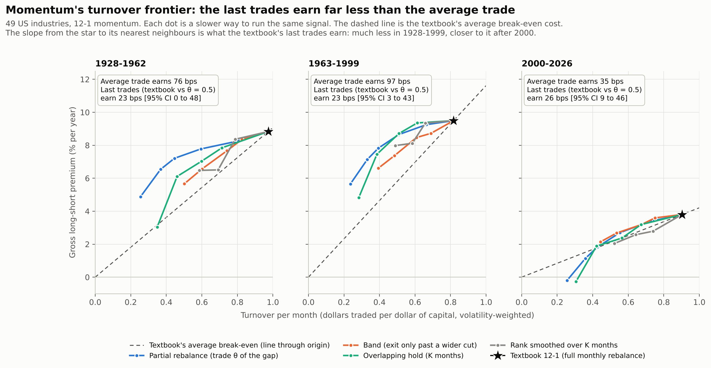
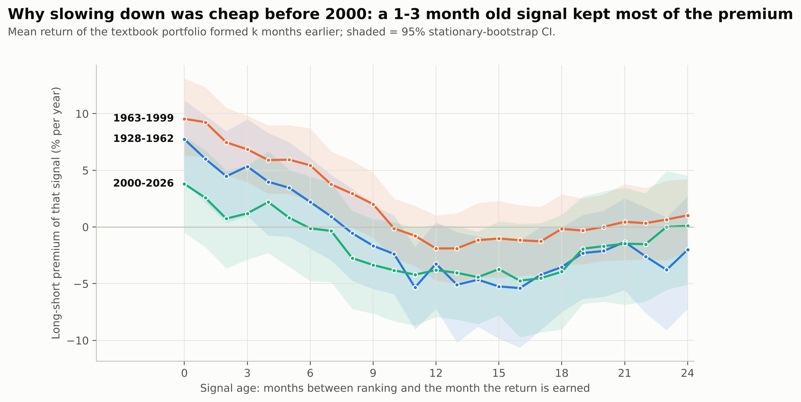
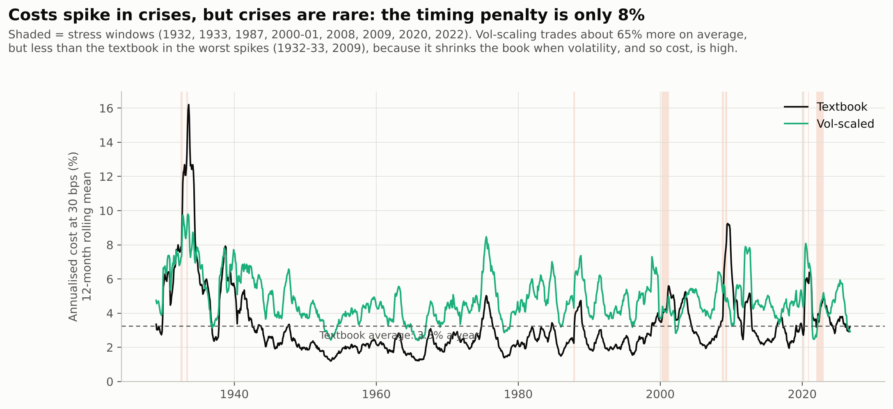
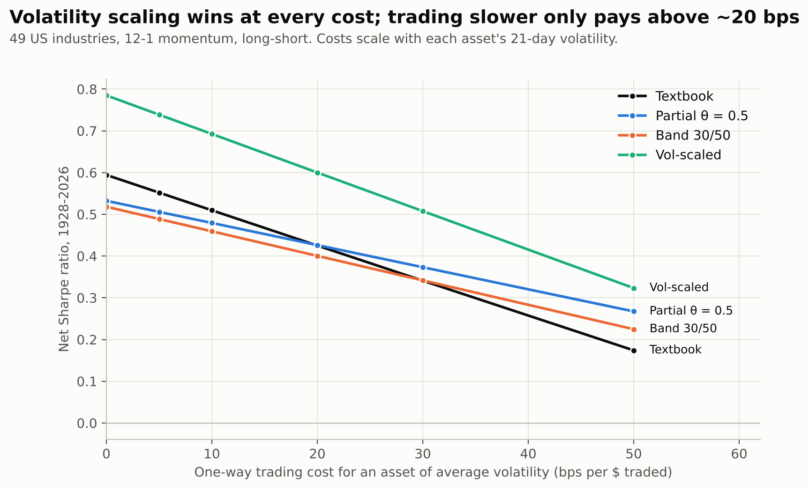
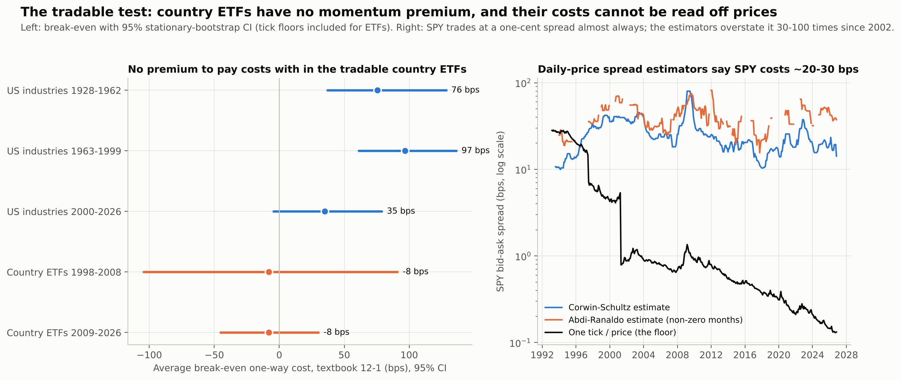

# The Last Trade Is the Cheapest to Skip

**Average versus marginal break-even costs of momentum, US industries 1928–2026 and country ETFs 1998–2026**

*Project 12 of [30 Quant Research Projects](../README.md) · Working paper, November 2026*



---

## Abstract

Every paper on momentum and trading costs reports one number: the **break-even cost**, the one-way
cost per dollar traded at which the strategy's net return falls to zero. That number is an *average*:
total gross premium divided by total turnover. It answers "should I run momentum at all?" It does
not answer the question an implementer actually faces, which is **"how fast should I trade it?"** That
question is about the *marginal* trade: the premium that the last, most frequent rebalancing trades
add, per extra dollar they turn over. If momentum's alpha were spread evenly across its trades, the
two numbers would be equal. They are not.

This project measures both, on the same signals, with exact turnover accounting. Universe A is the
49 Fama–French US industries, daily, January 1928 to September 2026 (1,185 months). Universe B is 42
single-country equity ETFs, the version of the strategy a private investor can actually trade, from
1998 to October 2026. Each universe runs three signals (12-1, 6-1 and 1-0 months) through 21 ways of
implementing the same signal: the textbook full monthly rebalance, 16 slower variants from four
families (partial rebalancing, banding, overlapping holding periods, rank smoothing), volatility
scaling, and a long-only version. That makes 126 backtests. Costs scale with each asset's own recent
volatility, as microstructure theory predicts. Inference uses paired stationary-bootstrap confidence
intervals and Holm correction over a confirmatory family of seven tests.

**Main findings**

1. **The textbook's last trades earn a third of what its average trade earns.** Textbook industry
   momentum (12-1, top and bottom 30%, monthly) breaks even at **71 bps** per dollar traded (95% CI
   46–98). Its marginal trades, the ones a half-speed partial rebalance (θ = 0.5) skips, break even at
   **24 bps** (CI 12–36). Skipping them cuts turnover by 38% and gives up only 13% of the gross premium.
   The gap between marginal and average holds for 14 of the 16 slower designs (p < 0.05). For the
   three confirmatory designs it survives Holm correction (adjusted p ≤ 0.009).
2. **The reason is how slowly the signal ages.** A 1-to-3-month-old ranking kept **71%** of a fresh
   ranking's premium (CI 54–84%), and 82% in 1963–1999. The event-time decay curve alone predicts the
   gross premium of every overlapping-hold design to within 0.1 percentage points a year. It predicts
   every partial-rebalance design to within 1.2 points; most of that gap comes from weight drift
   between trades.
3. **After 2000 the frontier straightened out.** Over 2000–2026 the textbook's average break-even
   fell to 35 bps (CI −4 to 79), and its marginal trades earn about the same (26 bps, CI 9–46). Every
   slower design lies on the same ray through the origin, so slowing down no longer buys a higher
   break-even. Gross premia are weak in this era (t = 1.4), so this is a point estimate and not yet a
   proven regime change.
4. **Cost timing is real but small.** Momentum does trade more, and trades more volatile industries,
   when trading is expensive. In the worst crisis windows (1932–33, 2008, 2009) its monthly cost runs 3–7 times its average. But
   crises are rare, so a backtest with a constant cost understates the true cost by only **8%**
   (multiplier κ = 1.081, CI 1.050–1.113). **Volatility-scaled momentum reverses the sign**
   (κ = 0.96): it shrinks its book when volatility, and so cost, is high. It trades 65% more than the
   textbook overall and still raises net Sharpe by +0.17 to +0.19 at every cost from 0 to 30 bps
   (Holm-adjusted p = 0.003).
5. **Knowing the right speed in hindsight is not the same as finding it in real time.** An investor
   who picks the design with the best past net return each January does no better than the textbook
   at 10–30 bps (Sharpe difference −0.01 to −0.03). The frontier is flat near its optimum, so getting
   the speed wrong by a factor of two costs little. Choosing in real time only helps at 50 bps, where
   it settles on θ = 0.5 (+0.06 Sharpe, CI 0.01–0.11).
6. **In the tradable universe there is nothing to pay costs with.** Country-ETF momentum has no
   gross premium in 1998–2026: −0.5% a year for 12-1 (CI −6.2 to +5.0; Holm p = 0.55). Pre-2001 tick
   sizes alone cost the textbook 7 bps a month in 1998–2008. The popular estimators that read spreads
   off daily prices (Corwin–Schultz, Abdi–Ranaldo) put SPY's spread at 20–27 bps since 2020, about
   **100 times** its one-cent quote. They cannot stand in for measured costs on ETFs.

**Practical rule.** Report two break-evens, not one. The average break-even tells you whether a
strategy is worth running. The marginal break-even, the slope of the turnover frontier at your
design, tells you whether your trading speed is right. For industry momentum before 2000, trading
slower paid for anyone whose all-in cost exceeded about 20–25 bps. Volatility scaling paid at every
cost level.

---

## 1. Why this question

Momentum is the anomaly most exposed to trading costs, because it turns over a large part of its
book every month. The literature has argued about whether it survives costs for twenty years.
Lesmond, Schill and Zhou (2004) call its profits "illusory". Korajczyk and Sadka (2004) estimate how
much capital it can absorb. Frazzini, Israel and Moskowitz (2018) use a large institution's live
trades and find costs an order of magnitude below earlier estimates. Novy-Marx and Velikov (2016)
show that cost-mitigation rules such as buy/hold spreads cut the drag substantially. All of them
summarise an anomaly by its break-even cost, and they disagree mainly about which cost to compare it
with.

That framing hides an asymmetry. A strategy's trades are not equally valuable. The trades that move
a winner from rank 15 to rank 16, or that re-sell a loser that has just bounced, carry much less of
the premium than the trades that put the strongest new winners into the book. If the low-value
trades are also the most frequent, the average break-even overstates what the marginal dollar of
turnover earns. An investor can then keep most of the premium at a fraction of the turnover. The
right summary is a **turnover frontier**: gross premium against turnover across many ways of running
the same signal. Its *slope* at the chosen design is the marginal break-even cost.

Three secondary questions follow, and each is a hypothesis fixed before the confirmatory tests were
run (§5).

* **Cost timing (H1).** Costs rise with volatility. If momentum's trades cluster in volatile months
  (turning points, crashes) or in volatile assets (extreme past performers), a constant-cost backtest
  understates its true cost. By how much?
* **Volatility scaling (H3).** Barroso and Santa-Clara (2015) show that scaling momentum to a
  constant volatility nearly doubles its Sharpe ratio. Scaling adds trading, since the book is
  resized every month, and critics of volatility-managed portfolios argue that this trading eats the
  gain. Does it, once costs move with volatility?
* **Tradability (H4).** Universe A cannot be traded as such. Does the same analysis on a universe a
  private investor can trade, single-country ETFs, leave anything to pay costs with?

This project builds on earlier projects rather than repeating them. Project [03](../03-moving-average-volatility/)
showed that a time-series trend rule's value is mostly a volatility forecast. Project [10](../10-market-terminal/)
found that 12-1 momentum, used as a screen signal, does not forecast an ETF's own next-month return.
This project is about the *cross-section*, ranking assets against each other, and about
implementation rather than prediction.

## 2. Data

**Universe A: 49 US industries.** These are Ken French's value-weighted industry portfolios, daily
excess returns from July 1926 to September 2026 (CRSP vintage 202609). It is the panel built by
project [09](../09-beta-horse-race/), copied here unchanged so the project is self-contained. The
same 49 industries also appear in project [05](../05-efficient-frontier/). Reusing them is deliberate:
industry momentum (Moskowitz and Grinblatt, 1999) has a century-long record, and a value-weighted
industry is dominated by large, liquid stocks, so its implementation cost is close to large-cap cost.
An industry joins the ranking once it has 12 full months of history; 39 to 49 are ranked at any time
(46 on average).

**Universe B: 42 country ETFs.** These are all US-listed single-country equity ETFs with history on
Yahoo Finance: the 17 original iShares WEBS from March 1996, then Brazil, Taiwan and Korea (2000),
South Africa (2003), China (2004), and 20 more listed from 2007 to 2015, including VanEck Vietnam and
Global X Greece and Argentina. EWUS is excluded because it duplicates the UK. The data are daily
OHLCV plus the dividend-adjusted close, to 17 November 2026. The sample is used to October 2026, and
returns are in excess of the 3-month T-bill (^IRX, from project 03). Two data-quality problems are
handled explicitly:

* **Stale early quotes.** In their first three years, the WEBS funds show no trade (zero volume or
  high = low) on up to 64% of days (Austria). A fund is ranked only if it traded on at least 80% of
  the previous 63 sessions.
* **Survivorship.** Country ETFs that were delisted (iShares Russia, frozen in 2022; Market Vectors
  Egypt; Global X Nigeria, Colombia and Pakistan) are not on Yahoo. The universe is therefore biased
  toward funds that survived. That should flatter momentum if anything, and the result is still null.

Both data files and the scripts that rebuild them are in `data/` and `src/fetch_data.py`.

## 3. Strategies

**Signals.** At each month-end, an asset's signal is its cumulative log excess return over months
*m−11…m−1* (12-1, skipping the most recent month), *m−5…m−1* (6-1), or month *m* alone (1-0,
short-term industry momentum). The textbook book is long the top 30% and short the bottom 30%,
equally weighted within each leg: $1 long and $1 short per $1 of capital.

**Twenty-one implementations of each signal** (`src/designs.py`):

| Family | Designs | What it does |
|---|---|---|
| Textbook | base | Rebalance fully to the new top/bottom 30% every month |
| Partial rebalance | θ = 0.75, 0.5, 0.33, 0.25, 0.15 | Trade only θ of the gap between the current and the target book (Gârleanu and Pedersen, 2013) |
| Banding | exit at 35, 40, 50, 60% | Enter at the top/bottom 30%, but keep a name until it leaves a wider band (Novy-Marx and Velikov, 2016) |
| Overlapping hold | K = 2, 3, 6, 12 months | Hold the average of the last K monthly selections (Jegadeesh and Titman, 1993) |
| Rank smoothing | 2, 3, 6 months | Rank on the average percentile of the last K months |
| Volatility scaling | alone, with band 50%, with θ = 0.33 | Scale the book to 15% annual volatility, estimated from its own past 126 daily returns; leverage capped at 2 (Barroso and Santa-Clara, 2015) |
| Long-only | top leg only | $1 long the top 30%, judged against the equal-weight universe |

**Accounting** (`src/engine.py`). Everything is decided at the close of month *m* from data up to
that close. The book is bought at that close and held, buy-and-hold, through month *m+1*, so weights
drift with prices. Turnover at *m* is Σ|w_new − w_drifted|, the dollars traded per dollar of capital.
Price moves alone therefore never count as trading. A test (`tests/test_engine.py::test_no_look_ahead`)
rewrites every return after a date and checks that nothing decided before it changes.

**Cost model.** A one-way trade of |Δw_i| in asset *i* at month *m* costs

  c × |Δw_i| × σ_i,m / σ̄,

where σ_i,m is the asset's annualised 21-day realised volatility at the trade date and σ̄ is the
average of σ across assets and months in the evaluation window. So *c* is the one-way cost for an
asset of average volatility, in bps per dollar traded. Proportionality to volatility is what the
standard microstructure models predict for both the half-spread and price impact (inventory and
adverse-selection models; the square-root impact law, Tóth et al., 2011). It is also what makes cost
timing measurable. Every result is reported as a break-even, so the level of *c* is never assumed.
Every constant-cost version is also in `results/summary.csv`. Universe B adds a **measured** floor:
half a tick divided by the fund's price ($1/8 before June 1997, $1/16 until AMEX decimalisation in
April 2001, $0.01 after). No trade can cross a quoted spread narrower than one tick.

## 4. Measures

* **Average break-even**, c̄ = mean gross return / mean volatility-weighted turnover, in bps.
* **Marginal break-even** of the textbook over a slower design *d*,
  c_marg = (gross_base − gross_d) / (turnover_base − turnover_d). It is the cost per dollar of the
  trades the textbook does and *d* skips. With c below c_marg the extra trades pay; above it, they do
  not.
* **Cost-timing multiplier** κ = Σ_m Σ_i |Δw_i,m| σ_i,m / (Σ_m τ_m · σ̄). Here κ = 1 means the strategy
  trades the average asset in the average month. It splits exactly into κ_time (*when* it trades:
  the turnover-weighted average of each month's mean volatility) and κ_cross (*what* it trades,
  within a month).
* **Event-time decay** α_k: the mean return earned in month *m+1* by the textbook book formed at the
  end of *m−k*, for signal ages k = 0…24.

Uncertainty comes from a stationary bootstrap (Politis and Romano, 1994) of months, with mean block
12 and 2,000 draws. The same resampled months are used for every design, so differences between
designs are paired.

## 5. Hypotheses and the confirmatory family

The family below was fixed before these tests were run and is Holm-corrected as a whole
(`results/hypotheses.csv`). In the interest of full disclosure: H2 was framed after a first
exploratory pass over a smaller grid of eight designs. That is why §6.1 reports all 16 slower
designs and every era, and not only the three in the family.

| | Hypothesis | Estimate (95% CI) | p (raw) | p (Holm) |
|---|---|---|---|---|
| H1 | Cost-timing multiplier of textbook 12-1 > 1 (A, 1928–2026) | κ = 1.081 [1.050, 1.113] | 0.0005 | 0.003 |
| H2a | Marginal break-even (textbook vs θ = 0.5) < average | 24 bps [12, 36] vs 71 | 0.0005 | 0.003 |
| H2b | Marginal break-even (textbook vs band 50%) < average | 44 bps [29, 60] vs 71 | 0.004 | 0.009 |
| H2c | Marginal break-even (textbook vs hold 3) < average | 32 bps [17, 47] vs 71 | 0.0015 | 0.004 |
| H3a | Vol-scaled net Sharpe > textbook at 10 bps | +0.18 [+0.09, +0.28] | 0.0005 | 0.003 |
| H3b | Vol-scaled net Sharpe > textbook at 30 bps | +0.17 [+0.08, +0.26] | 0.0005 | 0.003 |
| H4 | Country-ETF textbook 12-1 has a positive gross premium (B) | −0.54%/yr [−6.20, +4.95] | 0.55 | 0.55 |

A p-value of 0.0005 is the floor with 2,000 bootstrap draws.

## 6. Results

### 6.1 The turnover frontier: average versus marginal

Figure 1 plots each slower design's gross premium against its turnover, era by era. The dashed ray
through the origin has the textbook's average break-even as its slope. A design above the ray earns
more per dollar traded than the textbook does.

| Universe A, 12-1, 1928–2026 | Gross premium (%/yr) | Turnover (/month) | Average break-even (bps) | Share of turnover saved | Share of premium lost | Marginal break-even of the skipped trades (bps) |
|---|---|---|---|---|---|---|
| Textbook | 7.72 [5.40, 9.96] | 0.84 | **71** [46, 98] | | | |
| Partial θ = 0.75 | 7.30 | 0.68 | 83 | 19% | 5% | 20 [8, 32] |
| Partial θ = 0.5 | 6.73 | 0.52 | 101 [62, 142] | 38% | 13% | **24** [12, 36] |
| Partial θ = 0.33 | 5.98 | 0.40 | 118 | 53% | 22% | 30 [15, 46] |
| Band 30/50 | 5.81 | 0.48 | 89 [53, 128] | 40% | 25% | 44 [29, 60] |
| Hold 3 | 6.40 | 0.51 | 95 [56, 136] | 38% | 17% | 32 [17, 47] |
| Hold 12 | 2.81 | 0.27 | 74 | 65% | 64% | 70 [47, 92] |

(Turnover in the table is in dollars; the break-evens use volatility-weighted turnover, as defined
in §4. All 16 designs are in `results/marginal_breakeven.csv`.)

The first trades to go are nearly free to skip. The textbook's last 19% of turnover carries 5% of
its premium, and its last 38% carries 13%. The marginal break-even rises as the design slows down:
20 → 24 → 30 → 37 → 50 bps along the partial-rebalance family. That rise is the concave frontier.
Partial rebalancing and overlapping holds trace the upper edge of the frontier: for the same turnover
they keep more premium than banding or rank smoothing. At 0.55 turnover, for example, θ = 0.5 keeps
6.7% a year against 5.8% for band 30/50. Banding keeps holding names whose signal has already
weakened.

**By era.** In 1963–1999 the textbook's average break-even was 97 bps, and its marginal trades (vs
θ = 0.5) earned 23 bps (CI 3–43). All 16 slower designs have a marginal break-even significantly
below the average. In 1928–1962, 8 of 16 do. In **2000–2026, none does**: the average break-even
fell to 35 bps, and every design sits close to the same ray, with marginal break-evens of 11–57 bps
spread around the average. In this era the premium per dollar traded is roughly the same for every
trade, so slowing down gives up premium in proportion to the turnover it saves. The post-2000 gross
premium is itself only marginally significant (3.8%/yr, t = 1.40), so the honest reading is that the
frontier *looks* straight after 2000. The data do not reject a bend.

### 6.2 Why the frontier bends: signal decay



A slower design is a mixture of older rankings. Partial rebalancing at rate θ holds a ranking of age
k with weight θ(1−θ)^k, and a K-month hold gives weight 1/K to ages 0…K−1. Ignoring weight drift,
the decay curve α_k therefore *predicts* every design's gross premium (`results/decay_prediction.csv`).
The prediction matches the overlapping-hold backtests to within 0.10 percentage points a year in every
era. It matches the partial-rebalance backtests to within 1.2 points. The largest gaps are in the
volatile 1928–1962 era, where the slow partial designs do up to 1.2 points *better* than predicted.
Between trades, a partially rebalanced book lets its winners' weights grow and its losers' weights
shrink, and that drift is a small dose of momentum for free. After 2000, when the signal itself
decays faster, the same drift costs up to 0.6 points.

The decay curve explains the frontier. In 1963–1999 a ranking that was one to three months old kept
82% of the fresh ranking's premium (CI 69–97%). Skipping a month of rebalancing lost little, so
trading slower was cheap. Over 1928–2026 the figure is 71% (CI 54–84%). After 2000 the point estimate
is 40%, and the CI is uninformative, because the fresh premium itself is barely distinguishable from
zero. Every era shows the long-horizon reversal at ages 9–18 months. That is why a 12-month hold
earns little, and why its marginal break-even is close to the average.

### 6.3 Cost timing, and why volatility scaling wins net of costs



Momentum does trade at expensive moments. In the 1932 and 1933 rebounds, the textbook's monthly cost
at 30 bps ran **5.8 and 6.8 times** its full-sample average: turnover doubled, and volatility was
three times normal. In the 2008 crisis the multiple was 3.8, and in the March–May 2009 momentum crash
it was 3.0 (`results/stress_windows.csv`). Averaged over a century, though, these episodes are short.
The cost-timing multiplier is κ = 1.081 (CI 1.050–1.113). About half comes from *when* momentum
trades (κ_time = 1.04) and half from *what* it trades (κ_cross = 1.03: past extreme performers are
volatile). κ was largest in 1928–1962 (1.14) and is negligible after 2000 (1.02, CI 1.00–1.05).
**A constant-cost backtest understates momentum's true cost by about 8%**. That is a correction
worth making, but it is not a reason to doubt such backtests.



Volatility scaling flips the sign of the timing effect: κ = 0.96 (CI 0.94–0.99). The scaled book is
small exactly when volatility, and so cost, is high. In the 2009 crash it traded half as much as the
textbook and paid half the cost (1.2% vs 2.5% at 30 bps), on top of a much smaller gross loss (−15%
vs −31%). Over the full sample it trades 65% more than the textbook (1.38 vs 0.84 per month; its
average leverage is 1.6). But its premium rises even faster, so its average break-even is higher
(85 vs 71 bps). Its net Sharpe beats the textbook at every cost level:

| Net Sharpe, A, 12-1 | 0 bps | 10 bps | 30 bps | 50 bps |
|---|---|---|---|---|
| Textbook | 0.59 | 0.51 | 0.34 | 0.17 |
| Partial θ = 0.5 | 0.53 | 0.48 | 0.37 | 0.27 |
| Vol-scaled | **0.78** | **0.69** | **0.51** | **0.32** |
| Difference, vol-scaled − textbook | +0.19 [+0.10, +0.29] | +0.18 [+0.09, +0.28] | +0.17 [+0.08, +0.26] | +0.15 [+0.06, +0.24] |

The gain holds in 1928–1962 (+0.26 at 10 bps) and in 2000–2026 (+0.18, CI 0.02–0.34). It is not
significant in 1963–1999 (+0.04, CI −0.02 to +0.11), a calm era with few momentum crashes to avoid.
Slower trading overtakes the textbook in Sharpe terms only above about 20 bps (Figure 3). That is
consistent with the 20–24 bps marginal break-even of §6.1. Combining the two (vol-scaled with
θ = 0.33) has the highest break-even of all, 144 bps, and a net Sharpe of 0.52 at 30 bps.

### 6.4 Can the right speed be found in real time?

The frontier in §6.1 is drawn in hindsight. Here, each January from 1948, an investor paying *c*
picks among the 17 unscaled long-short designs the one with the best net mean return so far
(expanding window; the cost normalisation is expanding too). Switching between designs is charged a
full textbook rebalance, which overstates the true switching cost (`src/select_speed.py`).

| Cost | Sharpe, chosen in real time | Sharpe, textbook | Difference [95% CI] | Most-chosen design |
|---|---|---|---|---|
| 10 bps | 0.55 | 0.56 | −0.01 [−0.03, +0.00] | textbook (90% of years) |
| 20 bps | 0.45 | 0.48 | −0.03 [−0.06, +0.00] | textbook (63%) |
| 30 bps | 0.39 | 0.40 | −0.01 [−0.06, +0.03] | smooth 2 (50%) |
| 50 bps | 0.30 | 0.24 | **+0.06 [+0.01, +0.11]** | θ = 0.5 (71%) |

Near its optimum the frontier is flat, so learning the speed in real time neither helps nor hurts
much at realistic costs. The marginal break-even is still the right *diagnostic*. As a trading rule,
"slow down if your cost is above the marginal break-even" matters only when the cost is far above
it.

### 6.5 Robustness: signals, long-only, constant costs

* **Other signals.** Faster signals have far lower break-evens: 18 bps for 6-1 (CI −3 to 39) and
  11 bps for 1-0 (CI 4 to 19). For these signals, partial rebalancing roughly triples the
  break-even: θ = 0.33 gives 55 bps for 6-1 and 26 bps for 1-0. Short-term industry momentum (1-0)
  has a genuine gross premium (3.9%/yr, t = 3.5). At 10 bps the textbook keeps a net Sharpe of only
  0.04, but θ = 0.33 keeps 0.26. Its net value depends entirely on how it is traded.
* **Long-only.** Holding only the winners leg against the equal-weight universe earns 3.7% a year
  active (t = 5.5) at half the textbook's turnover, with a break-even of 75 bps (CI 47–104). After
  2000 it earns 1.8% (t = 1.2, break-even 35 bps).
* **Constant costs.** All break-evens and Sharpe ratios under a constant cost per dollar are in
  `results/summary.csv` (`be_const_*`, `sharpe_netconst_*`). They differ from the volatility-scaled
  numbers by the factor κ (1.0 to 1.2 across designs and eras), and no ranking of designs changes.

### 6.6 The tradable test: country ETFs



The same 21 designs on the 42 country ETFs find **no momentum premium to protect**. Textbook 12-1
earns −0.5% a year gross (CI −6.2 to +5.0; average break-even −8 bps), with −0.1% in 1998–2008 and
−0.8% in 2009–2026. 6-1 earns +1.4% (t = 0.5) and 1-0 earns −1.4%. No design's gross premium is
significant. Volatility scaling again does best (12-1: +2.0%/yr, Sharpe 0.13 gross), but at 10 bps its
net Sharpe is 0.00. The long-only winners leg beats the equal-weight universe by 0.9% a year
(t = 0.7). These are null results with wide intervals: 344 months of 10–42 funds is a small sample.
What they show is that the industry premium of §6.1 is not available, net or gross, in the country
universe an individual can trade.

Two cost facts in this universe are measured, not modelled:

* **The tick floor.** Before decimalisation, half of a $1/16 tick on a $10–20 fund is 15–30 bps
  per trade. Charging only that floor costs the textbook 12-1 book **7.4 bps a month (0.9% a year)**
  in 1998–2008, and 1.6 bps a month after 2009.
* **Spreads cannot be read off daily prices for ETFs.** The Corwin–Schultz and Abdi–Ranaldo
  estimators are widely used to put costs into backtests when no quote data exist. For SPY, whose
  quoted spread is almost always one cent, they give a median of 20 and 27 bps in 2020–2026,
  **100 and 116 times** the one-tick spread of 0.22 bps (`results/spread_estimator_summary.csv`).
  They also go *below* the tick floor in 1993–2001 (Corwin–Schultz median 0.63 ticks for the country
  ETFs), which no real spread can do. The estimators read the high–low range as spread. On a fund
  whose price keeps moving during US hours while its home market is closed, most of that range is
  price discovery, not cost. A backtest that charges these estimates would conclude that country
  momentum costs 15–30 bps a trade for reasons that have nothing to do with trading costs.

## 7. What this means in practice

1. **Report two break-evens.** The average tells you whether to run the strategy. The marginal,
   from two or three slower variants of the same signal, tells you whether you are trading it at the
   right speed. For industry momentum they differ by a factor of three.
2. **Slow down with partial rebalancing or overlapping holds, not bands.** For the same turnover,
   trading a fraction of the gap to the target keeps more of the premium than banding or rank
   smoothing.
3. **Scale by volatility.** It trades more on average but less when trading is expensive. It was the
   only change that raised net Sharpe at every cost level, by about 0.18.
4. **Do not trust constant-cost backtests by more than about 10%**, and do not put high–low spread
   estimates into an ETF backtest at all.
5. **Check the universe before optimising the speed.** In country ETFs since 1998 there was no
   premium for any speed to protect.

## 8. Limitations

* **The cost level is not measured for universe A.** The cost model fixes how costs vary across
  assets and over time (proportional to volatility), but not their level. That is why the paper
  reports break-evens. For orientation only: Jones (2002) puts one-way costs (half-spread plus
  commission) for large NYSE stocks at roughly 0.5–1% for most of the century before the 1975
  commission deregulation, falling toward 0.1–0.2% by 2000. Large institutions now report costs of
  about 10 bps or less (Frazzini, Israel and Moskowitz, 2018). Read the break-evens against those
  orders of magnitude. They are not precise era-specific inputs.
* **Industry-level volatility is a proxy for stock-level cost.** Trading an industry means trading
  its stocks. The cost state here is the industry's volatility, not its constituents' spreads, and
  the costs of rebalancing *within* an industry (index changes, new listings) are not charged.
* **Long-short frictions are ignored.** Shorting costs (borrow fees, recall risk) are not modelled.
  The short leg of industry momentum would in practice be run through stocks or sector ETFs, each
  with its own costs.
* **No capacity analysis.** Universe A has no volume data, so price impact as a function of fund size
  is not modelled. In universe B there is no premium whose capacity could be measured.
* **The design grid was refined after a first look.** See §5. Every design in the grid is reported,
  and the confirmatory tests are Holm-corrected, but H2 is not a pre-registered hypothesis in the
  strict sense. Project [23](../README.md) (deflated Sharpe) is the right tool to quantify that.
* **Post-2000 conclusions are weak.** The gross premium is not significant after 2000 (t = 1.4), so
  the "straight frontier" of §6.1 and the faster decay of §6.2 are point estimates.
* **Universe B survivorship.** Delisted country ETFs are missing (§2). Some early WEBS prices are
  stale even after the 80% screen.
* **Volatility-scaled leverage.** The scaled book runs at 1.6 times average leverage (cap 2). Its
  Sharpe comparison is leverage-free, but an investor whose leverage is capped at 1 would get a
  smaller version of the same gain.

## 9. Referee notes (self-review)

A harsh referee pass was run before submission. The points raised, and what was done:

1. *"The decay prediction of partial designs is off by more than 1 point in 1928–1962."* The first
   version compared the prediction with the backtest over different months, because ages up to 24
   need two years of history. Both now use the same months. The remaining gap is weight drift, and
   it is explained in §6.2.
2. *"Your vol-scaled book is mechanically more levered; is the net gain just leverage?"* Sharpe
   ratios are leverage-free, and the cost charged scales with the larger book's turnover (1.38 vs
   0.84). The gain survives.
3. *"Isn't κ just measuring that crashes are volatile?"* Partly, and that is the point. The κ_time /
   κ_cross split shows half the effect is which assets momentum holds, not when it trades.
4. *"Speed choice in hindsight is overfit."* Added the real-time selection test (§6.4). It removes
   the hindsight gain at 10–30 bps, and that result is reported.
5. *"High–low estimators are standard; why not use them for ETFs?"* Added the SPY check (§6.6),
   which shows they overstate a known one-cent spread about 100 times.
6. *"The country-ETF null could be a stale-price artefact."* Added the 80%-traded screen and the
   tick floor. The null holds with and without the screen's earliest years (1998–2008 and 2009–2026
   reported separately).
7. *"A 12-month hold has a marginal break-even almost equal to the average; doesn't that contradict
   H2?"* No. It skips the profitable fresh trades along with the cheap ones, because ages 9–18 carry
   a negative premium (reversal). H2 is a statement about the *first* trades skipped, which is why
   the family uses the three mildest slowdowns.

## 10. Connections to other projects

* [03](../03-moving-average-volatility/): a time-series trend rule's edge is mostly a volatility
  forecast. Here, too, the robust gain comes from volatility scaling.
* [05](../05-efficient-frontier/) and [09](../09-beta-horse-race/) use the same 49 industries, for
  portfolio construction and for beta.
* [10](../10-market-terminal/): 12-1 momentum as a screen signal does not forecast an ETF's own
  return. This project asks the cross-sectional question, with the same null for ETFs.
* Later projects: 13 (GARCH) can replace the 126-day volatility estimate behind volatility scaling;
  17 (Fama–French factors) is where UMD, the stock-level version of this premium, is studied; 21
  (backtest engine) generalises the turnover accounting used here; 23 (deflated Sharpe) addresses
  the design-grid multiple testing; 29 (optimal execution) models the price impact that §8 leaves
  out.

## 11. Reproduce

```bash
pip install -r requirements.txt
bash run_all.sh          # under 2 minutes on 4 cores; every CSV in results/ and every figure
```

`src/fetch_data.py` re-downloads the ETF data (Yahoo blocks some cloud machines;
`src/fetch_yahoo_browser.js` does the same from a browser console).

## 12. Repository layout

```
12-momentum-trading-costs/
├── README.md                 this paper
├── run_all.sh                one-command reproduction
├── data/                     industries_daily.csv.gz (A), country_etf_daily.csv.gz (B), irx_daily.csv
├── src/
│   ├── data.py               loaders, stale-quote checks
│   ├── engine.py             signals, designs, drift-exact turnover, cost model, kappa
│   ├── designs.py            the 21 designs, eras, stress windows
│   ├── backtest.py           126 runs -> results/runs.csv.gz
│   ├── evaluate.py           break-evens, marginal break-evens, hypotheses, stress windows
│   ├── decay.py              event-time decay and the frontier it predicts
│   ├── select_speed.py       real-time choice of trading speed
│   ├── costs_check.py        spread estimators vs the tick floor
│   ├── figures.py
│   ├── stats.py              stationary bootstrap, Holm
│   ├── fetch_data.py         rebuild the ETF file from Yahoo
│   └── fetch_yahoo_browser.js
├── tests/test_engine.py      10 tests (look-ahead, accounting, break-even identity, kappa)
├── results/                  every number in this paper as CSV
└── figures/
```

## References

* Barroso, P. and Santa-Clara, P. (2015). Momentum has its moments. *Journal of Financial Economics*.
* Corwin, S. and Schultz, P. (2012). A simple way to estimate bid-ask spreads from daily high and low prices. *Journal of Finance*.
* Abdi, F. and Ranaldo, A. (2017). A simple estimation of bid-ask spreads from daily close, high, and low prices. *Review of Financial Studies*.
* Frazzini, A., Israel, R. and Moskowitz, T. (2018). Trading costs. Working paper, AQR / Yale.
* Gârleanu, N. and Pedersen, L. H. (2013). Dynamic trading with predictable returns and transaction costs. *Journal of Finance*.
* Jegadeesh, N. and Titman, S. (1993). Returns to buying winners and selling losers. *Journal of Finance*.
* Jones, C. (2002). A century of stock market liquidity and trading costs. Working paper, Columbia.
* Korajczyk, R. and Sadka, R. (2004). Are momentum profits robust to trading costs? *Journal of Finance*.
* Lesmond, D., Schill, M. and Zhou, C. (2004). The illusory nature of momentum profits. *Journal of Financial Economics*.
* Moskowitz, T. and Grinblatt, M. (1999). Do industries explain momentum? *Journal of Finance*.
* Novy-Marx, R. and Velikov, M. (2016). A taxonomy of anomalies and their trading costs. *Review of Financial Studies*.
* Politis, D. and Romano, J. (1994). The stationary bootstrap. *Journal of the American Statistical Association*.
* Tóth, B. et al. (2011). Anomalous price impact and the critical nature of liquidity in financial markets. *Physical Review X*.
