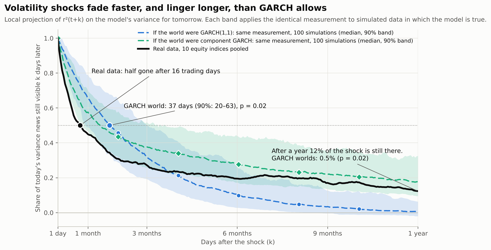
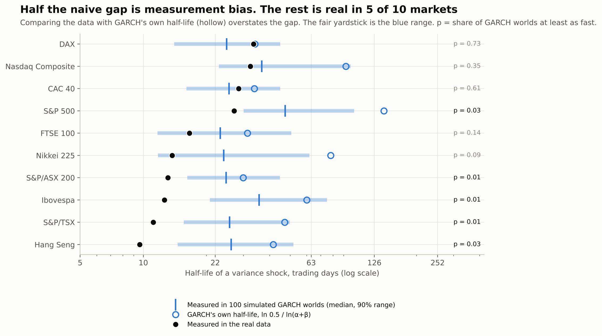
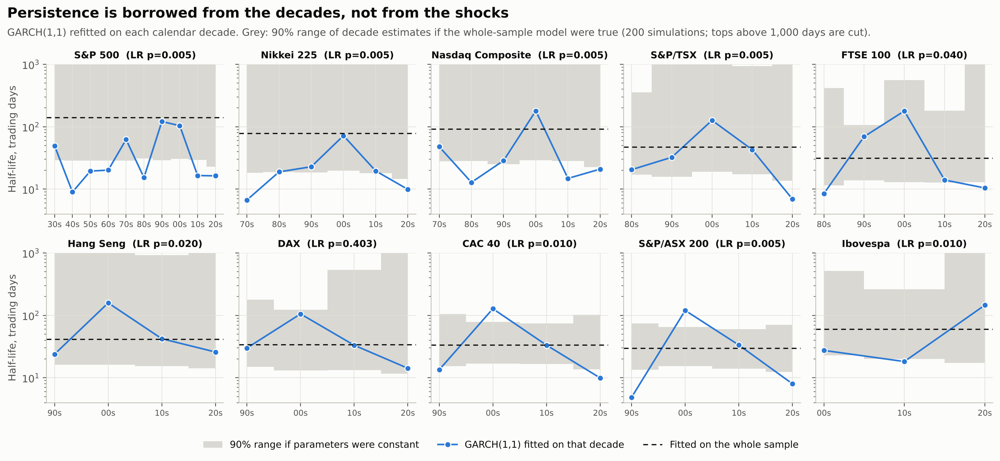
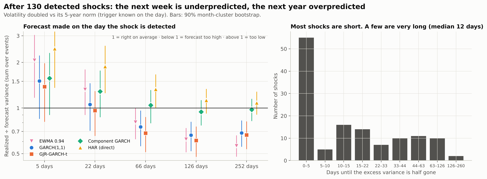
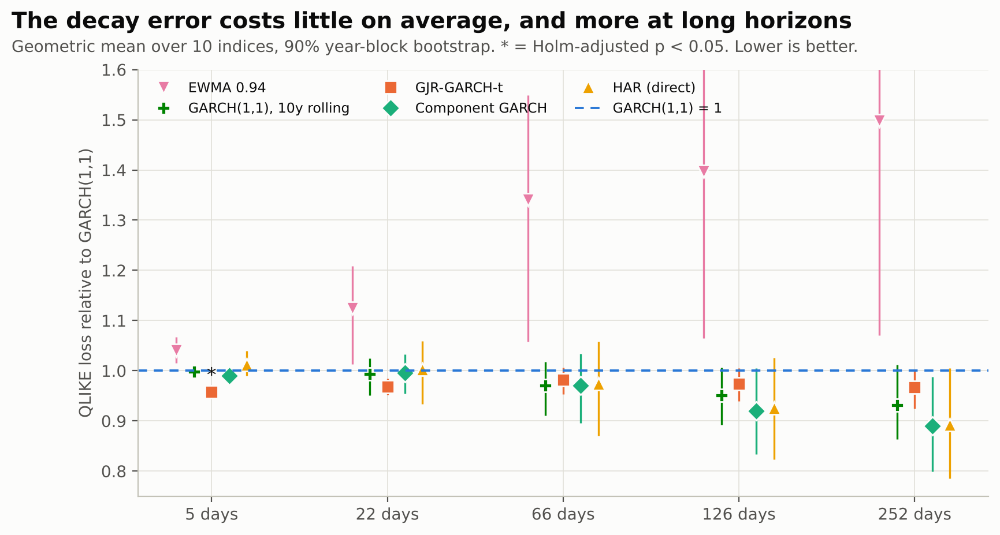
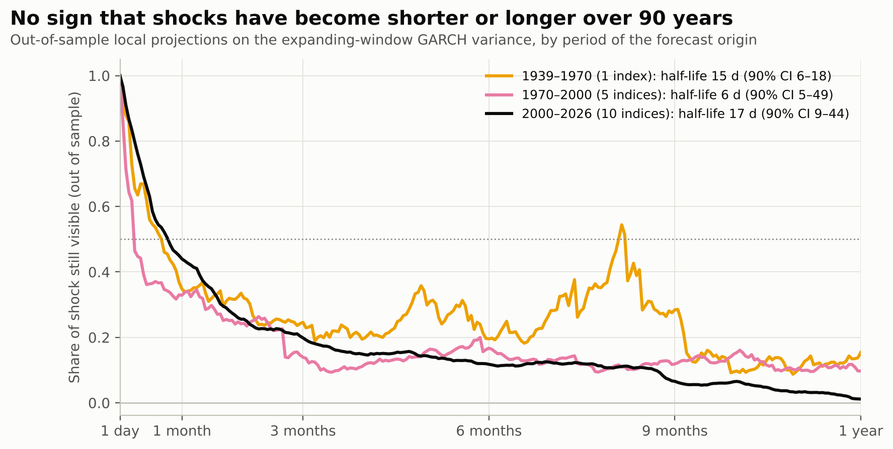

# How Long Does a Volatility Shock Last?

**GARCH's half-life tested against a century of daily data from 10 equity indices, 1928–2026**

*Project 13 of [30 Quant Research Projects](../README.md) · Working paper, November 2026*



---

## Abstract

Every GARCH(1,1) carries one number that answers a practical question: once volatility jumps, how long until
half of the jump is gone? The answer is the half-life, ln 0.5 / ln(α+β). Fitted on daily equity index returns,
α+β comes out around 0.99, which says half of a volatility shock is still there after six weeks to seven months, depending on the index. That number drives
every multi-week GARCH forecast, every VaR horizon scaling, and the mean-reversion speed that option models inherit.

This paper asks: **is that half-life a property of the shocks, and if not, where does it come from?** I measure
the decay of volatility shocks directly, with local projections (Jordà, 2005). This is a regression of the squared return k days ahead on the
variance the model quotes for tomorrow. I then compare it with what GARCH predicts. The comparison uses
10 equity indices: the S&P 500 from 1928, the Nasdaq, TSX, FTSE 100, DAX, CAC 40, Nikkei 225, Hang Seng, ASX 200 and
Ibovespa. Together they give 122,000 index-days and 95,500 out-of-sample forecast origins. The test has three parts. The headline test compares the data with
**the same measurement run on 100 simulated worlds in which the fitted model is true**. That matters, because the
measurement itself is biased (§4.1). The second part fits GARCH decade by decade and checks the parameter
estimates against their bootstrap null distribution. The third is an out-of-sample event study of 130 volatility
shocks, with forecasts from six models made on the day each shock was detected.

**Main findings**

1. **The naive comparison exaggerates the gap by about a factor of two.** Out of sample, the realized decay of a shock
   has a pooled half-life of **17 trading days** (90% CI 9–34). The GARCH forecasts imply **81 days**. But a placebo
   shows the measurement runs short even when GARCH is true. In simulated GARCH worlds with a true half-life of
   69 days, the measured half-life comes out at 37. Any "GARCH is too persistent" result that does not correct for
   this is overstated.
2. **After the correction, GARCH is still rejected, from both ends.** The same measurement gives 16 days in the data
   and **37 days in GARCH worlds** (90% range 20–63, p = 0.02). A year after the shock, **12%** of it is still visible
   in the data, against **0.5%** in GARCH worlds (p = 0.02). Real shocks fade faster at first and then linger far
   longer than one exponential allows. Per index, the fast decay is significant in 5 of 10 markets (p ≤ 0.03). DAX,
   CAC 40 and Nasdaq are fully consistent with GARCH.
3. **GARCH's long half-life is borrowed from the decades, not from the shocks.** Refitted on each calendar decade, the
   S&P 500's GARCH half-life is a median **20 days**. On the whole 1928–2026 sample it is **140 days**. If the parameters
   were constant, decade fits would give a median of 98 days. Parameter constancy is rejected in 9 of 10 indices by a
   parametric-bootstrap LR test (p ≤ 0.04; DAX p = 0.40). Shifts in the *level* of volatility between eras look,
   to a one-factor model, like slow decay of every shock. This is the Lamoureux–Lastrapes (1990) effect, measured
   here over a century.
4. **A component GARCH fixes the tail, not the start.** The Engle–Lee two-factor model reproduces the data's
   one-year tail (p = 0.85) but still decays too slowly in the first weeks: 16 days in the data against 30 in its own
   simulated worlds (p = 0.04).
5. **Out of sample the decay error costs little on average, and a lot after shocks.** Over all days, the
   QLIKE gaps between GARCH, GJR-GARCH-t, component GARCH and HAR are small. The only Holm-significant one is
   GJR-t's 4% gain at one week. At one year, component GARCH and HAR are 11% better than GARCH(1,1) (90% CI 0.80–0.99
   and 0.79–1.01), not significant after Holm. On the 130 shock days the error is systematic. Over the
   next 6–12 months, realized variance came in **34% below GARCH's forecast in aggregate** (realized ÷ forecast 0.66,
   90% CI 0.52–0.81), and below it in 75% of events. Over the next week it came in above the forecast (1.51, 90% CI
   0.85–2.22, so not significant), because many shocks are still escalating when they are first detected. Component
   GARCH is right at long horizons (0.95–0.98).

The practical reading: **a GARCH(1,1) volatility forecast beyond about a month is a forecast of the volatility regime,
and its regime anchor comes from the estimation sample, not from the shock.** Use a two-speed model, or a rolling window
that keeps the anchor current, for anything beyond a month.

---

## 1. Why this question

GARCH(1,1) is the default volatility model in risk management and the first one taught. Its parameters are rarely
questioned once fitted, but α + β is not a harmless technical detail:

* It sets the **term structure** of the volatility forecast. A 10-day VaR, a 3-month vol target or a GARCH option
  price all rest on how fast today's shock is assumed to fade.
* It is notoriously **close to 1** in daily data (integrated GARCH; Engle & Bollerslev, 1986). Lamoureux & Lastrapes
  (1990) and Mikosch & Stărică (2004) argued that this near-unit-root persistence is partly an artefact of
  structural breaks in the unconditional variance. Ding, Granger & Engle (1993) and Andersen & Bollerslev (1997) showed
  that absolute returns have *long memory*: their autocorrelations decay hyperbolically, not exponentially.
* Those papers tested the **autocorrelation of squared returns**, or the in-sample likelihood. Neither directly answers
  the forecasting question "how much of today's news is still there in k days?", and neither checks whether the test
  is biased.

What is new here:

1. The decay is measured **on the model's own terms**: by regressing the realized r²(t+k) on the variance the
   model quotes for tomorrow, and comparing with the same regression on the model's own k-step forecast. Out of sample,
   with yearly re-estimation, this is a Mincer–Zarnowitz test at every lag from 1 to 252.
2. The measurement is **calibrated by simulation**. I show it is biased towards short half-lives, and I test against the
   distribution it produces in worlds where GARCH (or component GARCH) is true. Comparisons of GARCH persistence
   with empirical decay rarely make this correction explicit.
3. **A century of data across 10 markets**, with decade-by-decade stability tests whose null comes from a parametric
   bootstrap, not from χ² tables. QMLE likelihood ratios are not χ² under fat tails.
4. An **out-of-sample event study** of the forecasts each model gave on the day a shock was detected.

### Hypotheses (stated before running the tests)

* **H1 (shape).** Measured decay is faster than GARCH implies in the first weeks.
* **H2 (stability).** GARCH parameters are not constant across decades, and the full-sample persistence is longer than
  the typical within-decade persistence, by more than small-sample bias explains.
* **H3 (forecasting).** GARCH(1,1)'s disadvantage against two-speed models grows with the horizon.
* **H4 (episodes).** After large shocks, GARCH over-forecasts multi-month variance.

H1 was confirmed only after the simulation correction, and only at half the size first measured. H2 was confirmed.
H3 holds in direction but is not significant after Holm. H4 was confirmed beyond 2 months, and reversed at 1 week.

---

## 2. Data

| Index | Symbol | Daily returns from | Out-of-sample origins from | Return days | Forecast origins |
|---|---|---|---|---|---|
| S&P 500 | ^GSPC | 1928-01 | 1939-01 | 24,837 | 22,092 |
| Nasdaq Composite | ^IXIC | 1971-02 | 1982-01 | 14,063 | 11,311 |
| S&P/TSX | ^GSPTSE | 1979-07 | 1990-01 | 11,897 | 9,272 |
| FTSE 100 | ^FTSE | 1984-01 | 1994-01 | 10,832 | 8,307 |
| DAX | ^GDAXI | 1988-01 | 1999-01 | 9,834 | 7,081 |
| CAC 40 | ^FCHI | 1990-03 | 2001-01 | 9,326 | 6,619 |
| Nikkei 225 | ^N225 | 1965-01 | 1976-01 | 15,208 | 12,512 |
| Hang Seng | ^HSI | 1987-01 | 1998-01 | 9,842 | 7,119 |
| S&P/ASX 200 | ^AXJO | 1992-11 | 2003-01 | 8,593 | 6,039 |
| Ibovespa | ^BVSP | 1995-01 | 2006-01 | 7,895 | 5,171 |
| **Total** | | | | **122,327** | **95,523** |

Daily closes from Yahoo Finance to 2026-11-18. This is the same file as project
[03](../03-moving-average-volatility/), reused on purpose: it is the only dataset in the series that reaches back a century,
and that is what this question needs. Returns are 100 × log close-to-close. Ibovespa starts in 1995 to skip
hyperinflation, the same cut as project 03. Price indices omit dividends, which is irrelevant for variance. Before 1957 the
S&P series is the S&P 90.

The stress windows of the series are all inside the out-of-sample period: 1987, 2008–09, 2011, 2020 and 2022.
In-sample fits also cover 1929–1937.

---

## 3. Method

### 3.1 Models (all zero-mean, re-estimated every January)

| Model | Variance recursion | What it says about a shock | Window |
|---|---|---|---|
| EWMA 0.94 (RiskMetrics) | σ²ₜ₊₁ = λσ²ₜ + (1−λ)r²ₜ | never decays (no mean reversion) | – |
| GARCH(1,1) | σ²ₜ₊₁ = ω + αr²ₜ + βσ²ₜ | one exponential, rate α+β | expanding |
| GARCH(1,1), 10y rolling | same | same, but the anchor ω/(1−α−β) is from the last decade | rolling 2,520 days |
| GJR-GARCH(1,1)-t | adds γ·r²ₜ·1[rₜ<0], Student-t | one exponential, rate α+γ/2+β | expanding |
| Component GARCH (Engle & Lee, 1999) | long-run qₜ with rate ρ, transitory σ²−q with rate α+β | two exponentials | expanding |
| HAR (direct) | log RV over the next h days on log RV over the last 5, 22, 66 and 252 days | no structural decay; horizon-specific regression | expanding |

My own QMLE code (`src/models.py`, numba recursions) matches the `arch` package's log-likelihood to within 2 points
on 12,500 to 25,000 observations (tests). Multi-step forecasts are closed form: for GARCH,
E[σ²ₜ₊ₖ] = σ̄² + (α+β)^(k−1)(σ²ₜ₊₁ − σ̄²). The first 2,520 days (10 years) of each index are burn-in, so forecasting starts in the eleventh year.

### 3.2 Measuring the decay: local projections on the model's own terms

For every forecast origin t and lag k = 1…252:

* **Realized:** regress r²ₜ₊ₖ = cₖ + bₖ · sₜ + e, where sₜ is the model's variance for tomorrow.
* **Model-implied:** regress the model's own k-step forecast Fₜ(k) on the same sₜ, which gives mₖ.

If the model is right, bₖ = mₖ at every k. The ratio bₖ/b₁ is the share of today's variance news still visible k days later.
The k where it crosses 0.5 is the **half-life**. The intercept absorbs any error in the model's long-run level, so
this isolates the *dynamics*. Indices are pooled with index fixed effects, after scaling each by its mean r².
Confidence bands come from a calendar-year block bootstrap (1,000 draws) that resamples the same years for every
index, which keeps the cross-market dependence of 2008 or 2020.

### 3.3 The placebo, and the fair test

`src/sim_check.py` simulates 25,000-day GARCH paths with t₅ shocks and true half-lives of 34, 69 and 138 days. It
fits GARCH and runs §3.2. The fitted model recovers the truth: 32, 72 and 139 days. **The local projection does
not.** It reports 28, 37 and 61 days. With fat tails, the variance of r² is barely finite, and the slope at long lags
is pulled towards zero. So the population half-life ln 0.5 / ln(α+β) is the wrong benchmark for a measured one.

The headline test (`src/null_worlds.py`) therefore compares like with like. For each index it fits GARCH(1,1), and
separately component GARCH, on the full sample. It simulates 100 paths of the same length, with shocks resampled from
that model's own standardized residuals (filtered historical simulation, which keeps the fat tails and skew). It refits
the model on each path and runs the identical in-sample local projection. The p-value is the share of simulated
worlds whose measured half-life is at least as short as the data's. The same simulations give the null distribution
of the one-year tail share.

### 3.4 Decade stability

GARCH(1,1) is fitted on every calendar decade with at least 5 years of data: 51 decade fits. The statistic is
LR = 2(Σ decade log-likelihoods − log-likelihood of the decades at the full-sample parameters). The null distribution
comes from 200 simulations of the full-sample model with bootstrapped residuals, with every fit repeated exactly on
each path (`src/stability.py`). The same simulations show what spread of decade half-lives estimation noise alone
produces.

### 3.5 Event study

A shock is detected on day t when the trailing 22-day realized variance first exceeds 4× its trailing 5-year median
(volatility doubles), after at least 126 days below that trigger. Everything is known at t. Over the out-of-sample
period this gives **130 events in 80 calendar months**. For each event and model, the realized cumulative variance over
5–252 days is compared with the forecast made at t. The main statistic is the **ratio of sums**, which is unbiased if
the model is right. The geometric mean of ratios is pulled below 1 by Jensen's inequality even under a correct model,
so it is reported only as a secondary statistic. Inference uses a cluster bootstrap that resamples calendar months.

### 3.6 Forecast evaluation

QLIKE against the realized sum of r² over the next h ∈ {5, 22, 66, 126, 252} days, every trading day. QLIKE is
robust to the noise in this proxy (Patton, 2011). There are Diebold–Mariano tests per index (Newey–West with lag h),
and a panel geometric mean of loss ratios with a year-block bootstrap. A Holm correction covers the family of 25
comparisons (5 models × 5 horizons, each against GARCH(1,1)).

---

## 4. Results

### 4.1 The naive gap, and why it is half bias

Out of sample, pooled over 10 indices (`results/half_lives.csv`, tag `main`):

| Model | Realized half-life (days, 90% CI) | Half-life implied by the model's own forecasts | Gap, 90% CI |
|---|---|---|---|
| GARCH(1,1) | 16.7 (8.7–34.1) | 81.4 | 64 (35–207) |
| GARCH(1,1), 10y rolling | 17.4 (9.4–37.2) | 53.2 | 36 (22–58) |
| GJR-GARCH-t | 14.6 (8.5–31.5) | 71.8 | 56 (39–79) |
| Component GARCH | 16.6 (8.7–35.4) | 38.1 | 20 (6–52) |

Taken at face value, this says GARCH believes shocks last five times longer than they do. It survives winsorizing r²
at the 99.9th percentile (20.1 vs 81.4) and dropping October 1987 to March 1988 (18.2 vs 69.9). **But it is not a
fair comparison.** The placebo in §3.3 shows that the realized measurement would report about half of the true
half-life even if GARCH were exactly right (37 for a true 69). The model-implied column has no such bias, because it is a regression of a
deterministic function of sₜ. Any comparison of GARCH persistence with an empirical decay of r², such as autocorrelations, faces the same
problem.

### 4.2 The fair test: data vs simulated model worlds (Figures 1 and 2)



`results/null_world_tests.csv`, in-sample fits, 100 worlds per model and index:

| | Data | GARCH worlds: median (90%) | p | Component GARCH worlds: median (90%) | p |
|---|---|---|---|---|---|
| Pooled half-life, days | **16.5** | 37.0 (20.2–63.4) | **0.020** | 30.4 (18.2–62.7) | **0.040** |
| Share left after 252 days | **0.12** | 0.005 | **0.020** | 0.18 | 0.85 |
| Mean share over days 1–126 | 0.33 | 0.39 | 0.25 | 0.44 | 0.050 |

Per index, the measured half-life is faster than at least 97% of GARCH worlds in **5 of 10** markets: S&P 500 (27 vs
47, p = 0.03), S&P/TSX (11 vs 26), ASX 200 (13 vs 25), Ibovespa (13 vs 36), each with p = 0.01, and Hang Seng (10 vs 26, p = 0.03). Nikkei
(p = 0.09) and FTSE (p = 0.14) point the same way. **DAX (p = 0.73), CAC 40 (0.61) and Nasdaq (0.35) are consistent with
GARCH.** A one-year tail far above GARCH's is significant for the S&P 500 (0.32 vs 0.02, p = 0.01) and the Nasdaq
(0.21 vs 0.00, p = 0.02).

So the shape result is real: **a fast initial decay followed by a long tail.** A single exponential has one dial. To
fit the tail it must decay slowly, and then it misses the start. Component GARCH has two dials. It matches the tail but
its maximum-likelihood fit still decays too slowly in the first weeks (16 days in the data against 30 in component
GARCH worlds, p = 0.04).

### 4.3 Where the persistence comes from: decades (Figure 3)



| Index | Decades | Full-sample half-life | Median decade half-life | Same, if parameters were constant | LR p |
|---|---|---|---|---|---|
| S&P 500 | 10 | 140 | 20 | 98 | 0.005 |
| Nikkei 225 | 6 | 78 | 19 | 56 | 0.005 |
| Nasdaq | 6 | 92 | 25 | 76 | 0.005 |
| S&P/TSX | 5 | 47 | 32 | 41 | 0.005 |
| FTSE 100 | 5 | 31 | 14 | 28 | 0.040 |
| Hang Seng | 4 | 42 | 34 | 39 | 0.020 |
| DAX | 4 | 34 | 32 | 29 | 0.403 |
| CAC 40 | 4 | 34 | 23 | 32 | 0.010 |
| ASX 200 | 4 | 30 | 21 | 28 | 0.005 |
| Ibovespa | 3 | 60 | 27 | 51 | 0.010 |

(p = 0.005 is the floor with 200 simulations.) Short windows do bias the persistence estimate down (for the
S&P 500, 98 days instead of 140 if nothing changed), but much less than the real decade fits fall. The median decade
half-life is below the constant-parameter null in 9 of 10 indices, and less than about half of it in the S&P 500,
Nikkei, Nasdaq, FTSE and Ibovespa. The pattern in Figure 3 is regular. Long half-lives appear in decades that *contain a regime shift in the
level of volatility*: the S&P 500 in the 1990s and 2000s (121 and 104 days), and the 2000s in 8 of 9 other indices
(70–180 days). Six of the ten S&P 500 decades give 9–20 days. **The 140-day half-life of the S&P 500 is not a property of any decade
in its history.** This is also what makes the S&P 500 the index where an expanding-window GARCH forecasts worst at
long horizons. Its anchor σ̄² still remembers the 1930s: at one year, the 10-year rolling GARCH has 43% lower
QLIKE, and HAR 55% lower (`results/qlike_by_index.csv`).

### 4.4 Shock by shock (Figures 4 and 7)



Realized ÷ forecast cumulative variance on the 130 shock days, as a ratio of sums with a 90% month-cluster bootstrap
(`results/event_errors.csv`):

| Horizon | GARCH(1,1) | GJR-GARCH-t | Component GARCH | HAR | EWMA |
|---|---|---|---|---|---|
| 5 days | 1.51 (0.85–2.22) | 1.38 | 1.57 | 2.47 | 2.07 |
| 22 days | 1.06 (0.71–1.46) | 0.96 | 1.29 | 1.88 | 1.33 |
| 66 days | **0.75** (0.56–0.96) | 0.68 | 1.04 | 1.33 | 0.81 |
| 126 days | **0.66** (0.52–0.81) | 0.61 | 0.95 | 1.13 | 0.62 |
| 252 days | **0.68** (0.56–0.83) | 0.66 | 0.98 | 1.08 | 0.56 |

Two errors, in opposite directions. In the first week, every model under-forecasts in aggregate, because the trigger often
fires on the first leg of a crash (the 1987 trigger fired on Friday 16 October, the trading day before Black Monday). From 3 months on, realized variance under GARCH and
GJR-t came in about a third below the forecast, and below it in about three events out of four. Component GARCH is unbiased at long horizons.
HAR is too slow at the start, because its regressors are trailing averages.

The halfway time of each event's excess variance (Figure 4, right) shows why the decay curve has two speeds. **42% of
shocks are half gone within 5 days.** Most are one-day jumps, such as the S&P 500 after the Kennedy assassination
in November 1963, or the February 2018 "Volmageddon" day. Another **18% take more than two months**: 1998 LTCM, 2000–02, 2008 in Brazil, 2020 in Europe.
A single exponential is fitted to the average of a mixture of very short and very long episodes. Figure 7 shows four
of them. In 1987 the expanding-window S&P GARCH actually forecast *rising* volatility after the crash, because its anchor
was the 1930s.

### 4.5 Does it matter for forecasting? (Figure 5)



Panel QLIKE relative to GARCH(1,1), geometric mean over 10 indices with a 90% year-block bootstrap
(`results/qlike_panel.csv`):

| Horizon | EWMA | GARCH 10y | GJR-t | Component GARCH | HAR |
|---|---|---|---|---|---|
| 5 days | 1.04 | 1.00 | **0.96** (Holm p = 0.01) | 0.99 | 1.01 |
| 22 days | 1.12 | 0.99 | 0.97 (Holm p = 0.10) | 1.00 | 1.00 |
| 66 days | 1.34 | 0.97 | 0.98 | 0.97 | 0.97 |
| 126 days | 1.40 | 0.95 | 0.97 | 0.92 | 0.93 |
| 252 days | 1.50 | 0.93 | 0.97 | 0.89 (0.80–0.99) | 0.89 (0.79–1.01) |

The decay error has a small average cost. Over all days, a shock is the exception, and between shocks GARCH's slow
decay does little harm. The cost grows with the horizon, as H3 predicted, but nothing beyond one week survives the
Holm correction over 25 comparisons. The one robust conclusion is that **EWMA, which has no mean reversion at all, is
the worst model at every horizon of three months or more** (34–50% worse than GARCH). Even an over-persistent model beats a model with
no persistence limit.

In the stress windows (`results/stress_windows.csv`, all indices, h = 22), GJR-t is the best model in 2008–09, 2011 and
2020, with GARCH(1,1) 3–4% behind it. In 2022, a slow-building bear market, HAR was best (0.93). Component GARCH is 12–18% worse, and HAR 35–38% worse in 2008 and
2020. A model that expects fast decay is hurt when a shock keeps building, so the event study and the stress windows
tell the same two-sided story.

### 4.6 Has the half-life changed over 90 years? (Figure 6)



Pooled out-of-sample decay by period of the forecast origin: 1939–1969 (S&P 500 only), **15 days** (90% CI 6.5–18);
1970–1999, **6 days** (5–49, very wide because of 1987); 2000–2026, **17 days** (9–44). There is no detectable trend.
Fast decay is not a feature of modern, electronic markets: it was already there in the 1940s.

---

## 5. What this means in practice

* **Do not read α+β as the life of a shock.** On daily equity data it is mostly the life of the *volatility regime*,
  and the estimation sample decides which regime that is. A forecast beyond a month from an expanding-window GARCH
  is mainly a bet on the sample's long-run variance.
* **For horizons beyond a month, use two speeds or a current anchor.** Component GARCH, HAR or a rolling-window GARCH
  remove the systematic one-third over-forecast after shocks at no cost at short horizons.
* **For the first days after a shock, keep a single-factor model with a leverage term.** GJR-GARCH-t is the only model
  significantly better than GARCH(1,1) anywhere, at one week, and it is the most robust in crises.
* **When you test persistence, calibrate the test.** The local-projection or autocorrelation half-life of squared
  returns is biased short under fat tails. Compare it with simulated model worlds, not with ln 0.5 / ln(α+β).

---

## 6. Robustness

| Check | Result | File |
|---|---|---|
| Winsorize r² at 99.9% | out-of-sample realized half-life 20 vs 81 for the model | `half_lives.csv`, tag `winsor99.9` |
| Drop Oct 1987 to Mar 1988 | 18 vs 70 | tag `drop1987` |
| Other yardstick models (GARCH 10y rolling, GJR-t, CGARCH) | realized half-lives 15–17 in every case | `half_lives.csv` |
| Placebo: two-component world (true half-life 17–20) | local projection recovers 17–22 | `simulation_check.csv` |
| Same optimizer on data and simulated paths | yes: all fits use the same multi-start QMLE | `stability.py` |
| Event trigger only after 1970 (115 events) | median halfway time 14 days, against 12 for all events | `events.csv` |

---

## 7. Limitations

* **Daily closes only.** Realized variance is the sum of squared daily returns, not intraday data, so it is a noisy
  proxy. QLIKE rankings are robust to this, but levels of loss are not comparable with intraday studies such as project
  [02](../02-volatility-dashboard-audit/), which has OHLC for ETFs. Intraday data would sharpen the first days of the decay
  curve.
* **Equity indices only.** Rates, FX and commodities may decay differently. Gold has an inverse leverage effect
  (project [10](../10-market-terminal/)).
* **100 simulated worlds per model and index.** The smallest attainable p-value is 0.0099. Per-index tests are 10 tests per
  measure and are reported without multiplicity adjustment. The pooled test is the pre-specified headline. With Holm
  over the 10 per-index half-life tests, none survives on its own (min p = 0.01 × 10 = 0.10). Read the per-index results as
  "5 of 10 point the same way at the 5% level", not as 5 independent discoveries.
* **Component GARCH is hard to identify.** For the Nikkei its long-run root hits 1 (a random-walk trend), and for
  the Hang Seng β = 0. Its maximum-likelihood fit is a one-step-ahead criterion, so it is not built to get the 3-month decay right.
  A multi-horizon estimator could do better and was not tried.
* **FIGARCH and realized GARCH are not included.** FIGARCH's analytic multi-step forecast costs O(h × 1,000) per
  origin, which was too expensive for 95,500 daily origins. Realized GARCH needs intraday data.
* **The event trigger is one rule.** Its cool-down skips some famous dates (the S&P 500 in September 2008 and March 2020
  fall inside earlier episodes). Results by horizon are stable to restricting it to post-1970 events, but other
  triggers were not tried.
* **Yahoo index data** before the 1960s are reconstructions (S&P 90), and a few non-US series have stale days. Zero-return
  days are 1.3% of S&P 500 and Nikkei days, and below 0.3% elsewhere.

---

## 8. Referee-style self-review: what it changed

1. **"Your measurement is biased."** The first draft's headline was "17 days vs 81 days". The placebo in §3.3,
   which I wrote to check the method, showed that the local projection reports about half of a true GARCH half-life.
   The headline test was rebuilt around simulated model worlds (§3.3, §4.2). The effect fell from a factor of 5 to a
   factor of 2.2, and from 10 of 10 to 5 of 10 significant markets. The naive table stays in §4.1, explicitly labelled.
2. **"Jensen's inequality."** The event study's first statistic was the geometric mean of realized ÷ forecast. It is below 1
   even for a correct model. The ratio of sums is now the main statistic. The direction of the conclusion did not
   change, but the one-week result flipped sign: models under-forecast the first week in aggregate.
3. **"The anchor and the dynamics are confounded."** An intercept in every local projection absorbs level errors, so the
   curves measure decay only. The anchor problem is reported separately (§4.3, S&P 500 at one year).
4. **"Simulations and data used different optimizers."** The first stability run warm-started simulated fits from one
   point. Every fit now uses the same multi-start QMLE. The results were unchanged.
5. **"Look-ahead in the event selection."** Selecting peaks of realized volatility would condition on the future and
   guarantee a decay. The trigger uses only trailing data, and forecasts use parameters estimated before the event.
6. **"Overclaiming forecast gains."** At one year component GARCH and HAR are 11% better. That is not significant after
   Holm, and the abstract says so.

---

## 9. Connections to the other projects

* **#01** uses GJR-GARCH-t as a Monte Carlo engine and finds its 90% intervals well calibrated at one week in every
  volatility quintile. That is consistent with this paper: the decay error matters beyond a month.
* **#02** found GJR-GARCH-t 25% better than a 21-day dashboard number at 22 days, and calibrated by volatility
  quintile. The same holds here on average (`calibration_by_state.csv`). The bias appears only when conditioning on
  the moment a shock is detected.
* **#03** uses the same index data. Its finding that the 200-day trend carries next-month *risk* information is a
  symptom of the slow component: the level of volatility moves with the regime.
* **#06** (filtered historical simulation VaR) and **#07** (GARCH-scaled Kelly) both scale risk by a GARCH variance. Their
  multi-week horizons inherit the over-persistence documented here.
* **#19** (HMM regimes) models directly what §4.3 finds: discrete shifts in the level of volatility. **#14** and **#26**
  (implied volatility surface, Heston) face the same two-speed problem: Heston's single mean-reversion speed κ is the
  continuous-time cousin of α+β.

---

## Reproduce

```bash
pip install -r requirements.txt
bash run_all.sh          # tests, all experiments and figures; about 15 minutes on 4 cores
```

All numbers in this document are in `results/*.csv`. Seeds are fixed. Data: `data/index_closes.csv`, the same file as
project 03 (refresh with `../03-moving-average-volatility/src/fetch_data.py`).

| File | What it does |
|---|---|
| `src/models.py` | GARCH, GJR-t, component GARCH, EWMA: QMLE, filters, closed-form forecasts, simulators |
| `src/backtest.py` | yearly-refit walk-forward forecasts at 5 horizons (`results/forecasts/*.pkl.gz`, not committed: rebuilt in about 80 seconds) |
| `src/irf.py` | out-of-sample local projections and half-lives, with robustness and era splits |
| `src/sim_check.py` | placebo: what the measurement reports when the truth is known |
| `src/null_worlds.py` | headline test against 100 simulated GARCH and component GARCH worlds per index |
| `src/stability.py` | decade fits and parametric-bootstrap LR test |
| `src/episodes.py` | event study of 130 detected shocks |
| `src/evaluate.py` | QLIKE, Diebold–Mariano, Holm, stress windows, calibration by state |
| `src/figures.py` | all figures |
| `tests/` | 11 tests, including cross-checks against the `arch` package and a no-look-ahead test |

## References

Andersen, T., Bollerslev, T. (1997). Heterogeneous information arrivals and return volatility dynamics. *Journal of Finance* 52(3).
Bollerslev, T. (1986). Generalized autoregressive conditional heteroskedasticity. *Journal of Econometrics* 31(3).
Corsi, F. (2009). A simple approximate long-memory model of realized volatility. *Journal of Financial Econometrics* 7(2).
Ding, Z., Granger, C., Engle, R. (1993). A long memory property of stock market returns and a new model. *Journal of Empirical Finance* 1(1).
Engle, R., Bollerslev, T. (1986). Modelling the persistence of conditional variances. *Econometric Reviews* 5(1).
Engle, R., Lee, G. (1999). A long-run and short-run component model of stock return volatility. In *Cointegration, Causality and Forecasting*, Oxford UP.
Glosten, L., Jagannathan, R., Runkle, D. (1993). On the relation between the expected value and the volatility of the nominal excess return on stocks. *Journal of Finance* 48(5).
Holm, S. (1979). A simple sequentially rejective multiple test procedure. *Scandinavian Journal of Statistics* 6(2).
Jordà, Ò. (2005). Estimation and inference of impulse responses by local projections. *American Economic Review* 95(1).
Lamoureux, C., Lastrapes, W. (1990). Persistence in variance, structural change, and the GARCH model. *Journal of Business & Economic Statistics* 8(2).
Mikosch, T., Stărică, C. (2004). Nonstationarities in financial time series, the long-range dependence, and the IGARCH effects. *Review of Economics and Statistics* 86(1).
Patton, A. (2011). Volatility forecast comparison using imperfect volatility proxies. *Journal of Econometrics* 160(1).
