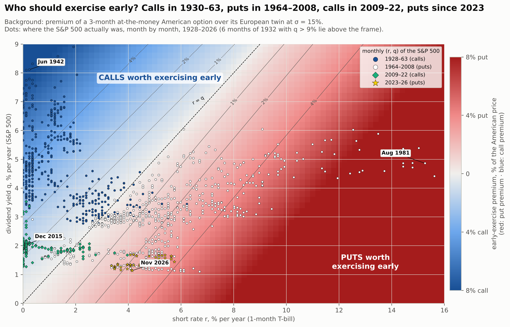
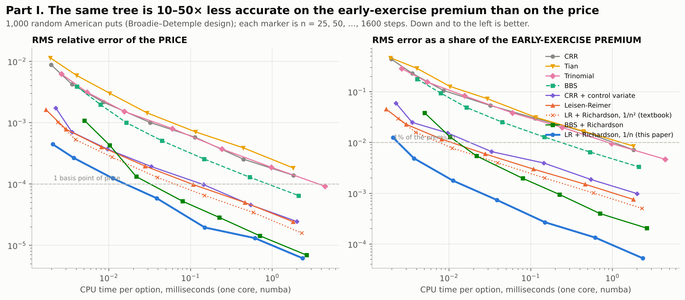
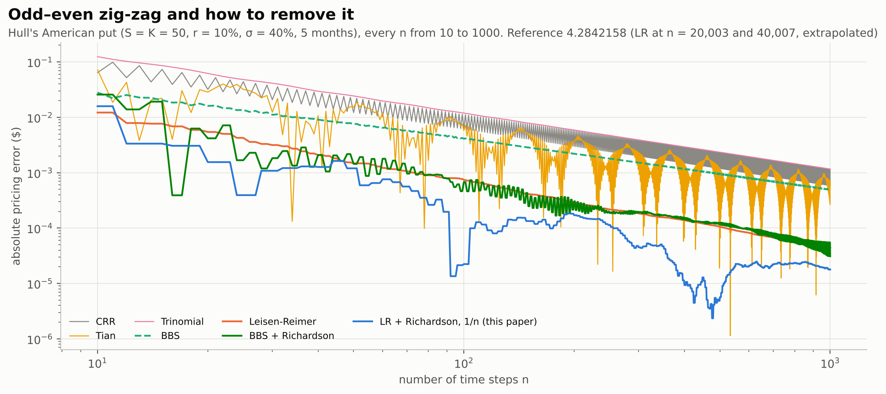
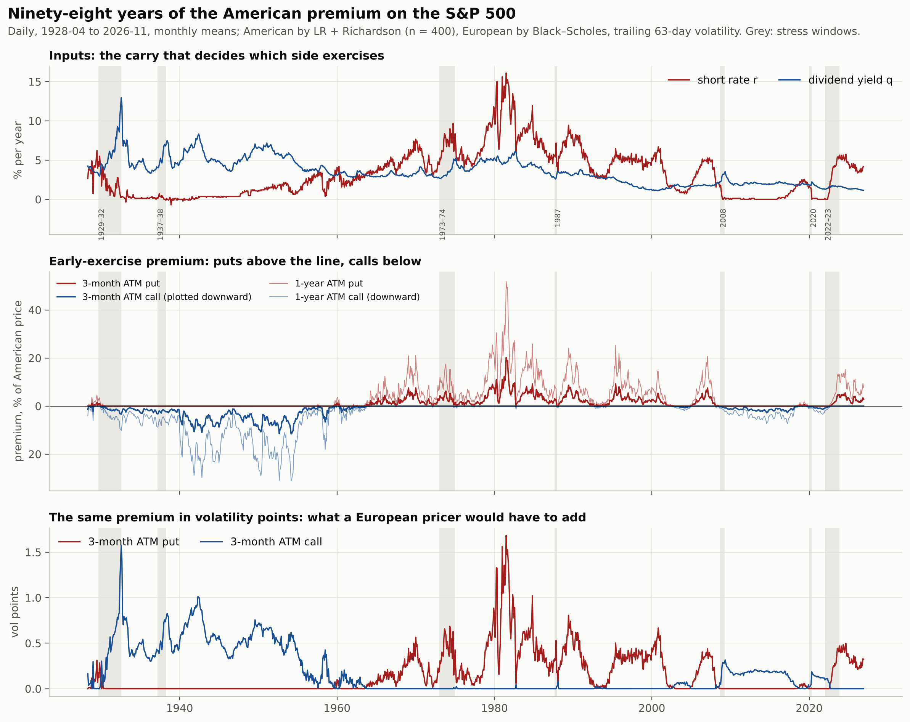
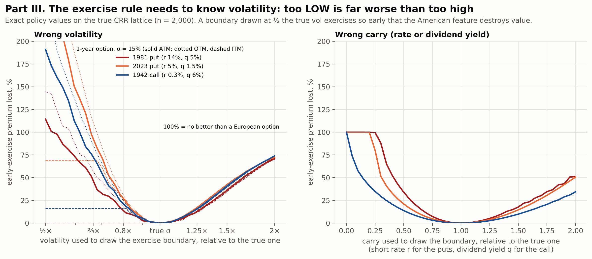
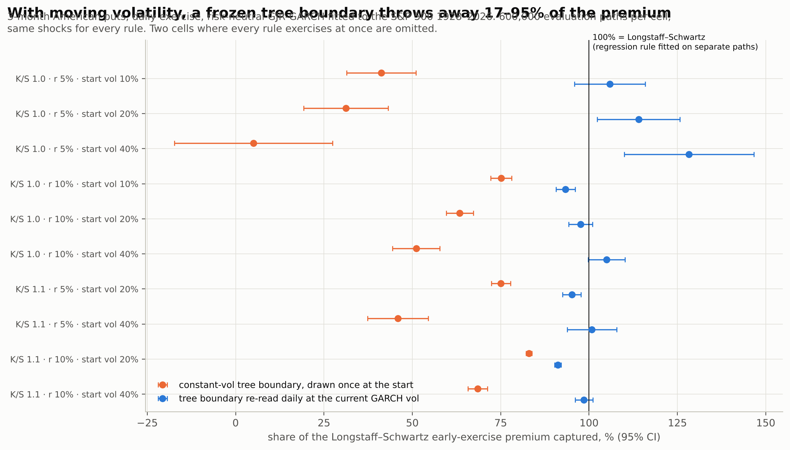

# When Is an American Option Worth More Than a European One?

**Thirteen lattices for American options, ninety-eight years of early-exercise premia on the S&P 500,
and what the exercise rule needs to know**

*Project 15 of [30 Quant Research Projects](../README.md) · Working paper, November 2026*



---

## Abstract

The binomial tree is the textbook engine for American options, and the textbook exercise stops at
"the tree converges". This paper asks three questions that sit underneath it. **(I)** Which lattice should you
actually use, and accurate to *what*? **(II)** Over a century of real interest rates, dividend yields and
volatility, when did the American feature of an index option matter at all, and for which side?
**(III)** Early exercise is a decision rule. How much of its value survives when the rule is drawn with the wrong
volatility, or in a world where volatility moves?

**Main findings**

1. **Accuracy on the price hides inaccuracy on the premium.** Across 1,000 random American puts, every lattice
   is, by its median ratio, 14–57 times less accurate in relative terms on the early-exercise premium (EEP) than on the price.
   CRR with 1,600 steps prices to 1.4 bp but still misstates the premium by 0.7%.
2. **Leisen–Reimer plus Richardson extrapolation wins, if you extrapolate with the right exponent.**
   For American options the LR error shrinks like 1/n, not 1/n² as in the European case. Extrapolating
   with 1/n gives 6.2 × 10⁻⁶ RMS relative price error at n = 1,600, 2.6× better than the textbook 1/n² weights
   and 22× better than CRR. Reaching a 1% premium error takes 0.004 ms with this engine and about 1.8 ms
   with CRR, roughly 500 times faster. The Hull–White control variate improves CRR by 5–7× and does nothing for LR.
3. **Who should exercise early flipped three times in 98 years.** On a 3-month at-the-money S&P 500 option,
   the call carried the larger premium on 96% of days in 1930–63 (dividend yields of 4–7% against bills near 1%).
   The put carried it on 92% of days in 1964–2008, and the call again on 89% of days in 2009–22 under zero
   rates. Since 2023 it has been the put on 100% of days. At the extremes the premium was 7.9% of the
   American price for a 3-month call in 1942 and 12.3% for a 3-month put in 1981 (33% for a one-year put).
4. **A European pricer is wrong by more than 1% on most days.** On 73% of trading days since 1928, either
   the 3-month ATM put or call had a premium above 1% of its price, and on 18% of days above 5%. For
   one-year options the figure is 93%. In the crashes of 2008 and 2020 the put premium was zero,
   because rates were zero. The American put pays for early exercise only when cash pays interest.
5. **The exercise rule needs to know volatility, and underestimating it is the expensive mistake.**
   Exact lattice policy evaluation shows that a boundary drawn at 0.8× the true volatility forfeits 11–24% of
   the premium. At ½× it forfeits 114–263%, so the "American" option ends up worth *less* than its European twin.
   Overestimating volatility by 1.25× costs only 11–15%. The loss is quadratic near the truth, about 3–5 × (ln m)².
6. **In a GARCH world a frozen tree boundary throws away most of the premium. A tree boundary that is
   re-read at the current volatility does not.** With risk-neutral GJR-GARCH paths fitted to the S&P 500
   (1928–2026), a constant-volatility boundary drawn once at the start captures only 5–83% of the
   Longstaff–Schwartz premium. Under the leverage effect the put is in the money exactly when volatility has risen,
   so a frozen boundary exercises too early; volatility is 16–37% above its assumed level when it exercises.
   Re-reading the same tree boundary daily at the current GARCH term volatility captures 91–128% of the
   Longstaff–Schwartz premium. In all 10 non-trivial cells it beats the frozen rule with z > 5.9.

---

## 1. Motivation and question

Most listed equity and ETF options are American. Most introductions to the binomial tree price one American put,
show the price converging, and stop. Three things are left unasked.

* *Convergence of what?* The quantity that distinguishes an American option from a European one is the
  early-exercise premium, which is often a few percent of the price. A tree's error is spread over the whole price, so
  a small relative price error can be a large relative error in the premium.
* *When does it matter?* The put premium comes from interest earned on the strike, and the call premium from
  dividends lost while waiting. Both carry rates have moved enormously since 1928. Nobody prices options
  with a 1942 dividend yield today, but the history tells you which regime you are in and how large the effect can get.
* *What does the exercise decision depend on?* A tree outputs a price and, implicitly, an exercise
  boundary. In practice that boundary is drawn with an estimated volatility in a world where volatility moves.

**Research questions.**
(I) Which lattice reaches a given accuracy on the price and on the premium fastest?
(II) From 1928 to 2026, how large was the EEP of S&P 500 puts and calls, and which side carried it?
(III) How much premium is lost when the exercise boundary is drawn with the wrong volatility or carry,
and does a tree boundary still work when volatility follows a GARCH process?

**Hypotheses stated before running Part II and Part III** (H1 is in the project thread from the first
message): **H1** in the high-dividend, near-zero-rate 1940s it was the American *call*, not the put, that
carried the early-exercise premium. **H2** the European price is a poor proxy (error > 1%) on a non-trivial share of days.
**H3** (*which turned out to be wrong*) the envelope theorem makes the value of an exercise rule insensitive to the
volatility used to draw it: I expected a 25% volatility error to cost under 5% of the premium.

Ideas this builds on: Cox, Ross and Rubinstein (1979); Jarrow and Rudd (1983); Trigeorgis (1991); Tian (1993);
Leisen and Reimer (1996); Broadie and Detemple (1996) for the BBS/BBSR methods and the random-contract test design;
Hull and White (1988) for the control variate; Longstaff and Schwartz (2001); Duan (1995) for risk-neutral GARCH;
McDonald and Schroder (1998) for put–call symmetry. To my knowledge, a century-long history of index early-exercise
premia and the exact cost of a mis-drawn exercise boundary have not been published.

## 2. Part I: which tree, and accurate to what?

### 2.1 Engines

`src/trees.py` implements thirteen lattice methods with a continuous dividend yield, compiled with numba. They share
one backward-induction kernel and differ only in (u, d, p) or in how the last step and the extrapolation are done:

| Method | Idea |
|---|---|
| CRR | u = e^{σ√Δt}, d = 1/u |
| Jarrow–Rudd | drift in the nodes; risk-neutral p (so the tree is arbitrage-free) |
| Tian | matches the first three moments |
| Trigeorgis | log-space tree with the drift in p |
| Trinomial | Boyle / Kamrad–Ritchken, λ = √3 |
| Leisen–Reimer | nodes centred on the strike via the Peizer–Pratt inversion; n odd |
| CRR avg(n, n+1) | averages away the odd–even zig-zag |
| BBS | CRR whose last step is the Black–Scholes value (Broadie–Detemple) |
| BBS + Richardson | 2·BBS(n) − BBS(n/2) |
| LR + Richardson (1/n) | 2·LR(2m) − LR(m) with the exact step ratio (*this paper's choice*) |
| LR + Richardson (1/n², textbook) | (4·LR(2m) − LR(m)) / 3 |
| CRR + control variate | American_tree − European_tree + Black–Scholes (Hull–White) |
| LR + control variate | the same on LR |

The Black–Scholes function prices the out-of-the-money side and gets the other by parity, as in
[project 04](../04-black-scholes-breakeven-smile/).

### 2.2 Reference values and design

Following Broadie and Detemple (1996), 1,000 American puts and 300 American calls on S = 100 are drawn at random:
K ∼ U[70, 130], σ ∼ U[10%, 60%], T ∼ U[0.1, 1] years with probability 0.75 and U[1, 5] otherwise,
r ∼ U[0, 10%] with probability 0.8 and 0 otherwise, q ∼ U[0, 10%] (calls: U[1%, 10%]). The sample includes
the q > r region where calls are exercised early.

The reference value is LR at n = 10,001 and 20,003 extrapolated with 1/n weights. Two independent checks on 60
contracts: BBS + Richardson at n = 40,000 agrees to a median 5 × 10⁻⁷ (max 9 × 10⁻⁶), and LR + Richardson at
n = 40,004 to a median 1 × 10⁻⁸ (max 1 × 10⁻⁵). The RMS relative disagreement is 1 × 10⁻⁷, more than 50 times
below the smallest error reported below (`results/reference_check.csv`).

Errors are measured two ways: relative to the price (on contracts worth at least $0.50, n = 928 puts) and relative
to the premium itself (on contracts whose premium is at least 5 cents, n = 386 puts). Timings are single-core.

### 2.3 Results



RMS relative error, American puts (`results/accuracy_errors.csv`; calls give the same ranking):

| Method | price, n = 200 | price, n = 1,600 | premium, n = 200 | premium, n = 1,600 | ms per option, n = 1,600 |
|---|---|---|---|---|---|
| CRR | 1.0 × 10⁻³ | 1.4 × 10⁻⁴ | 5.4% | 0.72% | 1.8 |
| Tian | 1.4 × 10⁻³ | 1.8 × 10⁻⁴ | 7.3% | 0.85% | 1.8 |
| Trinomial | 8.0 × 10⁻⁴ | 9.2 × 10⁻⁵ | 3.8% | 0.47% | 4.4 |
| BBS | 5.1 × 10⁻⁴ | 6.5 × 10⁻⁵ | 2.5% | 0.33% | 2.1 |
| CRR + control variate | 1.9 × 10⁻⁴ | 2.5 × 10⁻⁵ | 0.66% | 0.10% | 2.0 |
| Leisen–Reimer | 2.0 × 10⁻⁴ | 2.4 × 10⁻⁵ | 0.60% | 0.076% | 1.8 |
| LR + Richardson, 1/n² | 1.3 × 10⁻⁴ | 1.6 × 10⁻⁵ | 0.40% | 0.050% | 2.3 |
| BBS + Richardson | 5.2 × 10⁻⁵ | 6.9 × 10⁻⁶ | 0.20% | 0.021% | 2.6 |
| **LR + Richardson, 1/n** | **5.9 × 10⁻⁵** | **6.2 × 10⁻⁶** | **0.074%** | **0.0053%** | 2.3 |

What this shows:

* **The premium is the hard part.** For every method the relative error on the premium is 14–57 times the
  relative error on the price (median ratio across n, per method). A tree accurate to a basis point of price can be off
  by percent on the quantity that makes the option American.
* **The right Richardson exponent matters.** LR's European error is O(1/n²), which is why the textbook
  extrapolation uses weights 4/3 and −1/3. For American options the error is dominated by the exercise boundary
  and shrinks like 1/n (Hull's put in Figure 2: LR errors of 16, 7.7, 3.6 and 1.8 × 10⁻⁶ at n = 2,501, 5,001,
  10,001 and 20,001, halving each time n doubles).
  With the 1/n weights the premium error falls by a further 9× at n = 1,600.
* **The control variate helps a bad tree, not a good one.** It cuts CRR's errors 5–7×, because CRR's
  European error is large and is shared by the American price. LR's European error is already tiny (about
  10⁻⁷ at n = 1,000), and what remains of its American error comes from the exercise boundary, which the
  European leg cannot see.
* **Speed at equal accuracy.** For 1 bp of price, CRR needs more than 1,600 steps (1.8 ms) and LR + Richardson
  100–200 (0.01–0.04 ms). At n = 200 BBS + Richardson is level with it on price, but 3× worse on the premium. For 1% of the premium the gap is about 500× (1.8 ms against 0.004 ms at n = 50).



Part II uses LR + Richardson (1/n) at n = 400, which has a premium RMS error near 0.03%.

## 3. Part II: ninety-eight years of the American premium

### 3.1 Data

| Input | Source | Coverage |
|---|---|---|
| S&P 500 price | ^GSPC daily close (Yahoo, via [project 03](../03-moving-average-volatility/)) | 1927-12 to 2026-11-17 |
| Short rate r | Ken French RF (1-month T-bill), 12·ln(1+RF), applied within the month it is quoted for; ^IRX (13-week bill) after 2026-09 | 1926-07 to 2026-11 |
| Dividend yield q | Shiller trailing 12-month dividend / price, ln(1 + D/P), applied from the following month; from 2023-07 implied from SPY (total return minus ^GSPC price return over 252 days, plus SPY's 0.0945% fee) | 1928-04 to 2026-11 |
| Volatility σ | trailing 63-day close-to-close volatility of ^GSPC | 1928-04 to 2026-11 |

All inputs are known at the close of the pricing day. The SPY-implied yield tracks Shiller's in the 2007–2023
overlap with correlation 0.84 and a mean absolute gap of 15 bp (`results/dividend_splice_check.csv`).
On every one of 24,775 trading days I price American and European puts and calls (ATM 1 month, 3 months and 1 year;
3-month 10% OTM and ITM).

### 3.2 Results



**H1 confirmed, and the pattern repeats.** Mean premium as a share of the American price, 3-month ATM
(`results/history_summary.csv`):

| Period | r | q | put premium | call premium | days the put premium is larger |
|---|---|---|---|---|---|
| 1930–1963 | 1.1% | 5.0% | 0.02% | **3.5%** | 3.5% |
| 1964–2008 | 5.6% | 3.1% | **2.8%** | 0.03% | 92% |
| 2009–2022 | 0.5% | 2.0% | 0.04% | **1.1%** | 11% |
| 2023–2026 | 4.5% | 1.4% | **3.0%** | 0.00% | 100% |

The extremes are large. Over 1942 (r = 0.3%, q = 7.4%) a 3-month ATM call's premium averaged 7.9% of its price,
and 22% for one year. In 1981 (r = 13.7%) the 3-month put's premium was 12.3%, and 33% for one year. In November 2026 it is
2.8% (0.32 vol points) for the 3-month put, and zero for the call.

In volatility units, a European pricer used on an American 3-month ATM option would need to add 0.16–0.17 vol
points on average over the century, and up to 1.7 points in 1981 (bottom panel of Figure 4).

**H2 confirmed.** The European price is more than 1% below the American on 38% of days for the 3-month ATM put, 36%
for the call, and 73% for at least one of the two. For one-year options the either-side figure is 93%.

**Stress windows.** The premium is driven by carry, not by fear. In the 2008 crisis (σ = 51%) and the 2020 crash
(σ = 45%) the put premium was 0.00%, because bills paid nothing, and the call carried 0.4% and 0.2%.
In 1973–74 (r = 7.2%) the put premium averaged 3.3%, and over the 2022–23 hikes it rose from zero to 4.7% in
October 2023. In 1929–32 and 1937–38 the call side dominated (1.3% and 2.2%).

**The exercise boundary.** In put regimes the 3-month ATM put should be exercised once the index falls about
1.4–1.5 standard deviations (σ√T) below the strike (median S*/K = 0.91–0.92). In call regimes the call should be
exercised about 1.5–1.7 standard deviations above it (`results/history_boundary.csv`).

**Robustness.** Replacing the 63-day volatility with a 5-year one, a 21-day half-life EWMA or a constant 15% changes
the decade means substantially (the 1930s call premium goes from 1.8% to 4.5% at a constant 15%, because volatility
was then 33% and a higher volatility lowers the premium share). It never changes which side carries the premium in
any decade (`results/history_robustness.csv`). The (r, q) map in the header figure is computed at σ = 15% and is
not used for the daily numbers.

## 4. Part III: what does the exercise rule need to know?

### 4.1 Exact misspecification on the lattice

A lattice gives an exact way to value a *policy* rather than an option. `crr_boundary` extracts the critical price
at every step. `crr_policy_value` then values "exercise when the price crosses this boundary" on the *true* lattice
by backward induction, with no Monte Carlo noise. A test checks that the true boundary reproduces the American price
to 10⁻¹².

Three regimes from Part II, each for a 1-year option with σ = 15%: a 1981 put (r 14%, q 5%), a 2023 put (r 5%,
q 1.5%) and a 1942 call (r 0.3%, q 6%), at the money, 10% in and 10% out of the money; n = 2,000.



Share of the premium lost, at-the-money (`results/misspec_sigma.csv`):

| boundary drawn at | ½σ | ⅔σ | 0.8σ | 0.9σ | 1.1σ | 1.25σ | 1.5σ | 2σ |
|---|---|---|---|---|---|---|---|---|
| 1981 put | 114% | 51% | 11% | 2.5% | 3.2% | 11% | 38% | 71% |
| 2023 put | 263% | 98% | 24% | 5.6% | 4.1% | 15% | 44% | 72% |
| 1942 call | 191% | 76% | 19% | 5.3% | 4.0% | 14% | 42% | 74% |

**H3 rejected.** The envelope theorem holds, since the loss is second-order near the truth (about 3–5 × (ln m)²).
But the premium is itself small, so a second-order loss is a large *share* of it. A boundary drawn at too low a
volatility exercises too early: it gives up an option worth more than the interest or dividend it captures.
Below about ⅔σ that destroys more value than the American feature is worth. Overestimating volatility only delays
exercise, and the loss tends to 100% (never exercise), not beyond. The flat dashed lines are the ITM contracts,
where a low-volatility boundary says "exercise now".

The carry input behaves the same way: drawing the boundary with 0.75× the true carry costs 3–7% of the premium,
and 0.5× costs 14–34% (`results/misspec_rate.csv`).

Two heuristics: "exercise when intrinsic value exceeds the European value of what is left" loses 69–94% of the
premium in 7 of the 9 contracts, and "exercise as soon as it is in the money" loses up to 16.5 times the premium (`results/heuristics.csv`).

### 4.2 In a world where volatility moves

The lattice assumes constant volatility. To test the boundary where it does not hold, I fit a Gaussian GJR-GARCH(1,1)
with a risk premium λ√h to daily S&P 500 excess returns, 1928–2026 (24,774 days; α = 0.040, γ = 0.093, β = 0.903,
λ = 0.045), and simulate it under Duan's (1995) risk-neutral measure (persistence 0.993, long-run volatility 21.9%).
A 3-month American put can be exercised daily, with r ∈ {5%, 10%}, q = 1.5%, K/S ∈ {1.0, 1.1} and starting volatility
∈ {10%, 20%, 40%}. Four rules are evaluated on the same 600,000 paths per cell:

* **hold**: the European payoff;
* **static tree**: a CRR boundary drawn once at the GARCH expected volatility over the option's life;
* **dynamic tree**: the same CRR boundary table, re-read every day at the current GARCH term volatility;
* **Longstaff–Schwartz (LSM)**: regression on (S/K, √h) polynomials, fitted on 200,000 *separate* paths so that
  the evaluation is out of sample (a lower bound).

*Validation (constant volatility, where the exact daily-exercise value is known from a lattice):* the tree rule
captures 89–99% of the exact premium and LSM 77–99%. LSM is weakest at high volatility, which is why "captured" below
can exceed 100% (`results/lsm_gbm_validation.csv`).



Share of the LSM premium captured (`results/garch_policies.csv`; two deep-ITM, low-volatility cells where every rule
exercises immediately are left out):

| cell (K/S, r, start vol) | static tree | dynamic tree | vol when the static rule exercises vs assumed |
|---|---|---|---|
| 1.0, 5%, 10% | 41% ± 10 | 106% ± 10 | 1.37× |
| 1.0, 5%, 20% | 31% ± 12 | 114% ± 12 | 1.24× |
| 1.0, 5%, 40% | 5% ± 22 | 128% ± 18 | 1.16× |
| 1.0, 10%, 10% | 75% ± 3 | 93% ± 3 | 1.37× |
| 1.0, 10%, 20% | 63% ± 4 | 98% ± 3 | 1.27× |
| 1.0, 10%, 40% | 51% ± 7 | 105% ± 5 | 1.20× |
| 1.1, 5%, 20% | 75% ± 3 | 95% ± 3 | 1.05× |
| 1.1, 5%, 40% | 46% ± 9 | 101% ± 7 | 1.04× |
| 1.1, 10%, 20% | 83% ± 1 | 91% ± 1 | 1.04× |
| 1.1, 10%, 40% | 69% ± 3 | 99% ± 3 | 1.07× |

(± is the 95% half-width from paired differences with LSM.)

The mechanism is the one in 4.1. Under the leverage effect a falling index raises volatility, so the put is deep in
the money exactly when the true boundary has moved down. A boundary frozen at the starting volatility then
exercises too early: volatility at the static rule's exercise is 4–37% above what the rule assumed. The dynamic rule
beats the static one in every cell, with z between 5.9 and 11.2 even under a conservative standard error
(the sum of the two paired errors against LSM). All 10 survive a Holm correction trivially. Against LSM the dynamic
rule is ahead in 5 cells (significantly at the 5% level in 2) and behind in 5 (significantly in 3, worst 91%). A
constant-volatility tree is therefore a good exercise engine in a stochastic-volatility world, as long as its
volatility input is kept current.

## 5. Referee self-review: what it changed

I reviewed the first complete draft as a hostile referee would. The points raised, and what was done:

1. *"Your reference values are just another tree."* Added two independent extrapolations at n = 40,000 (BBS family
   and LR family). Their disagreement (RMS 10⁻⁷ relative) is reported and is far below every error in the table.
2. *"LR + Richardson is standard; what is new?"* The first run used the textbook 1/n² weights. The convergence
   trace showed 1/n behaviour for American options. Both variants are now reported side by side, and the 1/n version
   is 2.6× (price) to 9× (premium) more accurate.
3. *"A Monte Carlo EEP mixes the premium with the noise of the European leg."* The first validation compared MC
   American values with closed-form European values, so the MC noise of the European leg (up to 3 standard errors) leaked
   into the premium. All premia are now paired differences (rule − hold) on the same paths, and the paths were raised to 600,000.
4. *"Is the static rule's failure a bug?"* Under constant volatility the same code captures 89–99% of the exact
   premium, so the code is right. The failure appears only when volatility moves, and a diagnostic (volatility at
   exercise vs assumed) now shows the mechanism directly.
5. *"LSM is a lower bound, so 'captured > 100%' is odd."* That is stated, and validated: LSM leaves up to 23% of the
   premium on the table at 40% volatility under GBM. No claim is made that the dynamic tree is optimal.
6. *"The carry experiment for the call was trivial."* Scaling r for a call with r = 0.3% changes nothing. The call
   now scales q, the carry that drives its exercise.
7. *"Dividends."* An index pays a near-continuous dividend, so a continuous yield is a fair model for the S&P 500.
   It is not a fair model for single stocks with discrete ex-dates; see Limitations.
8. *"Star chart readability."* Era colours originally matched the red and blue of the map, which made dots
   invisible. Eras are now the four regimes, with marker shapes and colours outside the map's palette.

## 6. Limitations

* **Model premia, not market premia.** Part II prices options with a model at trailing volatility. Listed S&P 500
  index options (SPX) are European. The American products are OEX, SPY options and single-stock options, whose
  quotes before 1973 do not exist. The history shows what a correct American pricer *would* have charged.
* **Continuous dividend yield.** Real dividends arrive on ex-dates. For single stocks, early exercise of calls
  clusters just before ex-dates, and a continuous yield understates the call premium in that window. For the
  index, with hundreds of payers, the approximation is good.
* **Volatility input.** Trailing 63-day volatility ignores the volatility risk premium and the smile
  ([project 04](../04-black-scholes-breakeven-smile/)). The premium share falls as volatility rises, so implied
  volatility (higher on average) would give slightly smaller premia. The robustness table bounds this.
* **Rates.** The 1-month bill is a proxy for the financing rate of a hedger. Before the 1950s bill yields were
  sometimes slightly negative or administered. Using a 3-month rate would raise put premia slightly.
* **Splice.** The dividend yield after June 2023 is implied from SPY. It agrees with Shiller in the overlap to
  15 bp on average, and the last 41 months carry that error.
* **GARCH world.** One model (Gaussian GJR-GARCH, Duan measure) with 12 parameter cells and one maturity. Jumps,
  stochastic rates and a smile under Q are absent. LSM is a lower bound; an upper bound (Andersen–Broadie duality)
  would bracket the true premium.
* **Part I timings** come from one machine with numba JIT. Ratios between methods are more portable than
  absolute times.

## 7. Reproduce

```bash
pip install -r requirements.txt
bash run_all.sh            # about 20 minutes on 4 cores (18 min measured on a clean copy); accuracy.py takes most of it
python -m pytest tests     # 36 tests: convergence, parity, McDonald–Schroder symmetry, policy evaluation, data
```

| File | What it does |
|---|---|
| `src/trees.py` | 13 lattice engines, exercise boundary, exact policy evaluation, lattice Greeks |
| `src/build_data.py` | S&P 500 inputs (price, r, q, σ) from `data/raw` |
| `src/accuracy.py` | Part I: random contracts, references, accuracy and timing grid |
| `src/history.py` | Part II: daily premia 1928–2026, boundaries, (r, q) map, robustness |
| `src/garch.py` | GJR-GARCH estimation and risk-neutral simulation |
| `src/exercise.py` | Part III: lattice misspecification, heuristics, GARCH world, LSM |
| `src/figures.py` | All figures |

## 8. Connections to other projects

* **03 Moving average**: source of the S&P 500 and T-bill series.
* **04 Black–Scholes break-even smile**: the European pricer's numerics, and the smile that a constant-volatility
  boundary ignores.
* **13 GARCH volatility**: the leverage effect that breaks the frozen boundary here.
* **16 Delta hedging**: hedging an American option with lattice Greeks (`crr_delta`).
* **26 Heston calibration**: the stochastic-volatility version of Part III.
* **30 Deep hedging**: learned exercise and hedging rules can be benchmarked against the lattice policy evaluator.

## References

Andersen, L. and Broadie, M. (2004). Primal-dual simulation algorithm for pricing multidimensional American options.
*Management Science*. · Broadie, M. and Detemple, J. (1996). American option valuation: new bounds, approximations,
and a comparison of existing methods. *RFS*. · Cox, J., Ross, S. and Rubinstein, M. (1979). Option pricing: a
simplified approach. *JFE*. · Duan, J.-C. (1995). The GARCH option pricing model. *Mathematical Finance*. ·
Glosten, L., Jagannathan, R. and Runkle, D. (1993). *JF*. · Holm, S. (1979). *Scand. J. Stat.* · Hull, J. and
White, A. (1988). The use of the control variate technique in option pricing. *JFQA*. · Jarrow, R. and Rudd, A.
(1983). *Option Pricing*. · Leisen, D. and Reimer, M. (1996). Binomial models for option valuation: examining and
improving convergence. *Applied Mathematical Finance*. · Longstaff, F. and Schwartz, E. (2001). Valuing American
options by simulation. *RFS*. · McDonald, R. and Schroder, M. (1998). A parity result for American options.
*J. Computational Finance*. · Shiller, R. *Irrational Exuberance* data. · Tian, Y. (1993). A modified lattice
approach to option pricing. *J. Futures Markets*. · Trigeorgis, L. (1991). A log-transformed binomial numerical
analysis method. *JFQA*.

---

Code: MIT. Text and figures: CC BY 4.0.
