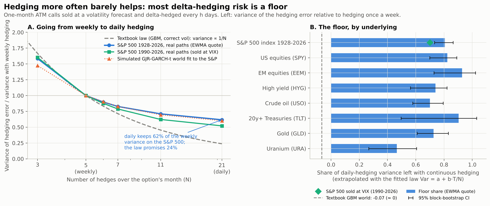
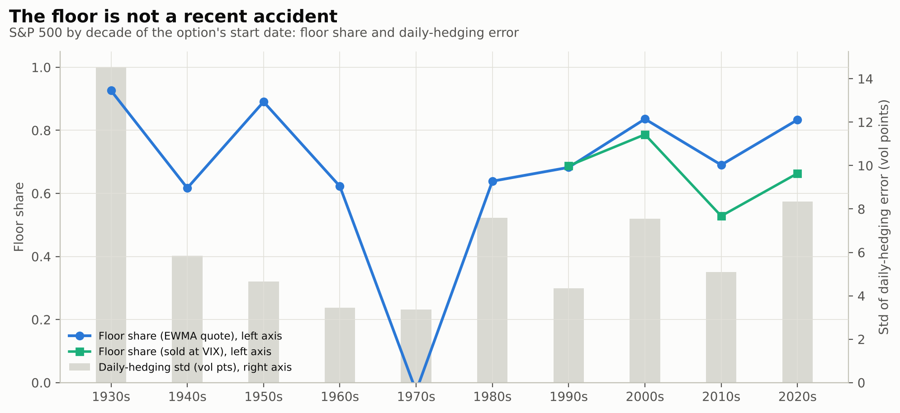
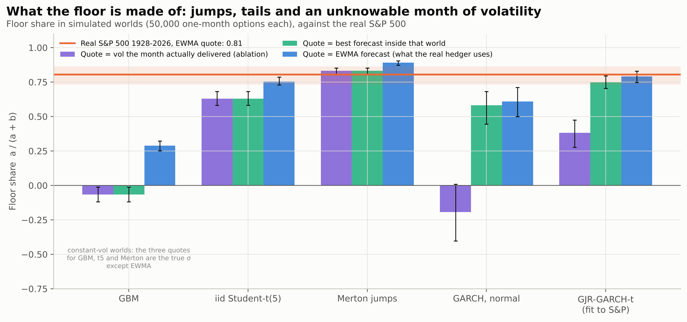
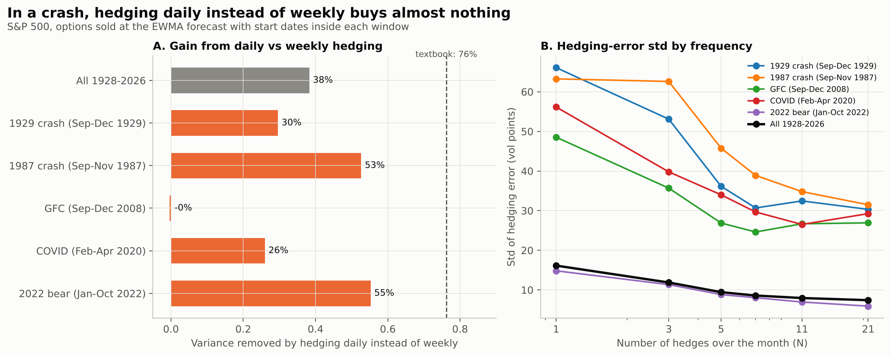
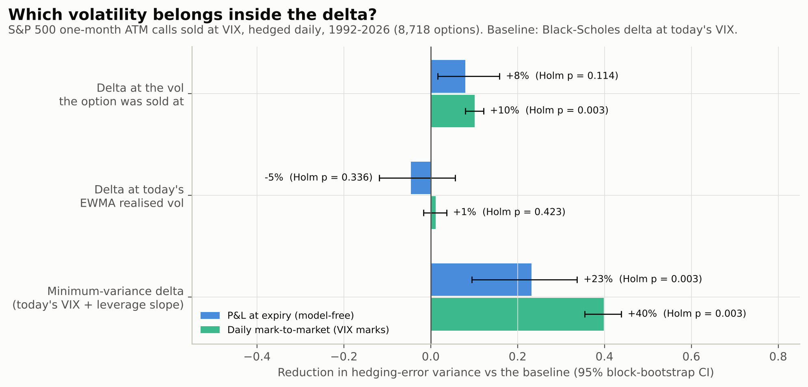
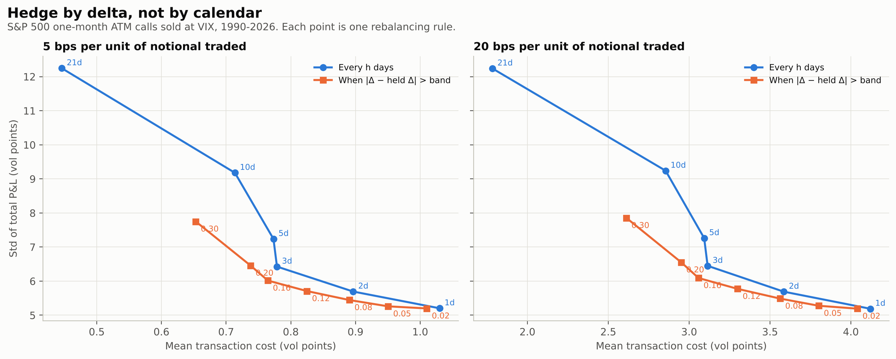
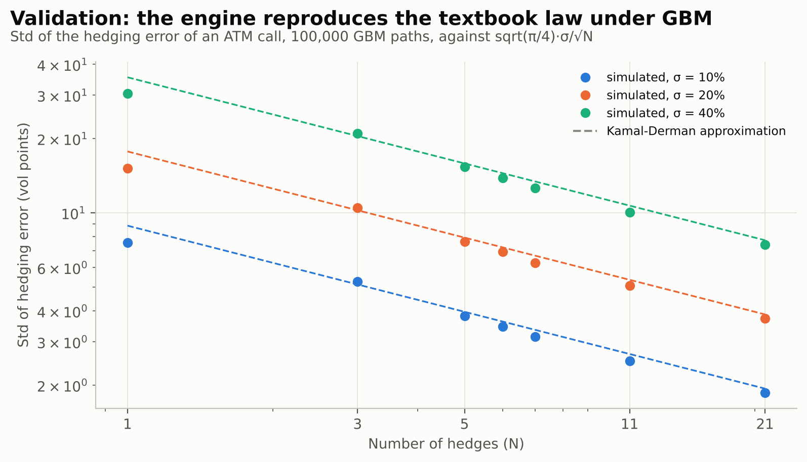

# The Floor Under Delta Hedging

**How much of an option's hedging risk can rebalancing remove? 98 years of the S&P 500, seven asset classes, a factorial of simulated worlds, and a minimum-variance delta**

*Project 16 of [30 Quant Research Projects](../README.md) · Working paper, November 2026*



---

## Abstract

The textbook says the error of a delta hedge shrinks like 1/√N with the number of rebalances N
(Boyle and Emanuel 1980; Kamal and Derman 1999). Hedge daily instead of weekly and the error variance
should fall to 5/21 of its weekly value. A desk that believes this hedges as often as costs allow. This
paper measures what rebalancing actually buys on real price paths. It sells a one-month at-the-money
call at a volatility known on the day, delta-hedges it every h days, and repeats this on every
trading day of the S&P 500 from 1928 to 2026 (24,757 options) and of seven ETFs from 2006 to 2026
(US and EM equities, high yield, crude oil, long Treasuries, gold, uranium).

The variance of the hedging error is fitted by the linear law Var = a + b·(T/N). The intercept *a*
is the part that would remain under continuous hedging if the law kept holding below one day. I call
a/(a+b) the **floor share**. It is zero in the textbook world.

**Main findings**

1. **Daily hedging keeps 62% of the weekly variance on the S&P 500. The textbook law promises 24%.**
   Moving from weekly to daily rebalancing removes 38% of the variance of the hedging error
   (95% block-bootstrap CI 30–46%), against 76% under geometric Brownian motion. Across the seven ETFs
   the gain ranges from 22% (EEM) to 63% (uranium).
2. **Most delta-hedging risk is a floor.** The floor share is **0.81 on the S&P 500 (CI 0.73–0.87)**,
   0.70 when the option is sold at VIX instead of a historical forecast, and between 0.47 (uranium) and
   0.93 (EEM) on the ETFs. Every confidence interval excludes zero. It is 0.70–0.94 in all but one decade
   since the 1930s, so it is not a feature of one era.
3. **The floor is the volatility you did not know, plus the shape of the month.** A simulated
   GJR-GARCH-t world fitted to the S&P 500 reproduces the real numbers almost exactly: floor share
   0.79 against 0.81, weekly-to-daily gain 40% against 38%. Inside that world, quoting the best
   forecast the model allows lowers the floor only to 0.75. Quoting the variance the month actually
   delivered, which nobody can know in advance, lowers it to 0.38. Pure volatility clustering without
   fat tails leaves no floor once the level is known (GARCH-normal, −0.19, CI −0.40 to 0.01).
   Jumps alone create a large one (Merton, 0.83).
4. **In a crash, hedging daily instead of weekly bought nothing.** For S&P 500 options sold in
   September–December 2008 the gain was 0% (and −41% for EEM). In 1929 it was 30%, in February–April
   2020 26%, and in the 1987 crash 53%, all below the textbook 76%.
5. **Which volatility you put in the delta matters more than how often you trade.** For S&P 500
   options sold at VIX (1992–2026, 8,718 options), a **minimum-variance delta** that adds the
   leverage effect, using the slope of VIX on index returns estimated only from past data,
   reduces the variance of the terminal hedging error by **23% (CI 9–34%, Holm p = 0.003)** relative
   to the desk-standard delta at today's VIX. It cuts the day-to-day mark-to-market error by 40%.
   For comparison, going from weekly to daily rebalancing cuts the variance by 48% on the VIX-quoted
   sample, and that takes four times as many trades. Recomputing the delta at today's realised volatility
   instead of VIX changes nothing (−5%, Holm p = 0.34).
6. **Hedge by delta, not by calendar.** At equal transaction cost, rebalancing whenever the delta has
   drifted by more than 0.16 has a standard deviation 1.2 vol points lower than rebalancing once a week
   (CI 0.9–1.6), which removes 31% of the variance. The ranking holds at 1, 5 and 20 bps. At 5 bps or
   less the best rule is a narrow band, close to daily hedging. Pre-registered hypothesis H5, that
   costs would make weekly-type hedging optimal, is **rejected**: frequency buys little, but it also
   costs little.

The engine (`src/hedgesim.py`) is a reusable, vectorised discrete-hedging simulator. It is validated
against the Kamal–Derman law and put–call parity in the tests, and project 30 (deep hedging) builds on it.

---

## 1. Motivation and question

[Project 04](../04-black-scholes-breakeven-smile/) asked what volatility a daily delta hedger *should*
have charged, strike by strike: the mean of the hedged P&L. This paper asks about its **spread**.
A market maker who sells an option and hedges it is not exposed to the average month but to this month.
The standard advice is that the spread is a discretisation error that more frequent hedging removes. If
that were true, the right response to hedging risk would be to trade more, and the only limit would be
transaction costs. That is the logic of Leland (1985) and of Whalley and Wilmott (1997).

There is a second source of spread that rebalancing cannot touch. A hedger who sells at σ_q while the
market delivers a different volatility earns ½ Σ Γ S² (σ_q² dt − r²). Its expected value does not
depend on how often you hedge (Ahmad and Wilmott 2005; Carr's "gamma-weighted variance" accounting).
The question is quantitative: **how much of real hedging risk is each kind, and what does that imply
for how often, and with which delta, a desk should hedge?**

I could not find this split measured on a century of index data, across asset classes, with a
calibrated simulation that explains it. The closest empirical work is Hull and White (2017), on the
minimum-variance delta, which is tested here too.

### Hypotheses (written down before the real-data runs)

* **H1** The weekly-to-daily variance reduction on real paths is smaller than the textbook 76%.
* **H2** The floor share is above 0.5 for the S&P 500 at daily hedging.
* **H3** A minimum-variance delta built from the out-of-sample VIX–return slope lowers the terminal
  hedging-error variance relative to the Black–Scholes delta at today's VIX.
* **H4** At equal mean cost, delta-band rules have a lower P&L spread than calendar rules.
* **H5** With realistic costs (5 bps), the best calendar rule hedges less often than daily.
* **Prediction P1** (from iid theory): the floor share equals ek/(2+ek), where ek is the excess
  kurtosis of daily returns standardised by their own month's volatility.

---

## 2. Design

### 2.1 The engine

`hedgesim.hedge_short_call` sells a European call and holds `pos` units of the underlying, reset on
the days chosen by a calendar schedule or by a band. It works with r = q = 0, so the hedge
instrument is the forward. A test shows that a 5%/year carry changes the P&L spread by less than 2%.
P&L is divided by the option's vega at inception and multiplied by 100, so it is in **volatility points**:
an error of 2 is as large as mis-pricing the option by 2 vol points. Options are one month (21 trading
days), at the money, on every trading day (overlapping, so every statistic uses a moving-block bootstrap
with 126-day blocks and 2,000 resamples).

Rebalancing intervals are h ∈ {1, 2, 3, 4, 5, 10, 21} days. With N = ⌈21/h⌉ hedges, the textbook
variance is proportional to T/N, not h (h = 4 and h = 5 give 6 and 5 hedges). The frequency law is
therefore fitted as Var = a + b·T/N on h = 1…5 (daily to weekly). Under GBM with the correct
volatility, the fitted floor share is −0.07 (CI −0.12 to −0.01): the estimator reads zero to within 0.1.

### 2.2 Quotes (what the option is sold at, and what goes into the delta)

* **EWMA forecast** (λ = 0.94), known at the close of the sale day. Used for every underlying.
* **VIX** at the close of the sale day, for the S&P 500 from 1990. VIX is a 30-day variance-swap rate,
  so it sits above at-the-money implied volatility. That shifts the mean P&L (the variance risk premium
  measured in [project 04](../04-black-scholes-breakeven-smile/)) but barely moves its spread.
* **Realised-vol oracle** (diagnostic only): the root mean square of the next 21 daily returns. It is
  exactly the volatility that makes a daily hedge break even on average, so it mechanically favours
  daily hedging and cannot be used to fit the floor (it gives negative floor shares). It answers only one
  question: how much of the daily-hedging variance is level error? On the S&P 500, knowing the month's
  realised volatility in advance would cut the daily-hedging std from 7.4 to 2.2 vol points, i.e. **91%
  of the variance is the level of volatility**.

### 2.3 Data

| Series | Period | Options | Source |
|---|---|---|---|
| S&P 500 price index (^GSPC) | 1928-03 to 2026-10 starts | 24,757 | Yahoo, same file as [project 03](../03-moving-average-volatility/) |
| VIX close | 1990-01 to 2026-09 | 9,244 | CBOE via datasets/finance-vix, same as [project 04](../04-black-scholes-breakeven-smile/) |
| SPY, EEM, HYG, USO, TLT, GLD, URA (total return) | 2006–2026 | 3,953–5,106 each | Yahoo, same file as [project 01](../01-monte-carlo-calibration/) |

The overlap with projects 01 and 04 is deliberate. The same paths that 01 forecasts and 04 prices are
hedged here. Market data ends in November 2026, VIX on 2026-09-22, so the last VIX-quoted option starts
in August 2026.

---

## 3. Result 1: rebalancing buys much less than the textbook says (H1, H2)

| Underlying | Sample | Std, daily | Std, weekly | Std, once | Weekly→daily gain (CI) | Floor share (CI) |
|---|---|---|---|---|---|---|
| S&P 500, EWMA | 1928–2026 | 7.41 | 9.43 | 16.1 | **38%** (30–46%) | **0.81** (0.73–0.87) |
| S&P 500, VIX | 1990–2026 | 5.22 | 7.24 | 12.2 | 48% (39–56%) | 0.70 (0.59–0.80) |
| SPY | 2006–2026 | 7.43 | 9.25 | 13.7 | 36% (26–48%) | 0.82 (0.70–0.89) |
| EEM | 2006–2026 | 11.19 | 12.64 | 19.1 | 22% (1–45%) | 0.93 (0.73–1.02) |
| HYG | 2007–2026 | 4.30 | 5.80 | 8.8 | 45% (36–59%) | 0.74 (0.56–0.82) |
| USO | 2006–2026 | 12.48 | 17.35 | 31.0 | 48% (39–57%) | 0.70 (0.58–0.79) |
| TLT | 2006–2026 | 5.69 | 6.64 | 11.3 | 27% (−7–61%) | 0.90 (0.50–1.03) |
| GLD | 2006–2026 | 6.65 | 8.97 | 13.9 | 45% (34–55%) | 0.73 (0.61–0.83) |
| URA | 2011–2026 | 11.12 | 18.25 | 30.7 | 63% (57–69%) | 0.47 (0.27–0.61) |
| *GBM, correct vol* | simulated | 3.51 | 7.23 | 14.1 | *76%* | *−0.07* |

Standard deviations are in vol points. "Once" means hedging only at inception. Source:
`results/floor_shares.csv`, `results/frontier_summary.csv`.

**H1 holds** for all eight underlyings. Even with a Bonferroni bound across the eight (one-sided
0.05/8, stricter than Holm), every upper limit of the gain is below the textbook 76%. The highest is
uranium's, at 71%. **H2 holds**: the S&P 500 floor share is 0.81, with lower limit 0.73, above 0.5.
No bootstrap resample out of 2,000 gives a floor share at or below zero for any underlying, and the
Bonferroni lower bounds run from 0.18 (uranium) to 0.71 (S&P 500). Columns `share_lo_bonf`,
`gain_hi_bonf` and `p_floor_le_0` in `results/floor_shares.csv`.

Uranium is the exception. Rebalancing helps more there than anywhere else (63%), and its floor
share is the lowest (0.47). A plausible reading, not tested here, is that uranium's large moves come
as trends lasting several days that a daily hedge can follow, rather than as one-day gaps.

**Robustness** (`results/robustness_floor.csv`). Strikes one standard deviation in or out of the money:
S&P floor shares 0.82 and 0.82. Three-month options (hedged up to every 63 days): 0.84–0.92 on the
S&P 500, 0.86–0.93 on USO. By decade (`results/spx_by_decade.csv`, Figure 6) the S&P floor share is
between 0.70 and 0.94 in every decade except the 1970s (0.24), a decade of low and slowly drifting
volatility in which EWMA forecasts were unusually accurate.



---

## 4. Result 2: what the floor is made of

Five simulated worlds, 200,000 days each, cut into 50,000 one-month options and hedged with the same
engine (`src/simulation.py`). The GARCH worlds are fitted by maximum likelihood to the S&P 500
1928–2026 (`results/sim_garch_params.csv`; GJR: α = 0.031, γ = 0.106, β = 0.907, ν = 6.0).



| World | Quote = what the month delivered | Quote = best forecast | Quote = EWMA |
|---|---|---|---|
| GBM | −0.07 | −0.07 | 0.29 |
| iid Student-t(5) | 0.63 | 0.63 | 0.75 |
| Merton jumps (4/yr, −3% ± 4%) | 0.83 | 0.83 | 0.89 |
| GARCH, normal | **−0.19** | 0.58 | 0.61 |
| GJR-GARCH-t (S&P fit) | **0.38** | 0.75 | **0.79** |
| *Real S&P 500* | — | — | ***0.81*** |

Three readings.

* **The calibrated world matches reality.** GJR-GARCH-t with an EWMA quote gives a floor share of 0.79
  and a weekly-to-daily gain of 40%. On real data they are 0.81 and 38%. The standardised within-month
  kurtosis matches too (0.29 simulated, 0.24 real). That is the evidence that the real floor is not an
  artefact of the data.
* **Volatility clustering creates a floor only through forecast error.** In the GARCH-normal world the
  floor disappears (−0.19, CI −0.40 to 0.01) when the quote equals the variance the month actually delivered.
  The best forecast the model allows still leaves 0.58, because the next month's average variance is
  genuinely uncertain.
* **Fat tails and jumps create a floor that no forecast can remove.** With iid t(5) returns or Merton
  jumps, the volatility is constant and known, and the floor is still 0.63 and 0.83. In the S&P world,
  the floor left after removing all level error is 0.38.

**Prediction P1 fails.** The iid formula ek/(2+ek) with the real standardised kurtosis (0.24) predicts a
floor share of 0.11, against 0.81 measured. After scaling by the month's own volatility, daily S&P returns
are close to Gaussian (Andersen et al. 2001 report the same for realised-volatility-standardised returns).
The floor is a cross-month phenomenon: which volatility the month will bring, and when its large moves
arrive relative to gamma. It is not a within-month tail effect that a kurtosis statistic could capture.

---

## 5. Result 3: in a crash, rebalancing buys nothing



| Window (start dates) | Options | Std daily | Std weekly | Weekly→daily gain |
|---|---|---|---|---|
| Sep–Dec 1929 | 81 | 30.3 | 36.2 | 30% |
| Sep–Nov 1987 | 63 | 31.5 | 45.8 | 53% |
| Sep–Dec 2008 | 85 | 26.9 | 26.9 | **0%** |
| Feb–Apr 2020 | 62 | 29.3 | 34.0 | 26% |
| Jan–Oct 2022 | 209 | 5.9 | 8.8 | 55% |
| All 1928–2026 | 24,757 | 7.4 | 9.4 | 38% |

S&P 500, EWMA quote. These windows hold few, heavily overlapping options, so the numbers are descriptive.
They come without confidence intervals and enter no test. In 2008 the result is the same for SPY (2%)
and worse for EEM (−41%): hedging EM equities daily instead of weekly *added* risk, because a daily hedge
re-sized into every reversal. In 2020, sold at VIX instead, the S&P gain was 38%. The 2022 bear market,
a slow decline without a volatility shock, looks like an ordinary period (55%).

---

## 6. Result 4: which volatility belongs inside the delta (H3)



S&P 500, one-month ATM calls sold at VIX, hedged daily, start dates 1992–2026 (the first two years of
VIX are the estimation window for the slope). Four delta rules, same premium, same paths:

| Delta rule | Std terminal | Mean P&L | Variance change vs today's-VIX delta (CI) | Holm p |
|---|---|---|---|---|
| Black–Scholes at today's VIX (desk standard, baseline) | 5.45 | 4.17 | — | — |
| Black–Scholes at the vol the option was sold at | 5.23 | 4.06 | −8% (−16% to −2%) | 0.11 |
| Black–Scholes at today's EWMA realised vol | 5.57 | 3.97 | +5% (−6% to +12%) | 0.34 |
| **Minimum-variance: today's VIX + vega · β̂ / S** | **4.78** | 3.72 | **−23% (−34% to −9%)** | **0.003** |

β̂ is the expanding-window OLS slope of daily VIX changes on S&P log returns, using only data before
the sale date. It moves from −0.86 in 1992 to −1.16 in 2026 (`results/leverage_slope.csv`): a 1% fall in
the index has come with a VIX rise of about one point. The adjustment vega·β̂/S lowers an ATM call delta
by about 0.1, similar in size to the adjustment Hull and White (2017) report for S&P 500 options.

**H3 holds.** The minimum-variance delta is the only rule that beats the baseline after Holm correction
over the six comparisons in `results/which_delta_tests.csv`. Two caveats. (i) Its mean P&L is 0.45 vol
points lower, because holding less of a rising index costs the equity drift. (ii) The daily
mark-to-market score (−40%) marks the option at VIX, the same series the slope is estimated on, so it
flatters the rule. The terminal score uses only premium, payoff and hedge gains, so it is model-free
and is the one I rely on.

---

## 7. Result 5: costs, and calendar against band rules (H4, H5)



Costs are proportional: k bps of notional per unit traded, including the trades that set up and unwind
the hedge. For the S&P 500 sold at VIX (1990–2026):

| Rule | Mean cost at 5 bps | Std of total P&L |
|---|---|---|
| Every day | 1.03 | 5.20 |
| Every 5 days | 0.77 | 7.24 |
| Band 0.16 | 0.76 | **6.02** |
| Band 0.02 | 1.01 | 5.20 |

**H4 holds.** At equal cost the band rule has a lower standard deviation than every calendar rule
except daily, where the two coincide. Against weekly hedging the difference is −1.22 vol points (CI
−1.61 to −0.86) at 5 bps, and −1.17 (CI −1.56 to −0.81) at 20 bps (`results/costs_band_vs_calendar.csv`).

**H5 is rejected.** Minimising mean cost + λ·std, the best calendar rule at 5 bps is daily for every
λ ∈ {0.5, 1, 2}, and so is the best rule for all seven ETFs at 5 bps (`results/costs_best.csv`). Only at
20 bps does a calendar rule of 2–3 days win. The reason is the flip side of Result 1. Halving the number of
trades does not halve the cost: going from 21 hedges to 5 cuts it only from 1.03 to 0.77 vol points,
because most of the turnover is the set-up and unwind trades plus the large re-hedges after big moves,
which a weekly hedge also has to make. Frequent hedging is a poor tool, but it is also a cheap one.

---

## 8. Validation



* Under GBM the engine reproduces the Kamal–Derman standard deviation √(π/4)·σ/√N to within 3–7% for
  every N from 3 to 21, at σ = 10%, 20% and 40% (`results/derman_check.csv`). The simulated values sit
  slightly below the formula, which is an asymptotic approximation. At N = 1 the formula overstates the
  error by 15%, as expected for an approximation built for many rebalances. The mean P&L is zero within
  0.2 vol points.
* The pricer and greeks agree with project 04's `bs.py` to 1e-12.
* A short put hedged with delta − 1 has exactly the same P&L as the short call (put–call parity). That
  is why only calls are reported.
* A zero-volatility path returns the premium (σ·100 vol points to first order).
* `pytest -q tests`: 12 tests pass.

---

## 9. Referee self-review: what it changed

I reviewed the first draft as a hostile referee would. Points raised and what was done:

1. *"Your fitted floor is non-zero even under GBM."* It was (0.24) in the first version, because the law
   was fitted on h rather than on T/N, and ⌈21/h⌉ makes h = 4 and h = 5 nearly the same hedge. It is
   now fitted on T/N, and GBM reads −0.07.
2. *"The oracle quote gives negative floors. Is the method broken?"* No. The realised-vol oracle is
   computed from the same daily returns the hedge is scored on, so it is tuned to daily sampling. It is
   now used only for the level-error share (91%). The ablation that removes level error without
   look-ahead is done in simulation (true integrated variance).
3. *"Extrapolating to continuous hedging from daily data is a leap."* Agreed. The floor is defined as the
   intercept of a law fitted between daily and weekly. The paper says "if the law continues below one
   day" everywhere. For a jump process the law is exactly linear with a positive intercept. For
   diffusive intraday volatility clustering it is linear with intercept equal to the level-error term.
4. *"The minimum-variance gain may come from the VIX marks."* That is why the terminal, model-free
   score is the headline (23%) and the mark-to-market score (40%) is labelled as flattered.
5. *"Stress windows have tiny samples."* They are shown as descriptive and enter no test.
6. *"Your iid kurtosis prediction failed. Why keep it?"* Because it was pre-registered. Its failure is
   informative: the floor is not a within-month tail effect.
7. *"H5 was rejected. Is the cost model too kind?"* At 20 bps, a cost an index-options desk would
   consider high, calendar rules of 2–3 days do win. The conclusion is stated per cost level.

---

## 10. Limitations

* **No traded option prices.** Options are priced by Black–Scholes at a quote. The study measures hedging
  error of a book quoted at VIX or EWMA, not the P&L of real SPX options, whose implied vol varies by
  strike and moves with the surface (see [project 14](../README.md) for the surface).
* **Daily closes only.** Nothing is measured below one day. The floor is an extrapolation of the law
  fitted between daily and weekly. Intraday hedging data could show the law bending.
* **Before 1952, Saturdays were trading days.** Each row is treated as one day. On start dates from 1952
  only (18,823 options) the S&P floor share is 0.71 and the weekly-to-daily gain 48%, still far from the
  textbook 0 and 76%.
* **Price index, not total return, for the S&P 500.** It is the right underlying for index options. The
  forward carry is ignored (test shows < 2% effect on the spread).
* **ETF returns are rounded to 4 decimals.** This adds noise of about 1% to squared returns, which is
  negligible here.
* **One maturity per main run.** Three-month options are a robustness check only. Strikes beyond ±1
  standard deviation, where #4 found the gamma sits in different places, are not tested.
* **Costs are linear.** No market impact, no fixed fee per ticket, no spread widening in crises, which
  would hurt frequent hedging most when it buys least (Section 5).
* **One minimum-variance specification.** The slope is linear in returns and the same for all strikes.
  Hull and White fit it as a quadratic in delta.

---

## 11. Reproduce

```bash
pip install -r requirements.txt
bash run_all.sh          # about 2 minutes on 4 cores; writes results/, figures/ and runs the tests
```

Seeds are fixed (16, 1616, 1603, 1604). Every number in this README is in a CSV in `results/`.

| Script | Produces |
|---|---|
| `src/hedgesim.py` | the engine (no outputs) |
| `src/frontier.py` | frontier_paths.csv.gz, frontier_summary, floor_shares, spx_by_decade, stress_windows, robustness_floor |
| `src/simulation.py` | sim_factorial, sim_garch_params, derman_check |
| `src/which_delta.py` | which_delta, which_delta_tests, which_delta_paths.csv.gz, leverage_slope |
| `src/costs.py` | costs_frontier, costs_best, costs_band_vs_calendar |
| `src/figures.py` | figures/fig1–fig7 |

---

## 12. Connections to other projects

* [01 Monte Carlo](../01-monte-carlo-calibration/): the GJR-GARCH-t model that forecasts best there is
  the one whose simulated world reproduces the real hedging floor here.
* [04 Black–Scholes break-even smile](../04-black-scholes-breakeven-smile/): 04 measures the *mean*
  of the daily-hedged P&L (break-even vol). This paper measures its *spread* and how it responds to
  frequency, delta choice and costs. The realised-vol oracle here is 04's break-even vol at the money.
* [03 Moving average](../03-moving-average-volatility/): same S&P 500 history. Its leverage effect is
  what the minimum-variance delta monetises.
* 13 GARCH, 14 implied vol surface, 26 Heston: better volatility forecasts and a real surface attack the
  level error, which Section 4 shows is most of the floor.
* 30 Deep hedging: reuses `hedgesim.py` (any `delta_fn`, schedule or band) and should be judged against
  the floor measured here, not against zero.

---

## References

Ahmad, R. and Wilmott, P. (2005). Which free lunch would you like today, sir? Delta hedging, volatility
arbitrage and optimal portfolios. *Wilmott Magazine*. · Andersen, T., Bollerslev, T., Diebold, F. and
Ebens, H. (2001). The distribution of realized stock return volatility. *JFE*. · Bollerslev, T. (1986).
*J. Econometrics*. · Boyle, P. and Emanuel, D. (1980). Discretely adjusted option hedges. *JFE*. ·
Carr, P. and Madan, D. (1998). Towards a theory of volatility trading. · Glosten, L., Jagannathan, R.
and Runkle, D. (1993). *JF*. · Holm, S. (1979). *Scand. J. Stat.* · Hull, J. and White, A. (2017).
Optimal delta hedging for options. *J. Banking & Finance*. · Kamal, M. and Derman, E. (1999). When you
cannot hedge continuously: the corrections to Black–Scholes. *Risk*. · Künsch, H. (1989). *Ann. Stat.*
· Leland, H. (1985). Option pricing and replication with transaction costs. *JF*. · Merton, R. (1976).
*JFE*. · Whalley, A. E. and Wilmott, P. (1997). An asymptotic analysis of an optimal hedging model for
option pricing with transaction costs. *Math. Finance*.

---

Code: MIT. Text and figures: CC BY 4.0.
