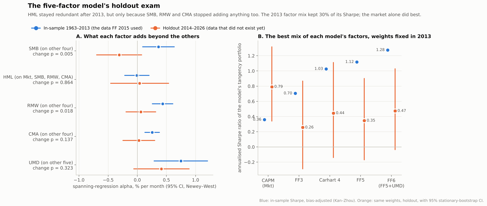
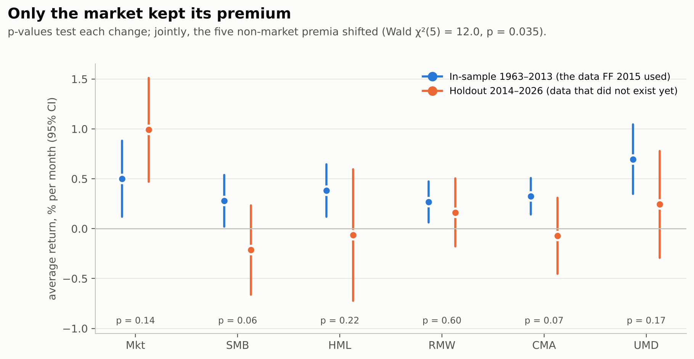
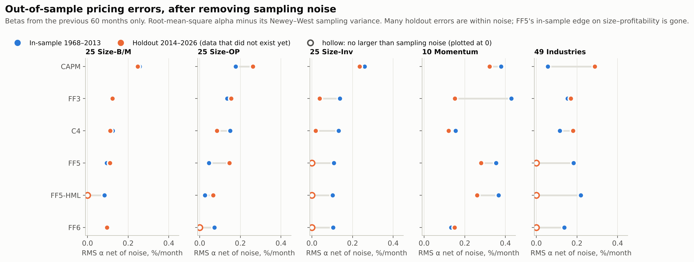
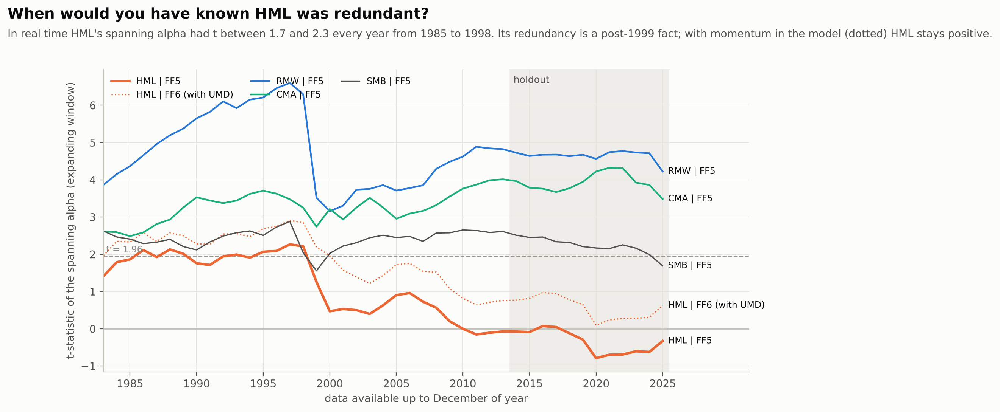
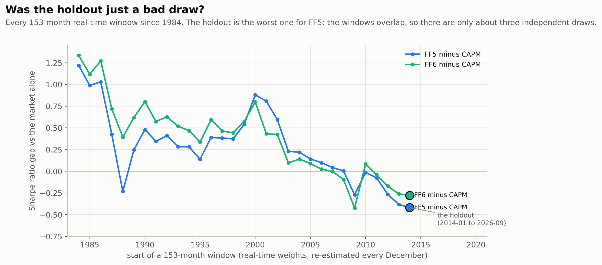
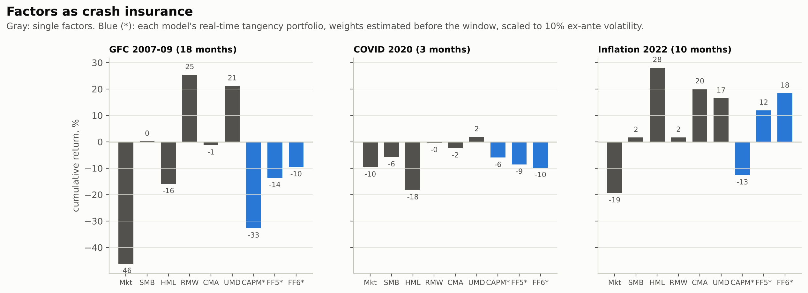

# The Five-Factor Model's Holdout Exam

**Thirteen years of returns that did not exist when Fama and French chose their model: does the verdict survive?**

*Project 17 of [30 Quant Research Projects](../README.md) · Working paper, November 2026*



---

## Abstract

Fama and French (2015) chose their five-factor model, and declared the value factor HML redundant,
using US stock returns from July 1963 to December 2013. Every later comparison of factor models
re-uses those same fifty years. This project treats the 153 months since then (January 2014 to
September 2026) as what they are: **a true holdout that nobody could have fitted to**, and it
pre-registers the tests ([PREREGISTRATION.md](PREREGISTRATION.md)) before looking at it. Seven models
(CAPM, FF3, Carhart, FF5, FF5 without HML, FF6 = FF5 + momentum, FF6 without HML) are judged three
ways: what each factor adds beyond the others (spanning regressions), the Sharpe ratio of each model's
best factor mix with weights frozen in 2013, and out-of-sample pricing errors on 75 sorted portfolios
with betas estimated only from past data. A real-time walk-forward (1984–2026) asks whether choosing
the model as you go would have helped. Data are the official Ken French files, CRSP vintage 202609.

**Main findings**

1. **HML stayed redundant, but the exam could not have failed it.** HML's alpha on Mkt, SMB, RMW and
   CMA was −0.01% a month in-sample and +0.04% (t = 0.16) in the holdout. The holdout standard error
   is so wide that the smallest alpha it could detect with 80% power is **0.71% a month, almost twice
   HML's entire historical premium**. "Not rejected" here means "not testable yet".
2. **What changed is that the other factors became redundant too.** SMB's spanning alpha fell from
   +0.36% to −0.31% a month (change p = 0.005) and RMW's from +0.44% to +0.06% (p = 0.018); CMA fell
   from +0.26% to +0.03%. Only the market kept its premium (0.99% a month); jointly, the five
   non-market premia shifted (Wald χ²(5) = 12.0, p = 0.035).
3. **The 2013 factor mix kept about 30% of its Sharpe ratio.** With weights frozen at the end of 2013,
   the FF5 tangency portfolio earned a holdout Sharpe ratio of 0.35 (95% CI −0.17 to 0.90), against a
   bias-adjusted in-sample value of 1.12 (one-sided p = 0.007, counting the sampling error of both
   estimates). FF6 went from 1.28 to 0.47. An
   equal-weight mix of the same factors lost just as much (FF5: 1.01 to 0.33), so this is premia decay,
   not optimizer error. The market alone earned 0.79. Dropping HML changed the holdout Sharpe by
   0.001 (CI −0.006 to 0.008).
4. **FF5 did not price better than FF3 out of sample, and the holdout mostly cannot tell.** On the
   75 size–B/M, size–profitability and size–investment portfolios, with betas from the previous 60
   months, FF5's average absolute alpha was 0.014% a month lower than FF3's (CI −0.057 to +0.014,
   p = 0.23). Net of sampling noise, FF5's in-sample edge on the size–profitability sorts (0.05% vs
   0.14%) is gone (0.15% vs 0.16%), but most holdout pricing errors are no bigger than their own noise,
   and no GRS test rejects any model in the holdout, the CAPM included.
5. **HML's redundancy is a post-1999 fact, and choosing the model in real time adds nothing.** In
   real time, HML's spanning alpha had a t-statistic between 1.7 and 2.3 every year from 1985 to 1998;
   it fell to 0.5 by 2000, has hovered around zero since 2010 and has been negative since 2018. A selector that picks the model with the
   best bias-adjusted in-sample Sharpe ratio every December always picks a six- or five-factor model
   with momentum and ends up equal to always holding FF6 (Sharpe 0.951 vs 0.947, p = 0.66).

**Pre-registered verdicts** (Holm-adjusted across five tests): H1 (HML stays redundant) not rejected;
H2 (dropping HML is free) not rejected; H3 (FF5 prices better than FF3) **not supported**; H4 (real-time
selection adds nothing) not rejected. All verdicts are unchanged in nine robustness variants.

**Practical reading.** The five-factor model was not falsified after 2013; it was barely tested,
because a decade of returns cannot distinguish alphas smaller than about 0.5% a month. What the holdout
does show clearly is the size of the in-sample optimism: a multifactor portfolio that looked like a
Sharpe ratio above 1 in 2013 delivered about a third of that. Plan with the haircut, not with the
backtest.

---

## 1. Why this question

Factor-model comparisons have a data problem nobody can fix: there is only one history of US stock
returns, and the same 1963–2013 sample that suggested the five-factor model is also the sample used
to test it (Fama and French 2015, 2018; Barillas and Shanken 2017, 2018; Hou, Xue and Zhang 2015).
Every new factor is found by looking at those years, so every in-sample comparison is contaminated by
the search. International samples help, but they are not independent of the US experience.

Time solves this slowly. The five-factor working paper was circulated in late 2013; since then the
CRSP files have grown by 153 months that played no part in choosing the model. That is short, but it
is the only clean test there is, and it is now long enough to ask three precise questions:

* **Redundancy.** Fama and French's most quoted conclusion was that HML adds nothing once RMW and
  CMA are in the model. Asness (2014) argued the opposite once momentum is included. Does the
  holdout side with either?
* **Model ranking.** In-sample, more factors always look better. Does the five-factor model's
  advantage over FF3 and the CAPM survive when the weights and betas come from the past?
* **Real-time choice.** An investor in 1990 or 2005 had to pick a model from the data available
  then. Would picking it by the best in-sample criterion have paid?

What is new here is the combination: a pre-registered holdout that did not exist when the model was
chosen, power calculations so that "not rejected" is never sold as "confirmed", a real-time history
of the redundancy claim, and a placebo comparison of the holdout against every earlier window of the
same length.

## 2. Data

Official Ken French Data Library files, downloaded on 2026-11-22, **CRSP vintage 202609** (the header
of every file says so, and `tests/` checks it). Monthly, July 1963 to September 2026, 759 months.

| File | Used for |
|---|---|
| Fama/French 5 Factors (2×3) | Mkt−RF, SMB, HML, RMW, CMA, RF |
| Momentum Factor (UMD) | the sixth factor |
| 25 Portfolios formed on Size and Book-to-Market (5×5) | test assets |
| 25 Portfolios formed on Size and Operating Profitability (5×5) | test assets |
| 25 Portfolios formed on Size and Investment (5×5) | test assets |
| 10 Portfolios formed on Prior (12−2) Return | extra test assets (momentum) |
| 49 Industry Portfolios | extra test assets (not sorted on any characteristic) |
| Fama/French 3 Factors | data-vintage comparison only |

Portfolio returns are value-weighted, in excess of the one-month T-bill. The cloud environment that
built this project cannot reach the Ken French server, so the files were fetched in a browser and
their first table extracted verbatim (`src/fetch_data.js`, which also logs each zip's SHA-256; the
hashes are listed in that file). The 49-industry and three-factor zips are byte-identical to the
ones project #09 used.

**Samples.**

| | Months | Role |
|---|---|---|
| In-sample (IS), 1963-07 to 2013-12 | 606 | the sample of Fama and French (2015) |
| Holdout (HO), 2014-01 to 2026-09 | 153 | data that did not exist when the model was chosen |
| Real time (RT), 1984-01 to 2026-09 | 513 | walk-forward, decisions every December from 1983-12 |

## 3. Models

| Model | Factors |
|---|---|
| CAPM | Mkt |
| FF3 | Mkt, SMB, HML |
| C4 (Carhart) | Mkt, SMB, HML, UMD |
| FF5 | Mkt, SMB, HML, RMW, CMA |
| FF5−HML | Mkt, SMB, RMW, CMA |
| FF6 | Mkt, SMB, HML, RMW, CMA, UMD |
| FF6−HML | Mkt, SMB, RMW, CMA, UMD |

## 4. Method

**Spanning regressions.** Each factor is regressed on the others of its model; the intercept is what
the factor adds to an investor who already holds the others (Barillas and Shanken 2017). Newey–West
standard errors with 6 lags. The change between IS and HO is tested in one pooled regression with a
holdout dummy on the intercept and on every slope, so a change in betas cannot masquerade as a change
in alpha. The minimum detectable effect (MDE) is the alpha a two-sided 5% test would find with 80%
probability: 2.8 standard errors.

**Tangency portfolios with frozen weights.** For each model the tangency weights Σ⁻¹μ are estimated on
the in-sample period, scaled to 10% annual ex-ante volatility, and held unchanged through the holdout.
The in-sample Sharpe ratio is reported raw and bias-adjusted (the squared Sharpe ratio estimator
((T−N−2)/T)·Sh² − N/T of Kan and Zhou 2007, which removes the in-sample optimism of an N-asset
tangency portfolio). Holdout confidence intervals and differences use the stationary bootstrap
(Politis and Romano 1994; mean block 6 months, 10,000 draws), resampling months jointly so that the
correlation between models is kept. Equal-weight factor mixes (no estimated weights at all) are the
control for weight-estimation error.

**Out-of-sample pricing errors.** For each test portfolio and month *t*, betas are estimated on months
*t*−60 to *t*−1 only, and the out-of-sample alpha is α̂ₜ = rₜ − β̂ₜ₋₁′fₜ. The pricing error of a model
is A|α|, the average across portfolios of the absolute time-series mean of α̂ (Fama and French 2015
use the same statistic in-sample). This avoids the mechanical advantage of bigger models in in-sample
regressions, where more regressors always shrink residuals. Differences between models are
bootstrapped over months. Standard in-sample GRS tests (Gibbons, Ross and Shanken 1989) are also
reported for each period.

**Real time.** Every December from 1983, using all data to that date, each model's bias-adjusted
squared Sharpe ratio is computed; the selector holds the tangency portfolio of the winning model for
the next twelve months. Each fixed model's real-time tangency portfolio is also held, re-estimated
every December. The real-time t-statistic of each factor's spanning alpha is recorded every year.

**Placebo holdouts.** Every real-time window of 153 months (the holdout's length), starting each
January from 1984, gives one draw of "how did multifactor models do against the market alone over a
period this long?" The holdout is then placed in that distribution.

**Multiple testing.** The five pre-registered tests (H1a, H1b, H2, H3, H4) are Holm-adjusted together.
Everything else is descriptive and labelled as such.

## 5. Pre-registered hypotheses

Written before any holdout statistic was computed (see [PREREGISTRATION.md](PREREGISTRATION.md)).

| | Claim | Estimate | p | p (Holm) | Verdict |
|---|---|---|---|---|---|
| H1a | HML's alpha on Mkt, SMB, RMW, CMA is zero in the holdout | +0.039%/month | 0.88 | 1.00 | not rejected |
| H1b | ...and unchanged from in-sample | +0.047%/month | 0.86 | 1.00 | not rejected |
| H2 | FF5−HML's holdout Sharpe is not below FF5's | −0.001 | 0.41 | 1.00 | not rejected |
| H3 | FF5's out-of-sample A\|α\| is below FF3's (75 portfolios) | −0.014%/month | 0.23 | 1.00 | **not supported** |
| H4 | The real-time selector's Sharpe is not below always-FF6 | +0.003 | 0.66 | 1.00 | not rejected |

H1, H2 and H4 are "nothing changed" claims and survive if their null is not rejected; H3 is a claim of
superiority and survives only if it is rejected. Three of the four "nothing changed" claims are
supported in the weakest possible sense: section 6.2 shows how little the holdout could have rejected.

## 6. Results

### 6.1 Only the market kept its premium



| % per month | Mkt | SMB | HML | RMW | CMA | UMD |
|---|---|---|---|---|---|---|
| In-sample 1963–2013 | 0.50 | 0.28 | 0.38 | 0.27 | 0.32 | 0.70 |
| Holdout 2014–2026 | **0.99** | −0.21 | −0.07 | 0.16 | −0.07 | 0.24 |
| Change p (Newey–West) | 0.14 | 0.06 | 0.22 | 0.60 | 0.07 | 0.17 |

No single change is significant at 5%, but jointly the five non-market premia moved (cross-equation
Newey–West Wald test, χ²(5) = 12.0, p = 0.035). The holdout is the period of the "value drought"
(Fama and French 2021) and of the mega-cap growth rally. It is not uniform: HML lost 0.31% a month in
2014–2019 and earned 0.15% in 2020–2026, mostly in 2022 (`results/holdout_split.csv`).

### 6.2 HML stayed redundant, and so did almost everything else

| Spanning alpha, %/month (t) | In-sample | Holdout | Change p | Holdout MDE |
|---|---|---|---|---|
| SMB on Mkt, HML, RMW, CMA | +0.36 (2.6) | −0.31 (−1.6) | **0.005** | 0.55 |
| HML on Mkt, SMB, RMW, CMA | −0.01 (−0.1) | +0.04 (0.2) | 0.86 | 0.71 |
| RMW on Mkt, SMB, HML, CMA | +0.44 (4.8) | +0.06 (0.5) | **0.018** | 0.37 |
| CMA on Mkt, SMB, HML, RMW | +0.26 (4.0) | +0.03 (0.2) | 0.14 | 0.39 |
| HML on FF5 others + UMD | +0.08 (0.8) | +0.10 (0.4) | 0.93 | 0.73 |
| UMD on the five FF5 factors | +0.75 (3.2) | +0.41 (1.7) | 0.32 | 0.68 |

Two readings of the same table. The literal one: HML's redundancy held, exactly as Fama and French
predicted. The honest one: the holdout could only have detected an HML alpha of 0.71% a month, and
HML's whole in-sample premium was 0.38%. The test that "confirmed" redundancy could not have rejected
it even if HML had been as valuable as it ever was. What the holdout *can* see is large changes, and
it sees two: SMB and RMW lost alphas that were 2.6 and 4.8 standard errors from zero in-sample. In the
holdout, an investor already holding the market gained nothing measurable from any of the other
factors.

Asness (2014) argued that HML becomes useful again once momentum is in the model, because value and
momentum are negatively correlated. The data agree in direction (HML's alpha is +0.08 in-sample and
+0.10 in the holdout with UMD in the regression, versus −0.01 and +0.04 without it), but neither number
is distinguishable from zero.

### 6.3 The 2013 factor mix kept a third of its Sharpe ratio

| Model | IS Sharpe | IS Sharpe, bias-adjusted | HO Sharpe, 2013 weights (95% CI) | HO/IS | p (HO ≥ adj. IS), bootstrap | p, two-sample |
|---|---|---|---|---|---|---|
| CAPM | 0.39 | 0.36 | **0.79** (0.34, 1.32) | 2.04 | 0.95 | 0.91 |
| FF3 | 0.75 | 0.70 | 0.26 (−0.29, 0.87) | 0.34 | 0.053 | 0.077 |
| C4 | 1.07 | 1.03 | 0.44 (−0.14, 1.11) | 0.42 | 0.026 | 0.033 |
| FF5 | 1.17 | 1.12 | 0.35 (−0.17, 0.90) | 0.30 | **0.001** | **0.007** |
| FF5−HML | 1.17 | 1.13 | 0.35 (−0.17, 0.90) | 0.30 | **0.001** | **0.007** |
| FF6 | 1.33 | 1.28 | 0.47 (−0.04, 1.03) | 0.36 | **0.001** | **0.006** |
| FF6−HML | 1.32 | 1.28 | 0.47 (−0.02, 1.02) | 0.36 | **0.000** | **0.006** |
| FF3, equal weights | 0.67 | – | 0.34 | 0.51 | – | – |
| FF5, equal weights | 1.01 | – | 0.33 | 0.32 | – | – |
| FF6, equal weights | 1.25 | – | 0.48 | 0.39 | – | – |

The bootstrap p treats the in-sample value as known; the two-sample p also counts its own sampling
error, using Lo's (2002) standard error for a Sharpe ratio, and is the one quoted in the abstract.

The FF5 tangency portfolio, frozen at its 2013 weights (15% Mkt, 13% SMB, 0% HML, 30% RMW, 41% CMA in
gross-weight terms), delivered a Sharpe ratio significantly below what even the bias-adjusted
in-sample estimate promised. The bias adjustment removes the optimism of *fitting the weights*; it
cannot remove the optimism of *having chosen the factors* from the same data, and that is what the
holdout measures. The equal-weight rows settle the question of where the loss came from: a portfolio
with no estimated weights lost the same two-thirds, so the factors' premia shrank; the optimizer was
not the problem.

Two more numbers keep this in proportion. First, re-fitting the weights *inside* the holdout gives FF5
a Sharpe of 0.96 and FF6 1.05 (`results/tangency_holdout.csv`), more than the market's 0.79: in
hindsight, a multifactor mix still looks better, which is exactly the trap. Second, the market's own
holdout Sharpe (0.79) is twice its in-sample value; part of the CAPM's "win" is that 2014–2026 was an
unusually good period for the market. Dropping HML from FF5 changed the holdout Sharpe by 0.001 (CI
−0.006 to 0.008): with a near-zero weight on HML in 2013, the two portfolios are almost identical.

### 6.4 Out-of-sample pricing: FF5's edge over FF3 is gone, and most errors are noise



| A\|α\|, %/month, betas from the previous 60 months | FF3 IS | FF3 HO | FF5 IS | FF5 HO | FF6 IS | FF6 HO | Noise, HO |
|---|---|---|---|---|---|---|---|
| 25 Size–B/M | 0.10 | 0.15 | 0.09 | 0.14 | 0.08 | 0.14 | 0.15 |
| 25 Size–OP | 0.13 | 0.17 | 0.06 | 0.17 | 0.07 | 0.15 | 0.19 |
| 25 Size–Inv | 0.11 | 0.13 | 0.10 | 0.11 | 0.10 | 0.11 | 0.14 |
| 10 Momentum | 0.32 | 0.21 | 0.28 | 0.25 | 0.13 | 0.22 | 0.23 |
| 49 Industries | 0.19 | 0.34 | 0.21 | 0.33 | 0.19 | 0.31 | 0.40 |

(In-sample here means 1968–2013, because the first five years are needed for betas. "Noise" is the
root-mean-square Newey–West standard error of a portfolio's mean alpha in the holdout, for FF5; it is
about half as large in-sample.)

**The pre-registered test.** Pooled over the 75 primary portfolios, FF5 minus FF3 is −0.014% a month
in the holdout (95% CI −0.057 to +0.014, one-sided p = 0.23): H3 is not supported.

**What the referee pass added.** The last column changes how this table should be read. A|α| averages
*absolute* mean alphas, and a mean of 153 noisy monthly alphas is itself noisy: if every true alpha
were zero, the holdout A|α| would still be about 0.8 × the noise column, roughly 0.11–0.15% a month
for the 25-portfolio sorts. The holdout A|α| values of the multifactor models sit right at that level.
So the apparent rise in pricing errors after 2013 is mostly the shorter sample, not the models getting
worse. The fix (used in Fama and French 2015 in-sample) is to subtract each alpha's sampling variance
from its square before averaging; `results/pricing_oos.csv` reports this "RMS α net of noise" and
Figure 5 plots it. Net of noise:

* FF5's in-sample advantage on the size–profitability sort, the one RMW was built to explain, is gone:
  0.05% vs FF3's 0.14% in 1968–2013, 0.15% vs 0.16% in the holdout. This is the clearest single change,
  but it is fragile: FF6's holdout error on the same portfolios is within noise.
* For the five-factor models on size–investment and the industries, and for FF5−HML on size–B/M,
  the holdout error is no larger than its own noise. Nothing can be learned from those cells.
* The CAPM's errors on the sorted portfolios are the only ones clearly above noise in both periods.

The in-sample-style GRS test (betas re-estimated within each period) rejects every model on every
family in 1963–2013 at p < 0.015 (the one exception is the CAPM on the 49 industries, p = 0.075), and
rejects **none** in the holdout, CAPM included (the smallest p is 0.08, CAPM on Size–B/M;
`results/pricing_grs.csv`). With 153 months and 25 assets the test has very little power, so this is
not evidence that the models started working.

Dropping HML from FF5 lowered the pooled holdout A|α| by 0.013% a month (one-sided p = 0.0499;
descriptive, not one of the corrected tests, and of the same size as the noise discussed above).

### 6.5 When did HML become redundant?



An investor in 1995 running the same spanning regression on the data then available would have found
HML's alpha 2.1 standard errors above zero. Between 1985 and 1998 the t-statistic was 1.7 to 2.3 every
year. It collapsed in 1999–2000 (the dot-com run-up and crash hit value, profitability and investment
at the same time), reached zero in 2010 and has been negative every year since 2018. The redundancy result in Fama and
French (2015) is therefore a statement about 1999–2013 as much as about 1963–2013. With momentum in
the model (dotted line), HML's t-statistic has stayed positive throughout.

The real-time model selector, choosing every December by the bias-adjusted squared Sharpe ratio,
picked FF6 in 29 of 43 years and FF6−HML in 14 (2010–2015 and 2018–2025). It never picked FF5, FF3 or
the CAPM. Its real-time Sharpe ratio over 1984–2026 is 0.951 (95% CI 0.64 to 1.29) against 0.947 for
always holding FF6 and 0.58 for the market alone. Selecting the model adds nothing because the
selection is almost always "use the most factors".

| Real-time Sharpe, re-estimated every December | 1984–2026 | Holdout years only |
|---|---|---|
| CAPM | 0.58 | 0.79 |
| FF3 | 0.50 | 0.32 |
| C4 | 0.74 | 0.50 |
| FF5 | 0.82 | 0.37 |
| FF6 | 0.95 | 0.51 |
| FF6−HML | 0.97 | 0.53 |
| Selector | 0.95 | 0.52 |

### 6.6 Was the holdout just a bad draw?



Over every 153-month window since 1984 (real-time weights), FF5's Sharpe ratio exceeded the market's
in 24 of 31 windows, often by 0.3 to 1.2. The holdout is the worst of the 31 windows for FF5 (−0.42).
For FF6 it is the second worst (−0.28; the window starting in 2009 was −0.42). But the windows overlap
heavily, so they contain only about three independent draws, and the gap has been shrinking steadily
since the windows that start around 2002. The holdout is the end of a trend that began inside the
original sample, not an isolated accident. Whether that trend is post-publication decay (McLean and
Pontiff 2016), crowding, or a run of bad luck cannot be separated with this much data.

### 6.7 Stress windows



| Cumulative return, % | Mkt | HML | RMW | CMA | UMD | CAPM* | FF5* | FF6* |
|---|---|---|---|---|---|---|---|---|
| GFC, 2007-10 to 2009-03 | −46.1 | −15.9 | +25.4 | −1.3 | +21.2 | −32.7 | −13.6 | −9.5 |
| COVID, 2020-02 to 2020-04 | −9.6 | −18.2 | −0.3 | −2.4 | +1.9 | −6.0 | −8.5 | −9.8 |
| Inflation, 2022-01 to 2022-10 | −19.4 | +28.1 | +1.7 | +20.0 | +16.5 | −12.6 | +11.9 | +18.4 |

\* Real-time tangency portfolios, weights estimated before the window, scaled to 10% ex-ante volatility.

Whatever their average return, the multifactor portfolios were good crash insurance in two of the
three windows: in 2008 FF6 lost less than a third of what the equally risky market portfolio lost, and in 2022
it gained 18% while the market fell 19%, because value and investment had their best year in decades.
In the COVID crash the protection failed: value fell 18% in three months and FF5 and FF6 lost more than
the equally risky market portfolio (−8.5% and −9.8% against −6.0%). The holdout's weak average hides one very good year (2022) inside a weak
decade.

### 6.8 Data vintage

Ken French revises the whole history when CRSP or Compustat data change. Comparing the early-2017
vintage shipped with the `linearmodels` package with the 2026 vintage over their common months
(1963-07 to 2017-03): the market factor is essentially unchanged (correlation 1.0000, tracking error
0.02% a month), but **HML has a monthly tracking error of 0.30% and one month differs by 2.2
percentage points** (correlation 0.994); SMB's tracking error is 0.17%. The in-sample average of HML
is identical in both vintages (0.381% vs 0.382%), so the conclusions here are not vintage artefacts,
but month-by-month replications of older papers will not match exactly (Akey, Robertson and Simutin
document the same problem). This project freezes the 202609 vintage.

### 6.9 Robustness

All five verdicts are unchanged in each of nine variants (`results/robustness.csv`): Newey–West lags
3 or 12; bootstrap mean block 3 or 12 months; beta window 36 or 120 months; real-time start 1973 or
1993; and a holdout that starts in January 2015, the year of publication. The H3 p-value ranges from
0.10 (36-month betas) to 0.43 (120-month betas); no other p-value moves below 0.40.

## 7. What this means in practice

* **Treat in-sample factor Sharpe ratios as upper bounds, even after the usual bias correction.**
  The correction handles fitted weights, not chosen factors. Over 2014–2026 the realised haircut for
  five- and six-factor mixes was about 65–70%. Project #23 (deflated Sharpe ratio) formalises the
  correction for the number of strategies tried.
* **Do not read "not rejected" as "confirmed" on short samples.** With about thirteen years of
  monthly data, a spanning or pricing test cannot see alphas below roughly 0.4–0.7% a month. State the
  minimum detectable effect next to every null result.
* **If you have to pick a model, include momentum.** Every real-time choice since 1983 included UMD,
  and the momentum-inclusive models had the best real-time record and the best 2008 protection.
  Whether HML is in or out makes no measurable difference.
* **Expect the market factor to dominate in some decades.** The CAPM's best-in-class holdout result
  is a reminder that factor tilts are long-horizon bets with decade-long droughts.

## 8. Referee notes (self-review)

Before release the project was reviewed as a referee would review it. What was attacked, and what
changed:

1. **"A|α| rises in the holdout" was mostly sampling noise.** The first draft read the higher holdout
   A|α| as models pricing worse. Absolute values of noisy means are biased upward, and the bias is
   about twice as large in a 153-month sample as in a 546-month one. Fixed: a noise-net RMS alpha
   (Newey–West sampling variance subtracted) is now reported and plotted, and section 6.4 says which
   cells are indistinguishable from noise. The pre-registered H3 test still uses A|α| differences, as
   registered; a paired difference between models cancels the part of the noise they share, though
   not all of it, so it is less affected than the levels.
2. **The Sharpe-decline test treated the in-sample Sharpe as known.** Fixed: a two-sample test with
   Lo's (2002) standard errors for both estimates is now the headline (p = 0.007 instead of 0.001).
3. **The first vintage comparison mixed definitions.** The 2017 file's SMB is the three-factor SMB; it
   was first compared with the five-factor SMB, which is built differently and showed a spurious
   tracking error of 0.56% a month. Fixed: the comparison now uses the 2026 three-factor file.
4. **H2 was a weak test.** In 2013 the FF5 tangency portfolio put almost no weight on HML (−0.6%), so
   FF5 and FF5−HML were nearly the same portfolio and "dropping HML is free" was close to guaranteed.
   It is kept because it was pre-registered, but no weight is put on it in the conclusions.
5. **The real-time selector was always going to pick a big model.** The bias-adjusted squared Sharpe
   ratio corrects for the number of factors but still rewards any factor with a positive in-sample
   premium. H4 therefore tests "does selection beat the largest model", which is the relevant question
   for a practitioner, not "does selection find a parsimonious model".
6. **Pre-registration does not erase prior knowledge.** It fixes the tests, not what the author knew:
   that value had a weak decade was public knowledge before the data were opened. The pre-registered
   hypotheses (H1, H2, H4) were "nothing changed" claims, which is the direction that knowledge would
   argue against, so it did not tilt the design toward the reported failures.

## 9. Limitations

* **153 months is short.** This is the central limitation and the reason power is reported
  everywhere. The holdout can detect large changes (SMB, RMW) but not the small ones that the
  redundancy debate is about.
* **One holdout, one country.** The placebo windows give context, but they overlap and share the same
  market. International factor data would add independent evidence, at the cost of less clean
  timing (several countries' data were already used in Fama and French 2017).
* **Factors are not tradeable as published.** The Ken French factors are long-short, rebalanced
  annually (monthly for UMD), with no transaction costs, shorting costs or capacity limits. The
  momentum results in particular would shrink after costs (project #12).
* **The holdout is not fully untouched.** The model was frozen in 2013 but the data were revised
  afterwards (section 6.8), and the methodology for some breakpoints has changed slightly over
  vintages. The in-sample averages are unaffected, so this is unlikely to matter here.
* **Portfolios, not stocks.** Test assets are sorted portfolios; the conclusions about pricing errors
  apply to them, not to individual stocks.
* **Not tested:** the q-factor model (Hou, Xue and Zhang 2015) and other non-French factors, because
  their files are not in the French library; conditional or time-varying factor models; Bayesian
  model comparison with informative priors.

## 10. Connections to other projects

* **#09 The Beta You Hedge With** showed that no estimate of the market beta makes the security
  market line steep enough. This project adds the other factors and finds that, after 2013, they
  stopped adding to the market too.
* **#05 Where Does the Efficient Frontier Break?** found that estimated means carry most of the
  value in mean–variance portfolios and that nothing beats 1/N after correction. Here, the equal-weight
  factor mix lost exactly as much as the optimised one: the problem was the means themselves.
* **#03 Not a Volatility Filter** used the same pre-registration discipline.
* **#12 Momentum with costs** asks whether the UMD premium survives trading costs; **#23 Deflated
  Sharpe ratio** formalises the in-sample optimism measured in section 6.3; **#20 Risk parity**
  and **#24 PCA stat arb** build portfolios from the same factor returns.

## 11. Reproduce

```bash
pip install -r requirements.txt
bash run_all.sh        # ~1 minute: analysis, robustness, figures, tests
```

Every number above is in `results/*.csv`; every figure is produced by `src/figures.py`. The raw files
are committed under `data/raw/`; `src/fetch_data.js` refreshes them from the Ken French site.

## 12. Repository layout

```
17-five-factor-holdout/
├── README.md                this paper
├── PREREGISTRATION.md       hypotheses and tests, written before the holdout was examined
├── data/raw/                first table of each Ken French file, CRSP vintage 202609
├── src/
│   ├── fetch_data.js        browser script that downloads and extracts the raw files (with SHA-256)
│   ├── data.py              parsing, samples, model definitions, stress windows
│   ├── stats.py             Newey–West OLS, GRS, tangency, adjusted Sh², stationary bootstrap, Holm, Wald
│   ├── analysis.py          every statistic in the paper
│   ├── robustness.py        nine sensitivity variants of the five pre-registered tests
│   └── figures.py
├── tests/test_core.py       estimator correctness, test size, unbiasedness, no look-ahead
├── results/   figures/
├── study/ESTUDIO_17.pdf     Spanish study guide (not part of the paper)
└── run_all.sh  requirements.txt  LINKEDIN_POST.md
```

## References

* Akey, P., Robertson, A. and Simutin, M. "Noisy Factors." Working paper, University of Toronto.
* Asness, C. (2014). "Our Model Goes to Six and Saves Value From Redundancy Along the Way." AQR Cliff's Perspective.
* Barillas, F. and Shanken, J. (2017). "Which Alpha?" *Review of Financial Studies* 30(4).
* Barillas, F. and Shanken, J. (2018). "Comparing Asset Pricing Models." *Journal of Finance* 73(2).
* Carhart, M. (1997). "On Persistence in Mutual Fund Performance." *Journal of Finance* 52(1).
* Fama, E. and French, K. (1993). "Common Risk Factors in the Returns on Stocks and Bonds." *Journal of Financial Economics* 33(1).
* Fama, E. and French, K. (2015). "A Five-Factor Asset Pricing Model." *Journal of Financial Economics* 116(1).
* Fama, E. and French, K. (2017). "International Tests of a Five-Factor Asset Pricing Model." *Journal of Financial Economics* 123(3).
* Fama, E. and French, K. (2018). "Choosing Factors." *Journal of Financial Economics* 128(2).
* Fama, E. and French, K. (2021). "The Value Premium." *Review of Asset Pricing Studies* 11(1).
* Gibbons, M., Ross, S. and Shanken, J. (1989). "A Test of the Efficiency of a Given Portfolio." *Econometrica* 57(5).
* Holm, S. (1979). "A Simple Sequentially Rejective Multiple Test Procedure." *Scandinavian Journal of Statistics* 6(2).
* Hou, K., Xue, C. and Zhang, L. (2015). "Digesting Anomalies: An Investment Approach." *Review of Financial Studies* 28(3).
* Lo, A. (2002). "The Statistics of Sharpe Ratios." *Financial Analysts Journal* 58(4).
* Kan, R. and Zhou, G. (2007). "Optimal Portfolio Choice with Parameter Uncertainty." *Journal of Financial and Quantitative Analysis* 42(3).
* McLean, R. D. and Pontiff, J. (2016). "Does Academic Research Destroy Stock Return Predictability?" *Journal of Finance* 71(1).
* Newey, W. and West, K. (1987). "A Simple, Positive Semi-Definite, Heteroskedasticity and Autocorrelation Consistent Covariance Matrix." *Econometrica* 55(3).
* Politis, D. and Romano, J. (1994). "The Stationary Bootstrap." *Journal of the American Statistical Association* 89(428).
