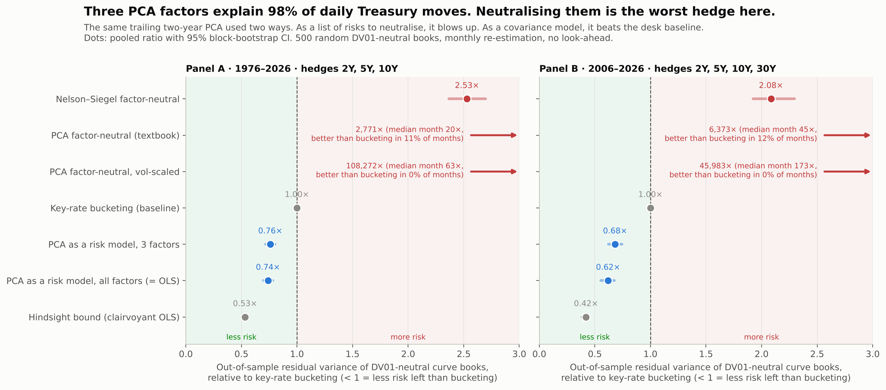
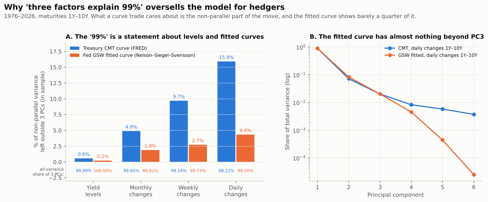
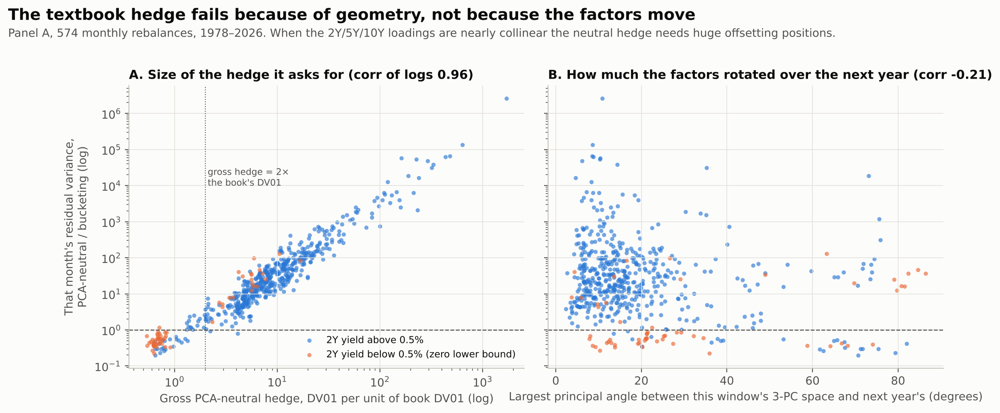
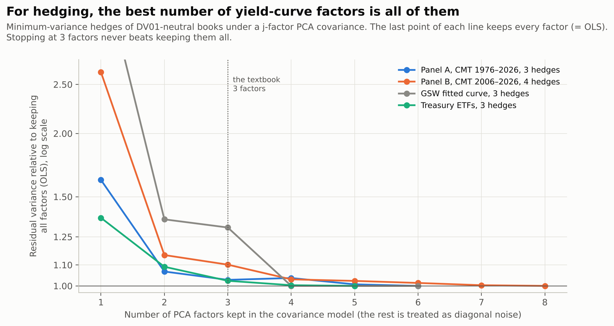
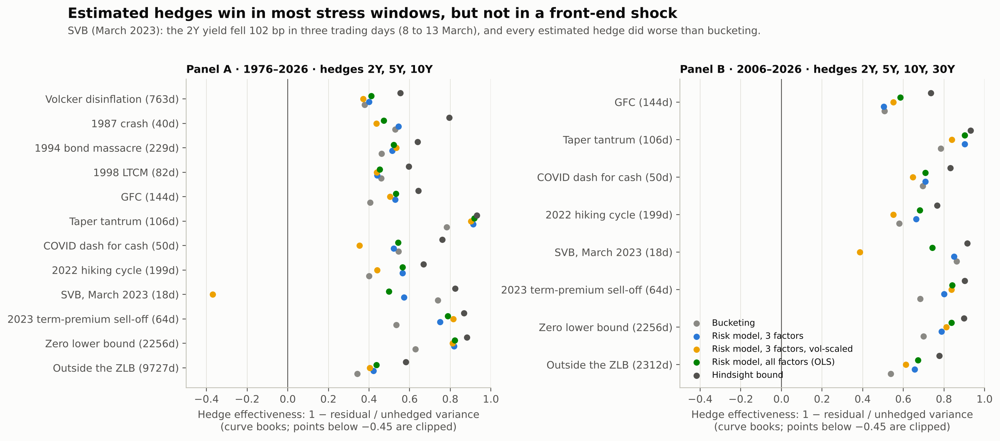
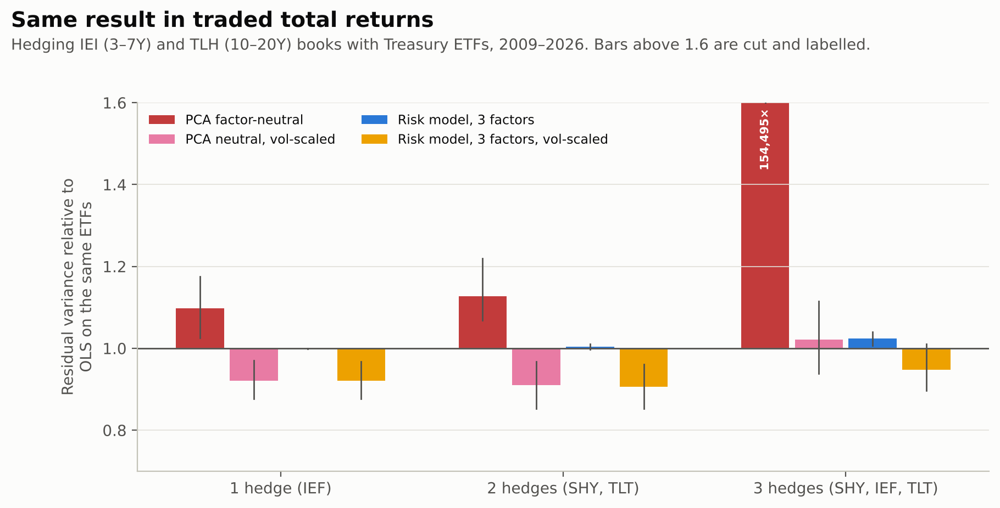

# Three Factors Explain the Curve. They Don't Hedge It.

**Fifty years of out-of-sample tests of yield-curve PCA as a hedging tool, against the desk's model-free baseline**

*Project 18 of [30 Quant Research Projects](../README.md) · Working paper, November 2026*



---

## Abstract

Every fixed-income course teaches the same fact: three principal components (level, slope and curvature)
explain about 99% of the movement of the Treasury yield curve (Litterman & Scheinkman, 1991). The usual
next step is the "PCA hedge": choose as many hedge instruments as factors, and size them so that the book
has zero exposure to each factor. This project asks: **does that hedge, or any hedge built from yield-curve
PCA, leave less risk out of sample than what a desk does without a model?**

I run a walk-forward hedging experiment on the daily US Treasury constant-maturity curve. Panel A covers
1Y–10Y from 1976 to 2026, hedged with the 2Y, 5Y and 10Y. Panel B covers 1Y–30Y from 2006 to 2026, hedged
with the 2Y, 5Y, 10Y and 30Y. Every month the models are re-estimated on the previous two years of data and
frozen for the next 21 days. There are 12,046 out-of-sample days in Panel A and 4,631 in Panel B. The books
are 500 random DV01-neutral curve positions and 500 random outright positions in the maturities that are
not hedge instruments. The baseline is **key-rate bucketing**: each maturity's DV01 is split between its
two neighbouring hedge points by linear interpolation, with no model at all. Two contrasts test the
mechanism: the same experiment on the Federal Reserve's *fitted* GSW zero curve, and on the total returns
of five traded Treasury ETFs.

**Main findings**

1. **The "99%" overstates what the model captures for a hedger.** On daily changes, 3 PCs explain 98.2% of
   all variance (Panel A). But a curve trade is exposed to the *non-parallel* part of the move, and 3 PCs
   leave 15.9% of that unexplained in sample and 15.2% out of sample (median trailing window). On the Fed's
   fitted curve over the same dates the gap is only 4.4%. Curve smoothing hides about three quarters of the
   risk that PCA misses.
2. **The textbook PCA-neutral hedge is the worst hedge tested.** With three factors and the 2Y/5Y/10Y it
   leaves a median of **20×** the residual variance of bucketing per month, and it beats bucketing in only
   11% of months (sign test, Holm p < 0.0001). With four factors in Panel B the median is 45×. In 87% of
   months it asks for a gross hedge more than 2× the book's DV01 (median 7×).
3. **The cause is geometry, not unstable factors.** Across 574 monthly rebalances, the PCA hedge's failure
   is almost perfectly ranked by the size of the hedge it asks for (correlation of logs 0.96), and *not* by
   how much the factors rotate over the next year (−0.21). Sampled at 2Y/5Y/10Y, the empirical curvature
   factor looks too much like the slope factor, so the 3×3 system is badly conditioned. The one regime
   where the hedge works is the zero lower bound: with the front end pinned, the loadings separate, and the
   PCA hedge beats bucketing in 63% of those months.
4. **The same PCA used as a risk model beats bucketing.** A minimum-variance hedge under the PCA covariance
   leaves 24% (Panel A, 3 factors) and 32% (Panel B) less variance than bucketing (95% CIs 0.72–0.80 and
   0.62–0.74). It wins in 83–86% of months. About two thirds of that gain comes from the 1Y point, which lies
   outside the hedge range. On the interior maturities alone the gain is 7–12%.
5. **For hedging, the best number of factors is all of them.** Keeping every component, which is the plain
   sample covariance or OLS, beats stopping at three by 2.8% in Panel A and 10.1% in Panel B with 4 hedges
   (Holm p < 0.0001). The components the "99%" discards are small, but they are hedgeable. This holds for
   every window length from 6 months to 5 years.
6. **Scaling by volatility helps only the one-instrument duration hedge.** Running the PCA on
   EWMA-standardised changes cuts residual variance by 6% in Panel B's single-instrument hedge (Holm p =
   0.0004) and by 8–10% in the ETF hedges. With two or more instruments it never helps, and in the SVB shock
   (March 2023) it was the worst hedge.
7. **The ranking survives in traded returns.** On Treasury ETF total returns (2009–2026), the PCA-neutral
   hedge with SHY/IEF/TLT blows up again (median month 19× OLS), and the 3-factor risk model is within 2% of
   OLS.

---

## 1. Why this question

PCA of the yield curve is the most-taught model in fixed income, and the reason it is taught is hedging.
Litterman & Scheinkman (1991) introduced it to argue that duration hedges miss the slope and curvature
risk. Tuckman & Serrat (2011, ch. 6) teach the "PCA hedge": with as many instruments as factors, choose
positions that cancel the book's exposure to each factor. Risk systems report "level, slope and curvature"
exposures, and interview questions ask how many factors "explain the curve".

Two things are rarely checked, and this project tests both:

* **"Explains 99%" is an in-sample statement about total variance.** A hedged book has already removed most of
  the level move, so what matters is how much of the *rest* the factors capture. The usual figure is also
  often computed on yield *levels*, on monthly data or on a fitted curve. Each of these makes it look higher
  (§4.1).
* **Neutralising factors and minimising variance are different hedges.** A factor-neutral hedge treats the
  factors as the only risks and ignores everything else. A minimum-variance hedge under the PCA covariance
  uses the same estimate but weighs every risk by its size. Out of sample they behave very differently.

The comparison that matters to a desk is with **key-rate bucketing**: map each bond's DV01 onto the
neighbouring hedge points by maturity and hedge those. It needs no estimation, which is a strength when
correlations shift. A model has to beat it to earn its place.

### Pre-specified hypotheses

* **H1.** Three PCs leave a material share of non-parallel variance unexplained, and more on raw data than
  on a fitted curve.
* **H2.** The textbook PCA-neutral hedge does not beat bucketing out of sample.
* **H3.** PCA used as a covariance model (minimum variance) beats bucketing.
* **H4.** Truncating that covariance at 3 factors is worse than keeping all of them.
* **H5.** Volatility-scaled PCA improves on plain PCA, especially in regime changes (the zero lower bound
  and 2022).

## 2. Data

| Set | Source | Sample | Use |
|---|---|---|---|
| Treasury constant-maturity yields (CMT), 1M–30Y | FRED (DGS series), daily | 1962-01 → 2026-11-19 | Panels A and B |
| Gürkaynak–Sack–Wright (GSW) Nelson–Siegel–Svensson parameters | Federal Reserve, `feds200628` | 1961-06 → 2026-11-13 | Panel G: fitted zero curve, same maturities |
| iShares SHY, IEI, IEF, TLH, TLT adjusted closes | Yahoo Finance | 2007-01 → 2026-11-20 | Panel E: traded total returns |

All three were downloaded on 2026-11-22 in a browser, because the cloud container cannot reach FRED, the Fed
or Yahoo. They are committed in `data/`. The GSW zero yields are rebuilt from the six daily parameters, and
they match the published SVENY columns to 3×10⁻⁴ percentage points.

* **Panel A:** CMT 1Y, 2Y, 3Y, 5Y, 7Y, 10Y, June 1976 to November 2026 (12,613 daily changes). It is the
  longest sample in which all six maturities are quoted, and it includes the Volcker years, 1987, 1994,
  1998, the GFC, two zero-lower-bound spells, 2022 and SVB. Out of sample from September 1978.
* **Panel B:** CMT 1Y, 2Y, 3Y, 5Y, 7Y, 10Y, 20Y, 30Y, February 2006 to November 2026 (5,198 changes). It starts
  when the 30Y was reintroduced. Out of sample from May 2008, so it covers the GFC.
* **Panel G:** GSW zero yields at 1Y, 2Y, 3Y, 5Y, 7Y, 10Y, same span as Panel A.
* **Panel E:** daily total log returns. Books hold IEI and TLH and are hedged with SHY, IEF and TLT. Out of
  sample from April 2009.

Bills (1M–6M) are excluded from the hedging panels. Bill yields are driven by money-market supply and policy
expectations, sit at zero for years, and are not hedged with notes in practice. CMT yields are quoted to
1 bp, so 11% of daily changes in Panel A are exactly zero. The rounding noise (variance 1/12 bp²) is about 0.2%
of a typical daily variance. It does inflate the higher components slightly. §7 discusses how much.

## 3. Method

### 3.1 Books, hedges and P&L

A book holds DV01 exposures *w* (dollars per basis point) at the target maturities: 1Y, 3Y and 7Y in Panel
A, and 1Y, 3Y, 7Y and 20Y in Panel B. The hedge holds *h* at the hedge maturities. The daily hedged P&L is
−(Δy_T′w + Δy_H′h), with Δy in bp. Every model below returns a matrix *A* with *h* = −*Aw*, so one
"residual design" e_t = Δy_T,t − Δy_H,t A serves every possible book. The hedge sets by number of instruments
*K* are:

| K | Panel A | Panel B | Panel E |
|---|---|---|---|
| 1 | 10Y | 10Y | IEF |
| 2 | 2Y, 10Y | 2Y, 10Y | SHY, TLT |
| 3 | 2Y, 5Y, 10Y | 2Y, 10Y, 30Y | SHY, IEF, TLT |
| 4 | — | 2Y, 5Y, 10Y, 30Y | — |

With one instrument, bucketing puts the whole DV01 on the 10Y, which is a plain duration hedge. For a
DV01-neutral curve book that means no hedge at all, so the K = 1 rows compare the models with an unhedged
curve book.

**Books.** There are 500 random "outright" books (i.i.d. normal exposures) and 500 random "curve" books
(exposures summing to zero, so they are DV01-neutral). Each has unit norm, and the seed is 18. Curve books
are the headline, because a curve book is exactly what PCA is supposed to help with. Three named trades
(bullet, steepener, butterfly) are reported too.

### 3.2 Hedging models

| Model | What it does | Estimated? |
|---|---|---|
| **Bucketing** (baseline) | Splits each target DV01 between the two neighbouring hedges, linear in maturity, flat beyond the ends | No |
| **Nelson–Siegel neutral** | Zero exposure to NS level, slope and curvature (Diebold–Li decay λ = 0.0609/month). K = 4 adds a Svensson hump | No |
| **PCA neutral** (textbook) | Zero exposure to the first K PCs of the trailing covariance of Δy | Yes |
| **PCA neutral, vol-scaled** | Same, on EWMA-standardised changes (λ = 0.97); loadings rescaled by today's EWMA vols | Yes |
| **PCA risk model, j factors** (fm*j*) | Minimum-variance hedge under Σ = V_j Λ_j V_j′ + Ψ, with Ψ diagonal | Yes |
| **… vol-scaled** (fmv*j*) | Same, on the EWMA-standardised correlation, rescaled by today's vols | Yes |
| **OLS** | Minimum-variance regression of the book on the hedges; equals fm*j* with every component kept | Yes |
| **Hindsight bound** | OLS fitted on the 21 holding days themselves | Uses the future, reference only |

The window is the trailing 504 days (two years). Hedges are re-estimated every 21 trading days and held
fixed in between. The EWMA volatility for day *t* uses data up to *t*−1, with a 0.25 bp floor so that
zero-lower-bound days cannot explode the standardisation. A unit test checks that changing the future never
changes the past volatility. Nothing a model uses is dated after the rebalance close.

### 3.3 Loss, inference and multiple testing

For a family of books the daily loss is the mean squared hedged P&L. It is divided by the trailing 252-day
mean of the unhedged loss, which is known ex ante. Without that scaling the 1979–82 years would dominate a
50-year average. Models are compared by the ratio of mean losses. The 95% CIs come from a moving-block
bootstrap of days (63-day blocks, 1,000 resamples), and the tests are HAC Diebold–Mariano. Because one
blow-up month can dominate a mean, every comparison also reports the **median monthly ratio**, the **share
of months won**, and a binomial sign test over months. The planned comparisons (PCA vs bucketing, OLS vs
bucketing, fm3 vs OLS, fmv3 vs fm3, vol-scaled vs plain PCA, NS vs bucketing, for each panel, K and book
family: 102 tests) are Holm-adjusted together.

## 4. Results

### 4.1 Where the "99%" comes from (H1)



| Data, 1Y–10Y, 1976–2026 | Share of all variance, 3 PCs (CMT) | Non-parallel variance left by 3 PCs: CMT | … GSW fitted |
|---|---|---|---|
| Yield levels | 99.99% | 0.6% | 0.2% |
| Monthly changes | 99.60% | 4.9% | 1.9% |
| Weekly changes | 99.14% | 9.7% | 2.7% |
| Daily changes | 98.22% | **15.9%** | 4.4% |

The headline number depends almost entirely on what is decomposed. On levels three factors capture
99.99%, but levels are dominated by fifty years of trend. On daily changes, which is what a daily hedge
faces, they capture 98.2% of the total. They capture only 84% of the part of the move that a DV01-neutral
book is exposed to. Out of sample, using the trailing window's PCs on the next 21 days, the median share
left is 15.2% in Panel A and 11.8% in Panel B. **H1 holds.** The fitted GSW curve shows only about a quarter
of this residual. Its eigenvalues fall off a cliff after PC3 (panel B of the figure), because a six-parameter
curve cannot express anything else. Studies run on fitted curves therefore find that PCA works better than
it does on market yields.

### 4.2 The horse race (H2, H3)

Ratios of out-of-sample residual variance to bucketing, curve books (outright books in brackets):

| Model | Panel A, K = 3 | Panel B, K = 4 | Median month (A / B) | Months better than bucketing (A / B) |
|---|---|---|---|---|
| Nelson–Siegel neutral | 2.53 (2.32) | 2.08 (2.14) | 2.57 / 2.15 | 4% / 6% |
| **PCA neutral (textbook)** | **2,771 (2,067)** | **6,373 (6,049)** | **20.4 / 44.7** | **11% / 12%** |
| PCA neutral, vol-scaled | 108,272 | 45,983 | 62.6 / 173 | 0% / 0% |
| Bucketing | 1 | 1 | 1 | — |
| PCA risk model, 3 factors | 0.76 [0.72, 0.80] (0.72) | 0.68 [0.62, 0.74] (0.64) | 0.73 / 0.66 | 83% / 86% |
| PCA risk model, all factors (OLS) | **0.74 [0.70, 0.78]** (0.70) | **0.62 [0.55, 0.68]** (0.59) | 0.71 / 0.57 | 87% / 94% |
| Hindsight bound | 0.53 | 0.42 | 0.52 / 0.39 | 99% / 100% |

The pooled ratios for the factor-neutral hedges are driven by blow-up months, and their bootstrap
intervals are correspondingly wide. With such heavy tails the DM test cannot reject equality (Holm p = 1),
even at 2,771×. The monthly evidence is unambiguous: the textbook hedge loses to bucketing in 89% of months
in Panel A (sign test, Holm p < 10⁻⁴). **H2 holds, more strongly than stated.** The PCA-neutral hedge is
not merely no better. It is the worst model tested. With fewer instruments it is less fragile. With K = 2
in Panel A it is roughly level with bucketing (1.19, CI 0.95–1.52; median month 0.87). With K = 2 in Panel B
it is better (0.79). With a single instrument (a PCA-weighted duration hedge) it beats bucketing by 28–36%.
The trouble starts with the third factor.

The **risk-model** use of the same PCA beats bucketing in every panel, at every K ≥ 2 and in both book
families (Holm p < 10⁻⁴ for OLS vs bucketing in all 14 A/B cells). **H3 holds.** How big the gain is
depends on where the book sits:

| Curve books, without any 1Y exposure | Panel A | Panel B |
|---|---|---|
| PCA risk model, 3 factors | 0.93 | 0.93 |
| OLS | 0.91 | 0.88 |
| PCA neutral | 378 (median month 1.39) | 34 (median month 1.82) |

Bucketing maps the 1Y flat onto the 2Y. A desk would do the same, but the 1Y moves less than the 2Y in most
regimes, and the estimated hedges learn that beta. On maturities between hedge points the advantage of
estimation is 7–12%, which is real but modest (`results/robustness_without_1y.csv`).

**Named trades** (Panel A, K = 3, daily residual volatility in bp of DV01): a 7Y bullet goes from 7.61
unhedged to 1.50 with bucketing and 1.43 with OLS. A 3s7s steepener goes from 3.34 to 2.44 and 2.33. For the
1s3s7s butterfly, bucketing barely helps (2.79 → 2.76), OLS gets to 2.55, and the PCA-neutral hedge turns it
into a 345 bp-per-day position. Panel B is similar: the 7s20s steepener goes 2.60 → 1.30 (bucketing) → 1.21
(OLS).

### 4.3 Why the textbook hedge fails: geometry, not rotation



The usual explanation for poor PCA hedges is that the factors are unstable. They do move. The median angle
between a two-year window's PC and the next year's is 5° for level, 12° for slope and 19° for curvature
(Panel A). The loadings in figure 5 show the level factor turning into a long-end factor at the zero lower
bound. But rotation does not explain the failures. Month by month, the log loss ratio of the PCA-neutral
hedge has correlation −0.21 with the largest principal angle, and **0.96 with the log of the gross hedge
it requires**.

The mechanism is conditioning. With K instruments the neutral hedge solves L_H′h = −L_T′w, where L_H is the
K×K matrix of factor loadings at the hedge maturities. On 1Y–10Y data the third PC is usually a front-end
shape: its median loadings at 2Y/5Y/10Y are (+0.44, +0.09, −0.31). Over those three points that is almost a
rescaled slope, so L_H is badly conditioned (median condition number 11, above 20 in a quarter of months,
and above 300 in the worst ones). To neutralise it the hedge has to take large,
offsetting positions. These are exact in the estimation window and are blown up by any small change
afterwards. The Panel B rows with 2Y/10Y/30Y show the same thing with a different instrument set (145×).

**A simple ex-ante rule exposes it.** If a desk only trusts the PCA hedge when its gross size is at most 2× the
book's DV01, it trusts it in 13% of months in Panel A. In those months it beats bucketing in 78% of cases
(median ratio 0.54). In the other 87% of months it beats bucketing in 0.4% of cases (median 28×). The months
that pass are mostly at the zero lower bound. With the 2Y yield below 0.5%, the front end barely moves, the
PCs separate, the median gross hedge is 0.7×, and the textbook hedge beats bucketing in 63% of months.

### 4.4 How many factors to keep (H4)



If PCA is used as a covariance model, the number of factors *j* is a separate choice from the number of
instruments. The residual variance falls almost monotonically in *j*. Stopping at 3 costs **+2.8%** in Panel A
(K = 3) and **+10.1%** in Panel B (K = 4) relative to keeping all factors (Holm p < 10⁻⁴; months won by fm3
32% and 19%). In Panel E it costs +2.3% (Holm p = 1 for curve books, p = 0.005 for outright books). For one
or two instruments the cost is below 0.5%, because those hedges mostly need the first two factors. **H4
holds wherever it can matter.** The discarded components are small, but they carry structure such as the
1Y–2Y spread, the 20Y anomaly in Panel B and the belly's idiosyncratic moves, and a minimum-variance hedge
uses it. On the GSW fitted curve truncation costs +30%. There the higher components are exact,
deterministic features of the fitting function, so they are perfectly hedgeable.

There is no regularisation benefit to offset this. With 6–8 maturities and a 126-day window the sample
covariance is already well determined, and the ranking holds for windows of 126, 252, 504 and 1,260 days
(`results/robustness.csv`).

### 4.5 Volatility scaling (H5)

Volatility-scaled PCA was meant to adapt the factor shapes to regimes such as the zero lower bound or 2022.
It helps where the hedge is a single duration ratio. In Panel B with K = 1 it cuts residual variance by 5.8%
(fmv3 vs fm3, Holm p = 0.0004; plain-PCA version −8.1%, p < 10⁻⁴). On ETFs with K = 1–2 it cuts 8–10%
relative to OLS. In Panel A the gain is −2.2% and not significant after Holm. With two or more instruments it
never helps significantly, and in Panel B with K = 3–4 it is 6–7% worse (not significant). **H5 is supported
only for one-instrument hedges.** As a neutral hedge it is the worst model of all: rescaling the
loadings by today's volatilities does nothing to fix the conditioning problem of §4.3, and in these data it
made the hedges larger still.

### 4.6 Stress windows



Hedge effectiveness (1 − residual / unhedged variance), curve books:

| Window | Days | Bucketing | Risk model, 3f | Vol-scaled, 3f | OLS | Hindsight |
|---|---|---|---|---|---|---|
| **Panel A (K = 3)** | | | | | | |
| Volcker 1979–82 | 763 | 0.38 | 0.40 | 0.37 | 0.41 | 0.55 |
| 1987 crash | 40 | 0.53 | 0.55 | 0.44 | 0.47 | 0.80 |
| 1994 bond massacre | 229 | 0.46 | 0.51 | 0.53 | 0.52 | 0.64 |
| 1998 LTCM | 82 | 0.46 | 0.44 | 0.44 | 0.45 | 0.60 |
| GFC 2008–09 | 144 | 0.41 | 0.53 | 0.50 | 0.53 | 0.64 |
| Taper tantrum 2013 | 106 | 0.78 | 0.91 | 0.90 | 0.92 | 0.93 |
| COVID 2020 | 50 | 0.54 | 0.52 | 0.35 | 0.54 | 0.76 |
| 2022 hiking cycle | 199 | 0.40 | 0.56 | 0.44 | 0.57 | 0.67 |
| **SVB, March 2023** | 18 | **0.74** | 0.57 | **−0.37** | 0.50 | 0.82 |
| 2023 term-premium sell-off | 64 | 0.53 | 0.75 | 0.81 | 0.79 | 0.87 |
| Zero lower bound (both spells) | 2,256 | 0.63 | 0.82 | 0.81 | 0.82 | 0.88 |
| **Panel B (K = 4)** | | | | | | |
| GFC 2008–09 | 144 | 0.51 | 0.50 | 0.55 | 0.58 | 0.74 |
| COVID 2020 | 50 | 0.70 | 0.71 | 0.65 | 0.71 | 0.83 |
| 2022 hiking cycle | 199 | 0.58 | 0.66 | 0.55 | 0.68 | 0.77 |
| SVB, March 2023 | 18 | **0.86** | 0.85 | 0.39 | 0.74 | 0.91 |

The estimated hedges win clearly in the GFC, 2022 and the 2023 term-premium sell-off. 2022 is the stress
that matters most for rates: there OLS removed 57% of curve risk against 40% for bucketing. The exception is
the front-end shock. In March 2023 the 2Y yield fell 102 bp in three trading days (8 to 13 March, CMT data)
while the long end moved far less. Every estimated hedge carried a 1Y-vs-2Y and 2Y-vs-5Y beta learned during
a hiking cycle, and every one did worse than bucketing. The vol-scaled version, whose volatilities were still
those of calm February, did worse than no hedge at all in Panel A. The 1987 crash also favours the
model-free baseline over OLS, and in COVID the two tie. In short, an estimated hedge buys about a quarter less risk in normal months
and in slow-moving stress, at the price of being wrong-footed when the front end breaks away from the rest
of the curve.

### 4.7 Traded instruments



Yield changes at constant maturity are not P&L. They ignore carry, roll-down, convexity and the
cheapest-security basis. Panel E repeats the test on ETF total returns, with OLS as the baseline, since
bucketing needs durations the ETFs do not publish historically. With SHY/IEF/TLT the PCA-neutral hedge
blows up again: pooled 154,495× OLS, median month 19×, and it beats OLS in 0.5% of months. The 3-factor risk
model is within 2.3% of OLS. Vol-scaled versions help with one or two hedges (−8 to −10%; Holm-adjusted
p = 0.0002 to 0.002 for the plain-PCA version and 0.22 to 0.85 for the risk-model version). The conclusions of
§4.2–4.5 carry over to traded returns.

### 4.8 Robustness

* **Window length** (126 / 252 / 504 / 1,260 days): OLS vs bucketing is 0.73–0.76 in Panel A (K = 3) and
  0.62–0.65 in Panel B (K = 4). fm3 is never better than OLS. The PCA-neutral hedge blows up at every window
  (pooled 974× to 13,589× in Panel A).
* **EWMA decay** (0.94 / 0.97 / 0.99): it changes the vol-scaled models by ±3% and the ranking not at all.
* **Transaction costs** (0.25 bp per unit of DV01 traded at each rebalance): negligible for every model
  except PCA-neutral, whose turnover is 21× the book's DV01 per month (costs 0.39 bp/day in Panel A).
* **Outright books** give the same ranking with slightly larger gains (OLS 0.70 and 0.59).
* **Books without the 1Y** (§4.2): the gains shrink to 7–12%, and the PCA-neutral hedge still fails.

## 5. What this changes in practice

1. **Do not quote "three factors explain 99%" for hedging.** Quote the share of *non-parallel daily*
   variance on market yields: about 85% for the 1Y–10Y curve. Never quote it from a fitted curve.
2. **Do not neutralise PCA factors with as many instruments as factors.** Beyond two factors the hedge is
   ill-conditioned for standard instrument sets. If you must, check the gross hedge size first: anything
   above 2× the book's DV01 is a warning, not a hedge.
3. **Use PCA as a risk model and hedge to minimum variance.** Keep every component: with fewer than about
   ten maturities and two years of data, truncation adds bias and no stability.
4. **Keep bucketing as a fallback for front-end shocks.** The model-free hedge cannot learn a beta that later
   breaks. A desk that blends the two, or shrinks the estimated hedge towards bucketing when front-end
   volatility jumps, should do better in SVB-type events. That is untested here and left for project 25
   (Kalman hedge ratios).

## 6. Connections to other projects

* **08 · Correlation:** owns the PCA and eigenvalue terms. Its finding that a slow, shrunk covariance beats
  a fast one matches §4.4: here the full sample covariance already beats a truncated one.
* **09 · Beta horse race:** the same lesson on a different asset. A regression hedge estimated on the right
  horizon beats the textbook one, and the hedge ratio, not the factor story, is what matters.
* **10 · Market terminal:** used the Kaiser rule to count widget factors. Here the count that matters for
  hedging is "all", not the Kaiser count.
* **13 · GARCH:** the EWMA scaling here is the simplest volatility filter. A GARCH filter is a natural test
  for §4.5.
* **19 · Regime detection:** the zero lower bound is the regime in which the textbook hedge works. An HMM
  could switch between neutral and minimum-variance hedges.
* **24 · PCA statistical arbitrage:** trades the residuals that PCA throws away. §4.4 shows that in rates
  those residuals have structure.
* **25 · Kalman hedge ratio:** the natural fix for the SVB failure, letting the hedge ratio update daily.

## 7. Limitations and what would change the conclusion

* **Constant-maturity yields are not bonds.** P&L is DV01 × Δy at fixed maturity, which ignores carry,
  roll-down, convexity and on-the-run/off-the-run spreads. CMT yields are themselves interpolated by the
  Treasury from on-the-run securities, so they are smoother than individual bonds. Panel E (ETFs) is the
  traded check, and it agrees. A bond-level test with CUSIP data would be stronger.
* **Rounding.** CMT yields are rounded to 1 bp. Rounding noise adds about 1/12 bp² per maturity per day,
  which is 8% of the variance that 3 PCs leave (1.06 bp² per maturity per day in Panel A). So about 1.3 of
  the 15.9 points in §4.1 are rounding. Rounding cannot be hedged by any model, so it does not change the
  ranking.
* **Instrument choice.** The textbook failure depends on where the hedges sit relative to the factor shapes.
  I tested 2Y/5Y/10Y and 2Y/10Y/30Y, the two standard sets. Some other set could condition the 3-factor
  system better, and the gross-hedge rule in §4.3 is the practical test for any set.
* **The GSW contrast mixes two changes.** GSW yields are fitted *zero* yields and CMT yields are *par*
  yields. Part of the gap in §4.1 could come from zero vs par rather than from smoothing. The eigenvalue
  cliff after PC3 (figure 2B) is the direct evidence that smoothing is the main cause.
* **Linear bucketing in maturity** is one desk convention. Bucketing by duration or by cash-flow mapping
  would differ in detail.
* **The 1Y point drives a large part of the risk-model advantage** (§4.2). Desks that hedge the 1Y with bills
  or SOFR futures would see a smaller gain from estimation.
* **Monthly rebalancing.** Daily rebalancing would favour the estimated hedges in fast regimes, and the
  model-free hedge does not care. It was not tested.
* **Heavy tails make pooled means fragile** for the neutral hedges. Conclusions about them rest on medians
  and sign tests. The CIs on the risk-model ratios are tight and do not have this problem.
* **Single country.** Bund, gilt or JGB curves (the JGB spent a decade at zero) are the natural out-of-sample
  test of §4.3's zero-lower-bound result.

## 8. Referee-style self-review: what it changed

I reviewed the first complete draft as a hostile referee would. Changes made:

1. **Bills removed from the hedging experiment.** The first draft used 3M–10Y and hedged bills with notes.
   The PCA-neutral hedge then extrapolated far outside the hedge range, and every model looked bad for
   reasons that have nothing to do with PCA. Bills are now excluded and Panel A starts in 1976 instead of
   1982, which adds the Volcker years.
2. **The "fair" PCA hedge added.** A draft that only showed the textbook hedge blowing up would have been a
   straw man. The minimum-variance risk-model version (fm*j*) uses the same PCA and gives it its best chance.
   That changed the headline from "PCA fails" to "one use of PCA fails, another works".
3. **Medians and sign tests added.** The pooled 2,771× is driven by a handful of months, and DM tests cannot
   reject at that level of kurtosis. The monthly median, months won and binomial sign tests now carry the
   claims about the neutral hedge.
4. **The 1Y caveat quantified.** I suspected the risk-model gain came partly from the extrapolated 1Y. It
   does (about two thirds), and that result is now in §4.2 and the abstract rather than buried.
5. **The mechanism tested, not assumed.** The draft said the hedge failed because "factors are unstable".
   The rotation-vs-gross test in §4.3 showed that this was wrong, and the text now says conditioning.
6. **A traded-instrument check added** (Panel E), because constant-maturity P&L is an approximation.
7. **Over-claiming removed.** "Volatility scaling helps in regime changes" became "helps one-instrument
   hedges", and "estimated hedges always win" became the SVB exception.

## 9. Reproduce

```bash
pip install -r requirements.txt
bash run_all.sh      # audit, 10 unit tests, backtests incl. robustness grid, analysis, figures (~2 min on 4 cores)
```

Seeds are fixed. Every number above is in `results/`. Unit tests (`tests/test_models.py`) check that
bucketing preserves DV01, that factor-neutral hedges are exactly neutral, that the minimum-variance hedge
equals OLS on the sample covariance, that the factor covariance keeps the diagonal and is full rank, the PCA
sign convention, that the EWMA volatility has no look-ahead, the Nelson–Siegel limits and NSS formula, the
principal angles, and the multiple-testing helpers.

| File | Content |
|---|---|
| `src/data.py` | CMT panels, GSW rebuild from NSS parameters, ETF returns, data audit |
| `src/models.py` | bucketing, NS, PCA-neutral, PCA risk models, OLS, EWMA, angles |
| `src/backtest.py` | walk-forward engine; residual designs and hedge matrices per rebalance |
| `src/analysis.py` | variance decomposition, horse race, planned tests, factor count, stress, rotation, robustness |
| `src/stats.py` | HAC Diebold–Mariano, moving-block bootstrap, Holm |
| `src/figures.py` | all figures |

## References

Diebold, F. X. & Li, C. (2006). Forecasting the term structure of government bond yields. *Journal of Econometrics* 130, 337–364.
Diebold, F. X. & Mariano, R. S. (1995). Comparing predictive accuracy. *Journal of Business & Economic Statistics* 13, 253–263.
Gürkaynak, R. S., Sack, B. & Wright, J. H. (2007). The U.S. Treasury yield curve: 1961 to the present. *Journal of Monetary Economics* 54, 2291–2304.
Holm, S. (1979). A simple sequentially rejective multiple test procedure. *Scandinavian Journal of Statistics* 6, 65–70.
Künsch, H. R. (1989). The jackknife and the bootstrap for general stationary observations. *Annals of Statistics* 17, 1217–1241.
Litterman, R. & Scheinkman, J. (1991). Common factors affecting bond returns. *Journal of Fixed Income* 1(1), 54–61.
Nelson, C. R. & Siegel, A. F. (1987). Parsimonious modeling of yield curves. *Journal of Business* 60, 473–489.
Svensson, L. E. O. (1994). Estimating and interpreting forward interest rates: Sweden 1992–1994. NBER Working Paper 4871.
Tuckman, B. & Serrat, A. (2011). *Fixed Income Securities*, 3rd ed. Wiley.
