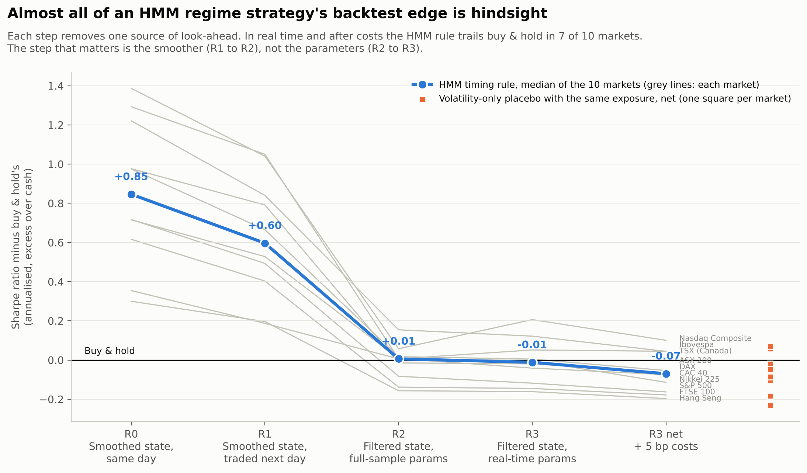
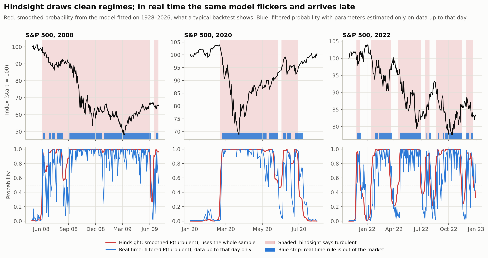
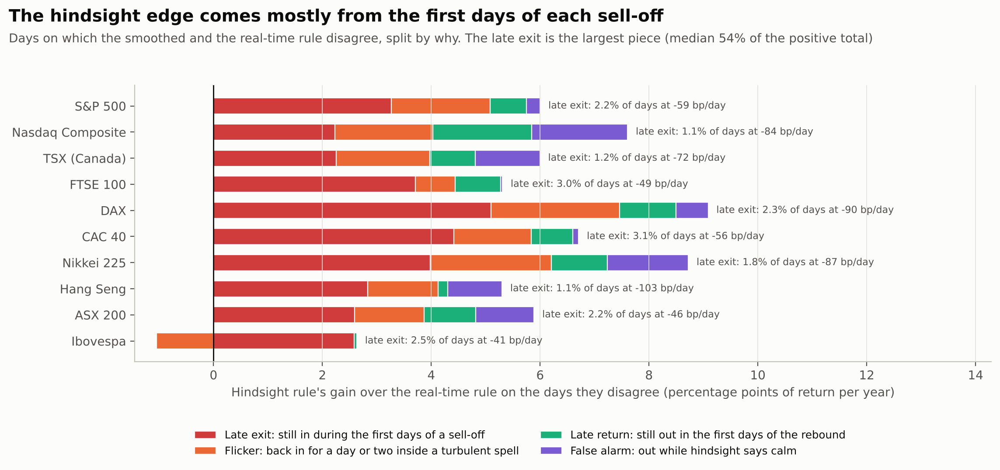
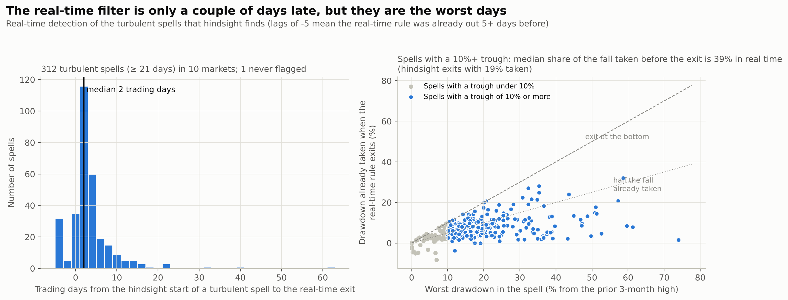
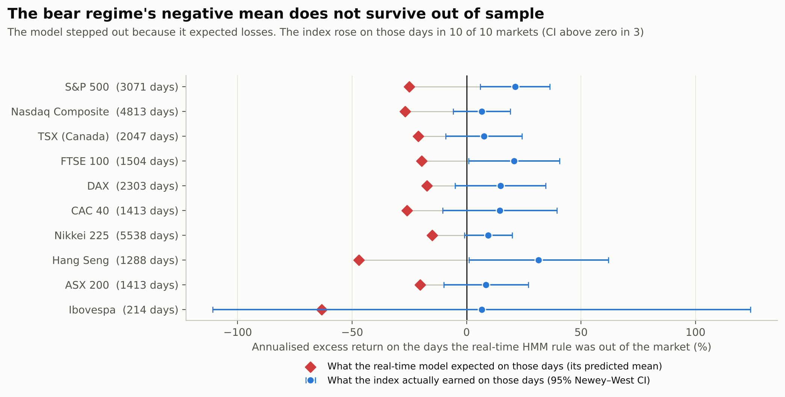
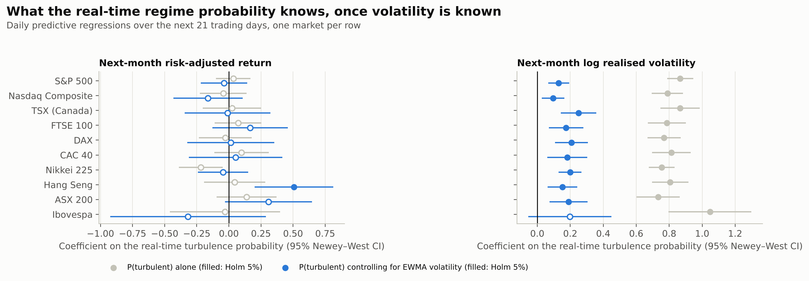
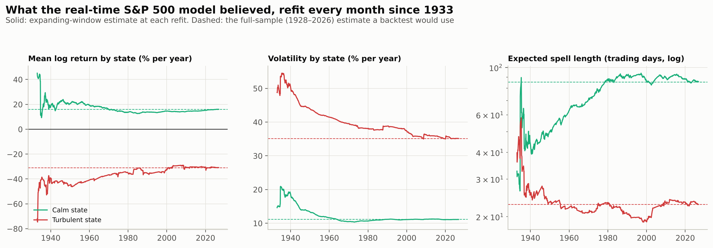
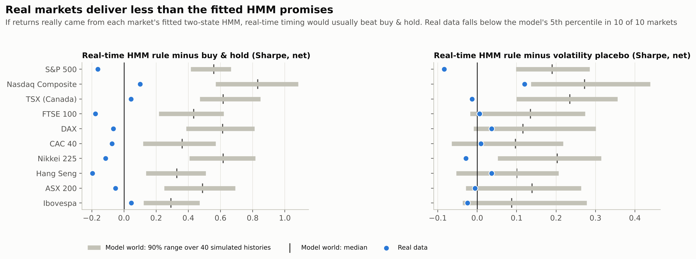
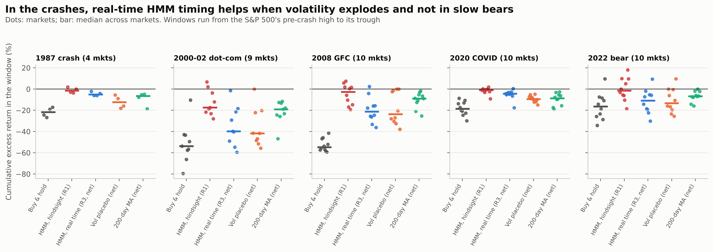

# The Regime You Only See Afterwards: How Much of HMM Regime Timing Is Hindsight?

*Project 19 of [30 Quant Research Projects](../README.md) · 10 equity indices · S&P 500 back to 1928 · ≈425 market-years of daily data · a Gaussian HMM written from scratch*

> **Headline.** A two-state hidden Markov model is the textbook way to find "bull" and "bear" regimes, and the textbook backtest looks spectacular: on the S&P 500 since 1934, holding the index only in the calm regime earns a Sharpe ratio of **1.01**, against **0.32** for buy & hold. I take that backtest apart one source of look-ahead at a time, in 10 markets. **Almost all of the edge is hindsight, and nearly all of that hindsight comes from one step: using smoothed rather than filtered regime probabilities.** That step costs a median **0.61** of Sharpe ratio (10/10 markets, all significant after Holm). Using parameters estimated on the full sample instead of in real time is worth almost nothing (median 0.01, 0/10 significant). In real time and after 5 bp costs, the HMM rule **trails buy & hold in 7 of 10 markets** (median −0.07 Sharpe, none significant), and it does no better than a placebo that only looks at volatility and has the same exposure (median difference 0.00). The edge disappears because of what happens on a few days. Hindsight steps out of each sell-off a median **2 trading days** before the real-time filter can, and those days cost 41–103 bp each. The "bear" regime's large negative mean does not survive out of sample either. On the days the real-time model stepped out because it expected losses of 15–63% a year, the index actually **rose in 10 of 10 markets**. The real-time regime probability is still useful as a **risk** forecast: it predicts next-month volatility beyond EWMA volatility in 9 of 10 markets after Holm. It has no value as a **return** forecast (1 of 10). Simulating from each market's own fitted HMM locates the failure: in that model world real-time timing beats buy & hold by a median **+0.52** of Sharpe with the same 1–2 day detection lag, and real data falls below the model's 5th percentile in **10 of 10** markets.



---

## 1. Question

Regime-switching models (Hamilton 1989) are among the most cited tools in empirical finance. In practice they usually appear as a two-state Gaussian hidden Markov model (HMM) fitted to daily index returns. The fit always finds the same picture: a calm state with positive drift and low volatility, and a turbulent state with high volatility and a strongly negative drift. Practitioner papers (Kritzman, Page & Turkington 2012; Nystrup et al. 2015–2018) and countless tutorials then switch exposure on the inferred state and report large gains.

Every one of those backtests has to answer two questions that are easy to get wrong:

1. **Which probability?** The forward filter gives $P(s_t \mid r_1,\dots,r_t)$ and only uses the past. The forward–backward smoother gives $P(s_t \mid r_1,\dots,r_T)$ and uses the whole sample, including every return after $t$. The Viterbi path does the same. Most library examples return the smoothed or Viterbi path by default, so a backtest built on them uses the future without saying so.
2. **Which parameters?** A model fitted once on 1928–2026 knows, in 1935, how volatile the turbulent state will turn out to be and how long its spells last.

**Research question.** If an HMM regime-timing strategy is rebuilt so that it only uses what was knowable at each close, how much of its backtest value survives? Which source of look-ahead accounts for the gap? And is what remains anything more than volatility timing?

**Hypotheses (fixed before the out-of-sample runs, §3).**
* **H1 (hindsight).** More than half of the Sharpe-ratio advantage of the textbook HMM backtest over buy & hold disappears once both kinds of look-ahead are removed.
* **H2 (volatility in disguise).** The real-time HMM rule does no better than a placebo that has the same exposure and looks only at current volatility.
* **H3 (the model's promise).** If the fitted HMM were the true data-generating process, real-time timing would beat buy & hold. Real data falls short of that promise.

Why it matters. Project [01](../01-monte-carlo-calibration/) used a Markov-switching model as a *distribution* forecaster and found it badly calibrated in the tails. Projects [03](../03-moving-average-volatility/) and [08](../08-correlation-crash-illusion/) conditioned on volatility regimes defined *ex ante* from observable volatility. This project asks the question in between: does the *latent* regime that an HMM infers carry tradeable information beyond what those simpler observable states give you, once you stop using information you could not have had?

## 2. Data

| Index | Sample evaluated (after a 6-year warm-up) | Years |
|---|---|---|
| S&P 500 (^GSPC) | 1934-01 – 2026-11 | 92.6 |
| Nikkei 225 (^N225) | 1971-03 – 2026-11 | 54.3 |
| Nasdaq Composite (^IXIC) | 1977-02 – 2026-11 | 49.8 |
| TSX (^GSPTSE) | 1985-07 – 2026-11 | 41.2 |
| FTSE 100 (^FTSE) | 1989-12 – 2026-11 | 37.0 |
| DAX (^GDAXI) | 1994-01 – 2026-11 | 33.0 |
| Hang Seng (^HSI) | 1993-02 – 2026-11 | 33.1 |
| CAC 40 (^FCHI) | 1996-03 – 2026-11 | 31.0 |
| ASX 200 (^AXJO) | 1998-11 – 2026-11 | 28.1 |
| Ibovespa (^BVSP, from 1995) | 2001-02 – 2026-11 | 25.3 |

The daily closes are the same file as in project [03](../03-moving-average-volatility/) (Yahoo Finance, pulled on 2026-11-18). I reuse them on purpose: the two projects ask the same kind of question ("what does this signal know beyond volatility?") about two different signals, and on identical data their answers can be compared directly (§5.4). The cash rate is the 13-week T-bill (^IRX) for the US indices from 1960. It is zero before 1960 and for the other markets (§8). An S&P 500 total-return version adds Shiller's monthly dividend yield, lagged one month so that it stays real-time (`data/shiller_dividends.csv`, from the `datasets/s-and-p-500` repository; it ends in 2023-06 and is carried forward after that).

Every stress window is covered: 1987, 2000–02, 2008, 2020 and 2022.

## 3. Design

**Model.** A $K$-state HMM on daily log returns (in %), with $r_t \mid s_t=k \sim \mathcal N(\mu_k,\sigma_k^2)$ and a first-order Markov chain $A$. It is fitted by Baum–Welch EM, written from scratch with numba (`src/hmm.py`). It is tested against brute-force enumeration of every state path for the likelihood and the smoothed marginals, and it recovers known parameters from simulated data (`tests/test_core.py`). States are always sorted by variance, so state 0 is "calm" and state $K-1$ is "turbulent". That fixes the label-switching problem across refits. The main specification is $K=2$, the canonical one. $K=3$ is a robustness check. BIC prefers $K=4$ in every market (`results/bic.csv`), which already says that two Gaussian regimes are a stylisation.

**Rule.** Hold the index over day $t+1$ if the probability of the turbulent state is below 0.5, otherwise hold cash. Costs are 5 bp per one-way trade.

**The hindsight ladder.** The same rule is run on five information sets, each one removing one source of look-ahead:

| Rung | Regime probability used for the position held over day $t+1$ | Look-ahead it still has |
|---|---|---|
| **R0** | smoothed $P(s_{t+1}\mid r_{1..T})$, i.e. tomorrow's state applied to tomorrow's return | state (including tomorrow's return) and parameters |
| **R1** | smoothed $P(s_{t}\mid r_{1..T})$ propagated one step, $\gamma_t A$ | state (returns after $t$) and parameters |
| **R2** | filtered $P(s_{t}\mid r_{1..t})\,A$ with full-sample parameters | parameters only |
| **R3** | filtered probability, with parameters re-estimated every 21 trading days on an expanding window, starting after 5 years (1,260 days) of data | none (real time) |
| **R3 net** | R3 after 5 bp per trade | none |

R0 is what a backtest computes when it multiplies a smoothed or Viterbi state series by the same day's return. R1 is the "careful" version that lags the signal by a day but still uses the smoother. Because Sharpe-ratio differences telescope, the five rungs split the textbook edge exactly into state look-ahead (R0→R1→R2), parameter look-ahead (R2→R3) and costs.

Each real-time refit starts from the previous fit and from a fixed default start. Every 12th refit also tries 4 random starts, and the highest likelihood wins. A test changes every return after day $t$ and checks that nothing the real-time engine reports up to $t$ changes, including the parameters (`test_realtime_has_no_look_ahead`).

**Baselines.**
* Buy & hold.
* **Volatility placebo.** It is invested iff today's RiskMetrics EWMA volatility ($\lambda=0.94$) is at or below the quantile of its trailing 5-year distribution that matches the fraction of those same 5 years the real-time HMM rule was invested. It has the same average exposure as the HMM rule, it is out in exactly the highest-volatility states, and it never sees the HMM's view of returns. This is the test of H2.
* The 200-day moving average, from project [03](../03-moving-average-volatility/), as a reference.
* Two HMM variants: a continuous weight $1-P(\text{turbulent})$, and a "mean rule" that is invested iff the model's predicted next-day mean is above the cash rate.

**Evaluation sample.** Per market, from the first day on which every strategy is defined (6 years after the data start) to 2026-11-16. All strategies use the same dates.

**Inference.** Sharpe differences use the Ledoit–Wolf (2008) HAC test and a stationary block bootstrap (63-day mean blocks, 999 draws, all strategies resampled jointly). I apply Holm across the 10 markets for every comparison and a sign test for consistency. Predictive regressions use Newey–West errors with 42 lags.

**Model world (H3).** For each market, I simulate 40 histories of the same length from that market's full-sample fitted HMM and run the whole ladder on them. Real-time refits are annual in the simulations to keep the run time manageable. §7 shows that annual and monthly refits give the same answer on real data.

## 4. Results: the hindsight ladder

Sharpe ratios (annualised, excess over cash). R0–R2 are shown gross, because they are not tradeable anyway. R3 and the baselines are net of 5 bp per trade (`results/performance.csv`).

| Market | R0 | R1 | R2 | R3 net | Buy & hold | Vol placebo | MA200 |
|---|---|---|---|---|---|---|---|
| S&P 500 | 1.03 | 0.81 | 0.23 | **0.15** | 0.32 | 0.24 | 0.46 |
| Nasdaq | 1.82 | 1.48 | 0.49 | **0.54** | 0.44 | 0.42 | 0.61 |
| TSX | 1.70 | 1.32 | 0.63 | **0.52** | 0.48 | 0.53 | 0.61 |
| FTSE 100 | 0.94 | 0.73 | 0.19 | **0.15** | 0.33 | 0.14 | 0.11 |
| DAX | 1.43 | 1.25 | 0.44 | **0.39** | 0.46 | 0.35 | 0.57 |
| CAC 40 | 1.04 | 0.85 | 0.33 | **0.25** | 0.32 | 0.24 | 0.40 |
| Nikkei 225 | 1.68 | 1.44 | 0.40 | **0.28** | 0.39 | 0.31 | 0.50 |
| Hang Seng | 0.59 | 0.49 | 0.14 | **0.10** | 0.29 | 0.06 | 0.39 |
| ASX 200 | 1.34 | 1.03 | 0.38 | **0.31** | 0.36 | 0.31 | 0.31 |
| Ibovespa | 0.83 | 0.66 | 0.48 | **0.52** | 0.47 | 0.54 | 0.37 |

The S&P 500 numbers are 0.15 for R3 net and 1.01 for R0 net. The R0 column above is gross, 1.03.

**Decomposition across the 10 markets** (`results/ladder_summary.csv`; Sharpe differences, 95% stationary-bootstrap CIs per market in `results/ladder_tests.csv`):

| Step | Median | Range | Markets > 0 | CI excludes 0 | Holm 5% |
|---|---|---|---|---|---|
| State look-ahead, same day (R0 − R1) | +0.22 | 0.10 to 0.38 | 10 | 10 | 10 |
| State look-ahead, smoother (R1 − R2) | **+0.61** | 0.18 to 1.04 | 10 | 10 | 10 |
| Parameter look-ahead (R2 − R3) | +0.01 | −0.15 to 0.05 | 8 | 1 | 0 |
| Costs (R3 gross − net) | +0.05 | 0.01 to 0.11 | 10 | 10 | — |
| **What is left (R3 net − buy & hold)** | **−0.07** | −0.20 to +0.10 | 3 | 1 | 0 |
| Real-time HMM − vol placebo (net) | 0.00 | −0.08 to +0.12 | 5 | 0 | 0 |
| Real-time HMM − MA200 (net) | −0.12 | −0.31 to +0.15 | 3 | 1 | 1 (S&P 500) |

**H1 holds, and more strongly than stated.** The whole advantage of the textbook backtest is look-ahead: the median R0 advantage over buy & hold is +0.85, and in real time it is −0.07. Look-ahead about the *state* accounts for essentially all of it (+0.22 + 0.61). Look-ahead about the *parameters* is negligible. That is counter-intuitive, because the usual warning about regime models is about "in-sample estimation", and the remedy people reach for is a walk-forward re-estimation. Walk-forward re-estimation fixes the wrong thing. A backtest with perfectly real-time parameters and a smoothed state is still almost entirely hindsight.

**H2 holds.** The real-time HMM rule and the volatility placebo with the same exposure are indistinguishable (median difference 0.00, 5/10 positive, none significant). In real time, the latent regime is a volatility filter.

The real-time rule also has *worse* maximum drawdowns than buy & hold in 3 markets (S&P 500 −72% vs −66%, FTSE 100, Hang Seng). It whipsaws: §5.2 shows why.

## 5. Why the edge is hindsight

### 5.1 The smoother draws clean regimes, the filter flickers



In real time the filtered probability is very noisy. A single quiet day inside a turbulent spell is enough to push it below 0.5. The smoother sees the high-volatility days on *both* sides of that quiet day and keeps the state turbulent. Across the 10 markets, the real-time rule starts 1.6–12.4 turbulent spells a year with a median length of 3–4 days. Hindsight finds 1.2–3.1 spells a year with a median length of 8–20 days (`results/classification.csv`). The two agree on 87–95% of days. The money is made on the other 5–13%.

### 5.2 Where the hindsight edge is earned



I split every day on which the hindsight rule (R1) and the real-time rule (R3) disagree by *why* they disagree (`results/attribution.csv`):

* **Late exit.** Hindsight is already out, and the real-time rule has not yet left in this spell. These are only 1.1–3.1% of days, but the index loses **41 to 103 bp a day** on them. This is the largest piece in every market: a median 54% of the hindsight edge, 2.2–5.1 percentage points of return a year.
* **Flicker.** Inside a hindsight spell, the real-time rule steps back in for a day or two after a quiet day, and catches the next large move. Worth 0.7–2.4 points a year (in Brazil it goes the other way).
* **Late return.** Hindsight is back in at the start of the rebound, and the real-time rule is still out. Worth 0.2–1.8 points a year.
* **False alarm.** The real-time rule is out while hindsight says calm. Usually small.

The mechanism is simple. A turbulent spell is *defined* by large returns. The smoother can label the first large down-day as turbulent, because it can see the large returns that come after it. The filter can only change its mind *after* it has seen one or two of them. So hindsight always leaves before the first big loss and comes back before the first big gain, and real time never can.

### 5.3 The filter is only a couple of days late, but they are the worst days



Across the 312 turbulent spells of at least 21 days that hindsight finds in the evaluation samples (`results/detection.csv`), the real-time rule leaves the market a median **2 trading days** after the hindsight start (interquartile range 1–4, 90th percentile 8). Only 1 spell is never flagged. In 23% of spells the real-time rule was out on or before the day hindsight's spell began (12% strictly before). Detection is fast. It is *not* fast enough, because in the 239 spells with a trough of 10% or more, the real-time exit comes after a median **39%** of the eventual drawdown from the prior 3-month high has already happened. The hindsight exit comes after 19%. Part of every drawdown happens before *either* rule could move. This is why the 2-day lag costs so much: it is the fat left tail.

### 5.4 The "bear" regime's negative mean is a hindsight artefact



Every fitted HMM agrees on the story. In every one of the 5,230 real-time refits across the 10 markets, the turbulent state has a negative mean, typically −20% to −50% a year (`results/full_sample_params.csv`, `results/realtime_fits.csv`). So the model steps out because it expects to lose money. On the days it actually did step out, the model's own predicted mean was −15% to −63% a year. What the index earned on those days (`results/belief_vs_reality.csv`):

| | S&P 500 | Nasdaq | TSX | FTSE | DAX | CAC | Nikkei | Hang Seng | ASX | Ibovespa |
|---|---|---|---|---|---|---|---|---|---|---|
| Model expected (% a year) | −25 | −27 | −21 | −20 | −17 | −26 | −15 | −47 | −20 | −63 |
| Index earned (% a year) | **+21** | +7 | +8 | **+21** | +15 | +15 | +10 | **+32** | +9 | +7 |

In **10 of 10** markets the realised mean is positive, the opposite sign to the model's belief, and in 3 the 95% Newey–West CI excludes zero. The negative mean of the turbulent state is not a forecast. It is a *label*: the smoother puts the crash days into the turbulent state because they are large, and their negative sum becomes the state's mean. Out of sample, high volatility is followed by ordinary-to-high returns, which is the old risk–return trade-off and the rebound effect. Project [03](../03-moving-average-volatility/) found the same thing for the 200-day rule's volatility component. The HMM regime is a risk forecast that the fitting procedure dresses up as a return forecast.

### 5.5 What the real-time regime probability does know



Regressions of next-month outcomes on the real-time turbulence probability, controlling for log EWMA volatility (`results/regressions.csv`):

* **Next-month log realised volatility.** The coefficient on $P(\text{turbulent})$ is positive in 10/10 markets, 0.10 to 0.25, and significant after Holm in **9/10** (not Ibovespa). Going from $P=0$ to $P=1$ means about 10–28% more volatility next month than EWMA predicts. The HMM probability reacts faster than EWMA after a burst, so the regime model is a better *risk* model than RiskMetrics.
* **Next-month risk-adjusted return.** No relation in 9/10 markets. The exception is the Hang Seng, where the coefficient is *positive* (higher turbulence probability, higher subsequent return) and significant after Holm. That is the opposite of what the regime story says.

That is the same split project [03](../03-moving-average-volatility/) found for the moving average: risk everywhere, returns almost nowhere. The difference is that the 200-day rule's information beyond volatility was worth +0.12 of Sharpe over the HMM here (median, 7/10 markets), while the HMM's information beyond volatility is not worth anything as a timing signal.

### 5.6 What the real-time model believed



The parameters themselves are not the problem. After about 1960, the real-time S&P 500 estimates sit close to the full-sample values. Only the 1930s estimates, fitted on the Depression alone, are far off (calm volatility near 20%, turbulent near 55%). The expected turbulent spell length stays at about 20–28 days throughout. This is why parameter look-ahead (R2→R3) costs nothing: what the filter lacks is not knowledge of the parameters but knowledge of the next few returns.

## 6. The model's own promise (H3)

If returns really came from each market's fitted two-state HMM, would real-time regime timing work? I simulate 40 histories per market from the full-sample fit, with the same length as the real data, and run the same ladder on them (`results/model_world.csv`, `results/model_vs_real.csv`).

| Median across the 10 markets (Sharpe minus buy & hold) | Model world | Real data | Real below the model's 5th percentile |
|---|---|---|---|
| R1 hindsight | +0.82 | +0.60 | 4/10 |
| R2 filtered, full-sample parameters | +0.57 | +0.01 | 10/10 |
| **R3 real time, net** | **+0.52** | **−0.07** | **10/10** |
| Volatility placebo, net | +0.36 | −0.08 | 9/10 |
| R3 minus volatility placebo | +0.14 | 0.00 | 3/10 |
| Median detection lag (days) | 1–2 | 1–5.5 | — |

**H3 holds, and it locates the failure.** In the model world, real-time timing is worth about half a Sharpe point. Smoothing is worth only +0.26 more than filtering, and the detection lag is the same 1–2 days as in real data. So the filter's lateness is not what breaks the strategy: a true HMM is just as late and still pays. What breaks it is that real markets do not have the turbulent state's negative mean (§5.4). In a true HMM, being out during turbulence avoids a −30% a year drift. In real data there is no such drift to avoid, so real-time timing only removes volatility and keeps paying for the late exits. The hindsight ladder looks the way it does in real data (+0.61 for the smoother instead of +0.26) because the smoother is the only part of the pipeline that can still find the crash days once the drift is gone.



## 7. Robustness

| Variant | Median R3 − B&H (net) | Markets above B&H | Median turnover / yr |
|---|---|---|---|
| Main (K=2, monthly refit, expanding window) | −0.07 | 3/10 | 12.4 |
| K=3 states (out if P(most turbulent) > 0.5) | +0.01 | 5/10 | 4.8 |
| Quarterly refit | −0.08 | 3/10 | 12.3 |
| Annual refit | −0.06 | 3/10 | 12.4 |
| Rolling 10-year window | −0.09 | 3/10 | 13.6 |
| Cost 0 bp | −0.01 | 4/10 | 12.4 |
| Cost 10 bp | −0.11 | 1/10 | 12.4 |
| Cost 20 bp | −0.22 | 1/10 | 12.4 |
| S&P 500 with dividends | −0.13 | 0/1 | 11.3 |
| Common sample 2001–2026 | −0.08 | 1/10 | — |

* **More states.** With $K=3$, the rule only exits in the most extreme state. That cuts turnover from 12 to 5 trades a year, and the rule ties buy & hold (median +0.01, 5/10). Hindsight is still worth +0.28 of Sharpe at R1, so the ladder's conclusion does not depend on $K$.
* **Refit frequency and window.** Monthly, quarterly or annual refits and a rolling 10-year window all give the same answer (median −0.06 to −0.09).
* **Dividends.** On the S&P 500 total-return series the real-time rule still trails buy & hold (−0.13, against −0.16 on the price index), and the hindsight rungs barely move (R1 +0.57 instead of +0.49). Dividends do not drive the result.
* **Costs.** Even at zero cost the median real-time rule does not beat buy & hold (−0.01, 4/10). At 10 bp it trails in 9/10.
* **Common modern sample (2001–2026, all 10 markets).** Hindsight R1 beats buy & hold by +0.73. The real-time rule trails it by −0.08 and beats it in only 1/10.

## 8. Stress windows



Cumulative excess return from the S&P 500's pre-crash high to its trough, median across markets (`results/stress_windows.csv`):

| Window | Buy & hold | HMM hindsight (R1) | HMM real time (R3, net) | Vol placebo | MA200 |
|---|---|---|---|---|---|
| 1987 crash (4 markets) | −22% | −1% | −5% | −12% | −6% |
| 2000–02 dot-com (9 markets) | −54% | −17% | −40% | −42% | −19% |
| 2008 GFC (10 markets) | −55% | −3% | −21% | −24% | −9% |
| 2020 COVID (10 markets) | −19% | −1% | −4% | −9% | −9% |
| 2022 bear (10 markets) | −16% | −2% | −11% | −13% | −7% |

The real-time HMM rule does what a volatility filter does, a little better than the placebo in every window. It protects best in the sudden crashes where volatility explodes at the start of the fall: −5% in 1987 and −4% in 2020, against −22% and −19% for buy & hold. It protects only partly in the long bear markets of 2000–02 (−40% vs −54%), 2008 (−21% vs −55%) and 2022 (−11% vs −16%). In those, volatility comes and goes while prices keep falling, and the rule keeps stepping back in. Those slow markets are where the 200-day moving average earns its keep (−19% and −9% in 2000–02 and 2008). Hindsight looks excellent in every window, between −1% and −17%.

## 9. Limitations

* **Price indices, not total returns**, except for the S&P 500 check in §7. In principle missing dividends favour timing, because cash days do not lose them. On the S&P 500, adding them changes the real-time gap from −0.16 to −0.13, so the effect is small.
* **No local cash rate outside the US.** The timing rules earn zero while out of the market instead of local T-bill rates. In high-rate markets (Brazil especially) that understates timing, but the real-time rule is out on only 3–40% of days, and the hindsight and placebo comparisons are unaffected because they share the same cash leg.
* **Gaussian emissions and $K=2$.** BIC prefers $K=4$. Student-t emissions, time-varying transition probabilities (Diebold, Lee & Weinbach 1994) or a GARCH inside each state are all richer models. None of them can remove the smoother's look-ahead, which is the main finding. They might change the "what is left" row, so it should be read as a statement about the canonical model.
* **The volatility control is EWMA.** A GARCH forecast (project 13) may absorb some of the HMM probability's extra risk information in §5.5.
* **Model world.** 40 histories per market, with annual refits for speed. The comparison is between distributions, so a moderate number of paths is enough to place the real data. It is not enough to estimate tails of the simulated distribution precisely.
* **Daily frequency.** Weekly or monthly regime models filter out more noise and flicker less. They would also be even later to detect a crash.
* **Multiple testing.** The headline comparisons are pre-registered. The attribution (§5.2) and belief-vs-reality (§5.4) analyses were added after seeing the ladder, to explain it, and are labelled as such. Their direction is the same in 10/10 markets.

## 10. Referee-style self-review: what it changed

I reviewed the first complete draft as a referee would, and changed the following before publishing.

1. **The 2008 window started too late.** It first ran from 2008-09-01, when every market was already in the turbulent state, so the real-time rule looked as if it lost nothing. It now runs from the S&P 500's high on 2007-10-09, and the real-time rule loses a median 21% (buy & hold: 55%). The text and figure were rewritten to match.
2. **"The filter is late by construction" overstated the lag.** The median lag is 2 trading days, which is fast. The finding is that those 2 days are the worst ones (§5.3), and the model world shows that a *true* HMM is just as late and still pays (§6). The headline now says that, and puts the failure where the evidence puts it: in the turbulent state's mean (§5.4).
3. **The first attribution only said *which* rule was out.** I replaced it with a split by mechanism (late exit, flicker, late return, false alarm). That is what showed that the late exit is the largest piece in every market. A plotting bug drew Brazil's negative flicker bar on top of its positive bar; negative pieces are now drawn to the left of zero.
4. **A claim about dividends was wrong.** The draft said that missing dividends must flatter timing. The S&P 500 total-return run shows a small effect in the other direction (−0.13 vs −0.16). The text now reports the number instead of the presumption.
5. **Numerical robustness.** Some random starts for $K=3$ collapsed a state and crashed EM. Those starts are now discarded (the default and warm starts always run), and the smoother guards against underflow. The HMM is tested against brute-force path enumeration and against parameter recovery, and the real-time engine is tested for look-ahead by changing the future.
6. **Units.** A figure showed state means and volatilities multiplied by 100 twice. Fixed, and every number in the text was checked against the CSVs in `results/`.
7. **Post-hoc analyses are labelled.** The ladder, the placebo test and the model world were planned. The attribution and belief-vs-reality analyses came after the first results, to explain them. Their direction is the same in all 10 markets.

Open points a referee could still raise: a GARCH volatility control instead of EWMA (project 13), Student-t emissions, and more simulated histories. The bootstrap CIs on the ladder also treat the full-sample fit as given and so ignore its estimation error. That matters little for the hindsight rungs, whose CIs exclude zero by a wide margin in every market, but it makes the CIs on the parameter step (R2 − R3) somewhat too narrow.

## 11. Conclusion

An HMM regime backtest is only as honest as the probability it trades on. With smoothed probabilities, or a Viterbi path, it is a lesson in hindsight: it exits two days before the filter could, keeps a clean regime the filter cannot hold, and comes back before the rebound. It also assigns the crash days to a "bear" state whose negative mean is then believed. Remove that, and the regime model is a volatility filter with a better-than-EWMA risk forecast and no return forecast. It does not beat buy & hold, a volatility placebo, or a 200-day moving average. For practitioners the checklist is short: use the filtered probability, report the detection lag, and compare against a volatility placebo with the same exposure. Re-estimating the parameters walk-forward is necessary, but it is not the fix that matters.

**Links to other projects.** [01](../01-monte-carlo-calibration/) (Markov-switching return distributions), [03](../03-moving-average-volatility/) (same data, the 200-day rule's information beyond volatility), [08](../08-correlation-crash-illusion/) (volatility-regime conditioning without hindsight), [10](../10-market-terminal/) (which screen signals forecast volatility). Next: 13 (GARCH as the volatility control), 22 (purged cross-validation, the general version of the look-ahead problem), 23 (deflated Sharpe: R0 is a textbook case of an inflated one).

## Reproduce

```bash
pip install -r requirements.txt
bash run_all.sh      # tests, all experiments, all figures (about 8 minutes on 4 cores)
```

`src/hmm.py` is the HMM (EM, filter, smoother, Viterbi, simulation). `src/core.py` has the data, the real-time engine, strategies and statistics. `src/build.py` builds every daily series for one market. `src/run_experiments.py` writes every CSV in `results/`, and `src/figures.py` draws every figure. Real-time fits are cached in `results/cache/` (git-ignored); `run_all.sh` rebuilds them from scratch.

## References

* Hamilton, J. D. (1989). A new approach to the economic analysis of nonstationary time series and the business cycle. *Econometrica* 57(2).
* Baum, L. E., Petrie, T., Soules, G. & Weiss, N. (1970). A maximization technique occurring in the statistical analysis of probabilistic functions of Markov chains. *Annals of Mathematical Statistics* 41(1).
* Ang, A. & Bekaert, G. (2002). International asset allocation with regime shifts. *Review of Financial Studies* 15(4).
* Kritzman, M., Page, S. & Turkington, D. (2012). Regime shifts: implications for dynamic strategies. *Financial Analysts Journal* 68(3).
* Nystrup, P., Hansen, B. W., Madsen, H. & Lindström, E. (2015). Regime-based versus static asset allocation: letting the data speak. *Journal of Portfolio Management* 42(1).
* Diebold, F. X., Lee, J.-H. & Weinbach, G. (1994). Regime switching with time-varying transition probabilities. In *Nonstationary Time Series Analysis and Cointegration*.
* Ledoit, O. & Wolf, M. (2008). Robust performance hypothesis testing with the Sharpe ratio. *Journal of Empirical Finance* 15(5).
* Politis, D. & Romano, J. (1994). The stationary bootstrap. *JASA* 89(428).
* Holm, S. (1979). A simple sequentially rejective multiple test procedure. *Scandinavian Journal of Statistics* 6(2).
