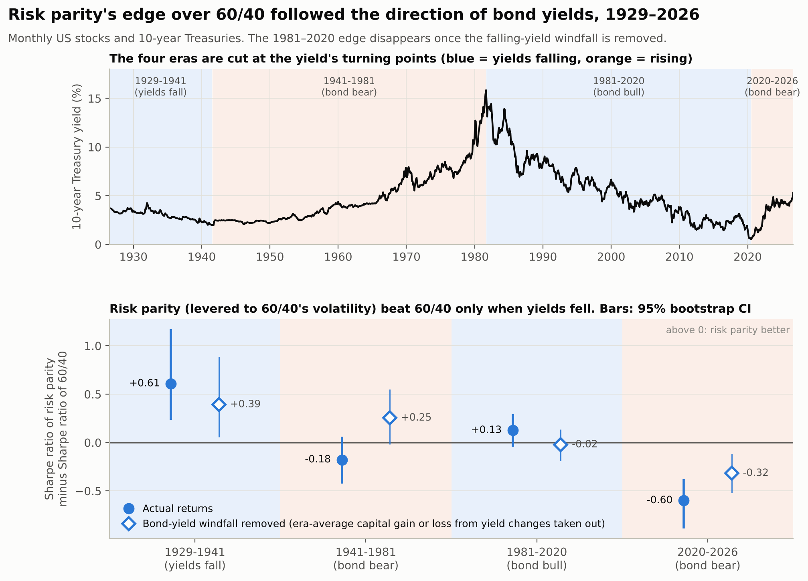
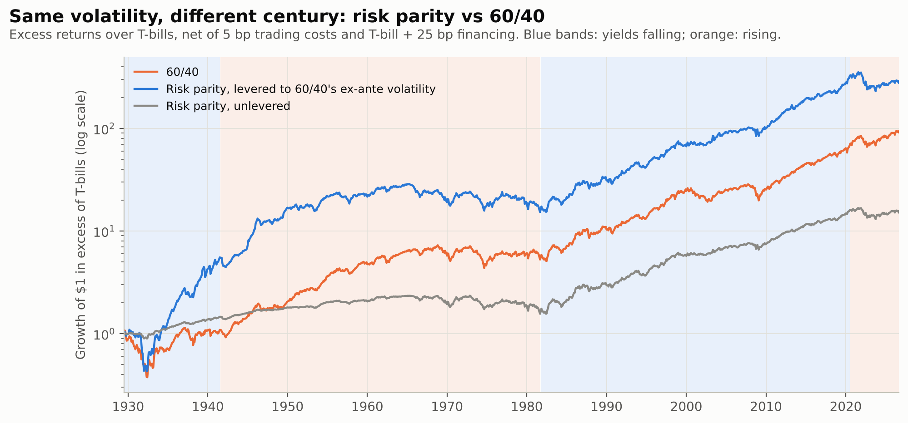
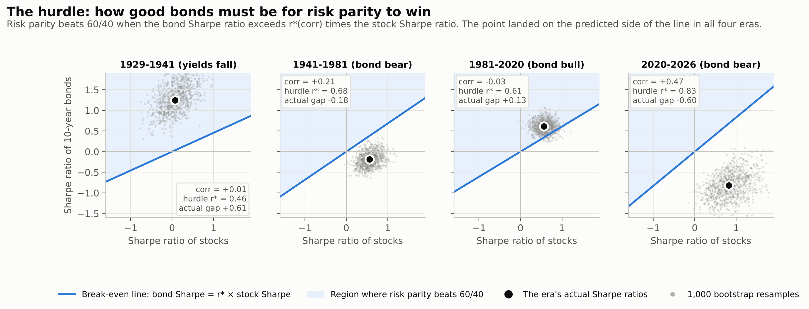
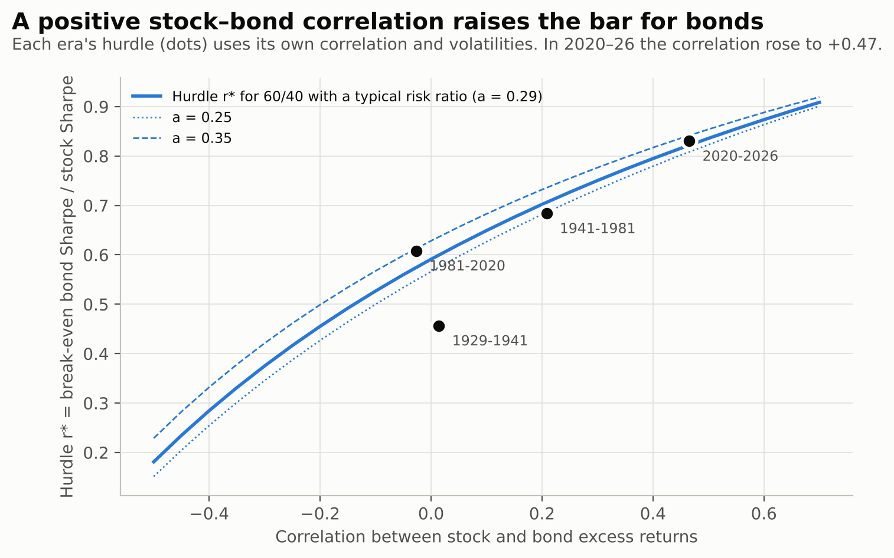
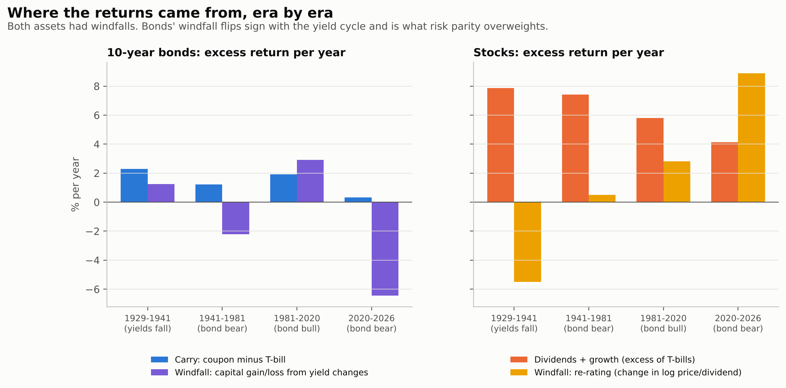
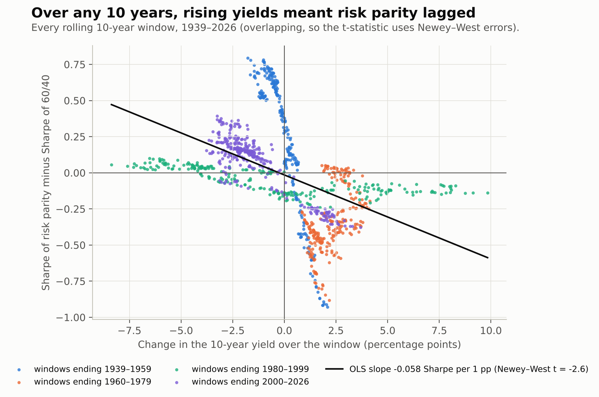
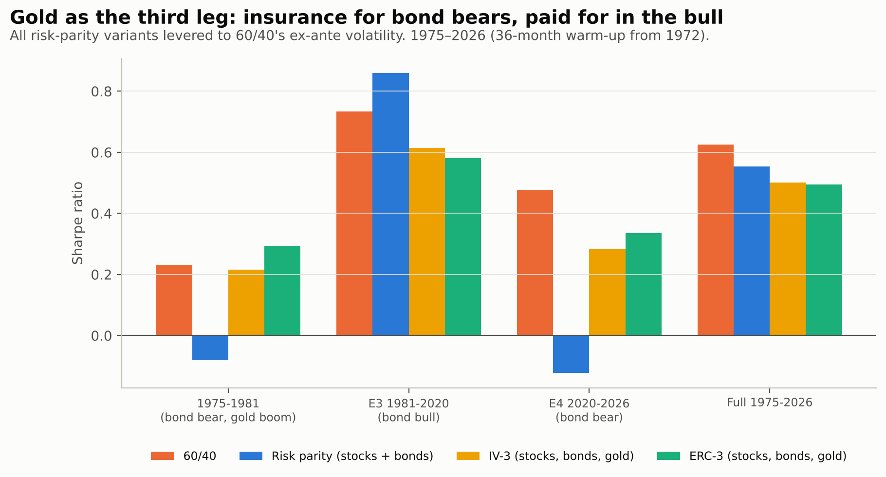
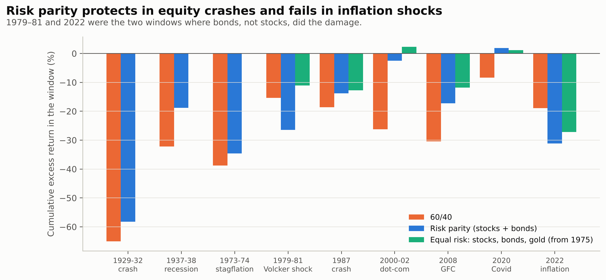
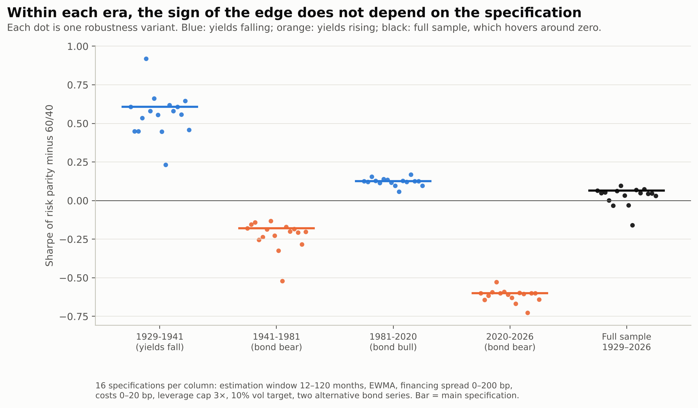

# Was Risk Parity Just a Bond Bull Market?

**A closed-form hurdle, a windfall decomposition and 97 years of US stocks and Treasuries (1929–2026) show when levered risk parity beats 60/40, and why its famous 1981–2020 edge came from falling yields**

*Project 20 of [30 Quant Research Projects](../README.md) · Working paper, November 2026*



---

## Abstract

Risk parity holds stocks and bonds in proportions that give each the same risk, then uses leverage to bring the
portfolio up to the volatility of a 60/40 portfolio. From the early 1980s to 2020 it beat 60/40 at the same
volatility, and in 2022 it had its worst year on record. There are two competing explanations. The **structural**
one (Asness, Frazzini & Pedersen 2012) says investors who cannot or will not borrow overpay for risky assets, so
low-risk assets such as bonds earn more per unit of risk, and a levered portfolio of them wins in any era. The
**bond-bull** one says risk parity simply overweighted the one asset that enjoyed a 40-year fall in yields, from
15.8% to 0.5%.

I separate the two with three tools:

1. **A closed-form hurdle.** For two assets, levered risk parity beats 60/40 at equal volatility exactly when the
   bond Sharpe ratio exceeds *r\** times the stock Sharpe ratio, where *r\** depends only on the stock–bond
   correlation and the vol ratio. At a zero correlation *r\** ≈ 0.6: bonds do **not** need a higher Sharpe ratio than
   stocks. At a correlation of +0.5 the bar rises to ≈ 0.84.
2. **Eras cut by the yield, not by the result.** The 10-year yield's turning points split 1929–2026 into two
   falling-yield eras (1929–41, 1981–2020) and two rising-yield eras (1941–81, 2020–26). This gives two
   "out-of-sample" bond bears for a strategy whose reputation was built in a bull.
3. **A windfall decomposition.** Bond returns split into carry and the capital gain or loss from yield changes;
   stock returns into dividends plus growth and re-rating. Removing each era's average windfall shows what is left.

The bond series is rebuilt from yields (month-end 10-year yields from 1962, the Federal Reserve's monthly long-term
yield before) and tracks two real Treasury funds with correlations of 0.94–0.96. The strategy uses only past data,
pays trading costs and finances its leverage at T-bills + 25 bp. Hypotheses were written down before the first
backtest ([PREREGISTRATION.md](PREREGISTRATION.md)).

**Main findings**

1. **The sign of risk parity's edge followed the direction of yields in all four eras.** Sharpe ratio of risk parity
   minus that of 60/40: **+0.61** in 1929–41 (95% CI +0.24 to +1.17), **−0.18** in 1941–81 (−0.42 to +0.06),
   **+0.13** in 1981–2020 (−0.04 to +0.29) and **−0.60** in 2020–26 (−0.89 to −0.38). The two short eras are significant after Holm (p = 0.046 and 0.002).
   Over the whole 97 years the gap is **+0.06** (−0.10 to +0.23), statistically zero. Every one of 16 robustness
   specifications gives the same sign in every era. *How much four signs prove:* four matches out of four would happen
   by a coin flip with probability 1/16 ≈ 0.06; only 1929–41 and 2020–26 are individually significant; and although
   the era boundaries are set by the yield's turning points, not by the result, they were chosen with hindsight. The
   test that needs no era cuts is the rolling one (Section 4.4, figure 4): the gap falls by 0.058 Sharpe per
   percentage point of rise in the yield (Newey–West t = −2.55; −0.14, t = −2.4, on non-overlapping decades).
2. **The 1981–2020 edge was the bond bull.** Removing that era's average gain from falling yields (+2.9% a year on the
   10-year bond) turns risk parity's +0.13 into **−0.02**. Removing the stock re-rating as well leaves +0.02, so
   **88% of the edge is gone** (pre-registered threshold: 50%).
3. **The structural premium is real but small, and it shows up in the bear markets.** With all four eras' windfalls
   removed, the century-long gap is **+0.17 (+0.02 to +0.33)**, and it is positive in 1941–81 (+0.27). Bond bears hid
   a modest leverage-aversion premium. In the bull the premium itself was absent (+0.02); the windfall stood in for it.
4. **The hurdle formula calls the winner in all four eras** (pre-registered: at least 3 of 4), and its static
   prediction of the gap is within 0.2 of the dynamic backtest in each. In 2020–26 the stock–bond correlation rose to
   +0.47, lifting the hurdle from 0.61 to 0.83, at the same time as bonds' Sharpe ratio fell to −0.82.
5. **Across any 10-year window, each percentage point of rise in the 10-year yield cost risk parity 0.058 of Sharpe
   relative to 60/40** (Newey–West t = −2.6; 9 non-overlapping decades give the same sign, t = −2.4).
6. **Mean-based timing does not reliably beat plain risk parity** (link to project 05). Max-Sharpe on trailing means
   and a rule that switches to 60/40 when trailing estimates fail the hurdle add +0.02 to +0.08 of Sharpe, none
   significant after Holm.
7. **Gold is insurance for bond bears that is paid for in the bull.** Adding gold through equal risk contribution
   raised Sharpe over stock–bond risk parity by +0.37 in 1975–81 and +0.46 in 2020–26 (neither survives Holm), and
   cost −0.28 in 1981–2020 (p = 0.03). Over 1975–2026, plain 60/40 had the highest Sharpe ratio of the four.

**The practical message.** Risk parity is a bet that bonds' Sharpe ratio will clear a hurdle of about 0.6 times
stocks', and that the stock–bond correlation stays low. That bet paid when yields fell and lost when they rose,
once in each direction in the 1930s–70s and again since 1981. Strip out the yield cycle and a premium of about
0.15–0.17 of Sharpe remains over the century. It came from 1929–81, not from 1981–2020, it is uncertain, and it disappears
at financing costs about 50 bp higher than assumed here.

---

## 1. Why this question

Project [05](../05-efficient-frontier/) found that the mean-variance frontier breaks in the **means**: estimated
expected returns destroy value, and "no view" portfolios such as 1/N and inverse volatility are the benchmark to
beat. Risk parity is the most popular "no view" portfolio in practice. It needs only a covariance matrix, and it is
the max-Sharpe portfolio *if* every asset has the same Sharpe ratio and the correlations are equal. So risk parity
does carry a view on the means after all, a hidden one: that bonds earn roughly the same return per unit of risk as
stocks. Project [08](../08-correlation-crash-illusion/) found that correlations move with the volatility regime.
Risk parity's leverage depends on the stock–bond correlation as well.

The debate around 2022 put the question sharply. Supporters pointed to decades of better risk-adjusted returns and to
the leverage-aversion theory. Critics pointed out that those decades coincided with the largest bond rally in history.
The two stories make different predictions about **bond bear markets**. The structural story predicts the edge
survives them. The bond-bull story predicts it reverses. Long US data contain two bond bears (1941–81 and 2020–26),
which is enough to test them.

## 2. Data

| Series | Source | Frequency, span | Notes |
|---|---|---|---|
| US stock market excess return, 1-month T-bill | Ken French data library (CRSP vintage 2026-09), copied from project 09 | monthly, 1926-07 to 2026-09 | value-weighted, total return |
| 10-year Treasury yield, month-end | ^TNX (CBOE), Yahoo Finance, via Chrome | 1962-01 to 2026-10 | used from 1962 |
| Long-term government bond yield | Federal Reserve Board, *Banking and Monetary Statistics* (FRED series LTGOVTBD), unofficial copy from the `open-datahub/interest_rate` GitHub repository | monthly averages, 1925-01 to 2000-06 | used before 1962; checks below |
| 10-year Treasury yield, monthly average | FRED GS10, via datasets/bond-yields-us-10y | 1953-04 to 2026-09 | robustness only |
| Gold | World Bank Pink Sheet (monthly average) to 2000-08; COMEX front month (Yahoo GC=F) month-end after | 1972-01 to 2026-10 | 3-asset universe only |
| S&P 500 dividend yield | multpl.com (Shiller's series, updated monthly) | 1871-01 to 2026-11 | stock re-rating only |
| Validation | Vanguard Intermediate-Term (VFITX) and Long-Term (VUSTX) Treasury funds, Yahoo adjusted close | 1986/1991 to 2026 | checks the rebuilt bond |

**Rebuilding the bond.** Each month a 10-year par bond is bought at last month's yield and revalued a month later at
this month's yield, with 9 years 11 months left. Its return is coupon accrual plus the price change. The two parts are
kept separately (`bond_carry`, `bond_price` in `data/monthly_panel.csv`). From 1962 onwards, with month-end yields,
the rebuilt bond correlates **0.96** with VFITX and **0.94** with VUSTX over 1986–2026, with annual returns of 4.5% vs
4.5% and 5.2% vs 5.7% (`results/data_bond_validation.csv`).

**A data trap I fell into.** The first run used Shiller's monthly long-term rate for 1926–61, as many replications do.
Risk parity then had a Sharpe ratio of 3.6 in the 1930s. The reason: before 1953 Shiller's yields are **linearly
interpolated from annual data**, so monthly bond returns are artificially smooth and bonds look almost riskless.
Risk parity loads up on the "riskless" asset with up to 8× leverage. I replaced the series with the Federal Reserve's
genuinely monthly yields and recorded the change in the pre-registration log. This is worth knowing for anyone
backtesting before 1953.

**Checking the LTGOVTBD copy.** FRED and the Federal Reserve's site are blocked from the cloud environment this was
built in, so the series comes from a third-party GitHub copy (`open-datahub/interest_rate`, file `LTGOVTBD.csv`), not
from FRED itself. Three checks: (i) a second, independent GitHub copy of the same series (in
`Akma86/us-tech-giants-market-analytics`) matches it value for value, apart from trailing-zero formatting;
(ii) over 1953–2000, where it overlaps FRED GS10, it correlates **0.988** in levels and **0.968** in monthly changes,
with a mean gap of −0.13 pp, as expected for bonds of 10+ years against a 10-year constant maturity; (iii) it is
genuinely monthly, not interpolated: monthly changes have an AR(1) of 0.32, against the near-1 an interpolated series
gives. A spot check against FRED or the printed Fed tables was **not** possible here; it is listed in Section 7.

**Averaged yields.** The Federal Reserve series before 1962 is still a monthly *average* of daily yields, not a month-end
value. Over 1962–2026, where both exist, bond returns from averaged yields have 15% less volatility (6.6% vs 7.7%) and
more autocorrelation (AR(1) 0.31 vs 0.10) than from month-end yields (`results/data_smoothing_check.csv`). Two
robustness runs handle this: one uses averaged yields throughout, the other rescales pre-1962 bond volatility by
×1.17. Neither changes any sign (Section 4.9).

**Sample.** With a 36-month warm-up, the backtests run from **1929-07 to 2026-09 (1,167 months)**. They include the 1929–32
crash, the 1970s stagflation, the Volcker shock, 2008, 2020 and 2022.

## 3. Design

### 3.1 Strategies

All positions are in excess returns (as if held through futures) and rebalanced monthly. Weights at month *t* use only
data up to *t − 1*.

| Strategy | Weights |
|---|---|
| **60/40** | 60% stocks, 40% bonds, unlevered |
| **RP** (main) | inverse volatility (36-month sample covariance), then scaled so its *ex-ante* volatility equals 60/40's under the same covariance |
| RP-unlevered | inverse volatility, weights sum to one |
| MVO-expanding / MVO-10y | long-only max-Sharpe on trailing mean excess returns (all history, or 10 years), scaled like RP |
| Switch-10y | holds RP when trailing 10-year means say RP has the higher Sharpe ratio, else 60/40 |
| IV-3, ERC-3 | stocks, bonds and gold by inverse volatility or equal risk contribution, scaled like RP (1975 onwards) |

**Costs.** 5 bp per unit of turnover. Leverage above 1× is financed at T-bill + 25 bp a year. Risk parity averaged
2.6× notional exposure overall: 5.9× in the 1930s when bonds were very calm, 1.4–1.5× since 1981.

### 3.2 The hurdle

Let *S_s* and *S_b* be the Sharpe ratios of stocks and bonds, *ρ* their correlation, and let a portfolio hold a bond
position whose stand-alone volatility is *k* times that of its stock position. Its Sharpe ratio is

$$\text{SR}(k) = S_s\,\frac{1 + k\,r}{\sqrt{1 + k^2 + 2\rho k}}, \qquad r = S_b / S_s .$$

Risk parity is *k* = 1. For 60/40, *k* = *a* = 0.4σ_b / 0.6σ_s, about 0.23–0.34 in the data. Setting SR(1) = SR(*a*)
gives the break-even ratio

$$r^*(\rho, a) = \frac{A - B}{B - aA}, \qquad A = \sqrt{2 + 2\rho}, \quad B = \sqrt{1 + a^2 + 2\rho a}.$$

Risk parity wins when *S_b* > *r\** *S_s*, a half-plane in the (*S_s*, *S_b*) plane (Figure 2). Leverage does not
appear, because both portfolios are compared at the same volatility. For *a* = 0.29, *r\** is 0.38 at *ρ* = −0.3,
0.59 at *ρ* = 0 and 0.84 at *ρ* = 0.5. Three things follow:

* **Bonds do not need to beat stocks on Sharpe.** With uncorrelated assets, risk parity wins if bonds deliver about
  60% of stocks' Sharpe ratio, because the diversification gain covers the rest.
* **Correlation is part of the bet.** A rising stock–bond correlation raises the bar at exactly the moment (inflation
  shocks) when bond returns are poor.
* **Risk parity is a view on means after all.** It is optimal only when *S_b* = *S_s*, and it beats 60/40 only when
  *S_b* / *S_s* > *r\**. Project 05's finding that means cannot be estimated reliably applies to that view as well.

The unit tests check the formula against Sharpe ratios computed from 400,000 simulated months.

### 3.3 Eras

Eras are cut at the global extremes of the 10-year yield: a trough of 1.98% in 1941-07, a peak of 15.84% in 1981-09
and a trough of 0.54% in 2020-07. The cut uses the yield only, not the strategies' returns. It is still an ex-post
cut, and the claim it supports is *conditional* ("in eras when yields rose, ...") rather than a forecast.
The rolling analysis in Section 4.4 does not depend on the cut.

### 3.4 Windfalls

Within each era I subtract a constant from each month's return: for bonds, the era's average price change from yield
moves; for stocks, the era's average change in log price/dividend. Volatility, correlation, carry, dividends and
earnings growth are left as they were. The result is what each asset would have returned had valuations ended each
era where they started. Both strategies are re-run on these returns.

### 3.5 Statistics

Sharpe differences use a paired stationary bootstrap (Politis & Romano 1994; mean block 12 months, 5,000 resamples).
Confidence intervals are percentile intervals, and p-values come from the re-centred bootstrap distribution. Each
pre-registered family gets a Holm correction: the four era tests (H1/H2), the three timing rules (H5) and the two
gold tests (H6). Rolling regressions use Newey–West errors with 120 lags.

## 4. Results

### 4.1 The record, era by era

| Era | Months | 60/40 Sharpe | RP Sharpe | RP − 60/40 [95% CI] | Holm p | RP avg. leverage |
|---|---:|---:|---:|---|---:|---:|
| 1929–1941, yields fall | 145 | 0.14 | 0.74 | **+0.61** [+0.24, +1.17] | **0.046** | 5.9× |
| 1941–1981, bond bear | 482 | 0.48 | 0.30 | **−0.18** [−0.42, +0.06] | 0.29 | 3.0× |
| 1981–2020, bond bull | 466 | 0.73 | 0.86 | **+0.13** [−0.04, +0.29] | 0.29 | 1.4× |
| 2020–2026, bond bear | 74 | 0.48 | −0.12 | **−0.60** [−0.89, −0.38] | **0.002** | 1.5× |
| Full sample 1929–2026 | 1,167 | 0.46 | 0.53 | +0.06 [−0.10, +0.23] | — | 2.6× |

The signs alternate with the yield cycle. 1929–41 and 2020–26 are individually significant after Holm, and the two
long eras have intervals that include zero. The signs repeat across all 16 specifications,
though, and the rolling regression below uses every window. Unlevered risk parity shows the same pattern with larger
swings: −0.42 in 1941–81 and −0.53 in 2020–26, both with p ≤ 0.001 (`results/sharpe_tests.csv`).

**The 2020–26 result is not only 2022.** Without calendar 2022, the gap over the remaining 62 months is −0.65.
After 2022 stocks kept rallying while bonds stayed weak, and that is the worst case for risk parity.

**Why earlier studies found a premium.** Ending the sample in 2010, as Asness, Frazzini & Pedersen (2012) did, gives
+0.11 (−0.07 to +0.29). That window contains both falling-yield eras and only one of the two bears.



### 4.2 The hurdle calls every era

| Era | Stock SR | Bond SR | Corr. | Hurdle *r\** | Bond SR needed | Predicted gap (static) | Backtest gap |
|---|---:|---:|---:|---:|---:|---:|---:|
| 1929–41 | 0.07 | 1.24 | +0.01 | 0.46 | 0.03 | +0.78 | +0.61 |
| 1941–81 | 0.56 | −0.19 | +0.21 | 0.68 | 0.38 | −0.24 | −0.18 |
| 1981–2020 | 0.56 | 0.61 | −0.03 | 0.61 | 0.34 | +0.11 | +0.13 |
| 2020–26 | 0.82 | −0.82 | +0.47 | 0.83 | 0.68 | −0.48 | −0.60 |

The formula uses each era's full-sample moments and fixed weights. The backtest uses rolling estimates and
time-varying leverage. Even so, the formula gets the sign right in **4 of 4 eras** (H4 required 3) and the size to
within 0.2. Applied to the full sample, the formula predicts a gap of zero (−0.004) and the backtest gives +0.06.

Two things stand out. In 1981–2020 bonds cleared the bar easily: 0.61 against 0.34 required. A bond Sharpe of 0.61 over
39 years is not a normal premium, though. It is the bull market. In 2020–26 the bar rose to 0.68 because the
correlation turned positive, and bonds delivered −0.82.





### 4.3 Removing the windfalls

| Era | Bond carry (%/yr) | Bond yield-change windfall (%/yr) | Stock re-rating (%/yr) | Gap, actual | Gap, bond windfall removed | Gap, both removed |
|---|---:|---:|---:|---:|---:|---:|
| 1929–41 | 2.3 | +1.2 | −5.5 | +0.61 | +0.39 | +0.38 |
| 1941–81 | 1.2 | −2.2 | +0.5 | −0.18 | +0.25 | +0.27 |
| 1981–2020 | 1.9 | **+2.9** | +2.8 | +0.13 | **−0.02** | +0.02 |
| 2020–26 | 0.3 | **−6.5** | +8.9 | −0.60 | −0.32 | −0.14 |
| Full 1929–2026 | 1.6 | 0.0 | +1.2 | +0.06 | +0.15 | **+0.17** [+0.02, +0.33] |

(`results/windfall_decomposition.csv`, `results/windfall_free_tests.csv`.)

* **H3 holds.** With both windfalls removed, the 1981–2020 edge falls from +0.13 to +0.02 (−88%). With only the bond
  windfall removed it becomes −0.02. **Nothing of risk parity's 1981–2020 edge over 60/40 survives once bonds are
  denied the fall in yields.** The stock re-rating in that era (dividend yield from 5.5% to 1.8%) actually helped 60/40.
* **The bears hid a premium.** In 1941–81 the gap goes from −0.18 to +0.25 to +0.27. Over the full sample the
  windfall-free gap is +0.17, with an interval that excludes zero (p = 0.03). This is the leverage-aversion premium
  of the structural story, measured without the yield cycle in it. It is about a quarter of the 0.6 of Sharpe that
  1929–41 alone suggests, and it sits close to the edge of significance (bond-only removal: +0.15, p = 0.07).
* **2020–26 stays negative** after both removals (−0.14, n.s.). The positive correlation did damage beyond the yield
  rise: the hurdle without windfalls is still 0.83, and bonds' windfall-free Sharpe ratio was only 0.16 of stocks'.



### 4.4 Rolling evidence, without era cuts

Over every rolling 10-year window from 1939 to 2026, the Sharpe gap falls by **0.058 per percentage point of rise in the
10-year yield** (Newey–West t = −2.55, R² = 0.22). The 9 non-overlapping decades give a slope of −0.14 (t = −2.4).
The gap also falls with the window's stock–bond correlation: −0.44 per unit of correlation (t = −3.5), consistent with
the hurdle formula (`results/rolling_regressions.csv`).



### 4.5 Can the hurdle be timed? (H5, link to project 05)

If the hurdle decides the winner, an investor could estimate it and switch. The trailing-mean rules do that:

| Rule (full sample) | Sharpe | vs RP [95% CI] | Holm p |
|---|---:|---|---:|
| RP (no means) | 0.53 | — | — |
| MVO on expanding-window means | 0.54 | +0.02 [−0.09, +0.12] | 0.79 |
| MVO on 10-year means | 0.60 | +0.08 [−0.04, +0.19] | 0.39 |
| Switch to 60/40 when the 10-year trailing hurdle fails | 0.59 | +0.07 [−0.00, +0.15] | 0.25 |

None is significant, so H5 holds: no mean-based rule reliably beats ignoring the means, as project 05 found for
industries. The point estimates are positive, though, and the switch rule's gain is concentrated in 1941–81, where it
roughly matched 60/40 instead of lagging it. Ten-year trailing Sharpe ratios carry some information about multi-decade
yield trends, but 97 years of data cannot separate it from luck. That is the same knowability problem project
[07](../07-kelly-estimation-risk/) found for Kelly fractions.

### 4.6 Did risk parity deliver parity?

Measured with each era's realised covariance and the strategy's actual weights, bonds supplied **54%** of risk
parity's variance over the full sample (60/40: 7%). The share was 47–53% in three eras and **68% in 1941–81**, when
bond volatility kept rising and a 36-month window kept underestimating it (`results/risk_share_by_era.csv`). Risk parity
therefore puts about half its risk in bonds by design, and more than half in bond bears, which are exactly the eras
when bonds lose.

### 4.7 Gold as a third leg (H6)

| Period | 60/40 | RP (stocks + bonds) | IV-3 | ERC-3 | ERC-3 − RP [95% CI] |
|---|---:|---:|---:|---:|---|
| 1975–81 (bond bear, gold boom) | 0.23 | −0.08 | 0.22 | 0.29 | +0.37 [−0.43, +1.12] |
| 1981–2020 (bond bull) | 0.73 | 0.86 | 0.61 | 0.58 | −0.28 [−0.54, −0.03] |
| 2020–26 (bond bear) | 0.48 | −0.12 | 0.28 | 0.34 | +0.46 [+0.05, +1.00] |
| 1975–2026 | 0.63 | 0.55 | 0.50 | 0.49 | −0.06 [−0.32, +0.18] |

Gold held about 40% of the notional exposure (a third of the risk, by construction). It rescued risk parity in both bond bears, with point estimates large enough
to matter, but neither survives Holm (adjusted p = 0.37 and 0.11), so H6 is supported in direction only. The price was
paid in the bull. Over 1975–2026 none of the risk-parity variants beat 60/40.



### 4.8 Stress windows

| Window | 60/40 | RP | ERC-3 | Who did the damage in RP |
|---|---:|---:|---:|---|
| 1929–32 crash | −65% | −58% | — | stocks |
| 1937–38 | −32% | −19% | — | stocks |
| 1973–74 stagflation | −39% | −35% | — | mostly stocks (bonds −11 pts) |
| 1979–81 Volcker | −15% | **−27%** | −11% | **bonds (−27 pts)** |
| 1987 crash | −19% | −14% | −13% | stocks |
| 2000–02 dot-com | −26% | −3% | +2% | stocks, offset by bonds |
| 2008 GFC | −30% | −17% | −12% | stocks, offset by bonds |
| 2020 Covid | −8% | +2% | +1% | — |
| 2022 inflation | −19% | **−31%** | −27% | **bonds (−26 pts)** |

Cumulative excess returns (`results/stress_windows.csv`). Risk parity's design suits growth shocks: it lost less
than 60/40 in every equity crash. In inflation shocks it loses more, because its largest position becomes the source
of the loss. Gold helped in 1979–81 (+17 pts) and did not help in 2022 (−5 pts).



### 4.9 Robustness

Sixteen specifications: covariance windows of 12, 24, 60 and 120 months, EWMA (half-life 12 months), financing spreads of
0, 50, 100 and 200 bp, costs of 0 and 20 bp, a 3× leverage cap, a 10% volatility target instead of matching 60/40, bonds
built only from averaged yields, and pre-1962 bond volatility rescaled ×1.17. **Within each era the sign never changes**
(Figure 8, `results/robustness.csv`). The full-sample gap does change sign: it ranges from +0.10 (no spread) to −0.16
(200 bp spread). The full-sample edge disappears at a financing spread about **50 bp** above the 25 bp assumed
(`results/break_even_spread.csv`). In 1981–2020 the edge survived up to about 3.3% of extra spread, because leverage
was only 1.4×.



### 4.10 Pre-registered hypotheses: scorecard

| Hypothesis | Verdict | Evidence |
|---|---|---|
| H1 bond bull: gap > 0 in 1981–2020, ≤ 0 in 1941–81 and 2020–26 | **Supported in direction**; the 1981–2020 gap is not significant | +0.13 (p = 0.15), −0.18, −0.60 |
| H2 structural: gap > 0 in every era | **Rejected** | 2020–26: −0.60, Holm p = 0.002 |
| H3 windfalls remove > 50% of the 1981–2020 edge | **Supported** | 88% (both), 117% (bonds only) |
| H4 hurdle calls ≥ 3 of 4 eras | **Supported** | 4 of 4 |
| H5 no mean-based rule beats RP after Holm | **Supported** | smallest Holm p = 0.25 |
| H6 gold raises RP's Sharpe in both bond bears | **Direction only** | +0.37, +0.46; Holm p = 0.37, 0.11 |

## 5. What this means in practice

1. **Know what risk parity bets on.** It is not a "no-view" portfolio. It bets that bonds will deliver at least
   *r\** ≈ 0.6 of stocks' Sharpe ratio, and *r\** rises with the stock–bond correlation. Write that view down and
   judge it the way any other return forecast would be judged.
2. **Do not extrapolate 1981–2020.** That edge came from falling yields, and yields cannot fall from 15.8% to 0.5%
   again. The windfall-free premium is about +0.15 of Sharpe, with a confidence interval that reaches zero.
3. **Financing is a first-order input.** With 2–3× leverage, 50 bp of extra financing cost removes the century-long
   edge. A retail investor borrowing at a margin rate would have done better with 60/40.
4. **Watch the stock–bond correlation, not only volatility.** Risk parity's risk model re-weights on volatility. The
   correlation moves the hurdle, and it turned positive in the two inflationary decades (projects
   [08](../08-correlation-crash-illusion/) and 19 study how correlations and regimes shift).
5. **A third asset that hedges inflation changes the bet.** Gold rescued risk parity in both bond bears and cost it in
   the bull. That is insurance with a premium, not a free lunch.

## 6. Referee self-review

I reviewed the study as a hostile referee would. The objections and responses follow.

**"The eras are cut with hindsight."** Yes, at the yield's extremes, and Section 3.3 says so. The cut uses the yield,
not returns, and the claims are conditional on the direction of yields. The rolling regression (Section 4.4) uses no
cut at all and gives the same answer, as do the 9 non-overlapping decades.

**"1929–41 with 5.9× leverage is fantasy: there were no bond futures before 1977."** Agreed, and it is why that era's
+0.61 should not be taken at face value. With leverage capped at 3×, the gap is +0.65, so the cap does not change
the result. The point of including the era is the *sign* in a falling-yield period, not an investable number.

**"Pre-1962 bonds are built from averaged yields, which understates their risk."** Quantified (15% less volatility over
1962–2026), and two robustness runs correct for it in opposite ways. No sign changes. The first version used
interpolated Shiller yields. That bug produced a Sharpe ratio of 3.6, was caught, and is documented in the
pre-registration log.

**"The windfall removal is arbitrary: why subtract the era mean rather than the full-sample mean or zero?"** The aim is
a counterfactual in which valuations end each era where they started. Subtracting a constant keeps every second
moment, so risk parity's weights hardly change. Both windfalls are removed symmetrically, and the bonds-only and
stocks-only versions are reported separately. Using the full-sample mean would by construction leave the long-run total
unchanged and could not answer the era question.

**"The stock re-rating measure uses the S&P 500 dividend yield while stock returns come from the CRSP market."** True.
The two indices' valuations move closely together, and the re-rating enters only as one constant per era. The bond
windfall, which drives H3, is measured exactly from the bond's own price changes.

**"E4 is only 74 months."** It is short, and its interval is wide (−0.89 to −0.38), but it is significant after Holm (p = 0.002), and the result does not depend on 2022 alone (Section 4.1).

**"A 10-year bond is not what risk parity funds hold."** Funds also hold inflation-linked bonds, credit and
commodities. That is why the gold extension exists, and why the conclusions are stated for the stock–bond core. A longer
duration would make the bond leg more sensitive to yields and strengthen the finding.

**"You matched ex-ante volatility, but realised volatility differs."** Risk parity's realised volatility was 12.6% against
60/40's 11.6%, because ex-ante estimates lag. The comparison uses Sharpe ratios, which do not depend on the scale, and
a 10%-target variant gives the same signs.

**"H4 is close to an identity: era Sharpe ratios mechanically determine the era gap."** Partly true. With fixed weights
and full-era moments, the formula *is* the gap. What the test checks is that a static two-number summary (the bond/stock
Sharpe ratio against *r\**) explains a dynamic, levered, cost-paying backtest with rolling estimates. It is evidence that
the formula is the right accounting frame, not a forecast. Section 4.5 shows it cannot be used as a forecast with
trailing estimates.

**"The +0.17 windfall-free premium over the full sample is your most quotable number, and it was not pre-registered."**
Correct. H3 was about 1981–2020 only. The full-sample windfall-free gap is reported as an exploratory result, its
interval (+0.02 to +0.33) is not multiple-testing adjusted, and the bonds-only version (+0.15, p = 0.07) is weaker. I
describe it as a premium that is "small and uncertain", not as established.

**"Many tests."** Each pre-registered family is Holm-corrected. The extra windows (to 2010, 2020–26 without 2022) and the
windfall variants are descriptive and labelled as such.

## 7. Limitations

* **One country.** Two bond bears in the US are a small sample. Other countries' bond markets (for example Japan or the
  euro area) would be the natural out-of-sample test.
* **Pre-1977 leverage is hypothetical**, and the 1930s numbers are not investable.
* **Monthly data.** Daily rebalancing and daily risk estimates would react faster, especially in 2022.
* **Two or three assets.** Real risk-parity funds hold 10–20 markets, including inflation-linked bonds and commodity
  futures. Long histories of those are not freely available.
* **Gold before 2000 is a monthly average**, which smooths its risk in 1975–2000.
* **The pre-1953 bond yields come from an unofficial copy** of FRED LTGOVTBD. It passes the consistency checks in
  Section 2, but it was not spot-checked against FRED or the Fed's *Banking and Monetary Statistics* tables directly.
* **Four eras, boundaries chosen ex post.** Four sign matches have a 1-in-16 chance under a coin flip; the rolling
  regression in Section 4.4 is the cut-free test.
* **The financing spread is a constant.** In practice, implied financing in futures varies, and it rose during crises.

## 8. Reproduce

```bash
pip install -r requirements.txt
bash run_all.sh        # tests, data checks, backtests, statistics, figures (about 1 minute)
```

`data/raw/` holds every input file. `src/data.py` builds `data/monthly_panel.csv` from them and writes the two data
checks. Seeds are fixed in `src/config.py`. The 35 unit tests cover bond pricing, the weights (ERC against its
definition, the max-Sharpe solver against the closed form), the hurdle (algebraically and against simulated returns),
the absence of look-ahead, the cost and financing accounting, the windfall removal, the bootstrap, Holm and the
Newey–West regression.

## 9. Repository layout

```
20-risk-parity-bond-bull/
├── README.md               this paper
├── PREREGISTRATION.md      hypotheses, written before the first backtest, with the change log
├── LINKEDIN_POST.md
├── run_all.sh  requirements.txt
├── data/
│   ├── raw/                every downloaded input file
│   └── monthly_panel.csv   stocks, rebuilt 10-year bond (carry + price), gold, T-bill, yields, dividend yield
├── src/
│   ├── config.py           eras, costs, window, bootstrap settings
│   ├── data.py             bond rebuilding, data validation
│   ├── portfolio.py        weights (inverse vol, ERC, max-Sharpe), the hurdle formula, the backtest engine
│   ├── backtest.py         all strategies, the windfall-free counterfactuals and 16 robustness variants
│   ├── stats.py            stationary bootstrap, paired Sharpe test, Holm, Newey–West
│   ├── evaluate.py         every table
│   └── figures.py
├── tests/                  pytest suite (35 tests)
├── results/                every number in this paper, as CSV (summary.csv has the headlines)
├── figures/
└── study/                  ESTUDIO_20.pdf (plain-Spanish study notes)
```

## References

* Anderson, R., Bianchi, S. & Goldberg, L. (2012). Will my risk parity strategy outperform? *Financial Analysts Journal* 68(6).
* Asness, C., Frazzini, A. & Pedersen, L. (2012). Leverage aversion and risk parity. *Financial Analysts Journal* 68(1).
* Black, F. (1972). Capital market equilibrium with restricted borrowing. *Journal of Business* 45(3).
* Campbell, J., Sunderam, A. & Viceira, L. (2017). Inflation bets or deflation hedges? The changing risks of nominal bonds. *Critical Finance Review* 6(2).
* Frazzini, A. & Pedersen, L. (2014). Betting against beta. *Journal of Financial Economics* 111(1).
* Griveau-Billion, T., Richard, J.-C. & Roncalli, T. (2013). A fast algorithm for computing high-dimensional risk parity portfolios. SSRN 2325255.
* Ilmanen, A. (2011). *Expected Returns*. Wiley.
* Ledoit, O. & Wolf, M. (2008). Robust performance hypothesis testing with the Sharpe ratio. *Journal of Empirical Finance* 15(5).
* Maillard, S., Roncalli, T. & Teïletche, J. (2010). The properties of equally weighted risk contribution portfolios. *Journal of Portfolio Management* 36(4).
* Newey, W. & West, K. (1987). A simple, positive semi-definite, heteroskedasticity and autocorrelation consistent covariance matrix. *Econometrica* 55(3).
* Politis, D. & Romano, J. (1994). The stationary bootstrap. *Journal of the American Statistical Association* 89(428).
* Qian, E. (2005). Risk parity portfolios: efficient portfolios through true diversification. PanAgora Asset Management.
* Swinkels, L. (2019). Treasury bond return data starting in 1962. *Data* 4(3).
