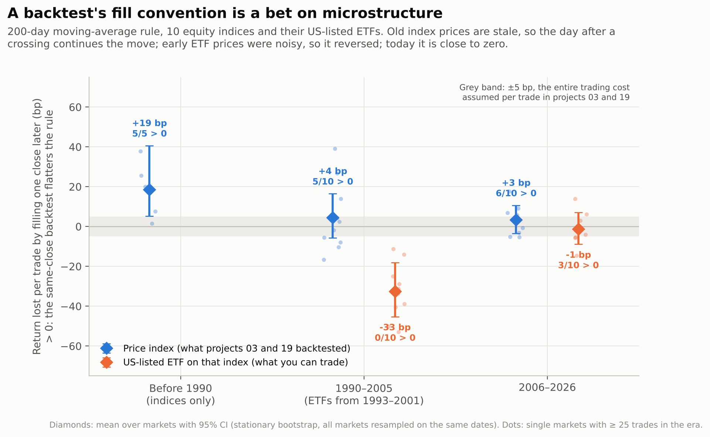
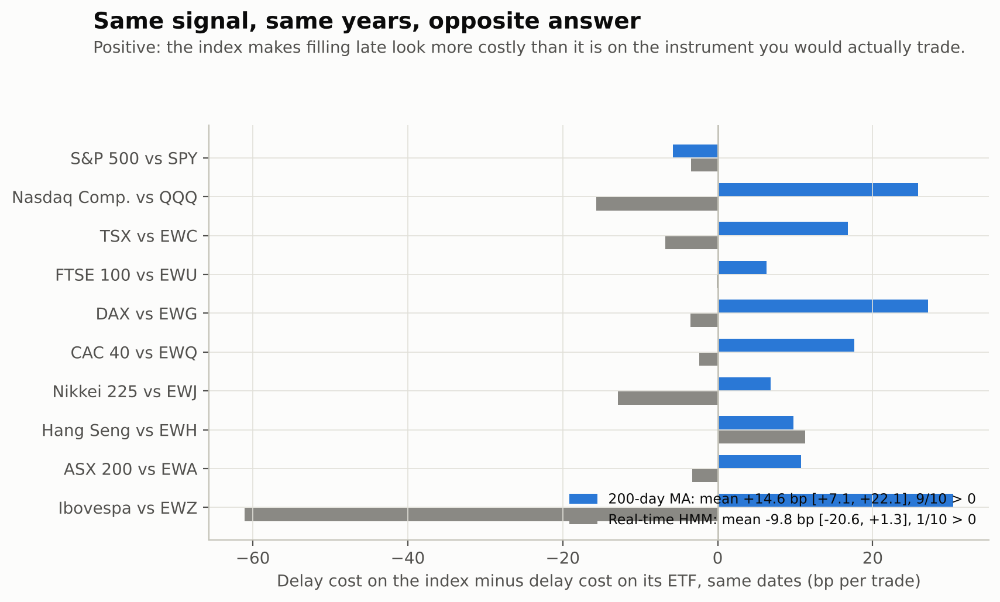
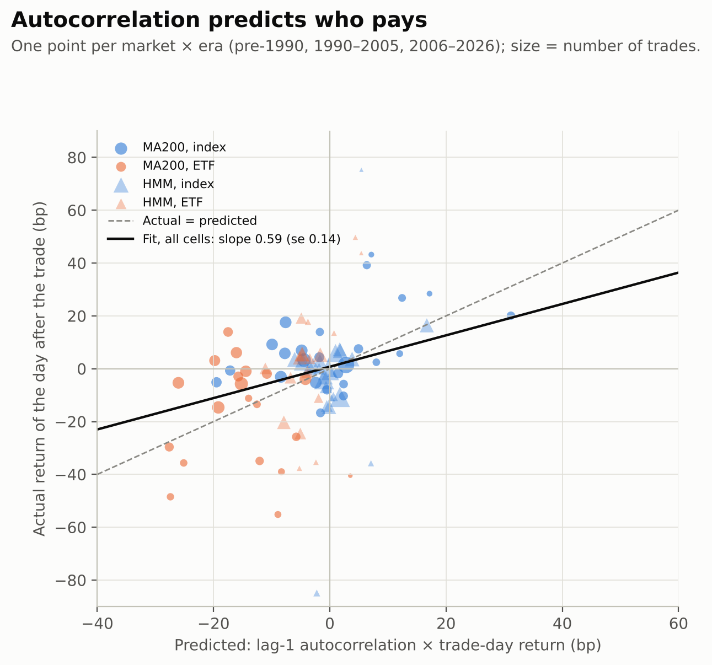
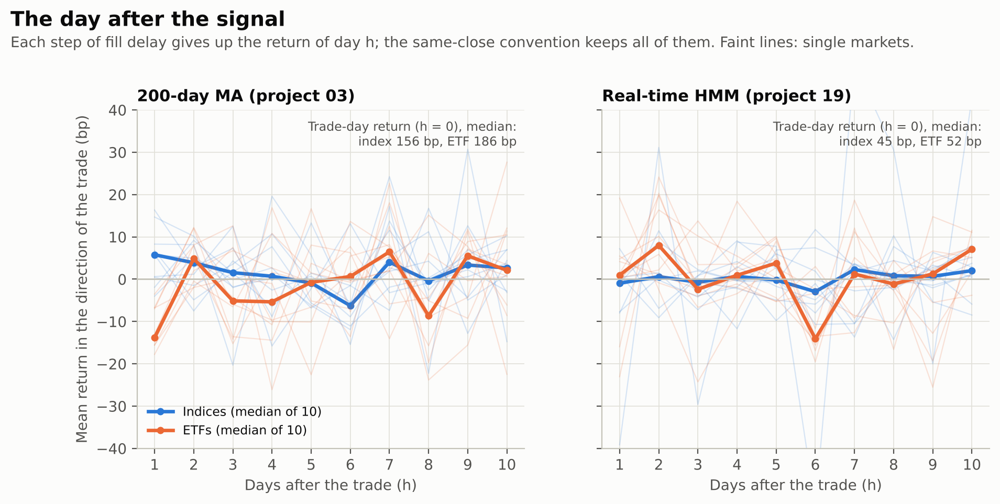
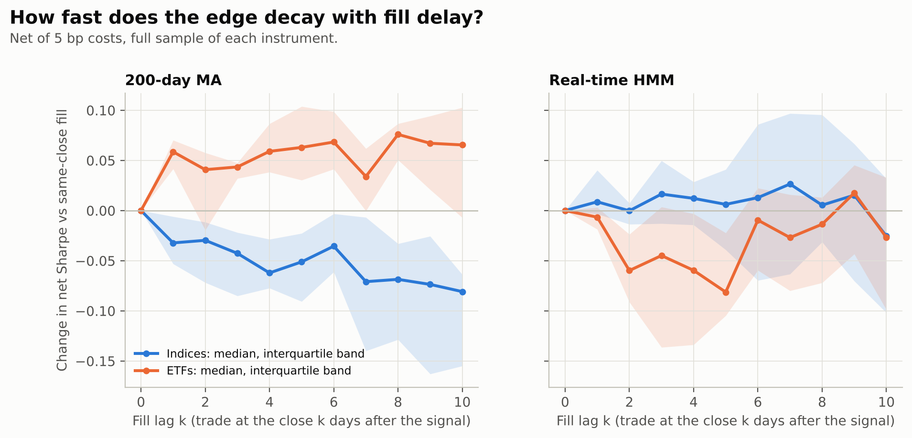
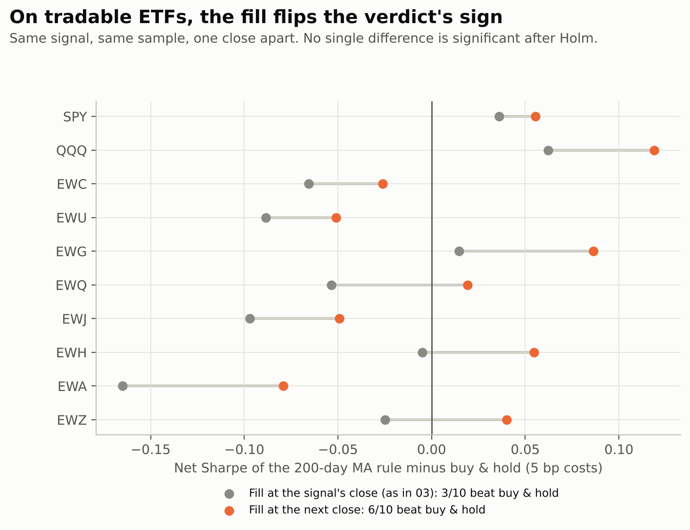
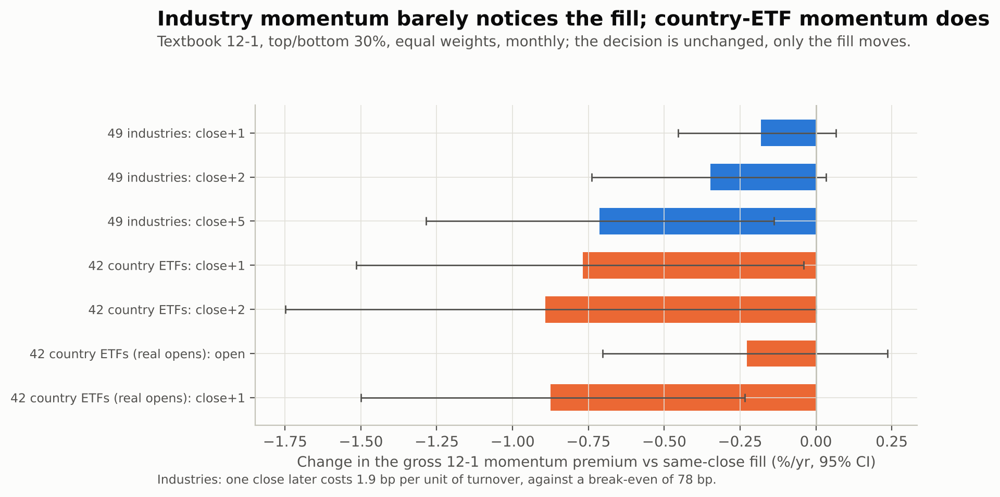

# The Day After the Signal: What One Backtest Engine Finds in Three Published Backtests

*Project 21 of 30 · Backtest engine · November 2026*

> **Headline.** Projects [03](../03-moving-average-volatility/), [12](../12-momentum-trading-costs/) and [19](../19-hmm-regime-hindsight/) each wrote their own backtest, and all three made the same silent choice: a trade fills **at the close the signal was computed from**. I rebuilt the three strategies on one engine that separates the *decision* from the *fill*, checked that it reproduces their published numbers (project 03's Sharpe ratios to four decimals in 10 of 10 indices), and then moved only the fill. For the 200-day moving-average rule, filling one close later is worth exactly the return of the first day after each trade. On the **price indices** that 03 and 19 used, that day continues the move before 1990: filling late costs **+19 bp per trade** (95% CI 5 to 41, 5 of 5 indices), four times the whole 5 bp cost those projects assumed. On the **US-listed ETFs** you would actually trade, the same day *reversed* in 1993–2005: filling late **earns 33 bp per trade** (CI 18 to 45; filling late helped in all 10 ETFs). Over the same dates, the index and its ETF disagree by **15 bp per trade** (CI 7 to 22, 9 of 10 pairs). Since 2006 both effects are close to zero (index +3 bp, ETF −1 bp). A cell's lag-1 autocorrelation times the return of the trade day predicts the sign: slope 0.59 (se 0.14) across 87 market-era cells. The fill moves the verdict on tradable ETFs, where the 200-day rule beats buy & hold in 3 of 10 at the same close and 6 of 10 one close later, though no single difference is significant. It does not move project 19's verdict (the real-time HMM trails buy & hold in 7 of 10 indices under every fill), because volatility, not direction, triggers its trades. Industry momentum (project 12) loses 1.9 bp per unit of turnover against a 78 bp break-even. The engine's **causality audit** passes all three real strategies and catches both planted look-ahead bugs.



---

## 1. Why this question

A backtest engine has one job that a spreadsheet cannot do: keep *what you decided* apart from *when and at what price it happened*. Most backtests fuse the two into one line, `position.shift(1) * returns`. That line hides an assumption. The signal is computed from today's close, and the trade happens at that same close.

For an ETF that is roughly feasible: a market-on-close order placed a few minutes before the bell, on a signal computed from the price at that moment. For a **price index** it is not, because you cannot trade the index. You trade a future or an ETF whose price can differ from the index print, and the index print itself may be **stale** (some of its stocks have not traded recently; see project [09](../09-beta-horse-race/) on non-synchronous trading and project [02](../02-volatility-dashboard-audit/) on stale opens).

Projects 03 and 19 tested timing rules on ten price indices back to 1928 and 1965. Project 12 tested momentum on 49 industry portfolios and 42 country ETFs. All three used the same-close fill. Each project was careful about look-ahead *in the signal* (19 is entirely about it). None of them asked whether the *fill* was innocent. That is this project's question:

**Research question.** Holding each strategy's decisions fixed, how much do the conclusions of projects 03, 12 and 19 depend on when the engine assumes the trade fills? Where they do, what mechanism decides the sign?

**Hypotheses** (written after a first exploratory pass on the S&P 500 and Nasdaq moving-average rule, before any ETF, HMM, momentum or era-split result was computed; I disclose this because it makes H1 partly in-sample):

* **H1 (stale indices).** On price indices with positive lag-1 autocorrelation, the same-close fill flatters a trend rule: filling one close later costs a positive amount per trade.
* **H2 (tradable instrument).** On the ETF that tracks the same index, over the same dates, that cost is smaller or negative.
* **H3 (mechanism).** The per-trade delay cost is predicted, to first order, by the lag-1 autocorrelation times the trade-day return (in the direction of the trade). So rules whose trades are triggered by direction (MA200) are exposed and rules triggered by volatility (HMM) much less.
* **H4 (slow signals).** A monthly cross-sectional signal (12-1 momentum) is insensitive: its delay cost per unit of turnover is a small fraction of its break-even cost.

## 2. Data

| Set | What | Period | Source | Status |
|---|---|---|---|---|
| Indices | S&P 500, Nasdaq Composite, TSX, FTSE 100, DAX, CAC 40, Nikkei 225, Hang Seng, ASX 200, Ibovespa (price, OHLC) | 1928–2026 (each from its first date; Ibovespa from 1995) | Yahoo Finance, pulled 2026-11-23 through a browser (`src/fetch_yahoo_browser.js`), cut at 2026-11-20 | Same indices as 03 and 19, **on purpose**: the point is to re-run their studies. New here: the open |
| ETFs | SPY, QQQ, EWC, EWU, EWG, EWQ, EWJ, EWH, EWA, EWZ (one per index; OHLC + dividend-adjusted close) | 1993/1996/1999–2026 | Yahoo; QQQ new, the others copied from 12's universe B | Deliberate overlap with 12, cross-linked |
| Industries | 49 Fama-French industries, daily excess returns | 1926–2026-09 | copied from 12 (universe A, from 09) | Deliberate overlap |
| Country ETFs | 42 single-country ETFs (12's universe B) | 1996–2026-10 | copied from 12 | Deliberate overlap |
| Cash | 13-week T-bill (^IRX) for US instruments and all ETFs from 1960; zero before 1960 and for foreign indices, as in 03 and 19 | | Yahoo | |
| Published numbers | the result CSVs of 03, 12 and 19 (`data/published_results.csv`) | | this monorepo | for §4.1 only |

Indices are price indices (no dividends), exactly as in 03 and 19. ETFs use total returns. QQQ tracks the Nasdaq-100, not the Composite; I keep it as the closest tradable proxy and flag it.

**Opens.** Yahoo's "open" for an index or an early ETF is often a copy of a close. `real_open_mask` keeps an instrument's open only from the first trailing year in which at least 80% of opens differ from both the same day's close and the previous close. For indices, even real opens are partly stale (the first print is computed before many stocks have traded; project 02), so the *next-open* fill is used only on ETFs.

## 3. The engine

`src/engine.py` (≈200 lines, no dependencies beyond numpy/pandas).

**Decision.** A strategy outputs target weights dated at a close, computed from data up to that close. The engine never sees how. **Fill.** An explicit argument: `close` (the signal's own close), `open` (next open) or `close+k` (the close *k* days later). **Accounting.** Each day splits into an overnight piece (close → open, where dividends go ex) and an intraday piece (open → close). Holdings before an open fill earn the overnight piece and holdings after it earn the intraday piece. Weights drift between trades. Turnover is measured against drifted weights, and the cost (5 bp per unit of one-way turnover, as in 03 and 19) is charged at the fill. Returns are in an excess-of-cash frame, rf + Σ w (R − rf), so the same code runs a long/flat timing rule and a $1/$1 long-short book.

**The identity that makes the fill measurable.** For a long/flat rule,

  Σ gross return (fill at close) − Σ gross return (fill at close+1) = Σ_t Δpos_t × (R_{t+1} − rf_{t+1}),

**exactly** (`tests/test_engine.py::test_delay_identity_is_exact`, to 1e-12). Moving the fill one close later costs precisely the excess return of the first day after each trade. Divided by turnover, that is a **delay cost in bp per trade**, in the same unit as a transaction cost. Positive means the same-close backtest flatters the rule.

**Causality audit** (`src/audit.py`). A decision dated *t* may use data up to *t* only. So if the input is truncated after a cut date τ, every decision dated ≤ τ must be unchanged. The audit recomputes a strategy on truncated inputs at random cut dates and counts decisions that moved. This is stricter than perturbing the future, because it also catches code that behaves differently on a shorter sample (a full-sample z-score, a full-sample fit). It generalises project 19's "change the future" test to any strategy.

**Strategies** (`src/strategies.py`), rewritten as pure decision functions with the original parameters: **MA200** (03: long when close > 200-day SMA including today); **real-time HMM** (19, rung R3: two-state Gaussian HMM refitted every 21 days on an expanding window after 5 years, long when tomorrow's predicted turbulent probability is below 0.5; `hmm.py` copied from 19); **12-1 momentum** (12: at each month end, rank on months m−11…m−1, long the top 30%, short the bottom 30%, equal weights).

**Statistics.** Per-trade delay costs get 95% CIs from a stationary bootstrap (mean block 20 days, 2,000 draws). Averages across the 10 indices or 10 ETFs use a **joint** date bootstrap: every instrument is resampled on the same dates, so a day like 16 March 2020 that hits all of them is not counted as ten independent events. Sharpe-ratio differences use the Ledoit-Wolf HAC test. Within each family of 10 markets, p-values are Holm-adjusted, and counts get a sign test.

## 4. Does the engine tell the truth?

### 4.1 It reproduces the three projects (`results/validation.csv`)

| Project | Quantity | Engine | Published | Gap |
|---|---|---|---|---|
| 03 | MA200 gross Sharpe, 10 indices | identical in 10/10 | | < 0.00005 |
| 03 | MA200 net Sharpe, 10 indices | | | −0.0002 to −0.0011 |
| 19 | real-time HMM net Sharpe, 10 indices | | | ≤ 0.002 in 9/10; ASX +0.005 |
| 12 | 12-1 on 49 industries: gross premium | 7.77 %/yr | 7.72 %/yr | +0.06 |
| 12 | … gross Sharpe (monthly) | 0.599 | 0.594 | +0.005 |
| 12 | … turnover per month | 0.836 | 0.836 | −0.001 |

The 03 net gap comes from one bookkeeping choice: 03 books the cost on the day after the trade, and this engine books it at the fill, compounded. The 19 gap comes from a price file that runs three days longer, so the HMM refits see slightly different data. The 12 gap comes from assets that drop out of the universe: 12 freezes their drifted weight, and this engine sets it to zero at the next rebalance. Every gap is at least 50 times smaller than the effects below.

### 4.2 The causality audit (`results/audit.csv`)

| Strategy | Expected | Decisions checked | Changed | Verdict |
|---|---|---|---|---|
| MA200 (03) | causal | 18,373 | 0 | pass |
| Centred MA200 (planted bug, `center=True`) | look-ahead | 18,670 | 297 (1.7%) | **caught** |
| Real-time HMM (19) | causal | 15,190 | 0 | pass |
| Smoothed HMM (19's rung R1) | look-ahead | 18,967 | 261 (2.3%) | **caught** |
| 12-1 momentum (12) | causal | 49,539 | 0 | pass |

Three cut dates each, S&P 500 1995–2026 and the industries 1990–2026. Momentum decides on the last trading day of the month, which the exchange calendar fixes in advance, so it is audited at its own decision dates.

So the signals of 03, 12 and 19 are clean. What the engine adds is the fill.

## 5. Results: moving only the fill

### 5.1 The 200-day rule: indices against ETFs (`results/pooled.csv`, `delay.csv`, `paired_gap.csv`)

Per-trade cost of filling one close later, mean over 10 instruments, joint-bootstrap 95% CI:

| Instruments | Sample | bp per trade | 95% CI | Instruments > 0 |
|---|---|---|---|---|
| 10 indices | each index's full sample | **+5.2** | −0.2 to +10.4 | 8/10 |
| 10 ETFs | each ETF's full sample | **−11.4** | −18.7 to −4.3 | **0/10** (sign p = 0.002) |
| 10 ETFs, next **open** instead | ETF dates with real opens | **−7.1** | −13.0 to −1.4 | 1/10 |
| Index minus its ETF, same dates | 1993–2026 | **+14.6** | +7.1 to +22.1 | 9/10 (sign p = 0.02; bootstrap p < 0.001) |

No single market is significant after Holm: one market's CI is ±15 to ±25 bp, because a 200-day rule trades only 6–10 times a year. The evidence is in the cross-section. Every ETF has a negative point estimate, and in 9 of 10 pairs the index makes late filling look worse than its own ETF does over the same dates (fig. 4).



### 5.2 By era (`results/era_pooled.csv`, star chart)

| | Before 1990 | 1990–2005 | 2006–2026 |
|---|---|---|---|
| Indices | **+18.5** [5.3, 40.6], 5/5 | +4.4 [−5.7, 16.5], 5/10 | +3.3 [−3.5, 10.7], 6/10 |
| ETFs | — | **−32.6** [−45.2, −18.1], 0/10 | −1.2 [−8.8, 7.2], 3/10 |

The full-sample numbers in §5.1 average over regimes that point in opposite directions. Before 1990, index prices were stale. The Nasdaq Composite had a lag-1 autocorrelation of +0.30 and the TSX +0.21 (`results/mechanism.csv`), so the day after a crossing kept going and a same-close fill captured that drift, which no one could actually trade. The young ETFs of 1993–2005 traded thinly, around a NAV set by markets that were often closed (project [11](../11-pairs-trading/) on premiums and discounts to NAV). Their lag-1 autocorrelations were negative in 9 of 10 (−0.04 to −0.15; EWZ +0.01), and the day after a crossing reversed. Since 2006 both are close to zero, and the fill convention costs or earns less than the 5 bp cost.

**Read it this way:** the longer the history a backtest uses, the more its fill convention matters, and the sign depends on whether the series is an untradable average (stale, momentum-like) or a thinly traded instrument (noisy, reverting).

### 5.3 The mechanism (`results/mechanism.csv`, `mechanism_fit.csv`)

If tomorrow's return projects linearly on today's, E[R_{t+1} | R_t] ≈ ρ₁ R_t, then the delay cost per trade ≈ ρ₁ × (trade-day return in the direction of the trade). I computed both sides in 87 cells (20 instruments × up to 3 eras × 2 strategies, at least 15 trades and 3 years per cell) and regressed actual on predicted, weighting by trades, with HC1 errors:

| Cells | Slope (se) | Intercept (se) | Weighted R² |
|---|---|---|---|
| All 87 | **0.59 (0.14)** | 0.8 (1.3) | 0.12 |
| MA200, 45 | 0.67 (0.16) | 2.9 (2.1) | 0.20 |
| HMM, 42 | 0.63 (0.34) | −0.2 (1.7) | 0.05 |



The slope is clearly positive and the intercept is zero, but the slope is below 1. Two reasons, both expected. First, ρ₁ in a cell is estimated with error, which attenuates the slope (errors in variables, project 09). Second, the projection is linear while crossings happen on large, unusual days. The R² is low because a cell's actual delay cost has a standard error of 5–15 bp. The mechanism **predicts the sign and roughly the size. It does not predict each cell.**

It also explains which strategies care. The median trade-day return in the direction of the trade is **156 bp** (indices) and **186 bp** (ETFs) for MA200, and only **45–52 bp** for the HMM (fig. 2, h = 0). A moving-average crossing happens *because* of a big directional move. A regime switch happens because of a big move *in either direction*, so it carries a third of the directional exposure. The prediction for the HMM is therefore small, and so is the result. Its per-trade delay cost is −0.7 bp on ETFs (CI −10.4 to +8.9) and −4.6 bp on indices (CI −12.5 to +2.4), with no consistent sign. The one exception is −8.8 bp on indices since 2006 (CI −17.9 to −0.1, p = 0.05, 5/10 positive), which is borderline and has no sign consistency. I do not read it as an effect.



The day-after profile also shows that **only day 1 is systematic**. From day 2 on, the medians move around zero by ±5–10 bp with no consistent shape. So the fill convention is a one-day microstructure effect, not slow information that a lagged trade misses.

### 5.4 Delay curves (`results/delay_curve.csv`)



Net Sharpe against fill lag *k* = 0…10 closes. MA200 on indices: median −0.03 at *k* = 1, drifting to −0.08 at *k* = 10. MA200 on ETFs: median **+0.06** at *k* = 1, staying between +0.03 and +0.08. HMM: within ±0.06 throughout, with no trend.

## 6. What changes in the three projects

### 6.1 Project 03 and 19's verdicts against buy & hold (`results/claims.csv`, `claims_summary.csv`)

Net Sharpe of the rule minus buy & hold, 5 bp costs:

| Rule, instrument | Same close (as published) | Next close | Next open (ETFs, same sample) |
|---|---|---|---|
| MA200, indices | median +0.080, 7/10 beat B&H | +0.061, 7/10 | — |
| MA200, ETFs | median −0.039, **3/10** | +0.030, **6/10** | −0.034 → +0.019, 3/10 → 6/10 |
| Real-time HMM, indices | median −0.063, 3/10 | −0.054, 3/10 | — |
| Real-time HMM, ETFs | median −0.050, 2/10 | −0.020, 2/10 | −0.050 → −0.036, 2/10 → 2/10 |

None of the individual differences in `claims.csv` is significant after Holm.



* **Project 03** ran on indices, where the same-close fill gives the rule a small tailwind (+0.02 Sharpe in the median). Its verdict there is unchanged: 7/10 either way. On the instruments you would actually trade, the published convention points the wrong way. It makes the 200-day rule *look worse* than a realistic fill would, and the count of markets where it beats buy & hold flips from 3/10 to 6/10. Project 03's main finding, that the rule's edge is a risk forecast and not a return forecast, does not depend on this: both counts are well short of significant.
* **Project 19's** conclusion that the real-time HMM trails buy & hold (7/10 indices) survives every fill and both instrument types. §5.3 explains why it is robust.

### 6.2 Project 12's momentum (`results/momentum.csv`)

| Universe | Fill | Gross premium (%/yr) | Change vs same close (95% CI) | Delay cost per unit turnover | Break-even (bp) |
|---|---|---|---|---|---|
| 49 industries, 1927–2026 | close | 7.77 | — | — | 77.5 |
| | close+1 | 7.60 | −0.18 (−0.45, +0.07) | **1.9 bp** | 75.8 |
| | close+2 | 7.42 | −0.35 (−0.74, +0.03) | 3.6 bp | 74.0 |
| | close+5 | 7.06 | −0.71 (−1.29, −0.14) | 7.4 bp | 70.2 |
| 42 country ETFs, 1997–2026 | close | 1.41 | — | — | 12.4 |
| | close+1 | 0.59 | **−0.77 (−1.51, −0.04)** | 6.7 bp | 5.2 |
| same, real-open dates (2001–) | open | −0.42 | −0.23 (−0.70, +0.24) | 2.0 bp | — |



**H4 holds for industries.** One close later costs 1.9 bp per unit of turnover, 2.4% of the break-even, and the CI includes zero. Project 12's break-even conclusions stand. Country-ETF momentum, which 12 already found had no reliable premium, loses half of what little it had by filling one close later, and the CI just excludes zero. Its sign is the opposite of MA200 on the same ETFs, as it should be. A cross-sectional winner bought at the close keeps drifting up for a day relative to the losers (positive cross-serial dependence), while a single ETF crossing its own moving average tends to bounce back.

## 7. Robustness and stress windows

**Stress windows** (`results/stress.csv`; GFC 2008-09-01 to 2009-03-31, COVID 2020-02-19 to 2020-04-30, inflation 2022-01-03 to 2022-10-31). The fill effect is **not** a crisis phenomenon. For MA200, the cumulative delay P&L (close vs close+1) averages +0.1% in the GFC, −0.8% (indices) and +0.2% (ETFs) in COVID, and +1.5% / +1.3% in 2022, all within ±10% in every single market. In the first two windows the rule left the market early and made few trades afterwards. For the HMM, the window means range from −3.5% to +4.6% with no consistent sign. The pre-1990 and 1993–2005 effects in §5.2 come from ordinary days, not from a few crashes.

**Next open versus next close.** On ETFs the next-open fill keeps about 60% of the next-close effect (−7.1 vs −11.4 bp per trade). The rest of the reversal happens overnight, before the next open.

**Cost assumption.** All Sharpe numbers are net of 5 bp. Delay costs are gross and in bp per trade, so they can be set directly against any cost assumption: the pre-1990 index effect (+19 bp) is four times it, and the 1993–2005 ETF effect (−33 bp) is six times it with the opposite sign.

**Ablation of the engine.** Each of the engine's choices is checked by a unit test that isolates it (`tests/test_engine.py`, 10 tests): buy & hold equals the asset's own return, a flat book earns cash, an open fill equals a close fill when the open equals the previous close, an open fill splits overnight and intraday correctly, drift is not counted as turnover, costs are exact, changing the future does not change the past, and the audit separates causal code from a centred window.

## 8. Limitations

* **Era boundaries.** 1990 and 2006 were fixed in the first exploratory pass (on two US indices), before any ETF or era result. They are round numbers, not estimated breakpoints. Other cuts would move the numbers. They should not reverse the before-1990 index result (5/5) or the 1993–2005 ETF result (0/10), but I have not tested that.
* **H1 is partly in-sample.** The exploratory pass that suggested it used the S&P 500 and Nasdaq. The confirmatory evidence is the other eight indices, the ETFs, the paired test and the mechanism regression.
* **The ETF is not the index.** QQQ tracks the Nasdaq-100. The foreign ETFs trade during US hours, asynchronously with their home markets, so the ETF's "day after" includes information the index sees on a different calendar day. The paired gap compares *the instrument a US investor trades* with *the series the projects backtested*, which is the comparison that matters for an investor. It is not a clean test of stale prices alone.
* **Same-close is not impossible.** On liquid ETFs, a market-on-close order placed on a signal computed a few minutes before the bell approximates it. I have no intraday data to measure how often a 15:50 signal differs from the close signal. The next-open and next-close fills bracket the realistic cases. A fill at an intraday VWAP is not modelled.
* **Few trades per market.** A 200-day rule trades 6–10 times a year, so single-market CIs are wide (±15–25 bp) and no single market survives Holm. All claims rest on cross-sectional counts and the joint bootstrap. The 1993–2005 ETF cells hold only 27–106 trades each.
* **Mechanism.** The linear prediction is a first-order approximation. It gets the sign and an attenuated slope (0.59), and it explains a small share of cell-to-cell variance.
* **Costs and dividends** follow 03 and 19: a flat 5 bp, price indices without dividends, zero cash for foreign indices. Projects 03 and 19 show these choices do not drive their results. Here they cancel out of the delay cost, which is a difference between two fills of the same rule.
* **Momentum B with opens** uses only the dates on which each ETF's open is real (from 2001), so it is a different sample from the close-fill run above it.

## 9. Referee self-review

I reviewed the draft as a hostile referee would. Points raised, and what changed:

1. *"The 'open' fill compares a shorter sample with the full-sample close fill."* True in the first draft of §6.1. The claims table now compares open with close on the **same** real-open sample (`fill = "close (open sample)"`), and the figure compares close with next close on the full sample.
2. *"Averaging per-market bootstraps treats correlated markets as independent."* Replaced with a joint date bootstrap for every across-market average (§3).
3. *"The HMM effect 'index, ETF dates' (−10.5 bp, p = 0.03) is a finding you are hiding."* Most of it is one pair: Ibovespa, with 60 HMM trades and −85 bp. Without it the mean is −2.2 bp. Eight of ten are negative, but all lie within ±8 bp and none is individually significant. It is reported in `delay_index_etf_dates.csv` and is not claimed as an effect.
4. *"The momentum title 'barely notices the fill' overstates."* Country-ETF momentum does lose half its premium. The figure title and §6.2 now say so.
5. *"Is the engine validated, or just self-consistent?"* It reproduces 03's published gross Sharpe ratios to four decimals in 10/10 indices, and 12 and 19 to within the stated, explained gaps (§4.1).
6. *"Is 'filling late earns money on ETFs' just short-term reversal?"* Yes, and that is the point: §5.3 names it and measures its strength. What is new is that it **reverses the sign** of the implementation gap relative to the index the original studies used, and that it was concentrated in 1993–2005.
7. *"Multiple testing across 2 strategies × 2 instrument types × 3 eras × 2 fills."* Holm within each 10-market family. The two headline cells (pre-1990 indices, 1993–2005 ETFs) have joint-bootstrap p = 0.04 and 0.0005 and sign counts of 5/5 and 0/10. With Holm over the 10 era-pooled tests in `era_pooled.csv`, the ETF cell survives (adjusted p ≈ 0.005) and the index cell does not (adjusted p ≈ 0.38). The pre-1990 index result should be read as consistent with H1, not as proven.

Open points a referee could still raise: estimated breakpoints instead of fixed eras, futures as the tradable instrument for the S&P 500 before 1993, and an intraday test of how far a 15:50 signal differs from the close signal.

## 10. Reproduce

```bash
pip install -r requirements.txt
./run_all.sh          # tests, HMM refits (about 6 min on 4 cores), every CSV and figure
```

`src/fetch_yahoo_browser.js` rebuilds `data/yahoo_ohlc.csv.gz` from a browser on the Yahoo origin (Yahoo blocks cloud machines). Everything else is in `data/`.

## 11. Links to other projects

* [03](../03-moving-average-volatility/) and [19](../19-hmm-regime-hindsight/): the strategies re-run here; their signal-level look-ahead checks are confirmed (§4.2).
* [12](../12-momentum-trading-costs/): break-even costs that the delay cost is compared against (§6.2).
* [11](../11-pairs-trading/): GGR's one-day wait exists for the same reason as §5.2's index effect, and its NAV premium/discount is why early ETFs reverted.
* [09](../09-beta-horse-race/) (non-synchronous trading) and [02](../02-volatility-dashboard-audit/) (stale opens): the microstructure behind the index results.
* Next: projects 22 (purged cross-validation) and 23 (deflated Sharpe). The fill is one more researcher degree of freedom that a deflated Sharpe should count.

## References

Gatev, E., Goetzmann, W. & Rouwenhorst, K. G. (2006). Pairs trading. *RFS* 19(3).
Lo, A. & MacKinlay, A. C. (1990). When are contrarian profits due to stock market overreaction? *RFS* 3(2).
Ledoit, O. & Wolf, M. (2008). Robust performance hypothesis testing with the Sharpe ratio. *JEF* 15(5).
Politis, D. & Romano, J. (1994). The stationary bootstrap. *JASA* 89(428).
Scholes, M. & Williams, J. (1977). Estimating betas from nonsynchronous data. *JFE* 5(3).
Holm, S. (1979). A simple sequentially rejective multiple test procedure. *Scand. J. Statist.* 6(2).
Bailey, D., Borwein, J., López de Prado, M. & Zhu, Q. (2014). Pseudo-mathematics and financial charlatanism. *Notices of the AMS* 61(5).
