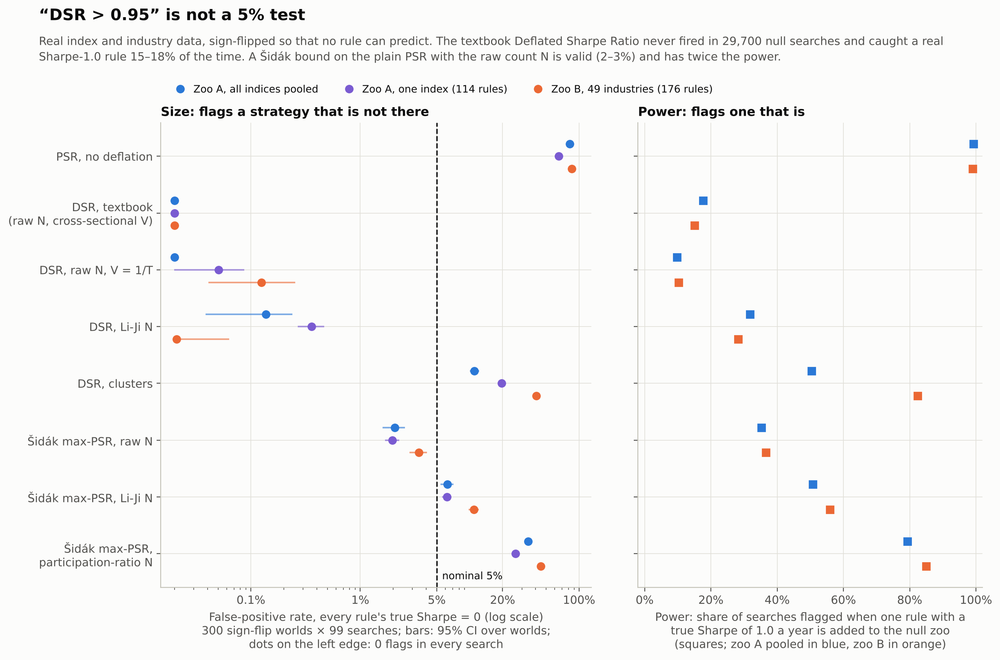
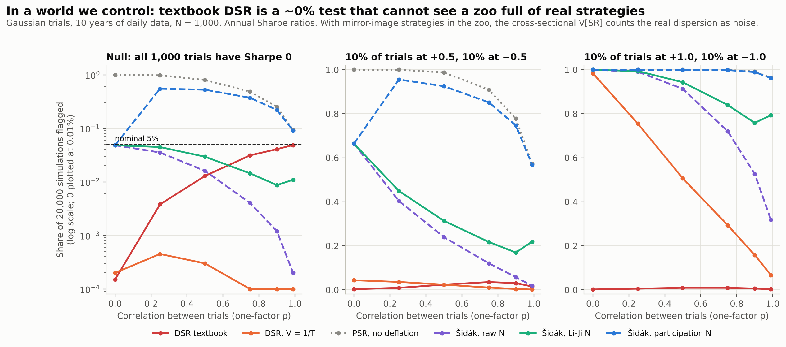
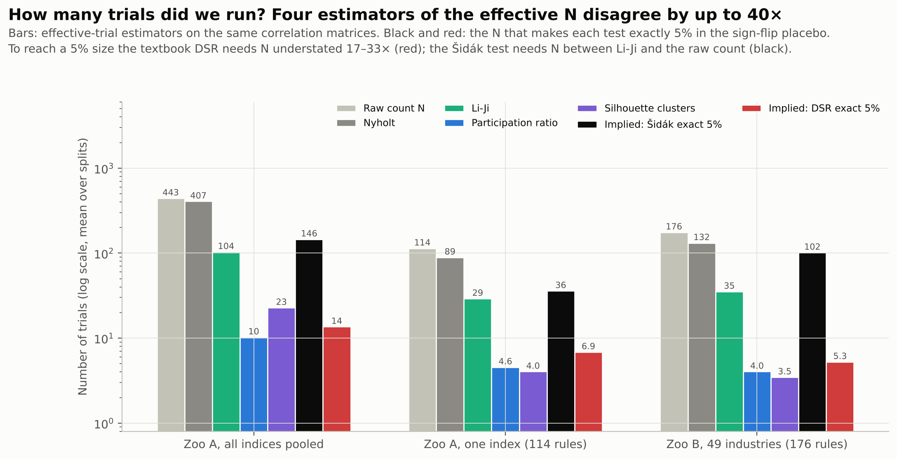
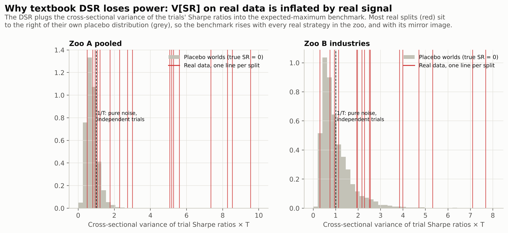
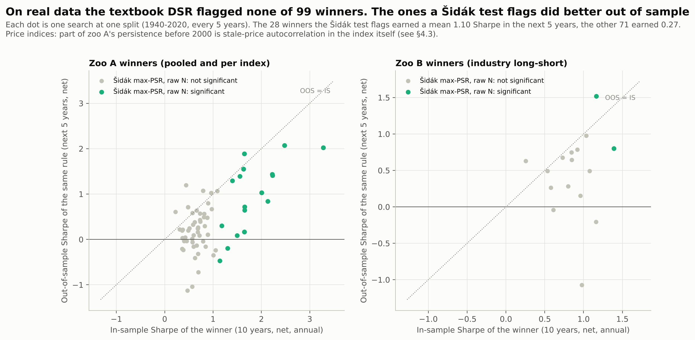
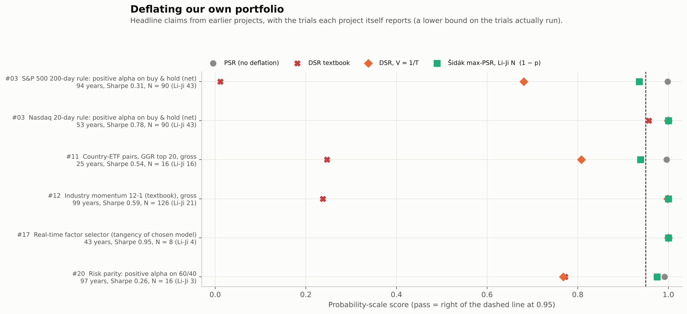

# The Deflated Sharpe Ratio Is Not a p-Value: Size, Power and an Audit of This Portfolio's Own Backtests

*Project 23 of [30 Quant Research Projects](../README.md) · a 1,316-rule strategy zoo on 10 equity indices (1928–2026, daily) and 49 US industries (1926–2026, monthly) · 300 sign-flip placebo worlds · 99 real in-sample searches with 5-year holdouts · six headline claims from projects 03–20 re-tested*

> **Headline.** The Deflated Sharpe Ratio (DSR) of Bailey & López de Prado (2014) is the standard answer to "my best backtest out of N is probably luck". In practice people read **DSR > 0.95** as "significant at 5% after correcting for N trials". **It is not a 5% test.** In 29,700 searches on real index and industry data whose returns were sign-flipped, so that every rule's true Sharpe ratio is exactly zero, the textbook DSR **never** crossed 0.95. When one rule with a true Sharpe ratio of **1.0** a year was added, the DSR found it in only **15–18%** of the searches. Two mechanisms explain this. (i) The DSR compares the winner with the *expected* maximum of N null Sharpe ratios, but it measures the gap in units of *one* strategy's standard error, so its false-positive rate is about **0.01–0.1%** even with independent trials. (ii) It estimates the noise in the trials from the cross-sectional variance of their Sharpe ratios, and that variance also contains every real strategy in the zoo and its mirror image. In a simulated zoo where 10% of the strategies have a true Sharpe ratio of 1.0, the textbook DSR flags the best one **0–1%** of the time. A simple fix works better: compare the winner's PSR with a Šidák bound, 0.95^(1/N). With the raw count N its size is **2.0–3.4%** (valid) and its power is about **twice** the DSR's (35–37%). On the real data the textbook DSR flagged **none of 99** in-sample winners, from 1940 to 2020. The 28 that the Šidák test flagged earned a mean out-of-sample Sharpe ratio of **1.10** over the next five years, against **0.27** for the rest (difference +0.83, 95% CI [+0.53, +1.12]). Run on this portfolio, a valid multiple-testing bound **keeps** industry momentum (#12), the real-time factor selector (#17) and the Nasdaq short-average rule (#03, a stale-price effect). It **does not keep** the S&P 500 200-day rule's alpha (#03, p = 0.13), country-ETF pairs (#11, p = 0.06) or risk parity's alpha over 60/40 (#20, p = 0.13).



---

## 1. Question

Every project in this portfolio reports a "best" configuration out of several. The honest question is how much of that Sharpe ratio is selection. Bailey & López de Prado (2014) give the most cited answer. The **Probabilistic Sharpe Ratio** (PSR) is the probability that the true Sharpe ratio exceeds a benchmark $SR^*$:

$$\mathrm{PSR}(SR^*) = \Phi\!\left(\frac{(\widehat{SR}-SR^*)\sqrt{T-1}}{\sqrt{1-\hat\gamma_3\widehat{SR}+\frac{\hat\gamma_4-1}{4}\widehat{SR}^2}}\right)$$

The **Deflated Sharpe Ratio** sets the benchmark to the Sharpe ratio you would expect from the best of $N$ worthless strategies (the "False Strategy Theorem"):

$$SR_0=\sqrt{V[\widehat{SR}_n]}\Big((1-\gamma)\Phi^{-1}(1-\tfrac1N)+\gamma\,\Phi^{-1}(1-\tfrac1{Ne})\Big),\qquad \mathrm{DSR}=\mathrm{PSR}(SR_0),$$

Here $V[\widehat{SR}_n]$ is the variance of the trials' Sharpe ratios, taken across the trials, and $\gamma$ is Euler's constant. The paper and most practitioners then read $\mathrm{DSR}>0.95$ as a rejection of "the winner is luck" at 5%. Two inputs are left to the user: $N$ (independent trials, which nobody records honestly) and $V$.

**Research question.** Is "DSR > 0.95" a 5% test? On real return data with realistic correlation between trials, how often does it flag a winner that is not there (size), and how often does it find one that is (power)? Which choice of $N$ and $V$ fixes it, if any? And on this portfolio's own published results, which claims survive a test that does have the right size?

**Hypotheses.** I wrote these down after the Gaussian simulation in §4.1 and a first pass over the real-data searches, and before the placebo worlds, the reality check and the audit were run. H3 is therefore not a clean out-of-sample prediction: I had seen the real winners' DSR values and their raw OOS Sharpe ratios, but not how any test sorted them.

* **H1 (size).** With the textbook inputs (raw $N$, cross-sectional $V$), the false-positive rate of "DSR > 0.95" on real-data placebos is far below 5%.
* **H2 (power).** Because the cross-sectional $V$ includes real dispersion between strategies, the textbook DSR loses most of its power in zoos that contain real strategies. A Šidák bound on the PSR with a valid $N$ has more power at the same or smaller size.
* **H3 (out of sample).** On real data, the winners a correctly sized test flags do better over the next five years than the winners it does not flag.
* **H4 (audit).** At least one headline claim of projects 03–20 does not survive a correctly sized multiple-testing bound with the trial count that the project itself reports.

**Why it matters.** Project [03](../03-moving-average-volatility/) applied Romano-Wolf within a 9-rule grid. Project [11](../11-pairs-trading/) showed that cointegration screens produce false positives. Project [17](../17-five-factor-holdout/) measured a Sharpe-ratio haircut on a real holdout. This project asks which of the portfolio's claims survive the most popular single-number correction, and whether that number deserves its popularity.

## 2. Data

| Panel | Source | Sample | Frequency | Rules |
|---|---|---|---|---|
| **Zoo A.** 10 equity price indices (S&P 500, Nasdaq, TSX, FTSE, DAX, Nikkei, Hang Seng, ASX, Ibovespa, CAC) | Yahoo Finance, the file from project [03](../03-moving-average-volatility/) (pulled 2026-11-18) | 1928-01 – 2026-11 (S&P 500), later for the others | daily | 57 signals × {long/flat, long/short} = 114 per index, 1,140 in total |
| **Zoo B.** 49 Fama-French industry portfolios | Ken French data library, the file from projects [09](../09-beta-horse-race/) and [12](../12-momentum-trading-costs/) | 1926-07 – 2026-09 | daily, compounded to monthly | 11 lookbacks × 2 skips × 4 breadths × {momentum, reversal} = 176 |

I reuse both files on purpose. Project 03 asked what the 200-day rule knows, and project 12 asked what industry momentum costs. Here both universes become the hunting ground for a researcher who tries everything. Index returns are in excess of the T-bill for the US indices (the Fama-French daily RF, then ^IRX after 2026-09) and of zero for the others, as in project 03. Ibovespa starts in 1995, after the hyperinflation years. Every stress window falls inside an out-of-sample window: 2008 (in 2006–10), 2020 (in 2016–20) and 2022 (in 2021–26).

**Zoo A rules.** These are evaluated at each close and traded on the next day, with 5 bp per unit change in position (`src/zoo.py`). They include price above its 5–300-day moving average (12 rules), 19 fast/slow crossovers, time-series momentum over 5–504 days (10), position in the 20–252-day channel (5), short-term reversal over 1–10 days (5), and "volatility below its own 1–2-year average" (6). **Zoo B rules** rank industries on their past 1–60-month return, with or without skipping the last month. They go long the top 3/5/7/10 and short the same number at the bottom, or the reverse, are rebalanced monthly, and pay 10 bp per unit of one-way turnover.

## 3. Design

**Searches and splits.** A *search* is one comparison of trials that a researcher might make: all eligible zoo-A trials pooled (up to 1,140), the 114 trials of one index, or the 176 industry trials. The in-sample (IS) window is the 10 calendar years ending in December of $Y$, for $Y = 1940, 1945, \dots, 2020$. The out-of-sample (OOS) window is the following 5 years (2021–2026-11 for the last split). A trial enters a search only once it has 600 trading days (61 months) of history before the IS window begins. That gives 17 pooled A searches, 66 single-index searches and 16 industry searches: **99 real searches**. The winner is the trial with the highest IS Sharpe ratio.

**The deflation methods** (`src/dsr.py`, `src/analyze.py`). Each one decides whether the winner is real at a nominal 5% level:

| Method | $N$ | $V$ | Decision |
|---|---|---|---|
| PSR, no deflation | 1 | – | PSR(0) > 0.95 |
| **DSR textbook** | raw count | variance of the trials' Sharpe ratios, across trials | DSR > 0.95 |
| DSR, null $V$ | raw count | $1/T$ (the null variance of one Sharpe estimate) | DSR > 0.95 |
| DSR, Li-Ji $N$ | Li & Ji (2005) eigenvalue count | cross-sectional | DSR > 0.95 |
| DSR, clusters | $K$ clusters (average linkage on $\sqrt{(1-\rho)/2}$, $K$ chosen by silhouette, López de Prado 2019) | variance of the cluster Sharpe ratios | DSR > 0.95 |
| **Šidák max-PSR** | raw, Li-Ji, Nyholt (2004), participation ratio $(\sum\lambda)^2/\sum\lambda^2$, or $K$ | – | PSR(0) > 0.95^{1/N} |
| **Reality check** (real data only) | – | – | the winner's IS Sharpe beats the 95th percentile of the best IS Sharpe in 200 drift-preserving sign-flip worlds |

The Šidák max-PSR test is the obvious alternative. If the trials were independent, $\max_n \mathrm{PSR}_n > 0.95^{1/N}$ would occur with probability exactly 5% under the null. With positively correlated trials it is conservative (Šidák 1967). It uses the same inputs as the DSR, so anyone who can compute a DSR can compute it.

**Part 0: a world we control** (`src/synthetic.py`). This part has Gaussian trials, $T = 2{,}520$ days, $N\in\{100, 1000\}$ and one-factor correlation $\rho\in\{0,\dots,0.99\}$. The null has every Sharpe ratio at 0. The "signal-rich" alternative has 10% of the trials at $+\mu$ and 10% at $-\mu$ (a strategy and its mirror image, as in any real zoo), with $\mu = 0.5$ or $1.0$ a year. There are 20,000 draws per cell.

**Part 1: placebo worlds built from the real data** (`src/run_placebo.py`). In each of 300 worlds every day's excess return is multiplied by one random sign, common to all 10 indices, and every month's industry excess return by one sign common to all 49 industries. This keeps the volatility path, the fat tails and the cross-asset correlation of the real data exactly. Because the sign of tomorrow's return is independent of everything before it, **every rule's true Sharpe ratio is exactly zero** (gross of costs). The rules, the correlation between trials and the clustering are all recomputed in each world. That makes this a test of the DSR *on the dependence structure a researcher actually faces*. **Power:** one extra trial is added to the null zoo, equal to the world's own S&P 500 (zoo A) or equal-weighted industry (zoo B) return plus a drift that gives it a true Sharpe ratio of 0.5, 1.0 or 1.5 a year. **Implied $N$:** the $N$ at which each test would have exactly 5% size.

**Part 2: real data** (`src/run_real.py`, `src/run_reality_check.py`). The same searches are run on the real returns, net of costs, with the winner's Sharpe ratio over the next five years. The exact benchmark is a reality check (White 2000) by sign flips that **keep each series' in-sample drift**: $x^*_t = s_t(x_t-\mu)+\mu$. Buy & hold therefore keeps its equity premium, and only the ability to predict the sign of the next return is destroyed. There are 200 worlds per split. The p-value is the share of worlds whose best IS Sharpe ratio is at least the real winner's.

**Part 3: audit** (`src/audit.py`). It covers six headline claims of projects 03, 11, 12, 17 and 20 whose null is "Sharpe = 0". Claims of the form "better than the benchmark" are tested through the strategy's alpha on that benchmark: its return minus β × the benchmark. $N$ is the number of configurations that the project's own results files report. That is a **lower bound** on the trials actually run, because design choices made before the first result was written down are not counted.

**No look-ahead.** Positions use closes up to $t$ and earn the return of $t+1$. Tests rewrite the future and check that past P&L does not change (zoo A and zoo B). Selection uses only the IS window. The OOS window is never used to choose anything. The drift-preserving reality check uses the in-sample mean only.

## 4. Results

### 4.1 Part 0: in a Gaussian world, "DSR > 0.95" is not a 5% test



With **independent** trials, $N = 1{,}000$ and every true Sharpe ratio at zero, the textbook DSR exceeds 0.95 in **0.01%** of draws (0.06% for $N = 100$). The Šidák max-PSR is at **4.8%**, as theory says. The reason is mechanical. $SR_0$ is the *mean* of the null maximum, but the DSR measures the distance to it with the standard error of *one* Sharpe ratio, $1/\sqrt T$. The maximum of $N$ Gaussians has a much smaller spread than one Gaussian (roughly $1.28/\sqrt{2\ln N}$ of it: about 0.43 for $N = 100$). Clearing $SR_0$ by 1.645 single standard errors therefore means landing almost four standard deviations of the maximum above its mean. For $N = 100$, "DSR > 0.95" is the same as $Z_{\max} > 4.15$, which is a p-value of 0.0017.

As the trials become correlated, the textbook DSR's size rises towards 5% (4.9% at $\rho = 0.99$). The DSR's real false-positive rate therefore depends on a nuisance parameter that the user never sees. It ranges from 0.01% to 5% across ordinary zoos.

The power result is the more damaging one. With 100 of 1,000 strategies at a true Sharpe ratio of **+1.0** a year (each with a t-statistic of 3.2) and their 100 mirror images at −1.0, **the textbook DSR flags the best strategy in 0.1–0.9% of draws at every $\rho$.** The PSR with no deflation flags it in 96–100%. The Šidák bound with the Li-Ji $N$ flags it in 76–100%. The cause is $V$. The cross-sectional variance of the trials' Sharpe ratios now includes $0.2\,\mu^2$ of real dispersion, so $SR_0$ climbs to roughly the winner's own Sharpe ratio. Setting $V = 1/T$ restores the power when $\rho = 0$ (98%), but it loses it again as $\rho$ rises (7% at 0.99), because the raw $N$ then overstates the number of independent bets.

### 4.2 Part 1: the same failure on real dependence (H1, H2)

| Method | Size: A pooled | A one index | B industries | Power at SR 1.0: A | B |
|---|---|---|---|---|---|
| PSR, no deflation | 82.4% | 65.2% | 85.7% | 99% | 99% |
| **DSR textbook** | **0.00%** [0, 0] | **0.00%** | **0.00%** | **17.6%** | **15.1%** |
| DSR, raw $N$, $V = 1/T$ | 0.00% | 0.05% | 0.12% | 9.7% | 10.3% |
| DSR, Li-Ji $N$ | 0.14% | 0.36% | 0.02% | 31.8% | 28.3% |
| DSR, clusters | 11.0% | 19.7% | 40.8% | 50.4% | 82.4% |
| **Šidák max-PSR, raw $N$** | **2.06%** [1.6, 2.5] | **1.97%** | **3.42%** [2.9, 4.0] | **35.2%** | **36.6%** |
| Šidák max-PSR, Li-Ji $N$ | 6.24% [5.5, 7.0] | 6.22% | 10.9% [10.0, 11.9] | 50.8% | 56.0% |
| Šidák max-PSR, Nyholt $N$ | 2.35% | 2.51% | 4.17% | 36.9% | 39.4% |
| Šidák max-PSR, participation $N$ | 34.2% | 26.3% | 44.6% | 79.4% | 85.0% |

*300 sign-flip worlds × (17 pooled + 66 single-index + 16 industry) searches = 29,700 null searches. Brackets: 95% CI from resampling worlds. Power: share of searches flagged when a rule with a true Sharpe ratio of 1.0 a year is added. That rule has the highest IS Sharpe ratio in 80% (A) and 79% (B) of the worlds, which caps any test's useful power near those values (`results/size.csv`, `results/power.csv`).*

**H1 supported.** The textbook DSR crossed 0.95 in **0 of 29,700** null searches. **H2 supported.** At the same data and the same nominal level, the Šidák max-PSR with the raw count is valid (2.0–3.4%) and has **2.0–2.4× the power** (35–37% against 15–18% at a true Sharpe ratio of 1.0; 87% against 68% at 1.5 in zoo A). With a Sharpe ratio of 0.5 a year, which is roughly what a good real strategy earns, nothing finds it reliably over 10 years. The textbook DSR finds it in 0.3–0.9% of searches.

**No count of "effective trials" rescues both the DSR and the Šidák test at once** (Figure 3, `results/implied_n.csv`). For the Šidák test to have exactly 5% size, $N$ would have to be 146 (A pooled, against a raw mean of 443), 36 (one index, against 114) and 102 (industries, against 176). These values lie between the Li-Ji count and the raw count. Li-Ji is closest for zoo A but undercounts zoo B, so its Šidák test is too liberal there (10.9%). For the **DSR** to reach 5%, $N$ would have to be understated **17–33×** (14, 6.9 and 5.3). The four estimators of the effective $N$ also disagree by up to 40× on the same correlation matrix: Nyholt is near the raw count, Li-Ji is about a quarter of it, and the participation ratio and the silhouette clusters give 4–23. The cluster-based DSR, the method López de Prado (2019) recommends, is **too liberal** (11–41%). Silhouette selection picks very few clusters (2–6 in a single-index or industry search, where it mostly splits momentum from reversal), so the max-over-clusters benchmark is set far too low.





**Mechanism (Figure 6).** In the placebo worlds, the cross-sectional variance of the trials' Sharpe ratios averages 0.7–1.0 × $1/T$: correlated trials have *less* dispersion than independent ones. On the real data it reaches up to 9.6 × $1/T$ (zoo A pooled; 19 in single-index searches) and 7.7 × $1/T$ (zoo B), because the zoo contains real winners together with their mirror images. The textbook DSR reads all of that as noise and raises its benchmark accordingly.

### 4.3 Part 2: real data, 1940–2020 (H3)



| Method (99 real searches) | Winners flagged | OOS Sharpe, flagged | OOS Sharpe, not flagged | Difference [95% CI] |
|---|---|---|---|---|
| PSR, no deflation | 83 | 0.56 | 0.20 | +0.37 [+0.08, +0.67] |
| **DSR textbook** | **0** | – | 0.50 | – |
| DSR, $V = 1/T$ | 24 | 1.24 | 0.27 | +0.97 [+0.70, +1.23] |
| **Šidák max-PSR, raw $N$** | **28** | **1.10** | **0.27** | **+0.83 [+0.53, +1.12]** |
| Šidák max-PSR, Li-Ji $N$ | 39 | 0.85 | 0.28 | +0.58 [+0.28, +0.84] |
| Reality check (drift-kept sign flip) | 22 | 1.12 | 0.33 | +0.80 [+0.45, +1.15] |

*Net of costs and annualised. CIs resample searches. The pooled, single-index and industry searches overlap in time and in trials, so the CIs are too narrow and should be read as descriptive (`results/real_summary.csv`, `results/real_decisions.csv`).*

**H3 supported, for every correctly sized test.** The textbook DSR flagged **none** of the 99 winners, not even the S&P 500 short-term rules chosen in 1960–1975, whose in-sample Sharpe ratios of 1.6–2.2 were followed by 1.0–1.9 out of sample. Every test with roughly the right size separates the future winners from the rest by about 0.6–1.0 of Sharpe ratio. Across all 99 searches, the IS Sharpe ratio of the winner predicts its OOS Sharpe ratio with a slope of 0.71 and an intercept of −0.23. The in-sample winner kept about 70 cents of each extra in-sample dollar of Sharpe ratio, minus a fixed haircut of 0.23.

**The persistence is real but mostly not tradable, and it ended around 2000.** Before 2000, 23 of 43 winners pass the Šidák test, and the winners earned a mean OOS Sharpe ratio of 0.95 (rank of the winner OOS: 79th percentile of its zoo). From 2000, 5 of 56 pass, and the winners earned 0.16, barely above the median rule (0.10, 59th percentile). The winners that passed are mostly the 5–10-day moving-average rules on the S&P 500 (1960–1980) and the Nasdaq (1985–1995). These rules exploit the positive daily autocorrelation of a price index whose small stocks traded infrequently (the stale-price effect that project [03](../03-moving-average-volatility/) found for the Nasdaq and project [02](../02-volatility-dashboard-audit/) measured with variance ratios). A correctly sized test is right that these winners are not luck. It cannot tell you that nobody could trade the index at those prices.

**Industry momentum passes the DSR-style tests but fails the reality check.** Zoo B's winners are almost always momentum rules (16/16), and they beat the median rule OOS by a mean 0.59 of Sharpe ratio. However, **0 of 16** pass the drift-preserving reality check. When each industry keeps its own in-sample mean and only the timing of its returns is randomised, ranking industries on past returns already earns as much as the real winner. In other words, most of the in-sample edge of industry momentum in a 10-year window comes from persistent differences in industries' average returns (Conrad & Kaul 1998), not from serial correlation. That is a different null from "Sharpe = 0", and only the reality check, which uses the full return data, can test it. No single-number deflator can.

### 4.4 Stress windows (2008, 2020, 2022)

| Year | Search (chosen on) | Winner | Winner's return | Zoo median | Zoo 10th–90th pct | Benchmark |
|---|---|---|---|---|---|---|
| 2008 | A pooled (1996–2005) | TSX channel-50, long/flat | −6.1% | −3.2% | −24.8% / +34.9% | S&P 500 −39.4% |
| 2008 | S&P 500 only | 378-day momentum, long/flat | −15.1% | 0.0% | −25.0% / +39.5% | −39.4% |
| 2008 | Industries | Momentum 6-1, top/bottom 10 | −2.0% | −5.5% | −25.2% / +13.9% | EW industries −39.7% |
| 2020 | A pooled (2006–15) | Nasdaq low-volatility filter | +40.2% | −2.0% | −25.7% / +25.6% | S&P 500 +15.7% |
| 2020 | S&P 500 only | 2-day reversal, long/short | −46.3% | +5.5% | −22.2% / +26.1% | +15.7% |
| 2020 | Industries | Momentum 3-1, top/bottom 3 | +73.4% | −1.1% | −45.8% / +61.8% | EW industries +20.0% |
| 2022 | A pooled (2011–20) | Nasdaq low-volatility filter | −24.2% | −10.8% | −24.1% / +4.6% | S&P 500 −20.6% |
| 2022 | S&P 500 only | Low-volatility filter (21/504) | −20.3% | −14.5% | −25.1% / −2.5% | −20.6% |
| 2022 | Industries | Momentum 2-1, top/bottom 3 | −0.9% | −3.8% | −34.2% / +38.7% | EW industries −13.6% |

*Calendar-year net excess returns (`results/stress_windows.csv`).* The in-sample winners are not crash-proof. In 2008 the selected timing rules lost far less than buy & hold, but about as much as the median rule or more (S&P 500 winner −15% against a median of 0%). In 2020 the S&P 500 winner (a 2-day reversal) lost 46%. In 2022 the low-volatility winners fell with the market. None of the 2005–2020 winners in these rows passed the raw-count Šidák test, which matches the post-2000 decay in §4.3.

### 4.5 Part 3: deflating this portfolio (H4)



| Project and claim | Years | Sharpe (ann.) | $N$ reported (Li-Ji) | PSR | DSR textbook | Šidák p, raw $N$ | Šidák p, Li-Ji $N$ | Verdict (raw $N$) |
|---|---|---|---|---|---|---|---|---|
| #03 S&P 500 200-day rule: alpha on buy & hold, net | 93.6 | 0.31 | 90 (43) | 0.998 | 0.01 | 0.13 | 0.064 | **does not survive** |
| #03 Nasdaq 20-day rule: alpha on buy & hold, net | 53.4 | 0.78 | 90 (43) | 1.000 | 0.96 | <0.001 | <0.001 | survives (stale prices, see #03) |
| #11 Country-ETF pairs, GGR top 20, gross | 24.8 | 0.54 | 16 (–) | 0.996 | 0.25 | 0.061 | – | **does not survive** (borderline) |
| #12 Industry momentum 12-1, gross | 98.8 | 0.59 | 126 (21) | 1.000 | 0.24 | <0.001 | <0.001 | survives |
| #17 Real-time factor selector (tangency) | 42.8 | 0.95 | 8 (4) | 1.000 | 1.00 | <0.001 | <0.001 | survives |
| #20 Risk parity: alpha on 60/40 | 97.3 | 0.26 | 16 (3) | 0.992 | 0.77 | 0.13 | 0.025 | **does not survive** with raw $N$ |

*`results/audit.csv`. Šidák p = $1-\mathrm{PSR}^N$. #11's moments are taken as normal because only summary rows are available, and its Li-Ji count could not be computed.*

**H4 supported.** Three of the six claims fail a correctly sized bound with the projects' own trial counts. Each of those projects already flagged its claim as fragile. Project 03 found that the S&P 500 return gain is concentrated before 1992. Project 11 reported only +0.44% a year net (t = 0.9). Project 20's full-sample Sharpe-ratio difference had p = 0.46. The audit makes that fragility quantitative. Two observations are uncomfortable for the textbook DSR:

* The textbook DSR fails **#12's industry momentum** (0.24), one of the most replicated anomalies in finance, observed here over 99 years. It does so because the 126 trading designs of #12 contain both fast and slow signals, so their Sharpe ratios are widely dispersed and $V$ is 6.6 × $1/T$. Every valid test passes it with p < 0.001.
* The textbook DSR **passes** the Nasdaq 20-day rule (0.96). Project 03 had already shown that this rule exploits stale index prices. No statistical deflator can see that; only economics can.

**Minimum track records.** With its Li-Ji count, the S&P 500 200-day alpha (Sharpe 0.31) would need **99 years** to pass the Šidák bound, and risk parity's alpha (0.26) would need 77. The record would have to be roughly as long as the history of the index for a Sharpe ratio of 0.3 to survive a search over a few dozen variants.

## 5. Robustness and checks

* **Tests (9 pass, `tests/test_dsr.py`).** The expected-maximum formula matches simulation within 3% (N = 10, 100, 1,000). The Mertens standard error matches simulation for Gaussian and Student-t(5) returns. The test of DSR size at 1/100 of nominal and of Šidák at exactly 5% reproduces the paper's first result in miniature. The effective-$N$ estimators have the right limits ($N$ for the identity matrix, 1 for perfect correlation). The clustering recovers three planted blocks. The minimum track record inverts the PSR. Zoo A and zoo B have no look-ahead (rewriting the future leaves the past unchanged). Sign flipping removes every rule's mean, even on a strongly trending series.
* **Common sign versus independent signs.** One sign per day across all indices keeps the cross-index correlation of the trials. Drawing independent signs per index would destroy it and make the pooled search look more independent than any real one.
* **Gross versus net in the placebo.** Size and power use gross returns, where the true Sharpe ratio is exactly zero. Costs would make every true Sharpe ratio negative and the tests look more conservative still.
* **Searches by period.** The textbook DSR is at 0% in every split of every zoo. The Šidák raw-$N$ size stays between 0.7% and 5.3% in every split of the pooled A and industry searches (300 worlds per split, `results/placebo_searches.csv.gz`).
* **Trial counts in the audit.** If the true number of trials were double the reported count, the Šidák p-values of the three surviving claims would stay below 0.001, and the three failing claims would fail more clearly (p = 0.12–0.24).

## 6. Limitations

* **The null is "no predictability of the sign".** The sign-flip worlds also make the return distribution symmetric, so negative skewness (short-volatility-like rules) is not stress-tested. A placebo that keeps skewness would need a different construction (for example, flipping signs of deviations from a skewed location). Strategy returns can still be skewed in the placebo (the winners' skewness has a median of +0.3 there, against −0.17 on real data, interquartile range −0.41 to +0.15). The PSR's skewness term is small at daily Sharpe ratios, so this matters little for zoo A, but a fat negative tail is not stress-tested.
* **Effective $N$ needs the trials' returns.** Li-Ji, Nyholt and the clusters were computed on the in-sample correlation matrix of the actual trial returns. Most published backtests report a count at best. That is why the recommendation in §8 is the raw count with Šidák.
* **Price indices and stale prices.** Zoo A uses price indices without dividends, and before about 1990 their daily returns are autocorrelated because small stocks traded rarely. This inflates the persistence of short-term rules on real data (§4.3) but does not affect the placebo results, where the sign flip removes all autocorrelation.
* **No local cash rate outside the US**, and no futures before 1982: the zoo-A rules could not have been traded at those prices. The project tests statistical procedures, not tradable strategies.
* **Overlapping searches.** The 99 real searches share years and trials (the S&P 500 search is the pooled search until 1960). Their CIs treat them as independent and are too narrow. The placebo CIs resample whole worlds and are valid.
* **A finite zoo.** 1,316 rules is a lower bound on what researchers try. Larger, more heterogeneous zoos would make the cross-sectional $V$ more contaminated and the textbook DSR more conservative still.
* **Multiple testing within this project.** Ten methods × three zoos are compared. The headline comparisons (textbook DSR against Šidák raw $N$) were fixed in advance after Part 0. The cluster and participation-ratio variants and the reality check were added for completeness. Their conclusions are labelled with that in mind and none of the headline numbers depends on them.

## 7. Referee-style self-review: what it changed

I reviewed the first complete draft as a referee would, and changed the following before publishing.

1. **"Equivalent to beating buy & hold" was false.** The audit first described a positive alpha on the benchmark as "the rule's Sharpe ratio is higher than the benchmark's". That is wrong: alpha > 0 means $SR_a > \rho_{ab} SR_b$, i.e. the rule improves a mix with the benchmark. The claims are now labelled "alpha on buy & hold", and the docstrings explain the difference.
2. **The first audit tested the wrong series for #03.** It used the rule minus buy & hold (active return), whose Sharpe ratio is negative simply because the rule holds the market less often. That had nothing to do with #03's claim. It now uses the benchmark-hedged return.
3. **The reality check first crashed silently.** Indices with no data in a split had a missing mean, which turned the whole series into missing values. Those indices now keep a mean of zero, and the run logs are checked.
4. **The industry score could not handle the placebo.** A +120% month becomes −120% after a sign flip, and a log return is then undefined. The formation score is now the sum of simple returns.
5. **A pandas trap.** The synthetic world labelled "null" was read back as a missing value, which silently emptied the first panel of Figure 2. It is now labelled "all-zero".
6. **The star chart first said that Šidák with the Li-Ji count "stays near 5%".** It does for zoo A (6.2%) but not zoo B (10.9%). The caption now recommends the raw count, which is valid in all three zoos.
7. **Claims about stale prices.** The draft called the 1960–1995 winners "real". They are not luck, but they are not tradable either. §4.3 now says both.

Points a referee could still raise: a skewness-preserving placebo (§6); a bootstrap over overlapping searches for the real-data CIs; and a comparison with Harvey & Liu's (2015) haircut and with the probability of backtest overfitting (Bailey et al. 2017), which is the subject of project 22's cross-validation design.

## 8. Conclusion

"DSR > 0.95" is not a 5% test. On the real data used here its false-positive rate is 0% and its power is a fraction of what a valid test achieves. The fix costs nothing. With $N$ trials and a winner whose PSR you already computed, report $p = 1 - \mathrm{PSR}^N$ (Šidák) using the **raw** count of everything you tried. It is valid whatever the correlation between trials, and it found twice as many real strategies in this study. If you have the trials' returns, run a sign-flip reality check, which is exact and can also tell drift from timing. Report the DSR, if at all, as a **descriptive** shrinkage of the Sharpe ratio, not as a probability.

For this portfolio, the claims that survive are #12's industry momentum, #17's factor selector and #03's Nasdaq rule (an artefact of stale index prices). The S&P 500 200-day alpha (#03), the country-ETF pairs (#11) and risk parity's alpha over 60/40 (#20) are best read as hypotheses.

**Links to other projects.** [02](../02-volatility-dashboard-audit/) (variance ratios), [03](../03-moving-average-volatility/) (same index data and the rule grid audited here), [09](../09-beta-horse-race/) and [12](../12-momentum-trading-costs/) (the industry panel), [11](../11-pairs-trading/) (screening and false positives), [17](../17-five-factor-holdout/) (the Sharpe haircut on a real holdout), [19](../19-hmm-regime-hindsight/) (an inflated Sharpe from look-ahead, the case no deflator can fix), [20](../20-risk-parity-bond-bull/) (risk parity's alpha). Next: 21 (one backtest engine for the whole portfolio) and 22 (purged cross-validation and the probability of backtest overfitting).

## Reproduce

```bash
pip install -r requirements.txt
bash run_all.sh      # tests, all experiments, all figures (about 45 minutes on 4 cores)
```

`src/dsr.py` holds PSR, DSR, the expected maximum, the minimum track record and the effective-trial estimators. `src/zoo.py` builds the 1,316 rules, and `src/search.py` runs one world's searches. `run_placebo.py`, `run_real.py` and `run_reality_check.py` write the raw records, `analyze.py` writes the tables in `results/`, `audit.py` re-tests the earlier projects (it reads the sibling project folders of the monorepo), and `figures.py` draws every figure.

## References

* Bailey, D. H. & López de Prado, M. (2012). The Sharpe ratio efficient frontier. *Journal of Risk* 15(2).
* Bailey, D. H. & López de Prado, M. (2014). The deflated Sharpe ratio: correcting for selection bias, backtest overfitting and non-normality. *Journal of Portfolio Management* 40(5).
* Bailey, D. H., Borwein, J., López de Prado, M. & Zhu, Q. J. (2017). The probability of backtest overfitting. *Journal of Computational Finance* 20(4).
* Conrad, J. & Kaul, G. (1998). An anatomy of trading strategies. *Review of Financial Studies* 11(3).
* Harvey, C. R. & Liu, Y. (2015). Backtesting. *Journal of Portfolio Management* 42(1).
* Li, J. & Ji, L. (2005). Adjusting multiple testing in multilocus analyses using the eigenvalues of a correlation matrix. *Heredity* 95.
* López de Prado, M. (2019). A data science solution to the multiple-testing crisis in financial research. *Journal of Financial Data Science* 1(1).
* López de Prado, M. & Lewis, M. J. (2019). Detection of false investment strategies using unsupervised learning methods. *Quantitative Finance* 19(9).
* Mertens, E. (2002). Comments on variance of the IID estimator in Lo (2002). Working paper.
* Nyholt, D. R. (2004). A simple correction for multiple testing for SNPs in linkage disequilibrium with each other. *American Journal of Human Genetics* 74(4).
* Šidák, Z. (1967). Rectangular confidence regions for the means of multivariate normal distributions. *JASA* 62(318).
* White, H. (2000). A reality check for data snooping. *Econometrica* 68(5).
