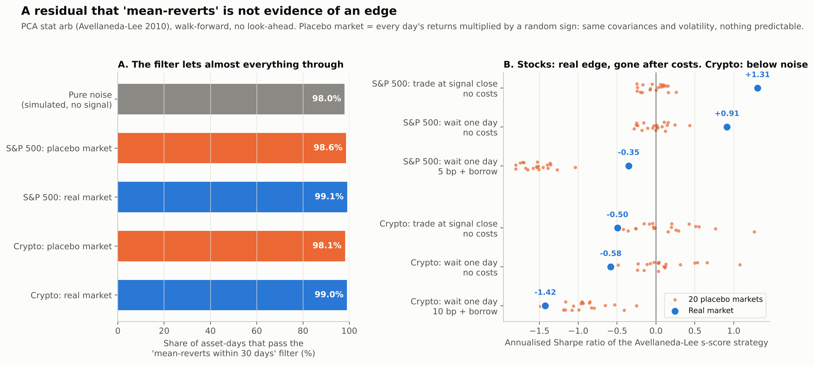
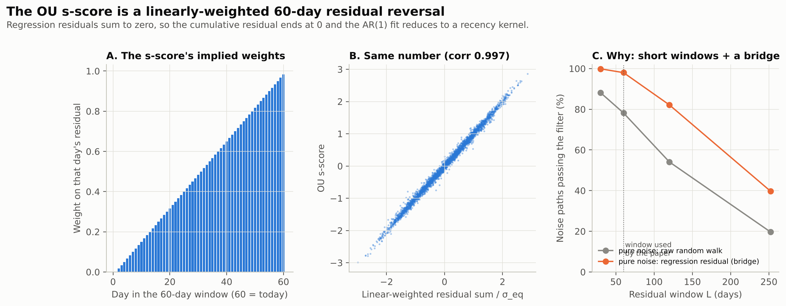
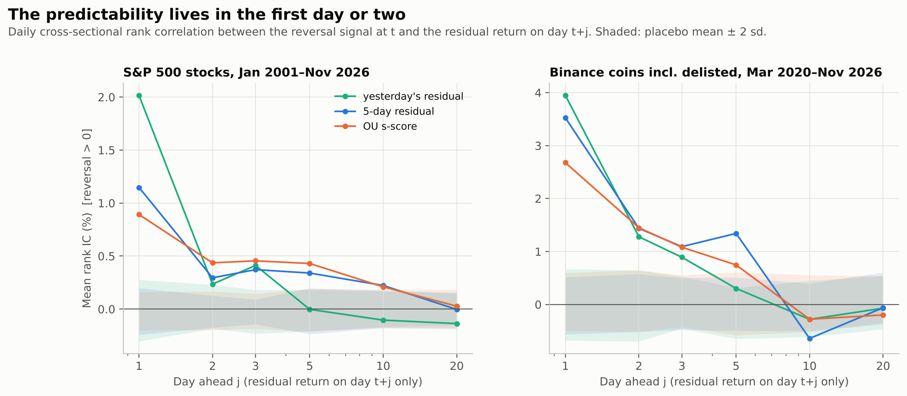
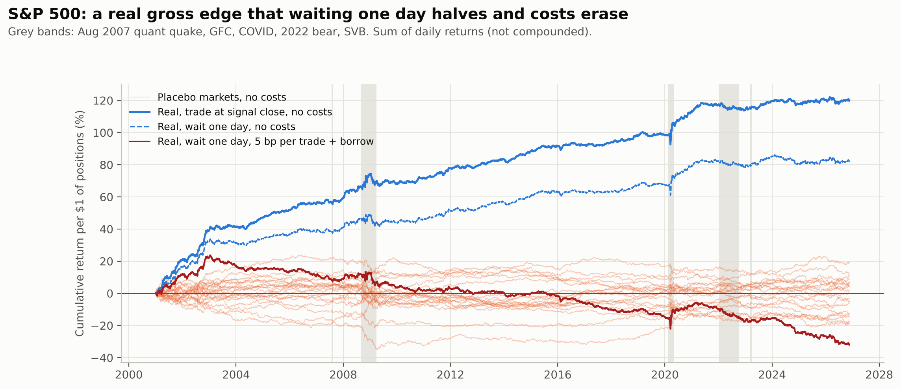
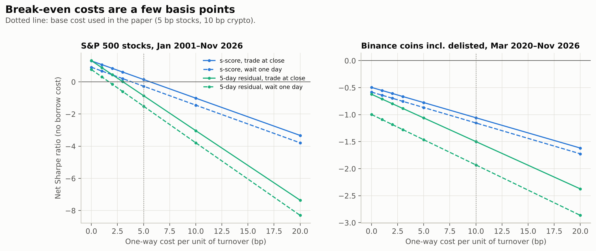
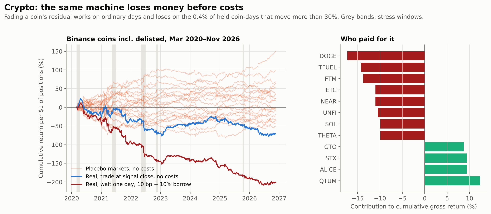
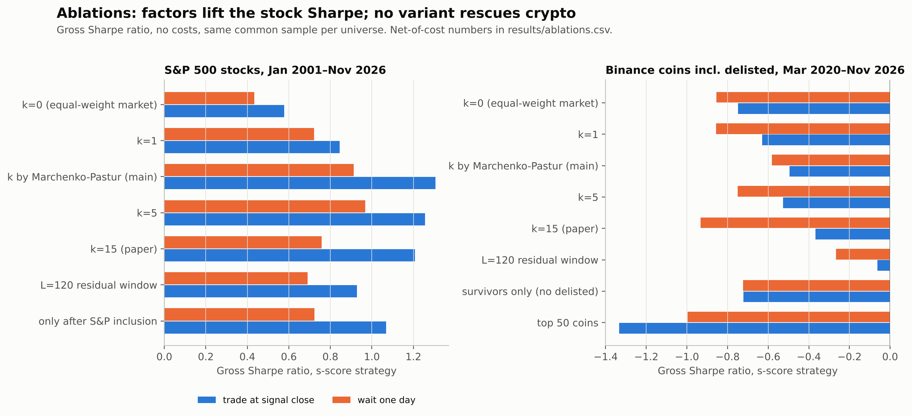

# The Filter That Lets Noise Through

**PCA statistical arbitrage against a placebo market, on 26 years of S&P 500 stocks and a delisting-complete crypto universe**

*Project 24 of [30 Quant Research Projects](../README.md) · Working paper, November 2026*



---

## Abstract

Avellaneda and Lee (2010) is the textbook recipe for PCA statistical arbitrage. You strip each stock of its
exposure to the top principal components and model the cumulative residual as an Ornstein–Uhlenbeck process. You
trade only the residuals that the fit says revert within 30 days, using bands on a standardised "s-score". The OU
fit and its filter are the part that looks most scientific. I test what they add by running the full walk-forward
recipe on a real market and on a **placebo market**, where every day's cross-section of returns is multiplied by an
independent random sign. That keeps every daily covariance matrix, the volatility path and the listing history
exactly, and makes tomorrow unpredictable. I use two universes. The first is the 503 S&P 500 members of November
2026, from 2001 to 2026. The second is all 743 Binance USDT spot pairs, **including the 217 that were later
delisted**, from 2020 to 2026.

Four results. **(1) The filter passes noise.** 99.1 % of stock-days and 99.0 % of coin-days pass the "reverts
within 30 days" test, against 98.6 % and 98.1 % in the placebo and 98.0 % in pure simulated noise. Regression
residuals sum to zero, so the cumulative residual is a Brownian bridge that ends at zero. A 60-day AR(1) fit then
finds a median mean-reversion time of about 8 days in any data. **(2) The s-score is a recency kernel.** With the
bridge ending at zero, the OU s-score equals a linearly weighted sum of the window's residuals (correlation 0.997).
A plain 5-day residual z-score earns the same gross Sharpe ratio (1.32 vs 1.31). **(3) In stocks the edge is real,
but costs remove it.** The strategy earns a gross Sharpe of 1.31 (95 % CI 0.90 to 1.76), against 0.00 ± 0.15
across 20 placebo markets (z = 8.6). A third of the edge sits in the first day: waiting one day cuts the Sharpe to
0.91. The break-even cost is 5.6 bp per unit of turnover, or 3.9 bp with the one-day wait. At a realistic 5 bp the
net Sharpe is 0.07, or −0.35 with the wait. The gross Sharpe fell from 2.44 in 2001–2007 to 0.78 in 2020–2026.
**(4) In crypto the same machine does worse than noise.** The gross Sharpe is −0.50 (CI −1.30 to +0.33), below all
20 placebos. Coin residuals do reverse at a one-to-five-day horizon (rank IC +2.7 % on day 1, t = 8.5). The book
still loses because it fades the 0.4 % of held coin-days that move more than 30 %. With daily returns capped at
±10 %, the same positions have a gross Sharpe of +1.82. Building the placebo also needed two corrections. A
within-quarter permutation leaked the real reversal back in (placebo Sharpe +0.81). A within-quarter bootstrap
manufactured momentum (−3.23). Both are documented and unit-tested.

---

## 1. Question

Statistical arbitrage on equity residuals goes back to Lehmann (1990) and Lo and MacKinlay (1990): stocks that fall
relative to their peers over a few days tend to bounce back. Avellaneda and Lee (2010, "AL" below) turned this into
the version taught today:

1. Estimate the correlation matrix of a large universe over a year, and keep the top *k* eigenvectors as
   **eigenportfolios** (risk factors).
2. Regress each stock's last 60 daily returns on those factor returns. The cumulative residual *X* is the stock's
   idiosyncratic price.
3. Fit *X* as an **Ornstein–Uhlenbeck process** through an AR(1) regression. Keep the stocks whose fitted
   mean-reversion time 1/κ is under 30 days ("fast mean reversion"), and compute the **s-score**, the distance of
   *X* from its fitted equilibrium in equilibrium standard deviations.
4. Buy the residual (stock long, factor betas short) when s < −1.25 and sell it when s > 1.25. Close at −0.5 and
   +0.75.

AL reported a Sharpe ratio of about 1.4 on US stocks from 1997 to 2007, and weaker results after 2002. The OU step
gives the recipe its look of rigour: each trade is justified by a stock whose residual has been shown to mean-revert
fast. This paper asks three questions about that step.

* **Q1.** Would the filter look any different if residuals had no memory at all?
* **Q2.** What does the s-score measure, and does the OU machinery beat a plain residual-reversal signal?
* **Q3.** How much real edge is left after a placebo comparison, a one-day execution wait, realistic costs and
  20 more years of data? Does the recipe carry over to a market whose cross-section is dominated by one factor
  and by jumps (crypto)?

These questions come from project [#11](../11-pairs-trading/README.md), whose title "Convergence Is Not Evidence"
makes the same point for pairs. There, the share of trades that converge and the share of pairs passing a
cointegration test were the same on a placebo market as on the real one. Project 24 brings the placebo test to the
PCA version of stat arb. The other close relative is [#18](../18-yield-curve-pca/README.md): it showed that three
principal components explain the Treasury curve but hedge it badly. Here PCA is used as a residualiser, not as a
hedge.

**Hypotheses** (written before the main runs; see the self-review for what that does and does not mean):

* H1. The share of residuals that pass the 30-day filter is about the same in real data, placebo data and pure
  noise.
* H2. The s-score is close to a linear-recency weighted sum of recent residuals, and a 5-day residual z-score does
  at least as well.
* H3. The equity strategy beats the placebo before costs, but its break-even cost is below a realistic cost for
  this turnover, and it has decayed since AL's sample.
* H4. In crypto, where residuals carry pumps and delistings, the strategy does not beat the placebo.

---

## 2. Data

| Universe | Source | Assets | Signal sample | Notes |
|---|---|---|---|---|
| **S&P 500 stocks** | Yahoo Finance adjusted closes and dollar volume, fetched through a browser | 503 members of Nov 2026 (436 tradable on an average day) | Jan 2001 – 20 Nov 2026, 6,511 days | Survivor-picked; see Limitations. A "point-in-time additions" variant only lets a stock in after its S&P inclusion date. |
| **Binance crypto** | Binance public klines API, daily 00:00 UTC closes and quote volume | 743 USDT spot pairs; 594 after removing 26 stablecoins/fiat/gold tokens, 10 leveraged tokens and 113 tokenised stocks; **217 pairs are delisted**, and their full history is kept | Mar 2020 – 22 Nov 2026, 2,458 days | The top 100 coins by 30-day median dollar volume are re-ranked monthly. Trading starts once 30 coins have a full year of history. |

The data files in `data/` are the raw downloads (about 26 MB). `src/data.py` applies the exclusions and builds the
return panels. Delisted pairs matter. Binance keeps serving the price history of pairs it has delisted (LUNA,
FTT, BCC, ...), so the crypto universe is free of survivorship bias, which the equity universe cannot be. A
"survivors only" run measures the difference (section 5).

**Stress windows** covered: August 2007 quant quake, GFC (Sep 2008 – Mar 2009), COVID (Feb–Apr 2020), the 2022
bear market and the SVB month (Mar 2023) for stocks; the COVID crash, the May 2021 crash, the LUNA collapse (May–Jun
2022), the FTX collapse (Nov 2022) and the October 2025 liquidation cascade for crypto. Crypto has no 2008 because
the market did not exist. Its own crashes are larger in residual terms than anything in the equity sample.

---

## 3. Design

**Walk-forward engine** (`src/engine.py`). Every input to a position decided at the close of day *t* uses returns up
to *t* only.

* Universe: rebuilt on the first trading day of each month from assets with 252 complete days of history, ranked by
  30-day median dollar volume (crypto: top 100; stocks: all eligible).
* Eigenportfolios: correlation matrix of the last W = 252 standardised returns, re-estimated every 5 days or
  whenever the active set changes. The number of factors *k* is the number of eigenvalues above the
  Marchenko–Pastur edge (project [#8](../08-correlation-crash-illusion/README.md)), capped at 15. That gives
  *k* ≈ 7.0 for stocks and ≈ 1.7 for crypto on average. AL used *k* = 15, which is an ablation here.
* Residuals: OLS with intercept of each asset's last L = 60 returns on the *k* factor returns.
* OU step and bands exactly as in AL. Each open position is $1/n_open of residual (asset long or short, factor
  betas the other way), so the book is factor-neutral by construction. Returns are per $1 of residual positions.
  The net gross exposure averages 1.17 (stocks) and 1.15 (crypto) per $1.
* Signals compared on the same residuals: `ou` = AL's s-score with the filter; `ou_nf` = the s-score without the
  filter; `res5` = the residual return of the last 5 days divided by its 60-day standard deviation, with the same
  bands.
* Execution: **delay 0** trades at the close that produced the signal (AL's convention). **Delay 1** waits one day,
  which removes bid-ask bounce and stale closing prints (project #11 used the same one-day wait).
* Costs: a one-way cost per unit of turnover of the net asset weights (5 bp for S&P 500 stocks, 10 bp for coins,
  which is Binance's base taker fee), plus a borrow fee on the short side (0.5 % a year for stocks, 10 % a year
  for coins, roughly the margin rate on altcoins). Sweeps from 0 to 20 bp are reported.

**Placebo market** (`engine.placebo`, method `signflip`). Every day, the whole vector of returns is multiplied by
one random sign. Each day's covariance matrix (r rᵀ) is unchanged, so PCA sees the same factor structure. The same
holds for volatility clustering, fat tails in absolute value, listing and delisting dates and liquidity ranks. Any
way of predicting the sign of tomorrow's residual is gone. Drift and skewness are lost, which does not matter to a
book that is factor-neutral and holds both sides. 20 placebo markets per universe are run through the identical
pipeline. Section 7 explains why two more natural placebos were rejected.

**Inference.** Sharpe ratio CIs come from a stationary bootstrap (mean block 20 days, 1,000 draws). t-statistics
are Newey–West. The real-vs-placebo test uses z = (SR_real − mean SR_placebo) / sd SR_placebo. Both families,
real-vs-placebo (12 tests: 2 universes × 3 signals × 2 delays) and ablations (60 tests), are corrected with Holm.
All comparisons inside a universe use one common sample (the latest start across its runs).

---

## 4. Results

### 4.1 The filter passes noise (H1: supported)

| | Pass the 30-day filter | Median fitted mean-reversion time |
|---|---|---|
| Pure noise, L = 60, intercept + 15 factors (simulated) | 98.0 % | 8.4 days |
| S&P 500 placebo markets (20) | 98.6 % (range 98.5–98.6) | 8.2 days |
| **S&P 500 real** | **99.1 %** | **7.7 days** |
| Crypto placebo markets (20) | 98.1 % (range 97.8–98.4) | 8.1 days |
| **Crypto real** | **99.0 %** | **7.2 days** |

*Source: `results/filter_real_vs_placebo.csv`, `results/theory_filter_null.csv`.*

Two mechanisms produce this (`src/theory.py`, figure 4C).

1. **A bridge.** An OLS regression with an intercept forces the 60 residuals to sum to zero, so the cumulative
   residual starts near 0 and ends at exactly 0. Any such path looks mean-reverting. With the regression, 98.5 % of
   pure-noise paths pass; with no regression at all, 78 % still pass.
2. **Dickey–Fuller bias.** An AR(1) slope fitted on 60 points of a random walk is biased towards zero. The median
   fitted *b* is 0.93, which already means a mean-reversion time of 13 days.

The filter only starts to bite with windows far longer than AL's: at L = 252 days, 40 % of noise paths pass.
Dropping it changes nothing. The no-filter strategy has the same Sharpe to the second decimal (1.30 vs 1.31) and
the same turnover. Real residuals are slightly faster than placebo ones (7.7 vs 8.2 days), so they do carry some
real reversal. The filter cannot see the difference, because the 30-day threshold sits far above where both
distributions live.

### 4.2 The s-score is a 60-day recency kernel (H2: supported)



Write ε₁ … ε₆₀ for the window's residuals. Because they sum to zero, X₆₀ = 0, and the AR(1) fit's equilibrium *m*
is essentially the path's average level, X̄. Rearranging gives −X̄ = Σᵢ ((i − 1)/60) εᵢ. The s-score
(X₆₀ − m)/σ_eq is therefore a weighted sum of the window's residuals. The weights rise linearly from 0 for the
oldest day to 1 for today, divided by a volatility. On noise the correlation between the exact s-score and this
kernel is **0.997** (`results/theory_kernel.csv`). AL's centring of *m* across stocks is a constant shift.

So the s-score is a residual-reversal signal with a mean look-back of about 20 days. That horizon is a poor match
for the data (figure 2).



The cross-sectional rank IC between a reversal signal at *t* and the residual return on one later day *t + j*
peaks on the first day and is gone by day 10–20 in both markets (`results/ic_term_structure.csv`). For stocks the
IC is 2.0 % for yesterday's residual alone (t = 16.5), 1.1 % for the 5-day residual and 0.9 % for the s-score. The
mean placebo IC is within 0.03 percentage points of zero at every horizon. The s-score spreads its weight over 60 days, while the signal
lives in the last few. It ends up holding positions for days after the information has decayed. As a trading
signal the plain 5-day z-score is as good: gross Sharpe 1.32 vs 1.31 for stocks. It trades twice as often,
though, so its break-even cost is lower (3.0 bp vs 5.6 bp). The OU machinery makes the signal slower and
therefore cheaper to trade. It does not make the signal better.

### 4.3 Stocks: a real gross edge, gone after costs (H3: supported)

| S&P 500, Jan 2001 – Nov 2026 | Gross SR [95 % CI] | Placebo SR (mean ± sd) | z vs placebo | Break-even (bp) | Net SR at 5 bp + borrow |
|---|---|---|---|---|---|
| s-score + filter, trade at the signal close | **1.31** [0.90, 1.76] | −0.02 ± 0.15 | 8.6 | 5.6 | 0.07 |
| s-score + filter, wait one day | **0.91** [0.52, 1.34] | −0.01 ± 0.19 | 5.0 | 3.9 | −0.35 |
| 5-day residual z, trade at the signal close | 1.32 [0.93, 1.77] | −0.08 ± 0.14 | 10.0 | 3.0 | −0.93 |
| 5-day residual z, wait one day | 0.77 [0.38, 1.14] | −0.07 ± 0.16 | 5.2 | 1.7 | −1.59 |

*Source: `results/main_real_vs_placebo.csv`. Holm-adjusted p < 0.001 for all four against the placebo. The
s-score book earns 4.7 % a year gross per $1 of positions at 3.6 % volatility and turns over 33 % of its
positions per day.*



The placebo test rules out "it's all an artefact": the real edge sits 5 to 10 placebo standard deviations away from
zero. The edge is also small next to its turnover. At 33 % turnover a day, every basis point of cost removes
0.8 % a year, so the 4.7 % gross becomes about zero at 5–6 bp. The cost sweep (figure 7) gives net Sharpe ratios of
1.07, 0.84, 0.61 and 0.15 at 1, 2, 3 and 5 bp (trading at the signal close). With the one-day wait they are 0.68,
0.44, 0.20 and −0.27.



**Decay.** Gross Sharpe ratios by era for the s-score at delay 0 (`results/eras.csv`) are 2.44 [1.61, 3.23] in
2001–2007, 0.73 [−0.77, 1.95] in 2008–2009, 1.27 [0.66, 1.90] in 2010–2019 and 0.78 [−0.01, 1.47] in 2020–2026.
Break-even costs went from 10 bp to 3.6 bp. That is the pattern AL already saw after 2002 and that project
[#3](../03-moving-average-volatility/README.md) found for its own published signal: what remains is too thin for
anyone who pays retail costs.

**Stress.** The equity book was not a crisis casualty (`results/stress_windows.csv`). It gained 3.4 % over the GFC
window and 7.8 % from February to April 2020, about 4.9 sd of a normal period's P&L. Dispersion was huge and
residuals snapped back. It lost 2.9 % over the 2022 bear market, its worst stretch, and was flat in the August 2007
quant quake (+0.4 %). The 2007 unwind hit crowded, levered books. This one is unlevered, and its universe is today's
survivors, which may flatter 2007–2009 (see Limitations).

### 4.4 Crypto: below noise (H4: supported, more strongly than stated)



| Binance top 100, Mar 2020 – Nov 2026 | Gross SR [95 % CI] | Placebo SR (mean ± sd) | Rank among 20 placebos | Net SR at 10 bp + 10 % borrow |
|---|---|---|---|---|
| s-score + filter, trade at the signal close | −0.50 [−1.30, 0.33] | +0.15 ± 0.41 | below all 20 | −1.32 |
| s-score + filter, wait one day | −0.58 [−1.35, 0.24] | +0.12 ± 0.36 | below all 20 | −1.42 |
| 5-day residual z, trade at the signal close | −0.62 [−1.32, 0.13] | +0.05 ± 0.34 | below all 20 | −1.69 |

The paradox is that coin residuals do reverse, more strongly than stock residuals. The day-1 rank IC is 2.7 % for
the s-score (t = 8.5) and 4.0 % for yesterday's residual (t = 11.9), against 0.05 % ± 0.27 % in the placebos. The money is
lost elsewhere (`results/crypto_tail_diagnostic.csv`):

| Daily returns capped at | none | ±100 % | ±50 % | ±30 % | ±20 % | ±10 % |
|---|---|---|---|---|---|---|
| Gross Sharpe, same positions | −0.50 | −0.41 | −0.19 | +0.24 | +0.76 | **+1.82** |

Only 0.44 % of the coin-days the book holds move by more than 30 %, and they decide the result. A rank IC counts a
+300 % listing pump as one bad rank among a hundred. A dollar P&L counts it as 300 %. A reversal book in crypto is
structurally **short jump risk**: it shorts what has just risen, and some of what has just risen keeps rising by
multiples (DOGE, TFUEL, FTM, NEAR, SOL are the largest losers). It does not survive the LUNA collapse either: −27 %
of capital in May–June 2022, its worst stress window and worse than any placebo path (placebo range −24 % to
+27 %). Removing the delisted coins does not help: survivors only, gross SR −0.72. Neither does any choice of
*k*, window or universe size (figure 6). Every crypto variant has a negative gross Sharpe, and none is
significant after Holm.

The capped-return Sharpe of +1.82 is **not** a tradable result. It describes P&L that the book did not earn. It
says where the loss is, not how to avoid it. A real fix would need a rule that sees the jump coming (volume, news,
listings), which is outside this paper.

---

## 5. Robustness and ablations



All on the same sample per universe, s-score strategy (`results/ablations.csv`).

| S&P 500 | Gross SR, trade at close | Gross SR, wait a day | Break-even bp (wait a day) | Net SR (wait a day, 5 bp) |
|---|---|---|---|---|
| k = 0 (residual vs equal-weight market) | 0.58 | 0.43 | 5.0 | −0.04 |
| k = 1 | 0.84 | 0.72 | **6.4** | **+0.11** |
| k ≈ 7, Marchenko–Pastur (main) | **1.31** | 0.91 | 3.9 | −0.35 |
| k = 5 | 1.26 | 0.97 | 4.7 | −0.15 |
| k = 15 (AL) | 1.21 | 0.76 | 2.1 | −1.12 |
| L = 120 residual window | 0.93 | 0.69 | 4.8 | −0.11 |
| Only after S&P inclusion date | 1.07 | 0.72 | 3.3 | −0.44 |

* **Factors buy gross Sharpe and cost net Sharpe.** Going from 1 to 15 factors raises the gross Sharpe from 0.84 to
  1.21. The hedge legs re-trade with every re-estimated eigenvector, though, so the break-even cost halves. With
  the one-day wait, only the one-factor book keeps a positive net Sharpe at 5 bp, and at +0.11 over 26 years
  (standard error about 0.2) it cannot be told apart from zero.
* **Look-ahead in the universe.** Letting a stock in only after its S&P inclusion date lowers the gross Sharpe from
  1.31 to 1.07. This is one measured piece of the survivorship bias, and it goes the expected way.
* **Crypto:** every row is negative (−0.06 to −1.33 gross). The longer window (L = 120) is the least bad, which
  fits section 4.2: slower signals trade less often into jumps.

---

## 6. Limitations

* **Equity survivorship.** The stock universe is the November 2026 S&P 500. Stocks that failed, were acquired or
  dropped out are missing (Yahoo does not serve most delisted tickers), so Lehman, Bear Stearns and Washington
  Mutual are not in the 2008 test. Survivorship tends to help a reversal book, because the dips of today's
  survivors were the ones that recovered. The point-in-time-additions run removes part of this (−0.24 Sharpe), not
  all of it. The equity Sharpe ratios are best read as upper bounds. The placebo comparison does not depend on
  this, since the placebo uses the same assets.
* **Costs are a single number.** 5 bp per unit of turnover is a reasonable large-cap figure for an institution
  trading at the close (spread plus some impact). It is optimistic for a retail account and pessimistic for a
  market maker. The cost sweep gives the whole curve. Impact grows with size (project
  [#12](../12-momentum-trading-costs/README.md)), so capacity is not addressed.
* **Closes are not fills.** Delay 0 assumes trading at the very close that produced the signal. The one-day wait is
  the conservative bracket, and the truth for a real desk lies in between.
* **Crypto shorting.** Shorting spot coins needs margin borrowing, which is not always available for small coins.
  A perpetual-futures implementation would pay funding instead of borrow. 10 % a year is a round number in the
  range of observed altcoin margin rates.
* **Crypto sample.** Six and a half years, with no 2008. Bootstrap CIs are wide (±0.8 Sharpe), so "below all 20
  placebos" is suggestive (z ≈ −1.6), not a precise estimate of how bad it is.
* **One recipe.** This tests AL's specification and close variants. It does not test PCA stat arb at intraday
  frequency, with industry ETFs as factors (AL's other variant) or with volume-weighted signals.
* **Hypotheses were not formally pre-registered.** I ran the noise simulation behind H1 before writing the
  hypotheses, so H1 was a known result when it was written down. H2–H4 were written before the first real-data
  runs.

---

## 7. Referee-style self-review: what it changed

I reviewed the first complete draft as a hostile referee would. Each point is followed by what was done.

1. **"Your first placebo is not a null."** It was not. Version 1 permuted the days within each calendar quarter,
   the natural extension of project #11. It gave the S&P 500 placebo a gross Sharpe of **+0.81** and a flat IC of
   +0.34 % at every horizon. The reason: a permutation keeps each quarter's total return, and real residuals mean
   revert, so real quarterly totals are small. In the permuted series later days of a quarter offset earlier ones,
   so the real reversal leaks back in, spread over the quarter. *Fix:* rejected. A unit test with a strongly
   mean-reverting series shows the leak (`test_permutation_placebo_leaks_real_reversal_bootstrap_does_not`).
2. **"Then use a bootstrap."** Version 2 drew days with replacement inside each quarter. It gave the S&P 500 placebo
   a Sharpe of **−3.23**. A day drawn twice makes a residual spike recur, which is a manufactured momentum that
   punishes any reversal book. *Fix:* rejected. Version 3, the random sign per day, keeps every daily covariance
   exactly and has a placebo Sharpe of −0.02 ± 0.15 and mean ICs within 0.03 points of zero. Unit-tested, and all three are
   compared in `results/placebo_versions.csv` and reproduced by `run_all.sh`. The lesson for #11's method:
   **resampling days inside short blocks is not neutral for a strategy whose signal window is about as long as the
   block.**
3. **"Delay 0 is look-ahead in disguise."** It is not look-ahead, since the weights use data up to the close. It
   does assume a fill at that close, and part of the day-1 IC is bid-ask bounce. *Fix:* every headline number is
   reported with a one-day wait next to it, and the conclusion is stated on the conservative one.
4. **"Different samples make the ablations incomparable."** The first draft compared each run from its own start.
   *Fix:* all comparisons in a universe use the latest common start.
5. **"Your crypto loss could be a bug in the delisting handling."** *Checked:* survivors only (no delisted coins at
   all) loses more (−0.72), and the loss is spread over large, still-listed coins (DOGE, SOL, NEAR). Capping
   returns shows it is a tail effect, not a single bad print.
6. **"The capped Sharpe of +1.8 will be quoted as a strategy."** *Fix:* it is labelled as a diagnostic, and section
   4.4 says it is not tradable.
7. **"Multiple testing."** 72 tests across two families, Holm-corrected. All four equity rows of the main table
   survive (p < 0.001), as do 24 of the 28 equity ablation rows. The four that do not are one-day-wait variants
   (k = 0 s-score, Holm p = 0.34; three 5-day z-score rows, 0.06–0.07). No crypto result survives, in either
   direction.

---

## 8. Conclusion

PCA statistical arbitrage has two parts. The residual and the reversal are real: in S&P 500 stocks they beat 20
placebo markets by 5–10 standard deviations before costs, over 26 years. The OU modelling around them is decoration.
Its mean-reversion filter passes 98 % of pure noise, because regression residuals form a bridge, and its s-score
is a 60-day linear recency kernel that a 5-day z-score matches. What is left is thin. The break-even cost is 4–6 bp
and falling, a third of the edge is in the first day, and with a one-day wait and 5 bp costs the net Sharpe is
below zero. In crypto, where residuals revert even more strongly in rank terms, the recipe does worse than noise. A
reversal book is short the jumps that make up crypto returns.

The practical rule: **when a stat-arb paper shows you that its residuals mean-revert, ask whether noise would have
looked the same, and only then look at the P&L.**

Cross-links: [#8](../08-correlation-crash-illusion/README.md) (Marchenko–Pastur edge used to choose *k*),
[#11](../11-pairs-trading/README.md) (placebo-market method, refined here),
[#12](../12-momentum-trading-costs/README.md) (break-even costs), [#18](../18-yield-curve-pca/README.md) (PCA as a
hedge vs as a residualiser). Projects #22 (purged cross-validation) and #23 (deflated Sharpe) take the
multiple-testing question further, and #25 (Kalman hedge ratio) replaces the 60-day OLS betas.

---

## Reproduce

```bash
pip install -r requirements.txt
./run_all.sh        # ~25 min on 4 cores; writes results/*.csv and figures/*.png, then runs 15 unit tests
```

`src/engine.py` (walk-forward engine and placebos) · `src/theory.py` (noise simulation, kernel identity) ·
`src/experiments.py` (all specifications) · `src/evaluate.py` (tables) · `src/diagnostics.py` (crypto tails) ·
`src/figures.py` · `tests/test_engine.py`. Per-run outputs (`results/runs*/`) are rebuilt by the script and are
not committed.

## References

* Avellaneda, M. and Lee, J.-H. (2010). Statistical arbitrage in the US equities market. *Quantitative Finance*
  10(7), 761–782.
* Lehmann, B. (1990). Fads, martingales, and market efficiency. *Quarterly Journal of Economics* 105(1), 1–28.
* Lo, A. and MacKinlay, A. C. (1990). When are contrarian profits due to stock market overreaction? *Review of
  Financial Studies* 3(2), 175–205.
* Khandani, A. and Lo, A. (2011). What happened to the quants in August 2007? *Journal of Financial Markets* 14(1),
  1–46.
* Dickey, D. and Fuller, W. (1979). Distribution of the estimators for autoregressive time series with a unit root.
  *JASA* 74, 427–431.
* Marchenko, V. and Pastur, L. (1967). Distribution of eigenvalues for some sets of random matrices. *Math. USSR-
  Sbornik* 1(4), 457–483.
* Politis, D. and Romano, J. (1994). The stationary bootstrap. *JASA* 89, 1303–1313.
* Holm, S. (1979). A simple sequentially rejective multiple test procedure. *Scandinavian Journal of Statistics* 6,
  65–70.
