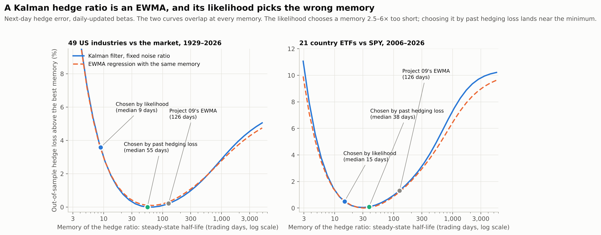

# The Kalman Hedge Ratio Is an EWMA in Disguise

**And its likelihood picks the wrong memory: an out-of-sample test on a century of US industries, twenty years of country ETFs and a placebo market**

*Project 25 of [30 Quant Research Projects](../README.md) · Working paper, November 2026*



---

## Abstract

The Kalman filter is the standard "advanced" answer to a hedge ratio that changes over time. The beta is
modelled as a random walk, the filter updates it every day, and the one free parameter, the ratio of
state noise to observation noise, is set by maximum likelihood or by a value copied from a textbook. I test
what this machinery adds out of sample, using exactly the data, protocols and placebo of two earlier
projects. The first is [project 09](../09-beta-horse-race/), with 49 Fama–French industries hedged with the
market from 1929 to 2026 and scored by its own hedge-loss metric. The second is
[project 11](../11-pairs-trading/), with pairs trading on 22 country ETFs and 49 industries, scored against
its placebo market, in which relative prices have no memory.

Four results.

**(1) The Kalman beta is an exponentially weighted regression.** For every value of the noise ratio, the
filter's hedge loss is within a fraction of a percent of an EWMA regression that forgets at the filter's
steady-state rate. With the noise ratio chosen by likelihood, the gap is −0.08 % of the loss on industries
(95 % CI −0.73 % to +0.58 %) and −0.06 % on country ETFs (CI −0.75 % to +0.63 %). Equivalence within ±1 % holds
with Holm-adjusted p = 0.012 in both. The only systematic difference is that the filter's gain grows with
the size of the market move. That makes it win 85 % of calm months, by 1.1 %, and lose the most volatile 10 % of
months by 1.8 %, which nets to zero.

**(2) The likelihood chooses a memory that is far too short.** The noise ratio picked by maximum likelihood
implies a median half-life of 9 trading days for industries and 15 for country ETFs. The out-of-sample
optimum is near 55 and 35 days. On project 09's scoreboard, the likelihood-tuned Kalman beta leaves 0.86 of
the textbook beta's avoidable error at a monthly rebalance, against 0.58 for project 09's best (Welch). It is
2.3 % worse than a plain 126-day EWMA when both update daily (CI +0.9 % to +4.4 %). A simulation pins down
why. When volatility clusters and tails are fat, the random-walk model explains large errors on volatile days
as uncertainty about beta. The likelihood then pays for the heteroskedasticity with a shorter memory: in the
simulation it picks 40 days when the truth is 63 and the best out of sample is 74. If the memory is chosen
instead by past hedging loss (the loss being minimised), the same filter becomes the best estimator in the
study, at 0.54 on project 09's scale.

**(3) In pairs trading, every Kalman diagnostic is passed on pure noise.** On the same 20 pairs per window,
the Kalman spread converges on 99 % of trades in the real market and on 99 % in the placebo. Its innovations
reject a unit root for 100 % of pairs in both markets. Only 8 % of the spread's closing on country ETFs (0.1 %
on industries) comes from relative prices converging; the rest is the filter moving its intercept and
slope.

**(4) The Kalman pairs trade is a one-day reversal trade.** It holds a position for about two days, its
monthly returns correlate 0.71 with a naive one-day reversal rule, and its edge over the placebo disappears
when the trade waits five days (+1.40 % a year becomes −0.10 %). It is not more profitable than a static hedge
ratio on the same pairs: the edge difference is −0.26 % a year (t = −0.4). At 5 bp per leg it loses 0.7 % a
year on country ETFs and 1.7 % a year on industries.

**Practical rule.** If you need a time-varying hedge ratio, use an EWMA or rolling regression and choose its
memory by out-of-sample hedging loss. Update it daily: that alone is worth 1–2 %, for any estimator. A Kalman
filter is a convenient way to write the same estimator, but its likelihood is not a good way to tune it. In
pairs trading, a Kalman spread that converges and looks stationary is evidence about the filter, not about the
pair.

---

## 1. Question

The Kalman hedge ratio has a strong reputation. It appears in algorithmic-trading textbooks (Chan 2013), in
the pairs-trading literature (Elliott, van der Hoek and Malcolm 2005) and in older comparisons of
time-varying betas, which found it fits better than GARCH or rolling betas (Brooks, Faff and McKenzie 1998;
Faff, Hillier and Hillier 2000). Those comparisons were mostly in-sample, or tuned on the evaluation sample.
Two earlier projects in this series ask the same question with simpler tools.
[Project 09](../09-beta-horse-race/) found that age-weighted daily betas (EWMA, Welch) leave about 0.58 of
the textbook beta's error. [Project 11](../11-pairs-trading/) found that convergence and cointegration are
weak evidence once they are compared with a placebo market.

So the question is:

> What does a Kalman-filter hedge ratio add, out of sample, over the static hedge ratio of project 11 and the
> rolling and exponentially weighted hedge ratios of project 09? And how much of what it seems to add is
> mechanical?

**Why the comparison with an EWMA is the right one.** The scalar model is

  y_t = β_t x_t + ε_t, ε_t ~ N(0, R);  β_t = β_{t−1} + η_t, η_t ~ N(0, q).

Only the ratio r = q/R moves the hedge ratio (a unit test checks this). Two facts follow. In a steady state
with market variance s², each new day gets a weight of s²p⁻/(1 + s²p⁻) in the update, where p⁻ solves the
Riccati equation s²p⁻² = r(1 + s²p⁻). That is exactly an exponentially weighted least-squares regression with
decay λ = 1/(1 + s²p⁻) (Ljung 1987; Harvey 1989), so every r has an implied half-life. Outside the steady
state, the gain is p⁻x_t/(1 + x_t²p⁻) and depends on today's market move: a crash day is weighted more
heavily than an EWMA would weight it. The empirical question is whether that second difference, or anything
else, is worth having.

**Pre-registration.** The hypotheses, universes, protocols and tests were written down before any Kalman
loss or strategy return was computed: [PREREGISTRATION.md](PREREGISTRATION.md). Six changes made later are
listed there and in Section 7. They all add analyses; none changes a registered one.

## 2. Data

All data are reused on purpose from earlier projects and copied unchanged into `data/` (provenance in
`src/data.py`).

| Use | Assets | Period | Source |
|---|---|---|---|
| Hedging A | 49 Fama–French value-weighted industries, daily excess returns, hedged with the value-weighted market | forecasts Aug 1929 – Sep 2026 (1,166 months, 54,328 industry-months) | Ken French Data Library, vintage 202609, as built by [project 09](../09-beta-horse-race/) |
| Hedging B | 21 iShares single-country ETFs hedged with SPY, daily total returns | evaluation Jan 2006 – Nov 2026 (251 months, 5,271 ETF-months) | Yahoo adjusted closes to 20 Nov 2026, as downloaded by [project 11](../11-pairs-trading/) |
| Pairs B (primary) | SPY + 21 country ETFs | Jan 2002 – Nov 2026 | project 11 |
| Pairs A | 49 industries (≥ 5 firms) | Jul 1927 – Sep 2026 | project 11 |

The country ETFs had many stale (exactly zero) daily returns in their first years. For hedging, each series
starts after the last calendar year in which 10 % or more of its returns were zero (1998–2004 depending on
the fund), and evaluation starts in January 2006 for all, after at least two years of estimation data. The
pairs part keeps project 11's rule (fewer than 5 % zero returns in each formation window). Country-ETF
returns are not net of the risk-free rate; at a daily horizon this changes losses by less than 0.01 %.

**Stress windows** covered: 1929–32, 1987, 2000–02, 2008–09, 2020 and 2022 (industries); 2008–09, the 2011
euro crisis, 2020 and 2022 (country ETFs).

## 3. Design

### 3.1 Hedging: eleven hedge ratios, two protocols

All estimators use only data before the day the hedge is applied (unit test: perturbing the future leaves
every past forecast unchanged).

| Name | What it is |
|---|---|
| **Kalman (likelihood)** | Random-walk beta. Every January, r is chosen from a 41-point grid (0 and 1e-5 … 1e3, half-lives from about 2 days to infinity) by the profile likelihood of all earlier data (R concentrated out, diffuse start). |
| EWMA, same memory | Weighted least squares through the origin with the decay λ implied by the same r̂ and the same past s² |
| EWMA, same memory, variance / \|x\| clock | The same average memory, but the weights decay with cumulative market variance or absolute return instead of calendar days |
| Kalman, time-varying noise | R_t = EWMA (21 days) of past squared errors; r by likelihood |
| **Kalman (past loss)** / EWMA (past loss) | The grid value with the smallest sum of past squared hedge errors, i.e. the hedging loss itself, chosen every January |
| EWMA 126 days | Project 09's EWMA half-life |
| OLS 252 / OLS 63 | Rolling regressions with intercept (OLS 252 is project 09's OLS-1Y-D) |
| Static | Expanding-window OLS: the hedge ratio of project 11's static world |

* **Protocol D (daily):** the predicted β_{t|t−1} is used on day t.
* **Protocol M (month-end):** the beta known at a month-end is held for the whole next month, as in project 09.
* **Loss:** project 09's, L = mean over the month's days of (y − β̂x)², averaged across assets each month. Tests
  are Diebold–Mariano style on the monthly series, with Newey–West errors (6 lags). CIs come from a
  stationary block bootstrap over months (mean block 12, 2,000 draws).

For industries, the month-end betas are also scored on project 09's own forecast panel. The next-month sums
match it to the last digit (`results/p09_comparison.csv`, column `max_abs_diff_sxx_vs_p09` = 0), so the
Kalman beta can be placed directly in project 09's table.

### 3.2 Pairs: same pairs, three hedge ratios

Project 11's design, unchanged: monthly portfolios, 252-day formation, 126-day trading, eligibility rules,
returns on committed capital, a one-day wait, and project 11's placebo N1. In N1, every asset in the window is
given the same drift, then whole days are resampled IID, with 10 replications per window. In every window
the 20 pairs with the smallest distance are selected **once**, then traded with three spreads, so that only
the hedge ratio differs:

* **Static:** OLS of log price A on log price B over formation; z = residual / formation residual s.d.
* **Rolling:** the same regression on the last 63 days, re-estimated daily; z = today's residual / the s.d.
  of those residuals.
* **Kalman:** the intercept and slope follow independent random walks. Their noise ratios are chosen from a
  12 × 14 grid by profile likelihood on the formation year, and the state is carried into trading.
  z = innovation / its predicted s.d.

All three rules open at |z| > 2, close at the zero crossing, and size the legs 1 : β at the open. Ablations:
legs rebalanced to the current β every day; Chan's (2013) fixed settings (δ = 1e-4, V_e = 1e-3), with a 2-s.d.
and a 1-s.d. entry; a 5-day wait; and all rules on Engle–Granger-selected pairs. Added after the first
results as a benchmark: a one-day reversal rule that trades today's relative return of the pair when it
exceeds 2 formation s.d.

### 3.3 Pre-registered hypotheses and tests

Confirmatory tests: H1 and H3 on both hedging universes, and H6, so five tests, Holm-corrected. H1 is an
equivalence test (two one-sided tests, margin ±1 % of the loss). H2, H4 and H5 are descriptive.

## 4. Results: hedging

### 4.1 The Kalman beta and its EWMA twin are the same estimator

Next-day hedge loss with daily-updated betas, relative to the 126-day EWMA (negative = better):

| Hedge ratio | Industries 1929–2026 | 95 % CI | Country ETFs 2006–2026 | 95 % CI | β turnover / yr (ind.) |
|---|---|---|---|---|---|
| Kalman, likelihood memory | **+2.29 %** | [+0.87, +4.37] | −0.26 % | [−1.45, +0.90] | 10.1 |
| EWMA, same memory | +2.37 % | [+1.33, +3.76] | −0.20 % | [−1.19, +0.71] | 15.2 |
| EWMA, same memory, variance clock | +3.89 % | [+1.54, +7.13] | +2.28 % | [−0.49, +6.07] | 7.7 |
| EWMA, same memory, \|x\| clock | +3.23 % | [+1.41, +5.81] | +0.34 % | [−0.95, +1.66] | 11.8 |
| Kalman, time-varying noise | +1.67 % | [+0.15, +3.76] | −0.76 % | [−1.48, −0.08] | 4.9 |
| **Kalman, memory by past loss** | **−0.15 %** | [−0.50, +0.23] | **−0.75 %** | [−1.29, −0.28] | 1.7 |
| EWMA, memory by past loss | +0.03 % | [−0.33, +0.55] | −0.96 % | [−1.67, −0.31] | 2.3 |
| EWMA 126 days (project 09) | 0 | | 0 | | 0.8 |
| Rolling OLS 252 days | +0.34 % | [+0.21, +0.49] | +0.23 % | [−0.16, +0.60] | 1.1 |
| Rolling OLS 63 days | +0.79 % | [+0.42, +1.26] | −0.25 % | [−1.36, +0.66] | 4.6 |
| Static (expanding OLS) | +5.60 % | [+3.96, +7.62] | +9.16 % | [+5.01, +13.51] | 0.03 |

*Industries: 1.363 %²/day for EWMA 126; country ETFs: 1.120 %²/day. Full table with both protocols and DM
t-statistics: `results/hedge_summary.csv`.*

The first two rows are the headline. With the same memory, the Kalman filter and the EWMA are statistically
and economically indistinguishable (H1: −0.08 % and −0.06 %, equivalence p = 0.003 and 0.004, Holm 0.012).
Figure 1 shows why this is not a coincidence of one setting. Across the whole grid, from a 3-day to a
6,000-day memory, the filter's loss curve sits on top of the EWMA's. The two clocks that try to imitate the
filter's data-dependent gain are both *worse* than the plain calendar EWMA. So the filter is, to a very good
approximation, a calendar EWMA.

**The only systematic difference is crash days (H2, reversed).** I registered that whatever the filter gains
over its twin would come from the most volatile months. The opposite happens (Figure 4):

| | Industries: Kalman vs twin | months Kalman better | Country ETFs: Kalman vs twin | months Kalman better |
|---|---|---|---|---|
| Most volatile 10 % of months | +1.79 % (t = 2.3) | 26 % | +1.55 % (t = 1.6) | 27 % |
| Other 90 % | −1.12 % (t = −7.1) | 85 % | −0.62 % (t = −5.3) | 71 % |

The filter's gain p⁻x_t/(1 + x_t²p⁻) is largest on the days the market moves most. A single crash day
therefore moves the Kalman beta further than it moves the EWMA beta (Figure 7: Japan in October 2008, Brazil in
March 2020). That reaction hurts in crashes and helps in calm months, and the two cancel.

### 4.2 The likelihood picks the wrong memory

The median half-life implied by the likelihood-chosen r is 9 days for industries and 15 for country ETFs. Past
hedging loss chooses 55 and 38 (`results/halflife_by_decade.csv`). Figure 1 marks both on the loss curve: the
likelihood's choice is 3.6 % above the minimum for industries, 0.5 % for country ETFs. The gap is stable: in
every decade since the 1930s the likelihood picks 6–13 days for industries (Figure 3, right).

Simulation (`src/mechanism.py`, 200 paths of 6,000 days per world; the first 4,000 choose, the last 2,000 score):

| World | Likelihood half-life (median) | Past-loss half-life | Best out of sample | Loss of likelihood choice vs best |
|---|---|---|---|---|
| A. constant β, constant volatility | ∞ (64 % of paths) | ∞ | ∞ | +0.03 % |
| C. random-walk β (true half-life 63), constant volatility | 60 | 60 | 61 | +0.10 % |
| G. constant β, slow common volatility factor | 1,608 | ∞ | ∞ | +0.79 % |
| H. G + GARCH + Student-t(4) | 379 | ∞ | ∞ | +2.96 % |
| **I. random-walk β (63) inside H's volatility and tails** | **40** | 86 | 74 | **+2.69 %** |

With constant volatility the likelihood is an excellent tuner (world C). Once market and idiosyncratic
volatility cluster together and tails are fat (I), it forgets too fast and costs 2.7 %, the same size as in
the industry data (+2.3 % against EWMA 126). The mechanism is visible in the model: the one-step error
variance is R(1 + x_t²p⁻), so a larger p⁻ lets the model "explain" big errors on volatile days. Real errors are
big on volatile days for a different reason (common volatility), and the likelihood cannot tell the two
apart. Two pieces of evidence support this reading. Letting R vary over time (Kalman, time-varying noise)
lengthens the likelihood's memory to a median 28 days and recovers about a quarter of the loss. Choosing r by
past squared error removes the bias (86 days against a best of 74 in world I). Worlds B, D, E and F in
`results/mechanism.csv` show that neither clustering alone nor transient beta noise alone is enough. The
combination with fat tails is what fools the likelihood.

### 4.3 Project 09's scoreboard, with the Kalman filter added

Same 54,245 industry-months, same loss, same oracle, same textbook benchmark (Figure 2):

| Estimator | Share of textbook's avoidable error left | 95 % CI | DM t vs textbook |
|---|---|---|---|
| Textbook OLS 5y monthly (project 09) | 1 | | |
| Welch age-weighted (project 09's best) | 0.58 | [0.53, 0.65] | −6.1 |
| EWMA 126 (project 09) | 0.59 | [0.54, 0.65] | −6.0 |
| **Kalman, likelihood memory, month-end** | **0.86** | [0.72, 1.01] | −2.4 |
| Kalman, likelihood memory, daily | 0.68 | [0.62, 0.76] | −6.0 |
| EWMA 126, daily | 0.55 | [0.51, 0.60] | −6.4 |
| **Kalman, memory by past loss, daily** | **0.54** | [0.50, 0.58] | −6.8 |

At project 09's own monthly rebalancing, the likelihood-tuned Kalman beta is worse than every estimator in
project 09's table except the textbook itself and β = 1. Updating it daily (H3) cuts its loss by 2.2 % (t = −2.9; country
ETFs 2.4 %, t = −2.7; Holm p ≤ 0.012). But daily updating helps every estimator: the plain EWMA goes from 0.59
to 0.55. The best number in this project, 0.54, belongs to the Kalman filter with its memory chosen by
hedging loss, and an EWMA with the same choice is statistically tied with it.

**Costs of rebalancing the hedge.** The likelihood-tuned Kalman beta moves by 10 units of beta a year per
industry, against 0.8 for EWMA 126 and 1.7 for the loss-tuned filter. At 1 bp per unit of notional traded in
an index future, that is about 10 bp a year of the hedged position against 1–2 bp. Small, but a cost added
to a worse hedge.

### 4.4 Stress windows

| Window | Kalman (likelihood) | EWMA, same memory | Kalman (past loss) | Rolling OLS 252 | Static |
|---|---|---|---|---|---|
| 1929–32 crash (ind.) | +6.7 % | +4.9 % | +0.6 % | +0.0 % | +2.5 % |
| 1987 crash (ind.) | +4.8 % | +2.5 % | +0.4 % | +1.2 % | +18.0 % |
| 2000–02 dot-com (ind.) | +1.3 % | −0.1 % | −1.8 % | +0.8 % | +17.1 % |
| 2008–09 GFC (ind.) | +0.7 % | −2.5 % | −2.7 % | +1.0 % | +22.6 % |
| 2020 Covid (ind.) | +7.2 % | +1.8 % | +0.6 % | +0.7 % | +2.2 % |
| 2022 inflation (ind.) | +0.9 % | −0.1 % | −1.0 % | −0.1 % | +5.0 % |
| 2008–09 GFC (ETFs) | +4.1 % | +0.9 % | +1.3 % | +0.1 % | +14.6 % |
| 2011 euro crisis (ETFs) | +0.6 % | +0.8 % | −0.2 % | +0.3 % | +29.6 % |
| 2020 Covid (ETFs) | +3.3 % | +1.8 % | +0.0 % | −0.1 % | +1.7 % |
| 2022 inflation (ETFs) | +1.0 % | +0.6 % | −0.7 % | −0.7 % | +13.0 % |

*Loss relative to EWMA 126 in each window; `results/hedge_stress_windows.csv`.*

The likelihood-tuned filter is worse than EWMA 126 in all ten windows, and worse than its own EWMA twin in
nine. The static hedge ratio of project 11's world is the worst estimator in most crises, by up to 30 %.

## 5. Results: pairs trading

### 5.1 Three kinds of evidence the filter produces on noise (H4, H5)

Same 20 distance pairs per window; real market against project 11's placebo (Figure 5):

| | Static | Rolling 63d | **Kalman** |
|---|---|---|---|
| Trades that converge, countries: real / placebo | 41 % / 37 % | 85 % / 83 % | **99 % / 99 %** |
| Trades that converge, industries: real / placebo | 40 % / 40 % | 84 % / 84 % | **99 % / 99 %** |
| Share of the spread's closing due to prices, countries: real / placebo | 100 % / 100 % | 22 % / 10 % | **8 % / 0.3 %** |
| Same, industries | 100 % / 100 % | 7 % / 8 % | **0.1 % / 0.1 %** |
| Formation spread rejects a unit root at 5 %, countries: real / placebo | 20 % / 9 % | | **100 % / 100 %** |
| Same, industries | 20 % / 15 % | | **100 % / 100 %** |

(The unit-root row uses the Engle–Granger test for the static residual and an ADF with constant for the Kalman
innovation, MacKinnon p-values; `results/pairs_unit_root.csv`.)

On formation data, the likelihood almost always chooses a large intercept noise. Its median ratio is at or
near the top of the grid, and above 0.1 for 99.9 % of pairs. The intercept therefore absorbs nearly all of
the level of the spread, and the "spread" that is left is close to the day's prediction error. Such a series
is stationary by construction, so it rejects a unit root whatever the pair is. And it crosses zero within a
few days whatever prices do, because the closing is done by the filter re-estimating the intercept, not by
the prices converging. All three classic pieces of pairs-trading evidence are mechanical for a Kalman spread.

### 5.2 What the Kalman pairs trade actually earns (H6)

Returns on committed capital, distance pairs, % a year (Figure 6):

| Rule | Countries 2002–2026: real gross | net 5 bp | placebo | edge over placebo (t) | Industries 1927–2026: real gross | net 5 bp | edge (t) |
|---|---|---|---|---|---|---|---|
| Static | +0.86 | +0.35 | −0.79 | +1.65 (2.9) | −1.49 | −2.04 | −0.89 (−2.5) |
| Rolling 63d | +1.51 | +0.24 | −1.15 | +2.66 (4.2) | −2.28 | −3.56 | −0.74 (−1.9) |
| **Kalman** | **+1.33** | **−0.71** | −0.07 | +1.40 (3.8) | **+0.38** | **−1.72** | +0.54 (2.9) |
| Kalman, legs rebalanced daily | +1.36 | −0.71 | −0.07 | +1.42 (3.8) | +0.42 | −1.71 | +0.57 (3.2) |
| Kalman, 5-day wait | −0.14 | −2.11 | −0.04 | −0.10 (−0.3) | +0.01 | −2.02 | +0.13 (0.8) |
| Kalman, Chan's settings | +0.03 | +0.00 | −0.02 | +0.05 (0.1) | +0.15 | +0.11 | +0.16 (1.8) |
| One-day reversal (benchmark) | +1.68 | −0.61 | −0.06 | +1.73 (5.1) | +0.83 | −1.73 | +0.83 (5.0) |

*Full table with Engle–Granger selection and all ablations: `results/pairs_summary.csv`.*

The Kalman rule does have a positive edge over the placebo in both universes, and in industries it is the
only rule with a positive gross return. But four facts identify that edge as one-day reversal, not as a
better hedge ratio. A position lasts about two days (open 9 % of the time across 5.1 trades per pair per
window). Its monthly returns correlate 0.71 with the naive one-day reversal rule, against 0.19–0.32 with the
static and rolling rules. The edge disappears with a five-day wait. And the one-day reversal rule, with no
filter at all, earns more. Its edge is not larger than the static rule's on country ETFs (H6: −0.26 % a year,
CI −1.5 % to +1.0 %, t = −0.4). It trades four times as often, so at 5 bp per leg it loses money in both
universes and in both country sub-periods (2002–09: +0.07 %; 2010–26: −1.08 %, t = −3.0).

Chan's fixed settings are a different story. On log prices they make the filter so slow that it almost never
trades (0.06 trades per pair per window). That is a reminder that a "standard" noise setting has no meaning
without the scale of the data it was set on.

### 5.3 Scorecard of the pre-registered hypotheses

| | Hypothesis | Verdict |
|---|---|---|
| H1 | Kalman within ±1 % of the matched EWMA (daily protocol), both universes | **Supported**: −0.08 % and −0.06 %, Holm p = 0.012 |
| H2 | Kalman's gain over the EWMA comes mostly from the most volatile months | **Rejected, reversed**: it loses those months (+1.8 %, +1.6 %) and wins calm ones |
| H3 | Daily updating beats month-end updating for the Kalman beta | **Supported**: −2.2 % and −2.4 %, Holm p ≤ 0.012 |
| H4 | Kalman innovation spreads reject a unit root for > 90 % of pairs on the placebo | **Supported**: 100 % in both markets |
| H5 | More than half of the closing of a Kalman spread is the filter, not prices | **Supported**: 92 % (countries), 99.9 % (industries) |
| H6 | Kalman's edge over the placebo is not larger than the static rule's (countries) | **Supported**: difference −0.26 % a year, t = −0.4 |

## 6. Robustness

* **Selection.** With Engle–Granger instead of distance selection the picture is the same: Kalman edge +1.22 %
  (countries) and +0.87 % (industries) gross, negative net, convergence 99 % on both markets.
* **Rebalancing the legs daily** to the current Kalman β changes returns by less than 0.05 % a year.
* **Entry threshold.** Chan's 1-s.d. entry gives +0.98 % gross on countries (t = 1.0, not significant).
* **Time-varying noise.** A Kalman filter with R_t from an EWMA of its own errors is the best likelihood-tuned
  filter on both universes, but still loses to EWMA 126 on industries (+1.7 %).
* **Sub-periods.** In pairs, country ETFs 2002–09 and 2010–26 give the same ordering (`pairs_subperiods.csv`).
  In hedging, the likelihood's memory is 6–13 days in every decade since 1930 and the past-loss memory 40–63
  days (`halflife_by_decade.csv`).
* **Protocol M.** At a monthly rebalance every estimator is worse by 0.5–2.5 %; the ordering is broadly the same.

## 7. Limitations

* **One state-space model.** I test the random-walk beta and its intercept-plus-slope version, which are what
  practitioners use. A mean-reverting (AR(1)) beta, a model with stochastic volatility in the observation
  equation, or a smoother with hand-picked priors could behave differently. The time-varying-noise variant is
  one step in that direction, and it helps.
* **Grid, not continuous optimisation.** r is chosen on a 41-point grid (12 × 14 for pairs). The loss curves in
  Figure 1 are flat enough near the optimum that a finer grid cannot change the conclusions.
* **No intercept in the hedging model**, as in project 09's EWMA. Daily alphas are tiny; OLS 252 with an
  intercept is in the table and behaves as expected.
* **Costs are stylised**: 5 bp per leg for pairs (project 11), 1 bp per unit of beta traded for hedges. No
  market impact, borrow fees or short constraints.
* **Industries are not tradable portfolios** and their 1930s data are noisy; the country ETFs are tradable but
  only cover 2002–2026. Results agree on both.
* **The placebo removes all relative memory, including one-day reversal.** A positive edge over it is
  therefore not evidence of convergence of pairs: Section 5.2 is the check.
* **Changes after registration** (PREREGISTRATION.md): (i) the grid for r was widened from [1e-7, 1e-1] to
  [1e-5, 1e3] after a first run showed the likelihood at the upper edge (no losses had been computed);
  (ii) the past-loss-tuned filter and EWMA were added after the first loss table; (iii) simulation worlds E–I
  were added after A–D failed to reproduce the short memory; (iv) the 5-day-wait and one-day-reversal rules
  were added after the first pairs results; (v) the country-ETF stale-year rule was tightened from "first
  clean year" to "after the last stale year" before any result; (vi) the 2011 euro crisis was added as a
  country-ETF stress window. Results from (ii)–(iv) are exploratory and are labelled as such. None of them
  enters the five confirmatory tests.
* **Multiple comparisons.** Beyond the five Holm-corrected tests there are many numbers in the tables. Treat
  any single t-statistic below 3 in them as suggestive.

## 8. Referee-style self-review: what it changed

I reviewed the first draft as a hostile referee would. The points that led to changes:

1. *"Your 'Kalman = EWMA' finding may just reflect one value of r."* Added the full tuning curves (Figure 1)
   for every grid value, plus the TOST equivalence test, instead of one comparison.
2. *"The likelihood might be fine; maybe beta really changes that fast."* Built the simulation with a known
   true half-life (worlds C and I). The likelihood is accurate when volatility is constant and too fast when
   it clusters with fat tails. Also added the time-varying-noise filter as a partial fix.
3. *"First version of the mechanism was wrong."* I first expected common GARCH volatility alone (world B) to
   explain the short memory. It does not, and that is reported rather than dropped.
4. *"The Kalman pairs edge over the placebo could be real convergence."* Added the decomposition of each
   trade's closing, a 5-day-wait ablation and a one-day reversal benchmark. Together they show the edge is
   short-term reversal.
5. *"Your project-09 comparison might be on a different sample."* Scored on project 09's own forecast panel;
   the next-month sums are identical to project 09's (difference 0).
6. *"Figure 3 claimed the gap was largest in the 1930s."* It is not (the likelihood's memory is shortest in
   the 1950s–60s). The panel title was corrected.
7. *"Numba cache corruption on the shared drive crashed runs."* `run_all.sh` now sets a local
   `NUMBA_CACHE_DIR`.
8. *"Subtitle of Figure 1 said the likelihood memory is 4–6× too short."* For country ETFs it is 2.5×
   (15 vs 38 days); corrected to 2.5–6×.

## 9. Conclusion

A Kalman filter is a good way to *write* a time-varying hedge ratio and a poor way to *tune* one. Written as
a filter, it is an exponentially weighted regression with a slightly louder reaction to crash days, and that
reaction is worth nothing net. Tuned by its own likelihood, it forgets in one or two weeks what should take two
or three months. The cause is heteroskedasticity that the random-walk model mistakes for beta drift. Tuned by
the loss it is meant to minimise, it is the best hedge ratio in this study, tied with an EWMA tuned the same
way. In pairs trading, the filter's spread converges, looks stationary and earns money before costs on a
market where nothing should, or almost nothing: what it earns is one-day reversal, and costs take it. Projects 09
and 11 asked what a beta and a pair are worth; this one adds that a sophisticated estimator mostly changes
how convincing the diagnostics look, not what the hedge is worth.

Cross-links: [project 09](../09-beta-horse-race/) (the beta horse race this extends),
[project 11](../11-pairs-trading/) (the placebo market), [project 13](../13-garch-shock-half-life/)
(volatility clustering and half-lives), [project 02](../02-volatility-dashboard-audit/) (EWMA half-lives).

## Reproduce

```bash
pip install -r requirements.txt
bash run_all.sh          # about 6 minutes on 4 cores
```

`src/hedging.py` (hedging horse race, ~10 s), `src/pairs.py` (pairs on real and placebo markets, ~5 min),
`src/mechanism.py` (simulation), `src/evaluate.py` (every table above), `src/figures.py`, and
`tests/test_kalman.py` (12 tests: filter against a textbook implementation, scale invariance, no look-ahead,
recovery of a known noise ratio, steady-state algebra, zero P&L on a placebo, and the spread decomposition).

## References

* Brooks, R., Faff, R. and McKenzie, M. (1998). Time-varying beta risk of Australian industry portfolios: a
  comparison of modelling techniques. *Australian Journal of Management* 23(1).
* Chan, E. (2013). *Algorithmic Trading: Winning Strategies and Their Rationale*. Wiley, ch. 3.
* Durbin, J. and Koopman, S. J. (2012). *Time Series Analysis by State Space Methods*, 2nd ed. Oxford.
* Elliott, R., van der Hoek, J. and Malcolm, W. (2005). Pairs trading. *Quantitative Finance* 5(3).
* Faff, R., Hillier, D. and Hillier, J. (2000). Time varying beta risk: an analysis of alternative modelling
  techniques. *Journal of Business Finance & Accounting* 27(5–6).
* Gatev, E., Goetzmann, W. and Rouwenhorst, K. G. (2006). Pairs trading. *Review of Financial Studies* 19(3).
* Harvey, A. (1989). *Forecasting, Structural Time Series Models and the Kalman Filter*. Cambridge.
* Holm, S. (1979). A simple sequentially rejective multiple test procedure. *Scandinavian Journal of
  Statistics* 6(2).
* Kalman, R. (1960). A new approach to linear filtering and prediction problems. *Journal of Basic
  Engineering* 82(1).
* Lehmann, B. (1990). Fads, martingales and market efficiency. *Quarterly Journal of Economics* 105(1).
* Ljung, L. (1987). *System Identification: Theory for the User*. Prentice Hall.
* MacKinnon, J. (1994). Approximate asymptotic distribution functions for unit-root and cointegration tests.
  *Journal of Business & Economic Statistics* 12(2).
* Newey, W. and West, K. (1987). A simple, positive semi-definite, heteroskedasticity and autocorrelation
  consistent covariance matrix. *Econometrica* 55(3).
* Politis, D. and Romano, J. (1994). The stationary bootstrap. *JASA* 89(428).
* Schuirmann, D. (1987). A comparison of the two one-sided tests procedure and the power approach for
  assessing the equivalence of average bioavailability. *Journal of Pharmacokinetics and Biopharmaceutics* 15(6).
* Welch, I. (2022). Simply better market betas. *Critical Finance Review* 11(1).
