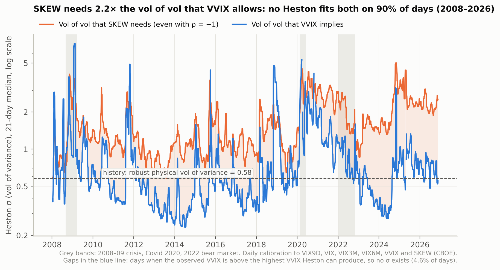
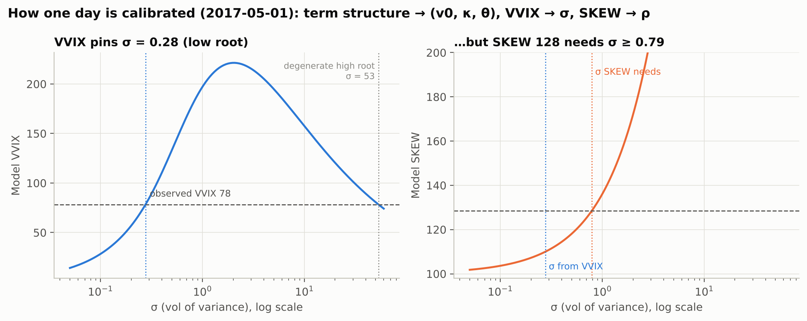
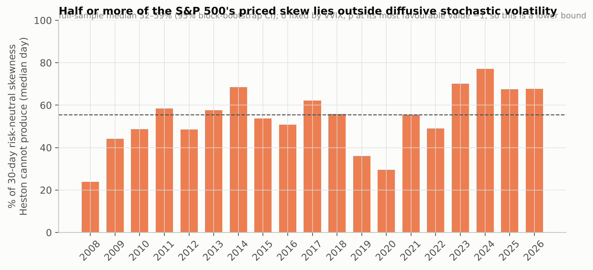
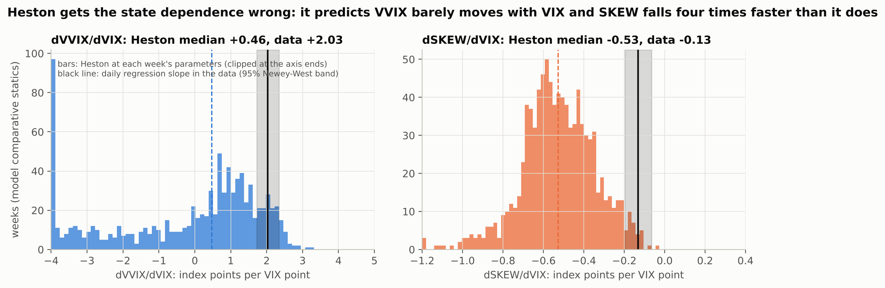
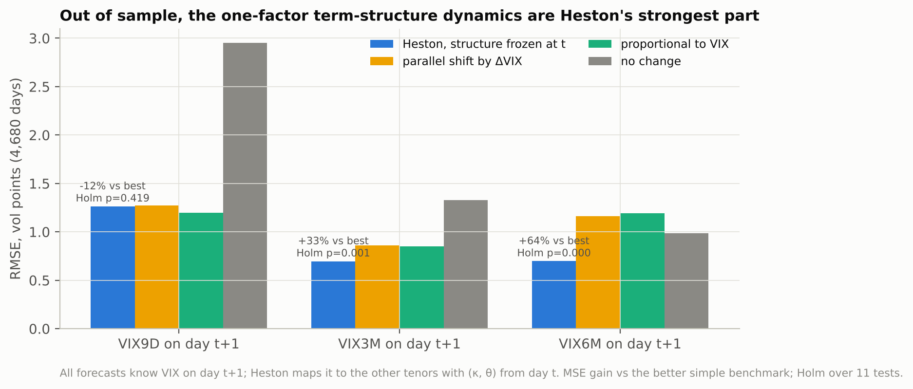
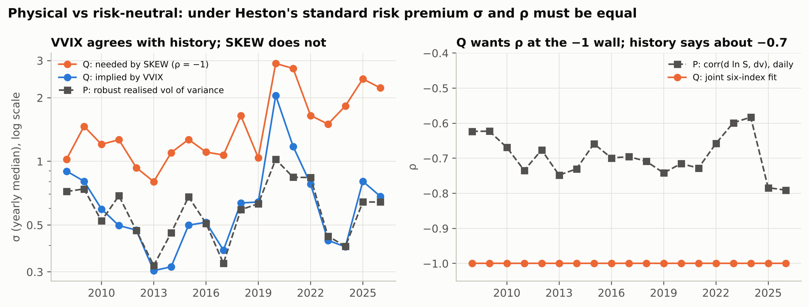
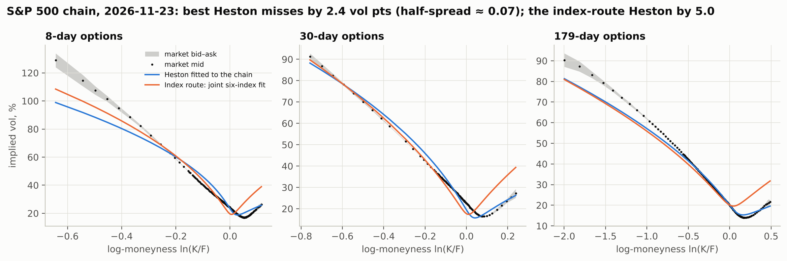

# Heston From Six Public Numbers: SKEW and VVIX Disagree About the Vol of Vol

**Project 26 of 30 · Heston calibration** · S&P 500, daily, 2008-01-02 to 2026-11-23

> **Abstract.** Calibrating the Heston model usually needs a full option chain, which costs money. CBOE publishes
> six numbers every day that are model-free summaries of that chain: the VIX term structure (VIX9D, VIX, VIX3M,
> VIX6M), the 30-day risk-neutral skewness (SKEW) and the vol of VIX (VVIX). Under Heston these six numbers have
> exact closed forms, and they identify the five parameters in a triangle: the term structure pins (v0, κ, θ),
> VVIX pins σ (it does not depend on ρ), and SKEW pins ρ. That gives a daily, free, fully reproducible
> calibration and a built-in consistency test. On 4,681 days the test fails on **90% of them (95% CI 87–93%)**.
> The vol of vol that SKEW needs, even with ρ = −1, is a median **2.24× (2.07–2.42)** the one VVIX allows, and
> at least **55% (52–59%)** of the priced 30-day skewness is out of reach of diffusive stochastic volatility.
> The VVIX value agrees with history: σ = 0.58 from VVIX against a robust physical estimate of 0.58
> (0.49–0.66). SKEW is the outlier. Exact fits exist on 40% of days only on a second, degenerate branch with σ ≈ 41
> and a *positive* spot-vol correlation (median +0.75, against −0.60 in the data). Heston's comparative statics
> have the wrong size: it predicts VVIX rising 0.46 points per VIX point (data: 2.03) and SKEW falling 0.53
> (data: 0.13). What does survive is the one-factor term structure. Out of sample, freezing (κ, θ) and moving
> only v cuts next-day VIX3M and VIX6M errors by 33% and 64% against the best simple rule (Holm p ≤ 0.001). On
> the live S&P 500 chain of 2026-11-23, my replication of the CBOE formulas matches the published VIX to
> 0.01 points. The best Heston fitted to the 10,454 quotes still misses by 2.4 vol points, 33 times the median
> half-spread, and needs σ = 5.7, which implies a VVIX of 134 against 119 observed.



---

## 1. Question and hypotheses

**Research question.** Can the Heston (1993) model be calibrated every day from the free CBOE indices alone? And
when it is, do the parameters tell one consistent story across the indices, across time, and between the
risk-neutral (Q) and physical (P) worlds?

Heston is the workhorse stochastic-volatility model:

    dS/S = √v dW₁,   dv = κ(θ − v) dt + σ √v dW₂,   corr(dW₁, dW₂) = ρ

The usual way to calibrate it is a least-squares fit to an option chain. That fit is famously ill-posed (flat
valleys between κ and σ, parameters that jump from day to day), and it needs data most self-taught researchers do
not have. My angle is to replace the chain with the six numbers CBOE already computes from it, *because each one
has an exact Heston counterpart* (Section 3), and the mapping is triangular. With six numbers and five
parameters, the system is over-identified by one, and that extra equation is a free daily specification test.

Hypotheses, stated before the main runs:

| | Hypothesis | Verdict |
|---|---|---|
| H1 | SKEW and VVIX cannot be matched by one (σ, ρ) on most days (the index version of the SPX–VIX joint-calibration puzzle) | **Supported**, 90% of days |
| H2 | At least half of the priced 30-day skewness lies outside what Heston can produce | **Supported**, 55% (52–59%), a lower bound |
| H3 | Heston's own comparative statics (how SKEW and VVIX move with VIX) match the daily data | **Rejected** for both |
| H4 | Out of sample, Heston's one-factor term structure beats simple rules for next-day VIX3M/VIX6M | **Supported**; not for VIX9D |
| H5 | σ and ρ are equal under P and Q, as Heston's standard λ·v risk premium requires | **Mixed**: σ from VVIX equals robust σᴾ; σ from SKEW and ρ do not |

One estimator in H5 was added after the first run. The sum-of-squares σᴾ was dominated by a few days with
huge variance jumps, so I added a robust (median-absolute-deviation) version. Both are reported (Section 4.5).

## 2. Data

All series are daily closes from Yahoo Finance, pulled through a browser on 2026-11-23 (details in
[data/README.md](data/README.md)).

| Series | Definition (CBOE) | Horizon | Starts |
|---|---|---|---|
| VIX9D, VIX, VIX3M, VIX6M | √(fair variance) from S&P 500 option strips | 9, 30, 93, 183 days | 2011, 1990, 2006, **2008** |
| SKEW | 100 − 10 × risk-neutral skewness of ln(S_T/F) | 30 days | 1990 |
| VVIX | VIX formula applied to VIX options | 30 days | 2007 |
| S&P 500 (^GSPC) | price index, for the P-measure checks | daily | 1970 |
| S&P 500 option chain | 22,388 quotes, 53 expiries, bid/ask, snapshot 2026-11-23 19:46 UTC | 1 day to 5 years | — |

The sample starts on 2008-01-02, the first day of VIX6M, and has 4,681 days. VIX9D exists only from 2011, so
2008–2010 uses three tenors (ablation A2 drops VIX9D everywhere). The last full day is 2026-11-20. The
2026-11-23 SKEW was not published when the data were pulled, so the chain experiment replicates it. The sample
includes every stress window in the brief: 2008–09, Covid 2020 and the 2022 bear market. It also includes a
live one, the November 2026 shock, when VIX went from 17.5 on 11-11 to 35.9 on 11-20.

**Universe overlap.** No earlier project uses the CBOE term-structure, SKEW or VVIX indices. #4 and #16 use VIX
only; #14 uses Deribit crypto options. The S&P 500 index is shared with #3, #13, #15 and #16 on purpose, only for
the P-measure checks.

## 3. Method

### 3.1 Six closed forms

Everything is written on the forward, X = ln(S_T/F₀), so rates and dividends never enter. That matches how CBOE
defines the indices.

**Term structure.** Under Heston the fair variance for horizon τ is the expected average variance:

    VIX_τ² = θ + (v₀ − θ)·b(τ),   b(τ) = (1 − e^{−κτ})/(κτ)

**SKEW.** CBOE's SKEW is 100 − 10·S, where S is the risk-neutral skewness of X over 30 days. I compute the
cumulants of X exactly with a Cauchy contour integral of the cumulant generating function, K(z) = log φ(−iz)
(Albrecher et al. "little trap" characteristic function):

    c_n = n!/(2πi) ∮ K(z) z^{−n−1} dz,   S = c₃ / c₂^{3/2}

The trapezoid rule on a circle is spectrally accurate. It agrees to 10⁻¹² across radii and with Monte Carlo
(tests).

**VVIX.** Under Heston, VIX_T² = a + b·v_T is affine in v_T. The VIX future F_t = E_t[VIX_T] is a continuous
martingale, so the model-free variance CBOE computes from VIX options equals the expected quadratic variation of
ln F. For a continuous martingale that is −2E[ln(VIX_T/F₀)]. Hence

    VVIX² · T = 2 ( ln E[√Y] − ½ E[ln Y] ),   Y = a + b·v_T,   T = 30 days

Both expectations are one-dimensional integrals of the CIR Laplace transform (√y and ln y have Laplace-type
integral representations). The result matches non-central χ² quadrature to 10⁻⁵ (tests). Two consequences
matter later. VVIX does not depend on ρ. And VVIX is **hump-shaped in σ** (Figure 2): above some σ, v is
absorbed near zero so often that the vol of VIX falls again.

**Options** are priced with the COS method (Fang & Oosterlee 2008) and inverted with the robust implied-vol
solver of project #4.

### 3.2 Triangular identification, one day at a time

1. **(v₀, κ, θ) from the four VIX tenors.** For fixed κ, VIX_τ² is linear in (θ, v₀). I profile κ on a grid
   (non-negative least squares in vol units), then refine. This is the global optimum, with no starting values.
   Bounds: κ ∈ [0.1, 30] (half-life 8 days to 7 years) and long-run vol √θ ≤ 100%.
2. **σ from VVIX**, using the low root of the hump. If the observed VVIX is above the hump's peak, no σ can
   match it, and the day is "VVIX-unreachable".
3. **ρ from SKEW**, a 1-D root in [−0.999, 0.999]. If the observed SKEW needs more skew than ρ = −1 can deliver,
   the day is "SKEW-infeasible". I then record σ_SKEW, the smallest σ that reaches SKEW at ρ = −1, and the
   share of the observed skewness that Heston cannot produce, 1 − S_Heston(ρ=−1, σ_VVIX)/S_market.
4. **The high root.** For completeness I also solve on the degenerate upper branch of the VVIX hump (σ up to 60).
5. **Joint fit.** A compromise least-squares fit to all six indices. Each residual is measured in units of that
   index's median absolute daily change, so 1 means an ordinary day's move.

Everything is computed day by day from that day's data only, so there is no look-ahead anywhere in the
calibration.

## 4. Results

### 4.1 E1/E2: SKEW and VVIX want different vol of vol



| Window | Days | No exact fit (low root) | VVIX unreachable | σ_SKEW / σ_VVIX (median) | Non-Heston share of skew | Feller violated |
|---|---|---|---|---|---|---|
| **Full sample 2008–2026** | 4,681 | **89.8%** (87.1–92.5) | 4.6% | **2.24** (2.07–2.42) | **55%** (52–59) | 38% |
| GFC Sep 2008–Mar 2009 | 146 | 69.9% | 0.0% | 1.77 | 43% | 77% |
| Covid Feb–May 2020 | 72 | 70.8% | 23.6% | 1.18 | 15% | 76% |
| 2022 bear market | 201 | 91.0% | 12.4% | 2.09 | 52% | 55% |
| Nov 2026 shock (11-16 to 11-20) | 5 | 100% | 60% | 3.37 | 52% | 40% |
| Calm: VIX below median | 2,339 | 97.3% | 0.2% | 2.56 | 61% | 21% |
| Turbulent: VIX top decile | 468 | 75.9% | 17.3% | 1.69 | 41% | 66% |

95% moving-block bootstrap CIs (63-day blocks) are in brackets. File: `results/e2_feasibility_by_window.csv`.

* On the economically sensible branch, σ_VVIX has a median of 0.58 and σ_SKEW a median of 1.43. The ratio is
  above 1 on 89% of days with a VVIX root.
* **The conflict is worst in calm markets** (97% infeasible), not in crises. In calm markets VVIX allows a
  small σ while SKEW stays high: the market keeps paying for crash protection that diffusive volatility cannot
  explain. In crises, both the short-dated skew and VVIX rise, and the gap narrows, to 1.18× in Covid.
* By SKEW and VVIX terciles, infeasibility goes from 67% (low SKEW, high VVIX) to 100% (high SKEW, low VVIX).
* It has grown. The non-Heston share was 24–49% in 2008–2010 and 68–77% in 2023–2026
  (`results/e2_by_year.csv`). This matches the post-2022 boom in very short-dated options and the steep
  short-end skew they carry.
* **The degenerate high root.** On 37.5% of days an exact fit exists on the upper branch. Including those, 40%
  of days have some exact solution. But those solutions have σ ≈ 41 (45× the low root), a Feller ratio of
  0.0005, and ρ > 0 on 98% of them (median +0.75). That is the opposite of the leverage effect in the data
  (ρᴾ = −0.60). I do not count them as a fit.



**What the joint fit does instead.** Forced to fit all six numbers, least squares keeps SKEW and VVIX nearly
right (median errors 0.15 and 0.14 "typical days"). It pays for that with the term structure: RMSE 0.70 vol
points against 0.13 for the triangular fit. κ is pushed to a median of 19 (half-life 13 days), ρ sits at −1 on
88% of days, and Feller is violated on 88%. The joint fit looks good on SKEW and VVIX only because it quietly
breaks the term structure.

### 4.2 E3: Heston's state dependence is wrong

Each week I bump v₀ at that week's parameters and read off the model's dVVIX/dVIX and dSKEW/dVIX. I compare them
with daily regressions in the data (Newey-West standard errors).

| | Heston (median, 10–90%) | Data slope (95% CI) |
|---|---|---|
| dVVIX / dVIX | +0.46 (−3.9 to +2.0); negative on 42% of weeks | **+2.03** (1.72 to 2.34) |
| dSKEW / dVIX | −0.53 (−0.73 to −0.30) | **−0.13** (−0.20 to −0.07) |

In Heston the vol of VIX scales roughly like σ/(2√v), so a higher VIX means a *lower* relative vol of VIX. In the
data VVIX rises two points per VIX point. SKEW does fall when VIX rises, but four times more slowly than Heston
says. Both failures show up out of sample too: adding Heston's predicted change to today's SKEW makes the
next-day forecast 4% worse than "no change" (Holm p = 0.005). For VVIX it is 84% worse (Holm p < 0.001), with a
sign hit-rate of 53%.



### 4.3 E4: what works is the term structure, out of sample

On day t+1, every forecaster knows that day's VIX. Heston maps it to the other tenors with (κ, θ) frozen at day
t. The competitors are a parallel shift (add ΔVIX), a proportional move (scale by VIX_{t+1}/VIX_t), and no
change. I use Diebold–Mariano tests with Newey-West (10 lags) and Holm across all 11 forecast tests.

| Target | Heston RMSE | Best simple rule | MSE gain | Holm p |
|---|---|---|---|---|
| VIX9D | 1.26 | proportional 1.20 | −12% | 0.42 |
| VIX3M | 0.70 | proportional 0.85 | **+33%** | 0.001 |
| VIX6M | 0.70 | no change 0.99 | **+50%** (+64% vs shift) | <0.001 |

The win mostly holds in stress (`results/e4_forecasts_stress.csv`). In the GFC, VIX6M RMSE was 1.43 against
1.98 for the best rule; in the Nov 2026 shock, VIX3M was 0.58 against 1.66. There are exceptions. In Covid the
proportional rule beat Heston on VIX3M (1.90 vs 2.59). In 2022 the parallel shift beat it on VIX9D (1.23 vs 1.63)
and on VIX3M (0.58 vs 0.67), while Heston still won on VIX6M (0.73 vs 0.93). The 9-day end is where Heston is
too smooth. That is the same short-maturity problem as SKEW.



### 4.4 E5: physical vs risk-neutral

v_t is backed out of VIX_t with that day's term-structure fit. All estimators are written on day pairs, and the
CIs come from a moving-block bootstrap of pairs with one-year blocks.

| | P estimate (95% CI) | Q (median) | Reading |
|---|---|---|---|
| κ | 5.96 (4.38–13.5), weekly AR(1) of VIX², bias-corrected | 4.40 (term structure) | κᵠ < κᴾ, as a negative variance risk premium implies; borderline |
| σ, sum of squares | 2.75 (1.43–3.53) | — | dominated by a few days of variance jumps |
| σ, robust (MAD) | **0.58 (0.49–0.66)** | **0.58** from VVIX; 1.43 needed by SKEW | VVIX = history; SKEW is 2.5× history |
| ρ | **−0.60 (−0.67 to −0.56)** | −1.00 (joint fit, 88% of days at the wall) | Q wants a correlation that does not exist |



The year-by-year robust σᴾ tracks the VVIX σ closely (left panel). That is the sharpest evidence that VVIX is
read correctly by the model and SKEW is not. The two σᴾ estimates bracket the story: the *diffusive* vol of
variance is about 0.6 under both measures. The heavy tail of daily variance moves (the gap between 0.58 and
2.75) is exactly the kind of jump that SKEW prices and Heston cannot represent. With ρ set to its physical value
−0.60 instead of −1, the missing share of skewness rises from 55% to 72%.

### 4.5 E6: the live option chain, 2026-11-23

This is a different route to the same question, so the conclusions do not rest on the indices alone.

**Replication.** Applying the CBOE strike-selection and variance formulas to the 19:46 UTC chain gives:

| | VIX9D | VIX | VIX3M | VIX6M | SKEW |
|---|---|---|---|---|---|
| Replicated from the chain | 28.17 | **27.43** | 25.89 | 26.18 | 133.99 |
| Published (~20:00 UTC) | 28.96 | **27.42** | 25.80 | 26.12 | not yet out (11-20: 138.84) |

**Direct Heston fit.** I fit 10,454 OTM options from 7 days to 1 year (each expiry weighted equally, IV errors).
The median half-spread is 0.07 vol points.

| | v₀ | κ | θ | σ | ρ | IV RMSE | Implied VVIX | Implied SKEW |
|---|---|---|---|---|---|---|---|---|
| Heston fitted to the chain | 0.095 | 20.7 | 0.062 | **5.73** | −0.72 | **2.41** | 134.1 | 142.0 |
| Index route, joint fit | 0.089 | 26.7 | 0.065 | 10 (bound) | −0.27 | 5.02 | 118.6 | 134.0 |
| Observed | | | | | | | **118.6** | **134.0** |

The triangular route has no solution that day: VVIX 118.6 is above the Heston hump given the term structure,
which fits the shock-regime pattern in 4.1. Three readings follow:

1. The best Heston misses the smile by 2.4 vol points, 33× the half-spread, worst at 8 days (3.6) and in the
   deep put wing.
2. To get even that close it needs σ = 5.7 and a Feller ratio of 0.08. That σ implies a VVIX of 134 against
   119 observed. This is the SPX–VIX puzzle (Gatheral 2008) seen directly on one day.
3. Per-expiry fits with (v₀, κ, θ) held fixed need σ between 4.5 and 8 (`results/e6_per_expiry_sigma_rho.csv`).
   No single σ covers the curve.



## 5. Ablations and robustness

Weekly subsample (937 days), `results/ablations.csv`:

| Variant | Exact fit share | σ_VVIX | σ_SKEW | Ratio | Ratio > 1 |
|---|---|---|---|---|---|
| A0 main | 9.9% | 0.57 | 1.42 | 2.27 | 90% |
| A1 wide bounds κ ∈ [0.02, 80], √θ ≤ 316% | 4.2% | 0.55 | 1.43 | 2.35 | 95% |
| A2 no VIX9D anywhere | 7.3% | 0.56 | 1.37 | 2.26 | 92% |
| A3 κ fixed at 4.4 | 0.2% | 0.59 | 1.35 | 2.25 | 99.8% |
| A4 naive VVIX (instantaneous vol of VIX) | 0.7% | 0.44 | 1.42 | 2.95 | 99% |

The headline ratio stays between 2.25 and 2.35 under every exact specification. The textbook shortcut for VVIX
(A4) overstates it by a third, which is why the exact formula matters. κ hits a bound on 26% of days. That is a
real identification limit: when the term structure is nearly straight between 9 days and 6 months, κ and θ
trade off. It is the reason A3 exists.

**Numerical validation** (`tests/`, 14 tests): martingale and normalization of the characteristic function;
cumulants are radius-invariant and match the closed-form mean; the zero-vol-of-vol limit equals Black–Scholes to
10⁻⁸; COS prices match Monte Carlo within 4 standard errors; skewness matches 10⁶-path Monte Carlo; VVIX matches
non-central χ² quadrature to 2·10⁻⁴; VIX futures match simulation; the calibration recovers known parameters
exactly; infeasible days are flagged; and the CBOE moment formulas return σ and zero skewness on a lognormal
strip.

## 6. Referee self-review (and what I changed)

1. *"SKEW is a noisy, wing-driven index; maybe the conflict is just SKEW measurement error."* SKEW is noisy:
   its median daily change is 1.7 points. But the gap is about 15 SKEW points at the median day (127 observed vs
   about 112 reachable), it is persistent for years, and it shows up independently on the live chain. There, a
   Heston fitted to 10,454 option quotes, which never sees SKEW, still produces a VVIX 15 points too high. I
   added the chain experiment for exactly this reason.
2. *"The VVIX formula is an approximation."* It is not. For continuous F the CBOE log-contract variance equals
   E[QV] exactly. The only approximation is CBOE's discrete strike strip, which the chain replication checks
   (VIX within 0.01). The naive instantaneous approximation is reported as ablation A4, and it would have
   inflated the headline.
3. *"You picked the low root to manufacture a conflict."* The high root is reported in full (4.1). It needs
   σ ≈ 41 and ρ > 0 on 98% of its days, which contradicts the most robust fact in equity volatility.
4. *"Bounds on κ drive the result."* A1 widens them to [0.02, 80] and A3 fixes κ. The ratio moves from 2.27 to
   2.25–2.35.
5. *"P-measure σ depends on the estimator."* Yes, so both are shown. The non-robust estimate (2.75) is larger
   than either Q value. That points to variance *jumps* in history. It does not rescue Heston, because a
   diffusion cannot have them.
6. *"Multiple testing."* The 11 forecast tests are Holm-adjusted. The headline proportions and ratios come with
   block-bootstrap CIs. The per-window table is descriptive, with no p-values claimed.
7. *"One chain snapshot is n = 1."* Agreed. It is a validation of the mechanism, not a statistic, and is
   labelled as such. It was taken on a high-volatility day (VIX 27), when the conflict is smaller than average.
8. *"Costs."* There is no trading strategy, so trading costs do not apply. Bid–ask enters where it matters: as
   the yardstick for chain-fit errors (the 0.07 median half-spread) and in the replication filters.
9. *"The data slope in E3 mixes the v-channel with parameter changes."* True. Heston's comparative statics hold
   (κ, θ, σ, ρ) fixed. But the model's *own* day-to-day forecast (4.2, last paragraph), which updates only v,
   loses to "no change". So the v-channel alone points the wrong way for VVIX and overshoots for SKEW.
10. Fix applied after review: the non-Heston share is now undefined (instead of computed at the VVIX-peak σ) on
   VVIX-unreachable days. Earlier it went negative in Covid and Nov 2026, which was an artefact.

## 7. Limitations

* **Heston only.** The paper shows *that* about half the skew is outside diffusive SV and that the diffusive
  σ matches history. It does not fit the obvious repair (Bates or SVJJ, with jumps in price and variance). Under
  those models VVIX would still pin the diffusive σ, and SKEW would then measure the jump cumulants. That is a
  natural follow-up, and #30 (deep hedging) inherits the question.
* **Index definitions vs model horizons.** CBOE interpolates two expiries to the target horizon, and the indices
  use discrete strike strips with truncation. The model uses exact horizons and continuous strips. The chain
  replication shows the gap is small for the VIX family. For SKEW, truncation removes far-wing mass, which
  biases the *published* SKEW toward 100. If anything, that makes the true conflict larger.
* **Yahoo closes.** The indices are end-of-day prints from Yahoo, not CBOE's official settlement files, and
  their timestamps may differ by minutes. A few obviously broken SKEW/VVIX prints are filtered (Section 2 code).
* **κ identification** is weak on days with a straight term structure (26% at a bound). θ is identified only
  out to 6 months, because no 1-year index existed for most of the sample.
* **The physical estimates** use v backed out of VIX with the day's Q-fit, so they are not independent of the
  model. The robust σᴾ is a median-based estimator and ignores the tails by design.
* **One chain snapshot.** Daily chains for 2008–2026 would allow a full-history direct calibration, but they are
  not free.

## 8. How it connects to the other 29

* **#1 (Monte Carlo):** #1 found that the tails matter more than the dynamics for forecast calibration. Here,
  the tails Heston cannot produce are most of the priced skew.
* **#4 (Black–Scholes break-even smile):** #4 showed that the physical smile explains part of the implied one.
  This project quantifies the part a stochastic-volatility diffusion can never reach.
* **#13 (GARCH half-life):** #13 found two-speed volatility decay. Here, κ jumps from about 1 to 12 across
  years, and the term-structure fit hits its bounds on 26% of days. That is consistent with one κ not being
  enough.
* **#14 (crypto implied surface):** same SVI/skew questions on BTC and ETH. The SKEW-vs-vol-of-vol diagnostic can
  be run there with DVOL.
* **#15 (American options), #16 (delta hedging):** #16's floor comes partly from the volatility level error that
  a better model would remove. This paper shows that Heston removes only the diffusive half.
* **#30 (deep hedging):** uses the Heston engine here (`src/heston.py`, with QE simulation) as its training
  world, and should be judged against the jump share found here.

## 9. Reproduce

```bash
pip install -r requirements.txt
bash run_all.sh        # about 15 minutes on 4 cores; ends by running the tests
```

| Script | What it does |
|---|---|
| `src/heston.py` | characteristic function, cumulants, VIX/SKEW/VVIX closed forms, COS pricer, QE simulator |
| `src/calibrate.py` | daily triangular, high-root and joint calibrations → `results/daily_calibration.csv` |
| `src/evaluate.py` | E2–E5 tables |
| `src/ablations.py` | A0–A4 |
| `src/chain.py` | E6: forwards, CBOE replication, chain fit, per-expiry σ, index-route repricing |
| `src/figures.py` | all figures |
| `src/bs.py` | Black–76 pricer and implied-vol solver, reused from #4 |

## References

Albrecher, Mayer, Schoutens & Tistaert (2007), *The little Heston trap*. Andersen (2008), *Simple and efficient
simulation of the Heston model* (QE scheme). Bakshi, Kapadia & Madan (2003), *Stock return characteristics, skew
laws*. CBOE, *SKEW Index*, *VIX* and *VVIX* white papers. Fang & Oosterlee (2008), *A novel pricing method based
on Fourier-cosine series*. Gatheral (2008), *Consistent modeling of SPX and VIX options*. Heston (1993). Kendall
(1954), bias of the AR(1) estimator. Bates (1996), *Jumps and stochastic volatility*. Diebold & Mariano (1995).
Holm (1979).
